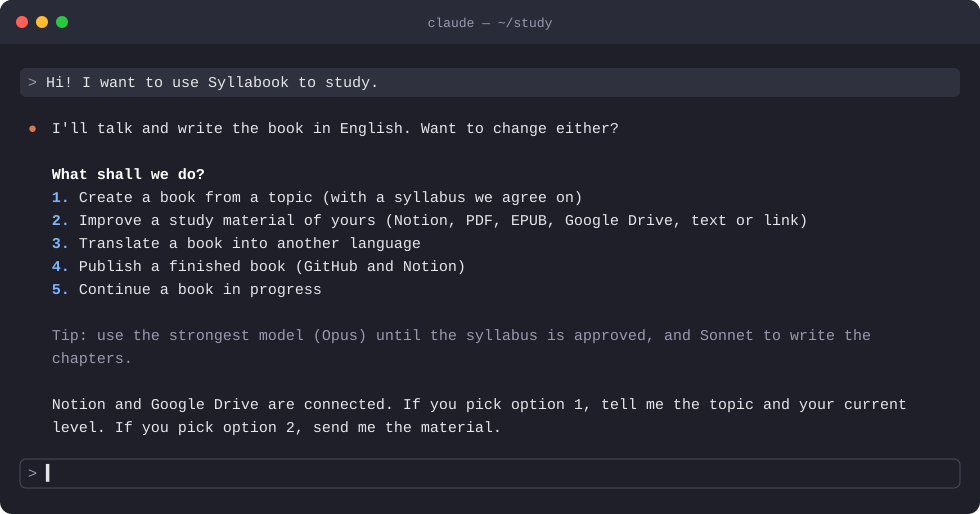

#  Syllabook

**English** | [Português](README.pt-BR.md)

**Turn any topic or study material into a book you can actually learn from.**

Syllabook is a Claude skill for self-learners. It writes course-books on any topic and improves the study materials you already have. Everything it produces is yours: Markdown in your GitHub repository, an EPUB for any e-reader, a searchable website and, if you want, a copy in Notion.

> 🧪 **Early version (0.x).** It works end to end, and it keeps improving in small releases until 1.0. The roadmap and decisions are in [`plano/PLANO.md`](plano/PLANO.md) (in Portuguese); changes are in the [CHANGELOG](CHANGELOG.md).

## Install

- **Claude app (claude.ai, desktop):** download `syllabook.zip` from the [latest release](https://github.com/Joshpcbrrj/syllabook/releases/latest) and upload it in the Skills section of Claude's settings. Code execution must be on (**Settings → Capabilities**).
- **Claude Code:** `claude plugin marketplace add Joshpcbrrj/syllabook`, then `claude plugin install syllabook@syllabook`.
- **On Windows, add WSL 2** ([installation guide](docs/integrations/wsl.md)): with Claude Code running inside Ubuntu, the skill tests every Linux command and code example and puts the real output in the book.

To update or remove it, see the [FAQ](docs/faq.md#how-do-i-update-or-remove-syllabook).

👀 **See it working:** the [demo library](https://github.com/Joshpcbrrj/syllabook-demo) and its [searchable website](https://joshpcbrrj.github.io/syllabook-demo/), built by the same workflows every library gets.

### 🔌 Integrations

None is required, and each one has a step-by-step installation guide:

- **[GitHub](docs/integrations/github.md)**, Claude connector: keeps the books in your repository, saves progress and publishes.
- **[Notion](docs/integrations/notion.md)**, Claude connector: reads a material of yours to improve and creates a copy of the book for your notes.
- **[Google Drive](docs/integrations/google-drive.md)**, Claude connector: finds your documents and files to use as sources.
- **[Docling](docs/integrations/docling.md)**: converts PDF, DOCX, PPTX and other documents to text, keeping tables and structure.
- **[WSL 2](docs/integrations/wsl.md)**: a real Linux on Windows, so the skill tests the books' commands and code.

All of them, plus GitHub Pages (searchable website), are on the [integrations page](docs/integrations/README.md).

## What it does

- **Creates a book from a topic.** Tell it what you want to learn. It researches, shows a short assessment and a syllabus, and you adjust until you approve. Then it writes the whole book, from beginner to intermediate.
- **Improves your study material.** Notion, PDF, EPUB, DOCX, Google Drive, plain text or a link. It keeps the purpose of the original, fixes errors, fills gaps and rewrites it for study, review and research.
- **Translates a book** into another language, adapting examples and terms to the new readers.
- **Works across fields:** programming and math, languages, practical skills (music, electronics...) and general knowledge (such as the history of computing).
- **Tests what it teaches:** it runs every command and piece of code and shows the real output; images are diagrams drawn from the content and photos with a free license.
- **Speaks your language:** it detects or asks the language of the conversation and of the book.

Every book includes a map with links, a placement test, exercises with commented answers, spaced reviews, a final mock exam and a glossary.

❓ **Questions** about plans, cost, privacy or languages? See the [FAQ](docs/faq.md).

## What's new

Every version and what changed in it, newest first, is in the **[CHANGELOG](CHANGELOG.md)**. The files of each version are in the [releases](https://github.com/Joshpcbrrj/syllabook/releases).

## Repository layout

| Folder | Contents |
| --- | --- |
| [`skills/syllabook/`](skills/syllabook/) | The skill: instructions, modes, references, scripts and the library skeleton |
| [`docs/`](docs/) | Documentation: how to use, integrations (GitHub, Notion, Google Drive, Docling, WSL 2), reference |
| [`install/`](install/) | Docling installers for Windows, macOS and Linux |
| [`evals/`](evals/README.md) | Behavior evals (`claude plugin eval`) |
| [`tests/`](docs/testing.md), [`tools/`](tools/) | Tests of the scripts ([how they work](docs/testing.md)) and the maintenance tools (translations, packaging, template sync) |
| [`plano/`](plano/) | Rebuild plan (temporary, in Portuguese) |

**Your own library:** every user keeps their books in a repository of their own. Create yours from the [library template](https://github.com/Joshpcbrrj/syllabook-library) (**Use this template → Create a new repository**, public), or start with an empty repository and let Syllabook set it up on the first book. This repository holds the skill and its development files, not books.

## Support Syllabook

Syllabook is free and open. If it helps you learn, you can support its development:

| Pix (random key) | Bitcoin (BlueWallet) | Other cryptocurrencies (HiddenSwap) |
| :---: | :---: | :---: |
|  |  |  |
| [Pay with Pix (Brazil)](https://nubank.com.br/cobrar/1i7whc/6b00f69e-18fc-4ede-8251-9aa5ab30882a) | `bc1qpavyz63u90f5y8mawj0lydn55hr3f9l9kum7mq` | [Pay with HiddenSwap](https://hiddenswap.com/pay/U5SUjiUR) |

## Contributing

Found an error or want to suggest a topic? Open an [issue](../../issues/new/choose). To contribute to the skill, see [CONTRIBUTING.md](CONTRIBUTING.md) and [how the tests work](docs/testing.md). This project follows a [Code of Conduct](CODE_OF_CONDUCT.md).

## License

- Content (books and documentation): [CC BY-SA 4.0](LICENSE).
- Code (skill and scripts): [MIT](LICENSE-CODIGO).
- Third parties: the diagram icons come from [Lucide](https://lucide.dev) (ISC license, [notice](skills/syllabook/assets/ICONS-LICENSE.txt)); the photos in each book keep their own free license, listed in the book's `img/CREDITS.md`.
