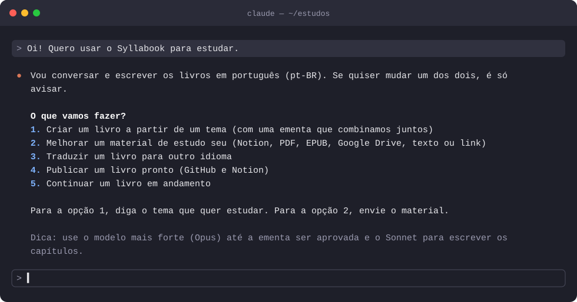

<!-- translation-of: README.md sha256:7d511d051625 -->
#  Syllabook

[English](README.md) | **Português**

**Transforme qualquer tema ou material de estudo num livro com que dá para aprender de verdade.**

Syllabook é uma skill do Claude para quem estuda sozinho. Ela cria livros-curso sobre qualquer tema e aprimora os materiais de estudo que você já tem. Tudo o que ela produz é seu: Markdown no seu repositório do GitHub, EPUB para qualquer leitor digital, um site com busca e, se você quiser, uma cópia no Notion.

> 🧪 **Versão inicial (0.x).** Funciona de ponta a ponta e vai melhorando em versões pequenas até a 1.0. O roteiro e as decisões estão em [`plano/PLANO.md`](plano/PLANO.md); as mudanças, no [CHANGELOG](CHANGELOG.md) (em inglês).

## Instalar

- **App do Claude (claude.ai, desktop):** baixe o `syllabook.zip` da [versão mais recente](https://github.com/Joshpcbrrj/syllabook/releases/latest) e envie na seção de Skills das configurações do Claude.
- **Claude Code:** `claude plugin marketplace add Joshpcbrrj/syllabook` e depois `claude plugin install syllabook@syllabook`.

👀 **Veja funcionando:** a [biblioteca de demonstração](https://github.com/Joshpcbrrj/syllabook-demo) e o [site com busca](https://joshpcbrrj.github.io/syllabook-demo/) dela, gerados pelos mesmos workflows que toda biblioteca recebe.

## O que ela faz

- **Cria um livro a partir de um tema.** Você diz o que quer aprender. Ela pesquisa, apresenta um parecer e uma ementa, e você ajusta até aprovar. Depois ela escreve o livro inteiro, do básico ao intermediário.
- **Aprimora um material seu.** Notion, PDF, EPUB, DOCX, Google Drive, texto ou link. Ela mantém a proposta do original, corrige, completa o que falta e reescreve para facilitar o estudo, a revisão e a pesquisa.
- **Traduz um livro** para outro idioma, adaptando exemplos e termos para os novos leitores.
- **Funciona para áreas diferentes:** programação e matemática, idiomas, habilidades práticas (música, eletrônica...) e conhecimento geral (como a história da computação).
- **Fala o seu idioma:** ela deduz ou pergunta o idioma da conversa e o do livro.

Cada livro traz mapa com links, teste de nivelamento, exercícios com gabarito comentado, revisões espaçadas, simulado final e glossário.

## Como o repositório está organizado

| Pasta | O que tem |
| --- | --- |
| [`created-books/`](created-books/README.pt-BR.md) | Livros feitos a partir de uma ementa |
| [`improved-materials/`](improved-materials/README.pt-BR.md) | Materiais de estudo aprimorados |
| [`site/`](site/README.pt-BR.md) | Fonte do site com busca (GitHub Pages) que mostra todos os livros |
| [`docs/`](docs/README.pt-BR.md) | Documentação: como usar, integrações (GitHub, Notion, Google Drive, Docling), referência |
| [`plano/`](plano/) | Plano da reformulação (temporário) |

Este repositório é um **template**: clique em **Use this template** para receber a skill e as pastas vazias, e guarde os seus livros na sua própria conta do GitHub.

## Contribuir

Achou um erro ou quer sugerir um tema? Abra uma [issue](../../issues/new/choose). Para contribuir com a skill, veja o [CONTRIBUTING.pt-BR.md](CONTRIBUTING.pt-BR.md). Este projeto segue um [Código de Conduta](CODE_OF_CONDUCT.pt-BR.md).

## Licença

- Conteúdo (livros e documentação): [CC BY-SA 4.0](LICENSE).
- Código (skill e scripts): [MIT](LICENSE-CODIGO).
