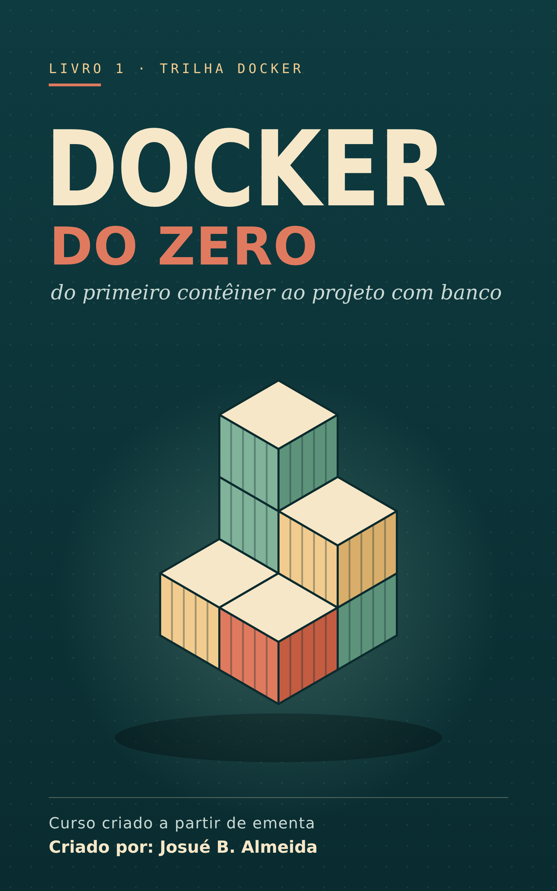

# Livro: Docker do zero - Josué B. Almeida

📥 **[Baixar o EPUB](https://github.com/Joshpcbrrj/biblioteca-de-estudos/releases/download/epubs/docker-do-zero.epub)**

Do primeiro contêiner a uma API com PostgreSQL: instalação no Windows (Docker Desktop com WSL 2), no Linux e no Mac, linha de comando x interface, imagens, Dockerfile, builds enxutos, volumes, redes, publicação e um projeto final com Compose. Cada capítulo tem laboratório executado de verdade, exercícios (respostas em **Ver resposta**) e as fontes conferidas.

> 🤖 Livro criado com IA a partir de fontes públicas, citadas em cada capítulo. Conferido em 2026-11-15. Trilha **docker**, 1º livro ([mapa das trilhas](../)). No Windows, comece pelo [WSL do zero](../wsl-do-zero/).

- [Sobre o livro](aulas/00-sobre-o-livro.md)

## Começar

- [1. Por que contêineres existem](aulas/01-por-que-conteineres-existem.md)
- [2. Docker Desktop no Windows: ativar e instalar](aulas/02-docker-desktop-no-windows-ativar-e-instalar.md)
- [3. Instalar no Linux e no Mac](aulas/03-instalar-no-linux-e-no-mac.md)

## Usar contêineres

- [4. Ciclo de vida do contêiner pela linha de comando](aulas/04-ciclo-de-vida-do-conteiner-pela-linha-de.md)
- [5. Docker Desktop na prática: interface x linha de comando](aulas/05-docker-desktop-na-pratica-interface-x-linha.md)

## Construir imagens

- [6. Imagens e o Docker Hub](aulas/06-imagens-e-o-docker-hub.md)
- [7. Seu primeiro Dockerfile](aulas/07-seu-primeiro-dockerfile.md)
- [8. Builds rápidos e imagens enxutas](aulas/08-builds-rapidos-e-imagens-enxutas.md)

## Dados, redes e publicação

- [9. Volumes: dados que sobrevivem](aulas/09-volumes-dados-que-sobrevivem.md)
- [10. Redes: contêineres que conversam](aulas/10-redes-conteineres-que-conversam.md)
- [11. Publicar a imagem](aulas/11-publicar-a-imagem.md)

## Projeto final

- [12. Projeto final: API com banco em contêineres](aulas/12-projeto-final-api-com-banco-em-conteineres.md)
- [13. Próximos livros da trilha](aulas/13-proximos-livros-da-trilha.md)
