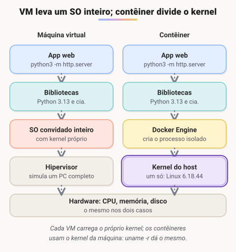
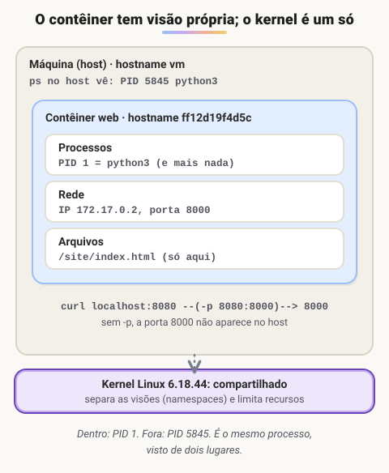
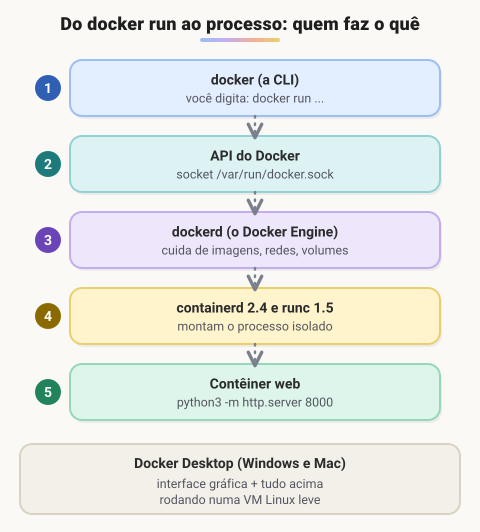

# 1. Por que contêineres existem

> 🗺️ **Neste capítulo:** o problema que os contêineres resolvem, a diferença entre contêiner e máquina virtual, o que o Docker isola e o que ele divide, e um servidor web de verdade rodando num contêiner.

## O problema "na minha máquina funciona"

Ana Souza escreveu uma API em Python no notebook dela. Lá, tudo roda. No servidor da empresa, a mesma API quebra na primeira requisição: o servidor tem outra versão do Python, falta uma biblioteca do sistema e uma variável de ambiente tem outro valor. O código é o mesmo; o **ambiente** é que mudou.

Esse é o problema que os contêineres atacam. Em vez de entregar só o código e torcer para o outro computador ter tudo igual, você entrega o código **junto com o ambiente de que ele precisa**: o interpretador, as bibliotecas, os arquivos de configuração e o comando que inicia o programa.

**Um contêiner (container) é um processo comum do sistema operacional que roda isolado, enxergando só os próprios arquivos, a própria rede e os próprios processos.** Ele não é um computador inteiro: é um programa com uma visão restrita da máquina.

O pacote que guarda esse ambiente pronto para uso é a **imagem**. A mesma imagem gera o mesmo ambiente no notebook da Ana, no servidor e na máquina de um colega.

> ⚠️ **Armadilha comum:** achar que o contêiner resolve *qualquer* diferença entre ambientes. Ele leva junto o software, mas não leva os dados, as senhas nem as configurações que você passa na hora de rodar. Se cada máquina passar uma variável de ambiente diferente, o comportamento muda do mesmo jeito.

## Contêiner x máquina virtual

Antes dos contêineres, a forma usual de isolar um programa era a **máquina virtual (VM)**: um software chamado **hipervisor** simula um computador completo, e dentro dele roda um sistema operacional inteiro, com o próprio kernel. Funciona, mas cada VM carrega gigabytes de sistema e precisa dar boot.

O contêiner faz um corte diferente: **ele não traz kernel**. O **kernel** é o núcleo do sistema operacional, a parte que conversa com o hardware e agenda os processos. Todos os contêineres de uma máquina usam o mesmo kernel, o da própria máquina (o **host**).

|  | Máquina virtual | Contêiner |
| --- | --- | --- |
| O que isola | Um computador inteiro simulado | Um processo (ou um grupo deles) |
| Kernel | Próprio, um por VM | O do host, compartilhado |
| Tamanho típico | Gigabytes (um SO completo) | De megabytes a poucos gigabytes |
| Para iniciar | Dá boot num sistema operacional | Inicia um processo |
| Isolamento | Mais forte (fronteira de hardware virtual) | Mais leve (o kernel é comum a todos) |
| Outro SO | Roda Windows dentro de Linux, e vice-versa | Só programas para o kernel do host |

Dá para ver isso na prática. Com o Docker instalado, compare a versão do kernel fora e dentro de um contêiner:

```bash
# versão do kernel na máquina (host)
uname -r
# a mesma pergunta, feita de dentro de um contêiner
docker run --rm ubuntu:24.04 uname -r
```

Saída na máquina usada para produzir o livro:

```
6.18.44-fc-v470
6.18.44-fc-v470
```

A resposta é idêntica porque não existe um segundo kernel: o contêiner pergunta ao mesmo kernel do host. Numa VM, a resposta seria a do kernel do sistema convidado.



> 💡 **Analogia:** pense numa praça de alimentação. Cada máquina virtual é um restaurante num prédio só dele, com caixa d'água, gerador e encanamento próprios (o kernel de cada VM). Os contêineres são os quiosques da praça: cada um tem o próprio balcão, a própria equipe e os próprios utensílios (processos e arquivos), mas todos usam a mesma rede elétrica e o mesmo encanamento do shopping (o kernel do host). Abrir um quiosque é muito mais rápido do que construir um prédio, mas um curto-circuito no shopping afeta todos eles.

> ⚠️ **Armadilha comum:** dizer que "contêiner é uma VM leve". Não é: é um processo isolado. A consequência prática é que um contêiner Linux precisa de um kernel Linux. No Windows e no Mac, o Docker Desktop resolve isso rodando uma VM Linux leve por baixo (no Windows, pelo WSL 2), e os contêineres rodam dentro dela. É o assunto do cap. 2.

## Imagem x contêiner

Os dois termos aparecem juntos o tempo todo, e confundi-los atrapalha a leitura de qualquer tutorial.

**Uma imagem (image) é um pacote somente leitura com tudo o que um programa precisa para rodar; um contêiner é uma instância em execução criada a partir de uma imagem.**

|  | Imagem | Contêiner |
| --- | --- | --- |
| O que é | Pacote parado, somente leitura | Processo rodando (ou parado) |
| Muda? | Não: para mudar, cria-se outra imagem | Sim: pode criar e alterar arquivos |
| Quantos | Uma imagem, por exemplo `ubuntu:24.04` | Vários contêineres da mesma imagem |
| Comando típico | `docker images` | `docker ps` |

> 💡 **Analogia:** a imagem é a fôrma de gelo; os contêineres são os cubos. Da mesma fôrma saem quantos cubos você quiser, todos iguais no começo. Se um cubo derrete ou quebra, a fôrma continua intacta, pronta para fazer outro.

O cap. 6 aprofunda imagens: camadas, tags e o Docker Hub. Por enquanto, basta saber que `ubuntu:24.04` é o nome de uma imagem (nome `ubuntu`, tag `24.04`).

## O que o contêiner isola, e o que ele divide

O isolamento não é mágica: ele vem de recursos do próprio kernel Linux. Os **namespaces** dão a cada contêiner uma visão própria de processos, rede, nome da máquina e sistema de arquivos. Os **cgroups** (control groups) contam e limitam quanto de CPU, memória e disco cada contêiner usa.

O que o contêiner tem só para ele:

- **processos:** lá dentro, o programa principal é o PID 1 e não enxerga os processos do host;
- **rede:** um endereço IP e portas próprios; uma porta só aparece no host se você a **publicar**;
- **sistema de arquivos:** o conteúdo da imagem mais o que o contêiner criar; o host não vê esses arquivos (e vice-versa);
- **nome da máquina (hostname):** por padrão, o início do id do contêiner.

O que ele divide com todos: **o kernel**, e com ele a CPU, a memória e o disco da máquina.

Um teste rápido com o nome da máquina:

```bash
# nome da máquina no host
hostname
# nome visto de dentro de um contêiner novo
docker run --rm ubuntu:24.04 hostname
```

Saída (o segundo valor muda a cada contêiner, porque é o início do id dele):

```
vm
90b89cd9a959
```



> 💡 **Analogia:** pense num campeonato de futebol. Cada time (um contêiner) numera os próprios jogadores, e todo time tem o seu camisa 1, assim como todo contêiner tem o seu PID 1. Dentro de campo, o jogador só enxerga o próprio elenco, o próprio vestiário e o próprio material (processos e arquivos do contêiner). A federação (o host) vê todos os jogadores de todos os times, mas pelo número de registro, que é único no campeonato (o PID 5845 visto pelo host). E as regras, a arbitragem e o calendário valem para todos os times (o kernel compartilhado).

> ⚠️ **Armadilha comum:** tratar o contêiner como uma fronteira de segurança tão forte quanto uma VM. Como o kernel é compartilhado, uma falha no kernel ou um contêiner rodando com privilégios demais pode afetar o host. Para separar código em que você não confia (por exemplo, de clientes diferentes), a recomendação usual é uma VM, ou contêineres dentro de VMs separadas.

## O que é o Docker

Contêineres existem no Linux há anos, mas montar namespaces e cgroups à mão é trabalhoso. O **Docker é o conjunto de ferramentas que empacota um programa numa imagem e cria contêineres a partir dela com um comando só.**

As peças que você vai usar no livro:

- **Docker CLI:** o comando `docker` que você digita no terminal. Ele não roda contêineres: só envia pedidos;
- **Docker Engine:** o serviço `dockerd`, que recebe os pedidos pela API do Docker e cuida de imagens, contêineres, redes e volumes. Por baixo, ele usa o `containerd` e o `runc` para criar o processo isolado;
- **Docker Desktop:** o aplicativo para Windows e Mac (também existe para Linux) que instala tudo isso, roda o Engine numa VM Linux leve e acrescenta uma interface gráfica. No Linux, você pode instalar só o Engine, sem o Desktop (cap. 3).

O comando `docker version` mostra as duas pontas, o cliente e o servidor:

```bash
# o cliente (CLI) e o servidor (Engine) têm versões próprias
docker version
```

Trecho da saída nesta produção (as linhas cortadas, marcadas com "...", trazem detalhes de compilação):

```
Client: Docker Engine - Community
 Version:           29.9.2
 API version:       1.56
 ...
Server: Docker Engine - Community
 Engine:
  Version:          29.9.2
  API version:      1.56 (minimum version 1.40)
 ...
 containerd:
  Version:          v2.4.2
 runc:
  Version:          1.5.2
```

A versão de referência deste livro é o Docker Desktop 4.96, com o Docker Engine 29.9. No seu computador os números podem ser maiores; os conceitos são os mesmos.



> 💡 **Analogia:** num aeroporto, o piloto pede pelo rádio para decolar (você digitando `docker`, a CLI). O pedido viaja numa frequência combinada (a API). A torre de controle decide e coordena pistas e portões (o `dockerd`, o Engine). A equipe de solo é quem de fato empurra o avião até a pista (o `containerd` e o `runc`). O voo no ar é o contêiner. O Docker Desktop é o aeroporto inteiro, com terminal de passageiros e painel de voos (a interface gráfica), construído num terreno próprio (a VM Linux).

> ⚠️ **Armadilha comum:** achar que "Docker" e "Docker Desktop" são a mesma coisa. Quando o `docker` responde `Cannot connect to the Docker daemon`, o problema não está no comando: é o Engine que não está rodando (no Windows e no Mac, normalmente porque o Docker Desktop está fechado).

## Quando NÃO usar contêineres

Contêiner é ótimo para serviços: APIs, sites, bancos de dados, filas, ferramentas de linha de comando. Ele não é a resposta para tudo.

| Situação | Melhor escolha | Por quê |
| --- | --- | --- |
| Programa gráfico de desktop no Windows ou Mac | Instalar normalmente | Contêiner é feito para processos sem janela |
| Precisa de outro sistema operacional ou kernel | Máquina virtual | O contêiner usa o kernel do host |
| Código de terceiros não confiável | VM (ou contêiner dentro de VM) | O kernel compartilhado é uma fronteira mais fraca |
| Script pequeno que só você roda | Rodar direto | O empacotamento custa mais do que resolve |
| Acesso direto a hardware ou drivers | Rodar no host ou VM | Exige configuração extra e anula parte do isolamento |

> ⚠️ **Armadilha comum:** colocar no contêiner um programa que guarda dados dentro dele e depois apagar o contêiner. Tudo o que foi gravado lá dentro some junto. Guardar dados de forma persistente é assunto do cap. 9 (volumes).

## 🧪 Laboratório

Você ainda não precisa ter o Docker instalado: a instalação vem nos caps. 2 (Windows) e 3 (Linux e Mac). Acompanhe a leitura agora e refaça os passos depois de instalar. Use um terminal bash: no Linux e no Mac, o terminal padrão; no Windows, o terminal do Ubuntu no WSL (veja *WSL do zero*, cap. 2).

> ⚠️ **O que difere do seu ambiente:** este laboratório foi executado com uma imagem `ubuntu:24.04` criada localmente, que já tem Python 3.13. A imagem oficial `ubuntu:24.04` do Docker Hub **não traz Python**. Para repetir os passos, troque `ubuntu:24.04` por `python:3.13-slim` no passo 1 (a imagem oficial do Python); esse `docker run` com o `python:3.13-slim` não foi executado na produção do livro, e o primeiro uso baixa a imagem antes de rodar. Ids, PIDs e horários mudam a cada execução.

**Objetivo:** subir um servidor web num contêiner, acessá-lo pelo host e ver, com os próprios olhos, o que ficou isolado.

**Passo 1: rodar o servidor.** O contêiner cria uma página e inicia o servidor web embutido do Python na porta 8000. O `-p 8080:8000` publica essa porta como 8080 no host.

```bash
# -d: roda em segundo plano; --name: um nome fácil
# -p 8080:8000: porta 8080 do host -> 8000 do contêiner
docker run -d --name web -p 8080:8000 ubuntu:24.04 \
  bash -c 'mkdir /site && cd /site &&
    echo "<h1>Olá do contêiner</h1>" > index.html &&
    exec python3 -m http.server 8000'
```

Saída: o id completo do contêiner criado.

```
ff12d19f4d5c161f916e9b3ee363047e257b967c1a582b19ad008b90a4e0acc3
```

**Passo 2: ver o contêiner rodando.**

```bash
# lista os contêineres em execução
docker ps
```

```
CONTAINER ID   IMAGE          COMMAND                  CREATED         STATUS         PORTS                    NAMES
ff12d19f4d5c   ubuntu:24.04   "bash -c 'mkdir /sit…"   2 seconds ago   Up 2 seconds   0.0.0.0:8080->8000/tcp   web
```

A coluna PORTS confirma a publicação: o que chegar na porta 8080 do host vai para a 8000 do contêiner.

**Passo 3: acessar pelo host.** Use o `curl` (ou abra [http://localhost:8080](http://localhost:8080) no navegador).

```bash
# porta publicada: responde
curl -s http://localhost:8080
# porta interna, não publicada: não responde
curl -sS http://localhost:8000
```

```
<h1>Olá do contêiner</h1>
curl: (7) Failed to connect to localhost port 8000 after 0 ms: Couldn't connect to server
```

Isso é isolamento de **rede**: dentro do contêiner o servidor escuta na 8000, mas o host só alcança o que foi publicado.

**Passo 4: processos, de fora e de dentro.**

```bash
# de fora: o Docker mostra o processo com o PID do host
docker top web -o pid,cmd
# de dentro: o mesmo processo, com a numeração do contêiner
docker exec web ps -o pid,cmd
# o host enxerga o processo como qualquer outro
ps -C python3 -o pid,cmd
```

```
PID                 CMD
5845                python3 -m http.server 8000
    PID CMD
      1 python3 -m http.server 8000
     10 ps -o pid,cmd
  PID CMD
 5845 python3 -m http.server 8000
```

O mesmo servidor tem dois números: 5845 para o host e 1 lá dentro. E, de dentro, só existem ele e o próprio `ps`: os outros processos da máquina são invisíveis. Isso é isolamento de **processos**. Ao mesmo tempo, o `ps` do host mostra o servidor como um processo comum: não há VM nenhuma no meio.

> 💡 Se você usou a `python:3.13-slim` e ela não tiver o comando `ps` (imagens "slim" cortam utilitários), liste os processos pelo próprio Python. Nesta produção, com a imagem local, o comando abaixo mostrou `['1', '8']`: o servidor e o próprio comando.<br />`docker exec web python3 -c "import os; print([p for p in os.listdir('/proc') if p.isdigit()])"`

**Passo 5: arquivos e kernel.**

```bash
# a página existe dentro do contêiner...
docker exec web ls /site
# ...mas não no host
ls /site
# o kernel, porém, é o mesmo nos dois lados
docker exec web uname -r
uname -r
```

```
index.html
ls: cannot access '/site': No such file or directory
6.18.44-fc-v470
6.18.44-fc-v470
```

**Passo 6: os registros do servidor.** Cada acesso do `curl` virou uma linha de log.

```bash
# mostra o que o processo escreveu na saída
docker logs web
```

```
172.17.0.1 - - [16/Nov/2026 00:30:02] "GET / HTTP/1.1" 200 -
```

O pedido chegou do endereço 172.17.0.1: é o host, visto de dentro da rede do contêiner. O horário aparece em UTC, o fuso padrão da imagem.

**Passo 7: parar e remover.**

```bash
# para o contêiner (ele continua existindo, parado)
docker stop web
# mostra também os parados
docker ps -a
# remove de vez
docker rm web
```

```
web
CONTAINER ID   IMAGE          COMMAND                  CREATED          STATUS                                PORTS     NAMES
ff12d19f4d5c   ubuntu:24.04   "bash -c 'mkdir /sit…"   12 seconds ago   Exited (137) Less than a second ago             web
web
```

Repare em duas coisas. Primeiro, o contêiner parado continua na lista até o `docker rm`; a imagem `ubuntu:24.04` continua lá mesmo depois do `rm` (a fôrma sobrevive ao cubo). Segundo, o `docker stop` levou cerca de 10 segundos e terminou com o código 137: o servidor não respondeu ao pedido educado de parada e o Docker precisou encerrá-lo à força. O cap. 4 explica por que isso acontece e como evitar.

## 🏋️ Pratique

**1.** Rode o mesmo servidor publicando a porta **9090** do host (ainda na porta 8000 do contêiner). O que respondem `curl -s http://localhost:9090` e `curl -sS http://localhost:8080`? Confirme a publicação com `docker port web`.

<details>
<summary>Ver resposta</summary>

```bash
# só a porta do host muda; o servidor segue na 8000
docker run -d --name web -p 9090:8000 ubuntu:24.04 \
  bash -c 'mkdir /site && cd /site &&
    echo "<h1>Olá do contêiner</h1>" > index.html &&
    exec python3 -m http.server 8000'
curl -s http://localhost:9090
curl -sS http://localhost:8080
# lista as portas publicadas deste contêiner
docker port web
# -f para e remove numa só etapa
docker rm -f web
```

```
<h1>Olá do contêiner</h1>
curl: (7) Failed to connect to localhost port 8080 after 0 ms: Couldn't connect to server
8000/tcp -> 0.0.0.0:9090
web
```

A 9090 responde e a 8080 não: só existe no host a porta que você publicou.

</details>

**2.** Suba **dois** contêineres da mesma imagem, `web1` na porta 8081 e `web2` na 8082. Dentro de cada um, qual é o PID do servidor? E no host, os PIDs são iguais? Os hostnames são iguais?

<details>
<summary>Ver resposta</summary>

```bash
# o mesmo comando para os dois; muda o nome e a porta
CMD='mkdir /site && cd /site &&
  echo "<h1>Olá do contêiner</h1>" > index.html &&
  exec python3 -m http.server 8000'
docker run -d --name web1 -p 8081:8000 ubuntu:24.04 \
  bash -c "$CMD"
docker run -d --name web2 -p 8082:8000 ubuntu:24.04 \
  bash -c "$CMD"
# dentro e fora, para cada um
docker exec web1 ps -o pid,cmd
docker top web1 -o pid,cmd
docker exec web2 ps -o pid,cmd
docker top web2 -o pid,cmd
docker rm -f web1 web2
```

Saída nesta produção (sem as linhas dos ids e dos nomes removidos):

```
    PID CMD
      1 python3 -m http.server 8000
      8 ps -o pid,cmd
PID                 CMD
4984                python3 -m http.server 8000
    PID CMD
      1 python3 -m http.server 8000
      9 ps -o pid,cmd
PID                 CMD
5051                python3 -m http.server 8000
```

Dentro, os dois servidores são o PID 1, cada um no próprio espaço de processos. No host, são processos diferentes (4984 e 5051). Os hostnames também diferem (aqui, `c5793f6d35e9` e `8dea36a49bc7`), e as duas portas, 8081 e 8082, respondem com a mesma página.

</details>

**3.** Para cada situação, diga se você usaria um contêiner ou uma máquina virtual: (a) rodar o PostgreSQL para desenvolver uma API no seu notebook; (b) testar um programa que só existe para Windows numa máquina Linux; (c) executar códigos enviados por desconhecidos numa plataforma de correção de exercícios.

<details>
<summary>Ver resposta</summary>

(a) **Contêiner**: é um serviço, sobe em segundos e some sem deixar rastro (o cap. 9 mostra como guardar os dados). (b) **Máquina virtual**: um contêiner usa o kernel do host, e um programa para Windows precisa do Windows. (c) **VM**, ou contêineres dentro de VMs isoladas: o código não é confiável, e o kernel compartilhado é uma fronteira mais fraca do que a de uma VM.

</details>

## 🧠 Revisão rápida

**Por que `uname -r` dá o mesmo resultado dentro e fora de um contêiner?**

Porque o contêiner não tem kernel próprio: ele usa o kernel do host.

**O servidor escuta na porta 8000 dentro do contêiner. Por que `curl localhost:8000` no host falha?**

Porque a rede do contêiner é isolada; só a porta publicada (8080, com `-p 8080:8000`) aparece no host.

**Qual a diferença entre imagem e contêiner?**

A imagem é o pacote somente leitura; o contêiner é uma instância criada a partir dela, que roda e pode ser parada e removida sem afetar a imagem.

> ➡️ **Próximo passo:** para repetir este laboratório no seu computador, você precisa do Docker instalado. No Windows, isso exige ativar a virtualização e o WSL 2 antes do instalador: **2. Docker Desktop no Windows: ativar e instalar**.

## 📚 Fontes

Conferido em 2026-11-15.

- [Docker overview](https://docs.docker.com/get-started/docker-overview/)
- [What is a container?](https://docs.docker.com/get-started/docker-concepts/the-basics/what-is-a-container/)
- [What is an image?](https://docs.docker.com/get-started/docker-concepts/the-basics/what-is-an-image/)
- [Docker Engine security (namespaces e cgroups)](https://docs.docker.com/engine/security/)
- [Docker Desktop](https://docs.docker.com/desktop/)
- [FAQs for Docker Desktop for Linux (por que há uma VM)](https://docs.docker.com/desktop/troubleshoot-and-support/faqs/linuxfaqs/)

## 📌 Resumo

| Item | Em uma frase |
| --- | --- |
| Problema | O código funciona numa máquina e quebra noutra porque o ambiente é diferente |
| Contêiner | Processo isolado que leva junto o ambiente de que precisa |
| Contêiner x VM | A VM simula um computador com kernel próprio; o contêiner usa o kernel do host |
| Imagem | Pacote somente leitura do qual saem os contêineres |
| Isola | Processos (PID 1 lá dentro), rede, arquivos e hostname |
| Divide | O kernel, e com ele CPU, memória e disco |
| Porta publicada | `-p 8080:8000` leva a porta 8080 do host à 8000 do contêiner |
| Docker | CLI que pede, Engine (`dockerd`) que executa, Desktop que empacota tudo com interface |
| Quando não usar | Apps gráficos, outro SO, código não confiável e scripts triviais |
