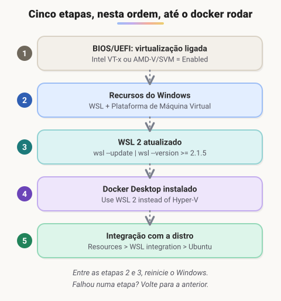
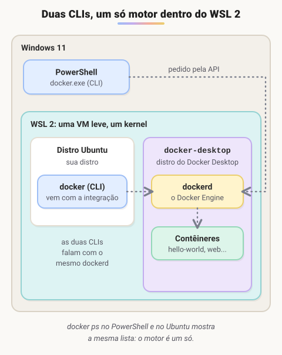

# 2. Docker Desktop no Windows: ativar e instalar

> 🗺️ **Neste capítulo:** o passo a passo para preparar o Windows (virtualização, recursos do Windows e WSL 2) e instalar o Docker Desktop, ligar a integração com o Ubuntu e provar que o `docker` funciona no PowerShell e no Linux do WSL.

## De onde paramos

No cap. 1 você viu que um contêiner é um processo isolado que usa o kernel do host, e que um contêiner Linux precisa de um kernel Linux. O Windows não tem esse kernel. Por isso, no Windows, o Docker roda dentro de uma máquina virtual Linux leve, e quem fornece essa VM é o WSL 2. Este capítulo monta esse caminho do zero, na ordem certa.



> 💡 **Analogia:** pense em instalar um chuveiro elétrico numa casa nova. Primeiro a distribuidora precisa liberar a energia no medidor (a virtualização na BIOS/UEFI). Depois você liga o disjuntor certo no quadro (os recursos do Windows). Confere se a fiação aguenta a carga (o WSL atualizado). Só então instala o chuveiro (o Docker Desktop) e, por fim, abre o registro do banheiro em que vai usá-lo (a integração com a distro Ubuntu). Pular uma etapa não dá erro na hora: dá água fria lá no fim.

## Requisitos: o que o seu Windows precisa ter

Quase todo problema de instalação do Docker Desktop vem de um requisito que faltou. Conferir antes leva cinco minutos; descobrir depois, com uma mensagem genérica de erro, leva uma tarde.

**Para o Docker Desktop com o backend WSL 2, você precisa de Windows 10 ou 11 de 64 bits numa versão recente, WSL 2.1.5 ou mais novo, 8 GB de RAM e a virtualização do processador ligada.**

Segundo a página oficial de instalação (conferida em 2026-11-15), para máquinas x86_64 (Intel e AMD):

| Requisito | Valor exigido |
| --- | --- |
| Windows 10 | 64 bits, versão 22H2 (build 19045) |
| Windows 11 | 64 bits, versão 23H2 (build 22631) ou mais nova |
| Edições citadas | Enterprise, Pro ou Education |
| WSL | versão 2.1.5 ou mais nova, com o recurso WSL 2 ligado |
| Processador | 64 bits, com SLAT (tradução de endereços de segundo nível) |
| Memória | 8 GB de RAM |
| Firmware | virtualização de hardware ligada na BIOS/UEFI |
| Serviço do Windows | **Servidor** (LanmanServer) ligado e com início Automático |

Para conferir a versão e o build do Windows, aperte **Win + R**, digite `winver` e Enter. Para a virtualização, abra o Gerenciador de Tarefas, aba **Desempenho**, **CPU**, linha **Virtualização**: precisa estar **Habilitado**.

> ⚠️ **Atenção ao Windows Home:** na lista de requisitos conferida, as edições citadas são Enterprise, Pro e Education; o Home não aparece. A mesma página diz, em outro trecho, que Home e Education só rodam contêineres Linux (que é o que este livro usa). Se a sua máquina é Home, confira a página oficial antes de instalar, porque é o ponto em que tutoriais antigos e a documentação atual divergem.

> ⚠️ **Armadilha comum:** o serviço **Servidor** (LanmanServer) desligado. Algumas máquinas corporativas ou "otimizadas" desativam esse serviço, e ele é um dos requisitos atuais. Confira em `services.msc`: o serviço **Servidor** deve estar **Em execução**, com tipo de inicialização **Automático**.

## Backend WSL 2 x Hyper-V

O Docker Desktop precisa de uma VM Linux para rodar o Engine. Ele sabe criar essa VM de mais de um jeito, e cada jeito é um **backend**.

**O backend é a tecnologia de virtualização que o Docker Desktop usa por baixo para rodar o Docker Engine: no Windows, o WSL 2 ou o Hyper-V.**

|  | WSL 2 (o deste livro) | Hyper-V |
| --- | --- | --- |
| O que usa | A VM leve do WSL 2, a mesma das suas distros | Uma VM própria, gerenciada pelo Hyper-V |
| Recursos do Windows | WSL e Plataforma de Máquina Virtual | Hyper-V e Containers |
| Instalação | Por usuário ou para todos os usuários | Só para todos os usuários (exige administrador) |
| Integração com o Ubuntu do WSL | Sim, direta | Não |
| Memória e CPU | Ajustadas pelo WSL (arquivo `.wslconfig`) | Fixadas nas configurações do Docker Desktop |
| Contêineres Windows | Não | Sim (com instalação para todos os usuários) |

O instalador usa o WSL 2 por padrão. A documentação também lista um terceiro backend, o **Docker VMM**, ainda em beta; ele não é usado neste livro.

> ⚠️ **Armadilha comum:** ligar o Hyper-V "por garantia". Para o backend WSL 2 ele não é necessário, e o Hyper-V só existe nas edições Pro, Enterprise e Education. O que o WSL 2 precisa é a **Plataforma de Máquina Virtual**.

## Ativar os recursos do Windows

O WSL 2 depende de dois **recursos opcionais do Windows** (optional features): o **Subsistema do Windows para Linux** e a **Plataforma de Máquina Virtual**. Eles vêm desligados de fábrica. Há três formas de ligá-los; escolha uma.

### Forma 1: `wsl --install` (a recomendada)

**O** `wsl --install` **liga os dois recursos, instala o kernel do WSL e o Ubuntu num comando só.** O livro *WSL do zero*, cap. 2, explica esse comando em detalhe, com a criação do usuário Linux; aqui basta o resumo.

```powershell
# PowerShell como administrador (botão direito
# no menu Iniciar > Terminal (Administrador))
wsl --install
# reinicie o Windows quando ele pedir
```

### Forma 2: `dism.exe`, recurso por recurso

Use quando quiser ligar só os recursos, sem instalar uma distro agora, ou quando o `wsl --install` não estiver disponível (Windows mais antigo). São os comandos da instalação manual da Microsoft:

```powershell
# PowerShell como administrador
# 1) o Subsistema do Windows para Linux
dism.exe /online /enable-feature `
  /featurename:Microsoft-Windows-Subsystem-Linux `
  /all /norestart
# 2) a Plataforma de Máquina Virtual, que roda
#    a VM leve do WSL 2
dism.exe /online /enable-feature `
  /featurename:VirtualMachinePlatform `
  /all /norestart
# o /norestart adia o reinício para depois do
# segundo comando: reinicie uma vez só, agora
Restart-Computer
```

O acento grave (`````) no fim da linha é como o PowerShell continua um comando na linha de baixo; se preferir, escreva cada `dism.exe` numa linha só.

### Forma 3: pela janela, com cliques

1. Aperte **Win + R**, digite `optionalfeatures` e Enter. Abre a janela **Ativar ou desativar recursos do Windows** (também dá para chegar nela pelo menu Iniciar, buscando por "recursos do Windows").
2. Role a lista e marque **Plataforma de Máquina Virtual**.
3. Marque também **Subsistema do Windows para Linux**.
4. Não marque **Hyper-V** (só serve para o outro backend).
5. Clique em **OK** e espere o Windows aplicar as mudanças.
6. Clique em **Reiniciar agora**.

Depois do reinício, atualize o WSL e confira a versão. Se você usou as formas 2 ou 3, instale também o Ubuntu (`wsl --install -d Ubuntu`), como mostra o *WSL do zero*, cap. 2.

```powershell
# baixa a versão mais nova do WSL pela loja
wsl --update
# a 1a linha mostra a versão do WSL: >= 2.1.5
wsl --version
```

### E a virtualização na BIOS/UEFI?

Se o Gerenciador de Tarefas mostrar **Virtualização: Desabilitado**, nenhum comando do Windows resolve: o recurso fica no firmware. O caminho (Shift + Reiniciar, Configurações de Firmware UEFI, Intel VT-x ou AMD-V/SVM em Enabled, salvar com F10) está no *WSL do zero*, cap. 2.

> ⚠️ **Armadilha comum:** ligar os recursos e não reiniciar. O Windows só carrega a Plataforma de Máquina Virtual no boot seguinte; até lá, o WSL 2 e o Docker Desktop falham como se nada tivesse sido feito.

## Instalar o Docker Desktop

Com o WSL 2 funcionando, falta o próprio Docker Desktop. A versão de referência deste livro é a **4.96**, que traz o Docker Engine 29.9.

### Baixar e escolher o modo de instalação

Baixe o instalador oficial na página **Install Docker Desktop on Windows** ([docs.docker.com](https://docs.docker.com/desktop/setup/install/windows-install/)), botão **Docker Desktop for Windows - x86_64**. O arquivo se chama `Docker Desktop Installer.exe`. A mesma página também aponta para a versão do Docker Desktop na **Microsoft Store**, como alternativa ao download direto.

Ao abrir o instalador, a primeira escolha é o **modo de instalação**:

|  | Por usuário (padrão) | Para todos os usuários |
| --- | --- | --- |
| Onde instala | `%LOCALAPPDATA%\Programs\DockerDesktop` | `C:\Program Files\Docker\Docker` |
| Precisa de administrador? | Não, nem para atualizar | Sim, para instalar e atualizar |
| Backends | WSL 2 ou Docker VMM | WSL 2, Hyper-V ou Docker VMM |
| Contêineres Windows | Não | Sim |

A documentação atual recomenda a instalação **por usuário**, que já vem marcada. Para trocar de modo depois, é preciso desinstalar e instalar de novo.

> ⚠️ **Correção em relação a tutoriais antigos:** muitos ainda mandam instalar como administrador em `C:\Program Files`. Isso é o modo "para todos os usuários", que hoje deixou de ser o padrão. Na página da Microsoft Store, a documentação conferida não diz qual dos dois modos é usado; se o modo importar para você, prefira o instalador baixado.

### O passo a passo do instalador

1. Dê dois cliques em `Docker Desktop Installer.exe`.
2. Escolha o modo de instalação (deixe **por usuário**, o padrão).
3. Na página **Configuration**, deixe marcada a opção **Use WSL 2 instead of Hyper-V**. Se ela não aparecer, é porque a sua máquina só suporta o WSL 2; tudo certo.
4. Siga o assistente até o fim e clique em **Close**. Se o instalador pedir, reinicie o Windows.

### Pela linha de comando

O mesmo instalador aceita comandos, útil para instalar em várias máquinas ou num script. Abra o PowerShell na pasta em que o arquivo foi baixado:

```powershell
# instalação por usuário, sem administrador;
# --accept-license já aceita os termos de uso e
# --backend=wsl-2 fixa o backend deste livro
Start-Process 'Docker Desktop Installer.exe' -Wait `
  -ArgumentList 'install', '--user', `
    '--accept-license', '--backend=wsl-2'
```

No PowerShell, as opções do instalador precisam ir dentro do `-ArgumentList`. Sem o `--user`, o instalador usa o modo para todos os usuários e exige um PowerShell de administrador.

### Alternativa: winget

O gerenciador de pacotes do Windows (`winget`) tem o Docker Desktop no catálogo com o id `Docker.DockerDesktop`:

```powershell
# confira antes o que será instalado (versão, origem)
winget show Docker.DockerDesktop
winget install Docker.DockerDesktop
```

> ⚠️ O id foi conferido no catálogo do winget, mas a documentação da Docker não cita o winget e não diz qual modo de instalação ele usa. Estes dois comandos não foram executados na produção do livro. Se algo der errado, volte ao instalador oficial.

### Primeiro início: termos e login

O Docker Desktop não abre sozinho ao fim da instalação. Abra o menu Iniciar, digite **Docker** e escolha **Docker Desktop**.

1. Aparece o **contrato de assinatura** (Docker Subscription Service Agreement). Clique em **Accept**: sem aceitar, o Docker Desktop não roda.
2. Em seguida, ele oferece o login com uma conta Docker. Para seguir este livro, o login é opcional; você vai precisar de uma conta só no cap. 11, para publicar imagens. Empresas podem exigir o login (o instalador tem a opção `--allowed-org` para isso).
3. Espere o ícone da baleia na área de notificação parar de se mexer e a janela mostrar o motor como rodando (**Engine running**).

**Licença, em uma frase:** o Docker Desktop é gratuito para uso pessoal, educação e pequenas empresas, e empresas maiores precisam de uma assinatura paga; o cap. 5 detalha os limites.

## A integração com o WSL

Depois da instalação, o `docker` já funciona no PowerShell. No Ubuntu do WSL, ainda não: falta ligar a integração.

**A integração com o WSL (WSL integration) é a opção do Docker Desktop que coloca o comando** `docker` **dentro de uma distro e o liga ao Engine que o Docker Desktop roda.**

Ao iniciar, o Docker Desktop cria no WSL uma distro própria, chamada `docker-desktop`, e roda o `dockerd` dentro dela. Você não usa essa distro diretamente; ela aparece na lista do `wsl -l -v` ao lado do seu Ubuntu.

Para ligar a integração:

1. Abra o Docker Desktop e clique na engrenagem (**Settings**).
2. Em **General**, confira que **Use the WSL 2 based engine** está marcado.
3. Vá em **Resources** > **WSL integration**.
4. Deixe ligada a integração com a distro padrão e ligue a chave da sua **Ubuntu** na lista.
5. Clique em **Apply** (ou **Apply & restart**, conforme a versão).



> 💡 **Analogia:** pense num prédio com gás encanado. O prédio é o Windows; a casa de máquinas no subsolo é a VM do WSL 2. A central de gás fica lá embaixo, num cômodo trancado que só o zelador abre (a distro `docker-desktop`, com o `dockerd`). Cada apartamento tem o próprio fogão com os próprios botões (a CLI do PowerShell e a CLI do Ubuntu). Ligar a integração é passar o encanamento até o apartamento do Ubuntu. Qualquer fogão que você acenda puxa gás da mesma central, e, se a central estiver fechada (Docker Desktop parado), nenhum fogão acende.

> ⚠️ **Armadilha comum:** instalar o Docker Engine também dentro do Ubuntu, com `apt`, "para garantir". Aí passam a existir dois motores: o do Docker Desktop e o do Ubuntu, cada um com as próprias imagens e contêineres, e o `docker ps` mostra listas diferentes conforme o terminal. Com o Docker Desktop, use só a integração. (A instalação pelo `apt` é para quem usa Linux sem o Docker Desktop: cap. 3.)

> 💡 **Não confunda:** as versões recentes do WSL (2.9.3 ou mais novas) trazem um comando próprio de contêineres, o `wslc`, e o tutorial de contêineres da Microsoft passou a ensiná-lo. Ele não é o Docker: tem outros comandos e não usa o Docker Desktop. Este livro usa o `docker`.

## Problemas comuns

| Sintoma | Causa provável | O que fazer |
| --- | --- | --- |
| Erro sobre virtualização ou WSL 2 ao abrir o Docker Desktop | Virtualização desligada na BIOS/UEFI ou Plataforma de Máquina Virtual desligada | Conferir no Gerenciador de Tarefas; ligar no firmware ou nos recursos do Windows; reiniciar |
| Aviso de que o WSL está desatualizado, ou `wsl --version` não é reconhecido | WSL antigo, embutido no Windows | `wsl --update` como administrador e reiniciar o Docker Desktop |
| Docker Desktop preso em **Starting the Docker Engine** | A VM do WSL travou ou ficou com estado antigo | Fechar o Docker Desktop (Quit), rodar `wsl --shutdown`, abrir de novo; se persistir, `wsl --update` e reiniciar o Windows |
| `docker: command not found` no Ubuntu | Integração com a distro desligada | Settings > Resources > WSL integration, ligar a Ubuntu |
| A Ubuntu não aparece na lista da integração | A distro está no WSL 1 | `wsl --set-version Ubuntu 2` (veja *WSL do zero*, cap. 2) |
| `Cannot connect to the Docker daemon` | Docker Desktop fechado | Abrir o Docker Desktop e esperar **Engine running** |

```powershell
# desliga todas as distros e a VM do WSL 2,
# inclusive a docker-desktop: o Docker Desktop
# recria tudo na próxima vez que abrir
wsl --shutdown
```

Se nada disso resolver, a área **Troubleshoot** do Docker Desktop tem as opções de reiniciar o Docker Desktop e de voltar às configurações de fábrica (esta última apaga imagens e contêineres).

> ⚠️ **Correção sobre o grupo** `docker-users`**:** muitos tutoriais mandam sempre adicionar o seu usuário a esse grupo. Pela documentação atual, isso só é necessário na instalação **para todos os usuários**, quando a conta de administrador é diferente da sua, e só para o backend Hyper-V ou para contêineres Windows. Com o WSL 2 e contêineres Linux (o caso deste livro), não é preciso. E não adicione ninguém sem necessidade: quem está nesse grupo controla o Docker Engine, o que equivale a acesso de administrador na máquina. Quando for mesmo preciso, o comando, num terminal de administrador, é `net localgroup docker-users <usuario> /add`, seguido de sair e entrar de novo no Windows.

## 🧪 Laboratório

> ⚠️ **O que não foi executado na produção do livro:** este livro foi produzido numa máquina Linux, sem Windows. Nenhum comando de Windows deste capítulo (`wsl`, `dism.exe`, instalador, `winget`) nem o Docker Desktop foram executados aqui. Os passos e os resultados descritos vêm da documentação oficial da Docker e da Microsoft (conferida em 2026-11-15), e não há saída de terminal inventada: onde o resultado aparece, ele é descrito, não copiado. A única saída real, no fim, é a do `docker version` numa máquina Linux, usada para explicar cliente e servidor.

**Objetivo:** sair de um Windows sem nada e chegar ao `docker run hello-world` funcionando no PowerShell e no Ubuntu do WSL.

**Passo 1: conferir os requisitos.** `winver` (Windows 10 22H2 ou Windows 11 23H2 ou mais novo) e Gerenciador de Tarefas (**Virtualização: Habilitado**). Se estiver desabilitado, ligue na BIOS/UEFI antes de seguir.

**Passo 2: preparar o WSL 2.** Num PowerShell de administrador:

```powershell
# liga os recursos e instala o Ubuntu
wsl --install
```

Reinicie, abra o **Ubuntu** pelo menu Iniciar e crie o usuário Linux (*WSL do zero*, cap. 2). Se o WSL já estava instalado, rode só `wsl --update`.

**Passo 3: conferir o WSL.**

```powershell
# versão do programa WSL: precisa ser >= 2.1.5
wsl --version
# a coluna VERSION do Ubuntu precisa ser 2
wsl -l -v
```

**Passo 4: instalar o Docker Desktop.** Rode o instalador por usuário, com **Use WSL 2 instead of Hyper-V** marcado (ou use o `Start-Process` mostrado acima). Abra o Docker Desktop, clique em **Accept** e pule o login, se quiser.

**Passo 5: ligar a integração.** Settings > Resources > WSL integration, chave da **Ubuntu** ligada, **Apply**. Confira no PowerShell:

```powershell
# agora a lista mostra também a distro
# docker-desktop, criada pelo Docker Desktop
wsl -l -v
```

**Passo 6: testar no PowerShell.**

```powershell
# mostra a versão do cliente e a do servidor
docker version
# baixa a imagem de teste e roda um contêiner
docker run hello-world
```

Pela arquitetura do Docker Desktop, o `docker version` no PowerShell mostra o cliente como um programa Windows (`OS/Arch: windows/amd64`) e o servidor como Linux (`linux/amd64`): o motor roda na VM. O `hello-world` baixa uma imagem pequena do Docker Hub e imprime uma mensagem que começa com `Hello from Docker!`, explicando os passos que o Docker acabou de fazer.

**Passo 7: testar no Ubuntu.** Abra o Ubuntu e repita:

```bash
# o mesmo comando, agora dentro do Linux do WSL
docker version
docker run hello-world
# lista também os parados: aparecem os dois
# contêineres hello-world, o do PowerShell e
# este, porque o motor é o mesmo
docker ps -a
```

Se o `docker ps -a` do Ubuntu mostrar o contêiner criado no PowerShell, a integração está provada: duas CLIs, um só motor.

**Passo 8 (executado aqui, em Linux): ler o** `docker version`**.** O `docker` que você digita é o **cliente**; o `dockerd` que executa é o **servidor**. Cada um tem a própria versão, e o `docker version` pergunta as duas. Saída real da máquina Linux usada para produzir o livro (sem Docker Desktop, com o Engine 29.9.2 instalado direto no Linux):

```
Client: Docker Engine - Community
 Version:           29.9.2
 API version:       1.56
 Go version:        go1.26.10
 Git commit:        a82e528
 Built:             Tue Oct 20 18:44:40 2026
 OS/Arch:           linux/amd64
 Context:           default

Server: Docker Engine - Community
 Engine:
  Version:          29.9.2
  API version:      1.56 (minimum version 1.40)
  Go version:       go1.26.10
  Git commit:       0367cbe
  Built:            Tue Oct 20 18:44:40 2026
  OS/Arch:          linux/amd64
  Experimental:     false
 containerd:
  Version:          v2.4.2
 ...
```

Como ler:

- **Client** e **Server** são dois programas. Se o servidor não responder, o `docker version` mostra o bloco **Client** e termina com um erro de conexão: o comando existe, mas o motor está parado.
- **API version**: a língua que os dois falam. O servidor aceita clientes desde a API 1.40 (`minimum version`).
- **OS/Arch**: aqui, os dois são `linux/amd64`, porque tudo roda no Linux. No PowerShell com Docker Desktop, o cliente é `windows/amd64` e o servidor continua `linux/amd64`.
- **Context**: para qual motor o cliente aponta. Aqui é `default`, o motor local. No Docker Desktop, o contexto normalmente se chama `desktop-linux`.

## 🏋️ Pratique

**1.** Para cada caso, escolha o modo de instalação (por usuário ou para todos os usuários) e o backend: (a) Ana Souza usa o notebook pessoal, sem senha de administrador da empresa, e só precisa de contêineres Linux; (b) um laboratório da faculdade precisa rodar contêineres Windows nas máquinas, usadas por vários alunos.

<details>
<summary>Ver resposta</summary>

(a) **Por usuário, backend WSL 2.** Não precisa de administrador nem para instalar nem para atualizar, e contêineres Linux rodam no WSL 2.<br />(b) **Para todos os usuários**, com backend **Hyper-V** (ou WSL 2 para os contêineres Linux). Contêineres Windows só existem na instalação para todos os usuários; nesse caso, os alunos que não são administradores entram no grupo `docker-users`, sabendo que isso lhes dá poder de administrador sobre o Docker.

</details>

**2.** No PowerShell, `docker run hello-world` funciona. No Ubuntu, o mesmo comando responde `docker: command not found`. O que está faltando, e como você confere que resolveu?

<details>
<summary>Ver resposta</summary>

Falta a integração com a distro. Em Settings > Resources > WSL integration, ligue a chave da Ubuntu e clique em Apply. Para conferir, no Ubuntu:

```bash
# o comando passa a existir na distro
docker version
# o contêiner criado no PowerShell aparece aqui
docker ps -a
```

Se a Ubuntu nem aparecer na lista da integração, confira com `wsl -l -v`: ela provavelmente está no WSL 1.

</details>

**3.** Escreva o comando do PowerShell que instala o Docker Desktop por usuário, aceitando os termos e usando o backend WSL 2, e explique por que ele não precisa de administrador.

<details>
<summary>Ver resposta</summary>

```powershell
# --user: instala no perfil do usuário
# --accept-license: aceita os termos já aqui
# --backend=wsl-2: o backend deste livro
Start-Process 'Docker Desktop Installer.exe' -Wait `
  -ArgumentList 'install', '--user', `
    '--accept-license', '--backend=wsl-2'
```

Não precisa de administrador porque a instalação por usuário grava em `%LOCALAPPDATA%\Programs\DockerDesktop` e no registro do próprio usuário (HKCU), sem serviço privilegiado do sistema.

</details>

## 🧠 Revisão rápida

**Quais dois recursos do Windows o WSL 2 precisa, e o que acontece se você não reiniciar depois de ligá-los?**

Subsistema do Windows para Linux e Plataforma de Máquina Virtual; sem reiniciar, eles não são carregados, e o WSL 2 e o Docker Desktop falham.

**Onde roda o `dockerd` no Docker Desktop com backend WSL 2?**

Numa distro própria do Docker Desktop, a `docker-desktop`, dentro da VM do WSL 2; as CLIs do PowerShell e do Ubuntu falam com esse mesmo motor.

**Preciso entrar no grupo `docker-users` para usar contêineres Linux com o WSL 2?**

Não: o grupo só é necessário na instalação para todos os usuários, com Hyper-V ou contêineres Windows, quando o administrador é outra conta.

> ➡️ **Próximo passo:** quem usa Linux ou Mac também precisa do Docker, mas o caminho é outro: no Ubuntu, o Docker Engine vem direto do repositório oficial, sem VM; no Mac, o Docker Desktop tem o seu próprio instalador. É o assunto de **3. Instalar no Linux e no Mac**.

## 📚 Fontes

Conferido em 2026-11-15.

- [Install Docker Desktop on Windows](https://docs.docker.com/desktop/setup/install/windows-install/)
- [Docker Desktop WSL 2 backend on Windows](https://docs.docker.com/desktop/features/wsl/)
- [How to install Linux on Windows with WSL (Microsoft)](https://learn.microsoft.com/windows/wsl/install)
- [Manual installation steps for older versions of WSL (Microsoft)](https://learn.microsoft.com/windows/wsl/install-manual)
- [Get started with WSL container (Microsoft)](https://learn.microsoft.com/windows/wsl/tutorials/wsl-containers)
- [Docker Desktop release notes](https://docs.docker.com/desktop/release-notes/)

## 📌 Resumo

| Item | Em uma frase |
| --- | --- |
| Por que uma VM | Contêiner Linux precisa de kernel Linux, e no Windows quem fornece é o WSL 2 |
| Requisitos | Windows 10 22H2 ou 11 23H2, 64 bits, 8 GB, WSL 2.1.5 ou mais novo e virtualização ligada |
| Backend | O livro usa o WSL 2; o Hyper-V é para contêineres Windows e instalação para todos |
| Recursos do Windows | Subsistema do Windows para Linux e Plataforma de Máquina Virtual, e depois reiniciar |
| Formas de ativar | `wsl --install`, `dism.exe` ou a janela `optionalfeatures` |
| Modo de instalação | Por usuário é o padrão e dispensa administrador; para todos exige |
| Primeiro início | Aceitar os termos é obrigatório; o login é opcional |
| Integração | Settings > Resources > WSL integration liga o `docker` no Ubuntu |
| Arquitetura | O `dockerd` roda na distro `docker-desktop`; as duas CLIs usam o mesmo motor |
| `docker-users` | Só para instalação para todos com Hyper-V ou contêineres Windows; equivale a administrador |
| Travou ao iniciar | Quit, `wsl --shutdown`, abrir de novo; depois `wsl --update` |
