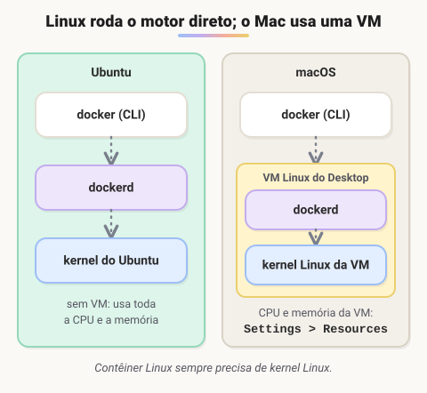
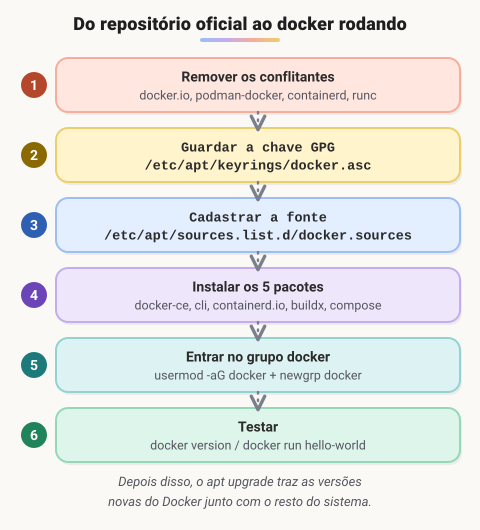
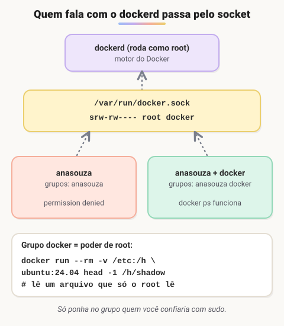

# 3. Instalar no Linux e no Mac

> 🗺️ **Neste capítulo:** instalar o Docker Engine no Ubuntu pelo repositório oficial da Docker (também no Ubuntu do WSL, sem Docker Desktop), liberar o uso sem `sudo` com o grupo `docker`, e instalar o Docker Desktop no Mac pelo `.dmg`, pela linha de comando ou pelo Homebrew.

## De onde paramos

No cap. 2 o Docker chegou ao Windows dentro de uma VM do WSL 2, porque contêiner Linux precisa de kernel Linux. No Linux esse kernel já está ali: o motor roda direto, sem VM, e a instalação é pelo gerenciador de pacotes. No Mac a situação volta a ser parecida com a do Windows: o Docker Desktop traz a sua própria VM Linux. Este capítulo cobre os dois caminhos.



> 💡 **Analogia:** no Linux, o Docker mora na casa própria: usa a cozinha, a luz e a água da casa (o kernel) sem pedir licença a ninguém, e pode ocupar todos os cômodos (toda a CPU e a memória). No Mac, ele aluga um quarto num apart-hotel (a VM do Docker Desktop): tem cozinha própria, mas o tamanho do quarto está no contrato, e para ganhar mais espaço você muda o contrato (Settings > Resources).

## Linux: Docker Engine ou Docker Desktop for Linux?

No Linux existem dois produtos com nomes parecidos, e escolher o errado é a origem de muita confusão.

**O Docker Engine é o motor (**`dockerd`**) e a CLI instalados direto no sistema; o Docker Desktop for Linux é o mesmo aplicativo gráfico do Windows e do Mac, que roda o seu próprio motor dentro de uma VM.**

|  | Docker Engine (este capítulo) | Docker Desktop for Linux |
| --- | --- | --- |
| Onde o motor roda | Direto no kernel da máquina | Numa VM (precisa de KVM) |
| Interface gráfica | Não | Sim, igual à do Windows e do Mac |
| Contexto da CLI | `default` | `desktop-linux` |
| Imagens e contêineres | Em `/var/lib/docker` | Num disco próprio da VM; não vê os do Engine |
| Licença | Livre (Apache 2.0) | Mesmas regras de assinatura do Desktop |
| Bom para | Servidores, WSL sem Desktop, CI | Desktop Linux de quem quer a interface |

Os dois podem ser instalados lado a lado, mas cada um tem as próprias imagens e contêineres, e a documentação recomenda parar o Engine enquanto usa o Desktop, para não disputarem portas. **Este livro recomenda o Docker Engine em servidores e no Ubuntu do WSL sem Docker Desktop**: é mais leve, não depende de VM e é o que você vai encontrar em produção.

> ⚠️ **Armadilha comum:** achar que o pacote `docker.io` do Ubuntu é "o Docker oficial". Ele é empacotado pelo Ubuntu, com versão e ritmo de atualização próprios, e conflita com os pacotes da Docker. Este capítulo usa o repositório da própria Docker (`docker-ce`).

## Instalar o Docker Engine no Ubuntu pelo repositório oficial

O Ubuntu instala programas pelo **apt**, que busca pacotes nas fontes cadastradas no sistema. A Docker mantém a sua própria fonte, em `download.docker.com`. Cadastrá-la uma vez faz o `apt upgrade` trazer as versões novas do Docker junto com o resto do sistema.

**Instalar pelo repositório oficial é cadastrar a fonte da Docker no apt, com a chave que prova que os pacotes vieram dela, e instalar os pacotes** `docker-ce` **por ali.**

Versões do Ubuntu suportadas pela documentação (64 bits, conferido em 2026-11-15): 26.10, 26.04 LTS, 24.04 LTS e 22.04 LTS, em x86_64 (amd64), arm64, armhf, s390x e ppc64le. Derivados como o Linux Mint não são suportados oficialmente, embora possam funcionar.



> 💡 **Analogia:** é como assinar uma revista direto com a editora. Primeiro você cancela a versão "genérica" que chegava por outro distribuidor (os pacotes conflitantes). Depois guarda o selo de autenticidade da editora (a chave GPG), para recusar qualquer exemplar falsificado. Cadastra o endereço da editora na lista de entregas (o arquivo de fonte). Faz o primeiro pedido (o `apt install`). Daí em diante, cada edição nova chega sozinha com as outras entregas (o `apt upgrade`).

### Passo 1: remover os pacotes conflitantes

O Ubuntu e outras fontes oferecem pacotes não oficiais (`docker.io`, `podman-docker`) e versões próprias de `containerd` e `runc`, que brigam com o `containerd.io` da Docker. A lista atual da documentação:

```bash
# remove só os que estiverem instalados: o dpkg
# --get-selections filtra, e o cut pega o nome
sudo apt remove $(dpkg --get-selections \
  docker.io docker-compose docker-compose-v2 \
  docker-doc docker-buildx podman-docker \
  containerd runc | cut -f1)
```

Se nenhum estiver instalado, o apt avisa que não há nada a remover. Isso é normal. Imagens, contêineres e volumes antigos em `/var/lib/docker` não são apagados por esse comando.

### Passo 2: guardar a chave GPG da Docker

```bash
sudo apt update
sudo apt install ca-certificates curl
# a pasta onde o apt procura chaves de terceiros
sudo install -m 0755 -d /etc/apt/keyrings
# baixa a chave pública da Docker e deixa legível
sudo curl -fsSL \
  https://download.docker.com/linux/ubuntu/gpg \
  -o /etc/apt/keyrings/docker.asc
sudo chmod a+r /etc/apt/keyrings/docker.asc
```

A chave não é uma senha: ela é a assinatura pública que o apt usa para conferir que cada pacote baixado foi mesmo publicado pela Docker.

### Passo 3: cadastrar a fonte

A documentação atual usa o formato **deb822**, um arquivo `.sources` com um campo por linha (o mesmo formato do `ubuntu.sources` do próprio Ubuntu 24.04). As duas variáveis abaixo descobrem o codinome do Ubuntu (`noble` no 24.04) e a arquitetura (`amd64`, `arm64`...):

```bash
# codinome da versão do Ubuntu (ex.: noble)
CODENAME=$(. /etc/os-release && \
  echo "${UBUNTU_CODENAME:-$VERSION_CODENAME}")
# arquitetura do processador (ex.: amd64)
ARCH=$(dpkg --print-architecture)
# grava a fonte; Signed-By liga a fonte à chave
sudo tee /etc/apt/sources.list.d/docker.sources <<EOF
Types: deb
URIs: https://download.docker.com/linux/ubuntu
Suites: $CODENAME
Components: stable
Architectures: $ARCH
Signed-By: /etc/apt/keyrings/docker.asc
EOF
sudo apt update
```

A documentação faz o mesmo com os `$(...)` escritos dentro do próprio arquivo; aqui eles foram separados em variáveis só para caber na tela.

> ⚠️ **Correção em relação a tutoriais antigos:** muitos ainda ensinam uma linha única num arquivo `docker.list`, no formato `deb [arch=amd64 signed-by=/etc/apt/keyrings/docker.asc] https://download.docker.com/linux/ubuntu noble stable`. Esse formato ainda funciona (a máquina usada para produzir o livro foi configurada assim, como mostra o Laboratório), mas a documentação atual usa o `docker.sources`. Não deixe os dois arquivos ao mesmo tempo: o apt reclama de fonte duplicada. E tutoriais mais velhos ainda usam o `apt-key add`, que foi removido das versões atuais do apt.

### Passo 4: instalar os pacotes

```bash
# motor, CLI, runtime e os plugins buildx e compose
sudo apt install docker-ce docker-ce-cli \
  containerd.io docker-buildx-plugin \
  docker-compose-plugin
```

| Pacote | O que é |
| --- | --- |
| `docker-ce` | o motor, `dockerd` (CE = Community Edition) |
| `docker-ce-cli` | o comando `docker` |
| `containerd.io` | o runtime que de fato cria os contêineres (traz o `runc`) |
| `docker-buildx-plugin` | o `docker buildx`, construtor de imagens (cap. 7) |
| `docker-compose-plugin` | o `docker compose` (fica para o próximo livro da trilha) |

Para fixar uma versão, liste as disponíveis com `apt list --all-versions docker-ce` e instale com `docker-ce=<versão>` e `docker-ce-cli=<versão>`. No Ubuntu, o serviço do Docker já fica habilitado e iniciado ao fim da instalação.

### Passo 5: testar

```bash
# o serviço está ativo? (q sai do pager)
sudo systemctl status docker
# ainda com sudo: o grupo docker vem a seguir
sudo docker run hello-world
```

O `hello-world` baixa uma imagem pequena do Docker Hub e imprime uma mensagem que começa com `Hello from Docker!`.

### Alternativa só para testes: o script de conveniência

A Docker mantém um script de conveniência, publicado em `get.docker.com`, que faz os passos 2 a 4 sozinho. É prático numa VM descartável, mas a documentação faz ressalvas: ele exige root, instala dependências sem perguntar, sempre pega a versão estável mais nova e não serve para atualizar uma instalação existente.

```bash
curl -fsSL https://get.docker.com -o get-docker.sh
# leia antes de rodar; --dry-run só mostra os passos
sudo sh ./get-docker.sh --dry-run
sudo sh get-docker.sh
```

Depois de instalar pelo script, as atualizações vêm pelo apt normalmente; rodar o script de novo não traz vantagem.

## Pós-instalação: usar o docker sem sudo

Depois do passo 5, o `docker` só funciona com `sudo`. O motivo é o caminho por onde a CLI conversa com o motor.

**O** `dockerd` **roda como root e recebe ordens por um arquivo especial, o socket** `/var/run/docker.sock`**; só o root e os membros do grupo** `docker` **podem escrever nele.**

Saída real nesta máquina:

```
$ ls -l /var/run/docker.sock
srw-rw---- 1 root docker 0 Nov 15 22:18 /var/run/docker.sock
```

O `s` no começo indica um socket; `rw-rw----` dá leitura e escrita ao dono (root) e ao grupo (`docker`), e nada aos outros. Um usuário fora do grupo recebe:

```
permission denied while trying to connect to the docker API at unix:///var/run/docker.sock
```



> 💡 **Analogia:** o grupo `docker` é a pulseira de acesso ao backstage de um show. Sem ela, o segurança barra você na porta do camarim (o `permission denied`). Com ela, você entra, e lá dentro pode mexer em qualquer equipamento do palco, inclusive desligar o som de todo mundo. Por isso não se distribui pulseira para quem pediu só para "dar uma olhadinha".

Para entrar no grupo:

```bash
# cria o grupo (o pacote docker-ce já cria;
# se existir, o groupadd só avisa)
sudo groupadd docker
# -a acrescenta sem tirar dos outros grupos
sudo usermod -aG docker $USER
# abre um shell que já enxerga o grupo novo
newgrp docker
docker run hello-world
```

Grupos são lidos no login. O terminal que já estava aberto continua sem o grupo: o `newgrp docker` resolve naquele terminal, e sair e entrar de novo na sessão resolve em todos.

> ⚠️ **Grupo** `docker` **equivale a root.** A documentação avisa que o grupo concede privilégios de nível root. No Laboratório, um usuário comum, sem `sudo`, leu o `/etc/shadow` (o arquivo de senhas, que só o root lê) montando o `/etc` num contêiner. Ponha no grupo só quem você daria `sudo`.

**Se você já usou** `sudo docker` **antes**, a pasta `~/.docker` pode ter ficado com dono root, e aparece `WARNING: Error loading config file ... permission denied`. A correção é devolver a pasta ao seu usuário: `sudo chown "$USER":"$USER" ~/.docker -R`.

**Iniciar com o sistema.** No Ubuntu e no Debian, o Docker e o containerd já iniciam no boot. Em outras distribuições com systemd:

```bash
# liga o início automático no boot
sudo systemctl enable docker.service
sudo systemctl enable containerd.service
# (para desligar: systemctl disable ...)
```

**Modo rootless, em uma frase:** existe um modo em que o próprio `dockerd` roda como usuário comum, sem root e sem o grupo `docker`, mais seguro mas com limitações (portas baixas, alguns tipos de rede); este livro não o usa, e a documentação o descreve em "Rootless mode".

## Docker Engine direto no Ubuntu do WSL

Quem usa Windows pode pular o Docker Desktop e instalar o Docker Engine dentro do Ubuntu do WSL, exatamente com os passos acima.

**Faz sentido** quando você trabalha só pelo terminal do Ubuntu, quer menos memória ocupada (sem a interface nem a distro `docker-desktop`), ou está numa empresa grande que não tem assinatura do Docker Desktop (o Engine é livre). **Não faz sentido** quando você quer a interface gráfica do cap. 5 ou usar o `docker` no PowerShell.

A condição técnica é o **systemd ligado** na distro: sem ele, o `systemctl` não funciona e o serviço `docker` não sobe sozinho. Distros novas do WSL já vêm com o systemd ligado; para conferir e ligar no `/etc/wsl.conf`, veja *WSL do zero*, cap. 3.

```bash
# PID 1 precisa ser o systemd
ps -p 1 -o comm=
# depois dos passos 1 a 5, o serviço deve estar ativo
systemctl is-active docker
```

> ⚠️ **Armadilha comum:** ter os dois ao mesmo tempo. Se o Docker Desktop estiver com a integração ligada para esta distro (cap. 2), o `docker` do Ubuntu pode estar falando com o motor do Desktop ou com o Engine local, cada um com as suas imagens. Escolha um: ou desligue a integração dessa distro no Docker Desktop, ou não instale o Engine nela. O `docker context ls` mostra para qual motor a CLI aponta.

## Instalar o Docker Desktop no Mac

O macOS não tem kernel Linux, então o Docker Desktop leva uma VM Linux leve para dentro do Mac, como no Windows. A versão de referência do livro é a 4.96; em 2026-11-15, o Homebrew já listava a 4.99, com os mesmos menus.

### Requisitos

| Requisito | Valor (conferido em 2026-11-15) |
| --- | --- |
| macOS | a versão atual e as duas anteriores |
| Memória | pelo menos 4 GB de RAM |
| Processador | Apple silicon (M1 em diante) ou Intel, com download próprio |
| Rosetta 2 | recomendado no Apple silicon, mas não obrigatório |

Quando sai uma versão nova do macOS, a mais antiga das três deixa de ser suportada. No Apple silicon, algumas ferramentas opcionais de linha de comando ainda precisam do Rosetta 2 (a camada da Apple que roda programas de Intel):

```bash
# instala o Rosetta 2 (só em Mac com Apple silicon)
softwareupdate --install-rosetta
```

> ⚠️ **Armadilha comum:** baixar o instalador do chip errado. No menu Apple > Sobre Este Mac, a linha **Chip** (Apple M...) indica Apple silicon; a linha **Processador** (Intel...) indica Intel. Cada um tem o seu `Docker.dmg`.

### Pelo .dmg (com cliques)

1. Na página **Install Docker Desktop on Mac**, baixe o instalador do seu chip.
2. Abra o `Docker.dmg` e arraste o ícone do Docker para a pasta **Aplicativos** (o destino é `/Applications/Docker.app`). Deixe o disco do instalador montado até o fim da cópia.
3. Abra o **Docker** pela pasta Aplicativos.
4. Aparece o contrato de assinatura (Docker Subscription Service Agreement). Clique em **Accept**: sem aceitar, o Docker Desktop não roda.
5. O motor inicia; o login com conta Docker é opcional, como no Windows.

Antes de instalar ou atualizar, feche editores e terminais que possam estar chamando o `docker` por trás.

> ⚠️ **Mudança recente:** até a versão 4.88, o instalador perguntava onde pôr as ferramentas de linha de comando e pedia a senha de administrador. Nas versões atuais ele não pede senha: as ferramentas ficam em `$HOME/.docker/bin` (incluída no PATH) e o socket padrão `/var/run/docker.sock` não é criado. Programas que exigem esse caminho fixo funcionam depois de ligar a opção em **Settings > Advanced**.

### Pela linha de comando

Útil para instalar em várias máquinas ou num script. No Terminal, na pasta em que o `Docker.dmg` foi baixado:

```bash
# monta o disco do instalador em /Volumes/Docker
sudo hdiutil attach Docker.dmg
# instala e já aceita o contrato de assinatura
sudo /Volumes/Docker/Docker.app/Contents/MacOS/install \
  --accept-license
# desmonta o disco
sudo hdiutil detach /Volumes/Docker
```

O `install` pode levar alguns minutos, porque o macOS faz verificações de segurança no primeiro uso. Ele aceita outras opções, como `--user=<usuario>` (faz a configuração privilegiada já na instalação) e `--allowed-org=<organização>` (exige login numa organização do Docker Hub). Para muitas máquinas gerenciadas, a documentação recomenda o instalador `.pkg`.

### Pelo Homebrew

No Homebrew, o pacote (cask) se chama `docker-desktop`; o nome antigo era `docker`.

```bash
# --cask: aplicativo gráfico, não ferramenta de terminal
brew install --cask docker-desktop
```

Depois, abra o Docker pela pasta Aplicativos e aceite o contrato, como no `.dmg`.

> ⚠️ **Correção em relação a tutoriais antigos:** muitos mandam rodar `brew install --cask docker`. O cask foi renomeado para `docker-desktop` (conferido no catálogo do Homebrew em 2026-11-15). E cuidado com o `brew install docker`, sem `--cask`: ele instala só a CLI, sem motor nenhum, e todo comando termina em erro de conexão. A Docker não cita o Homebrew na página de instalação; se algo der errado, volte ao `.dmg` oficial.

### Onde ajustar CPU e memória no Mac

No Windows com WSL 2, a memória e a CPU da VM são ajustadas pelo arquivo `.wslconfig` do WSL (*WSL do zero*). No Mac não existe esse arquivo: os limites ficam no próprio Docker Desktop, em **Settings > Resources**, seção **Advanced**, com controles para CPUs, memória, swap e o tamanho máximo do disco virtual. Depois de mudar, clique em **Apply & restart**: o motor reinicia e os contêineres que estavam rodando param.

> ⚠️ **Armadilha comum:** um contêiner do banco de dados morre sem explicação no Mac, mas funciona no Linux. A causa frequente é o limite de memória da VM, que é bem menor que a memória do Mac. Confira em Settings > Resources antes de culpar a imagem.

## Problemas comuns

| Sintoma | Causa provável | O que fazer |
| --- | --- | --- |
| `permission denied while trying to connect to the docker API` | Usuário fora do grupo `docker`, ou terminal aberto antes de entrar nele | `id -nG`; se faltar `docker`, `usermod -aG` e `newgrp docker` (ou sair e entrar) |
| `failed to connect to the docker API ... check if the path is correct and if the daemon is running` | Motor parado (no Mac, Docker Desktop fechado) | Linux: `sudo systemctl start docker`; Mac: abrir o Docker Desktop |
| `docker: command not found` no Mac depois do Homebrew | Instalou só a CLI (sem `--cask`) ou o Desktop nunca foi aberto | `brew install --cask docker-desktop` e abrir o app |
| Versão estranha ou conflito no `apt` | Pacote `docker.io` ou `containerd` do Ubuntu junto com os da Docker | Passo 1 (remover os conflitantes) e instalar de novo |
| `Error loading config file ... permission denied` | `~/.docker` criado com `sudo` | `sudo chown "$USER":"$USER" ~/.docker -R` |
| `systemctl` falha no Ubuntu do WSL | systemd desligado na distro | *WSL do zero*, cap. 3 |

Em versões mais antigas do Docker, os dois primeiros erros apareciam com outro texto: `Got permission denied while trying to connect to the Docker daemon socket` e `Cannot connect to the Docker daemon ... Is the docker daemon running?`. A causa e a solução são as mesmas.

> ⚠️ **Armadilha comum:** resolver o `permission denied` com `sudo chmod 666 /var/run/docker.sock`. Funciona, mas dá poder de root a qualquer usuário e a qualquer programa da máquina, e é desfeito no próximo reinício do serviço. O caminho certo é o grupo `docker`, para quem deve ter esse poder.

## 🧪 Laboratório

> ⚠️ **O que não foi executado na produção do livro:** a máquina do livro já tinha o Docker Engine 29.9.2 instalado pelo repositório oficial, e nela o `apt` não alcança `download.docker.com`. Por isso os comandos de instalação (passos 1 a 4, `get.docker.com`), o `docker run hello-world` (o Docker Hub está bloqueado na rede da sessão) e os comandos de `systemctl` (a sessão não roda o systemd) não foram executados aqui: vêm da documentação oficial, conferida em 2026-11-15. Nada do Mac foi executado (não há Mac na produção). As saídas abaixo são reais: o que já estava instalado e o teste do grupo `docker` com um usuário criado para isso.

**Objetivo:** conferir uma instalação do Docker Engine pelo repositório oficial e ver, com um usuário novo, a diferença entre estar e não estar no grupo `docker`.

**Passo 1: as versões do cliente e do servidor.**

```bash
docker version
```

```
Client: Docker Engine - Community
 Version:           29.9.2
 API version:       1.56
 Go version:        go1.26.10
 Git commit:        a82e528
 Built:             Tue Oct 20 18:44:40 2026
 OS/Arch:           linux/amd64
 Context:           default

Server: Docker Engine - Community
 Engine:
  Version:          29.9.2
  API version:      1.56 (minimum version 1.40)
  ...
 containerd:
  Version:          v2.4.2
 runc:
  Version:          1.5.2
 docker-init:
  Version:          0.19.0
```

O **Docker Engine - Community** é o nome do pacote `docker-ce`; o `docker.io` do Ubuntu não mostra esse nome. O `Context: default` confirma o motor local, sem Docker Desktop.

**Passo 2: campos escolhidos do docker info.** A saída completa do `docker info` é longa; o `--format` pega só o que interessa, com a mesma sintaxe de modelos que o cap. 4 usa no `inspect`.

```bash
docker info --format \
  '{{.ServerVersion}} {{.OperatingSystem}}'
# driver de armazenamento e pasta dos dados
docker info --format \
  'driver={{.Driver}} raiz={{.DockerRootDir}}'
```

```
29.9.2 Ubuntu 24.04.5 LTS
driver=overlayfs raiz=/var/lib/docker
```

**Passo 3: os pacotes, a chave e a fonte.**

```bash
# versões instaladas dos cinco pacotes
dpkg-query -W -f='${Package} ${Version}\n' \
  docker-ce docker-ce-cli containerd.io \
  docker-buildx-plugin docker-compose-plugin
ls -l /etc/apt/keyrings/docker.asc
ls /etc/apt/sources.list.d/
cat /etc/apt/sources.list.d/docker.list
```

```
containerd.io 2.4.2-3~ubuntu.24.04~noble
docker-buildx-plugin 0.38.1-1~ubuntu.24.04~noble
docker-ce 5:29.9.2-1~ubuntu.24.04~noble
docker-ce-cli 5:29.9.2-1~ubuntu.24.04~noble
docker-compose-plugin 5.6.1-1~ubuntu.24.04~noble
-rw-r--r-- 1 root root 3817 Oct 23 19:03 /etc/apt/keyrings/docker.asc
docker.list
ubuntu.sources
deb [arch=amd64 signed-by=/etc/apt/keyrings/docker.asc] https://download.docker.com/linux/ubuntu   noble stable
```

Esta máquina foi configurada no formato antigo, de uma linha (`docker.list`). Na sua, seguindo o passo 3 da documentação atual, aparece `docker.sources`, com os mesmos dados em campos separados: `noble` vira `Suites`, `stable` vira `Components`, e o `signed-by` vira `Signed-By`. O `5:` no começo da versão do `docker-ce` é a "época" do Debian, um número que garante a ordem certa entre versões.

**Passo 4: o grupo e o socket.**

```bash
getent group docker
ls -l /var/run/docker.sock
```

```
docker:x:996:
srw-rw---- 1 root docker 0 Nov 15 22:18 /var/run/docker.sock
```

O grupo existe (o número 996 muda de máquina para máquina) e ainda não tem membros listados. O root não precisa estar no grupo.

**Passo 5: um usuário novo, fora do grupo.**

```bash
# cria a usuária de teste, com pasta pessoal
sudo useradd -m -s /bin/bash anasouza
# su - abre uma sessão de login como ela
sudo su - anasouza -c 'id -nG; docker ps'
```

```
anasouza
permission denied while trying to connect to the docker API at unix:///var/run/docker.sock
```

**Passo 6: o terminal antigo não enxerga o grupo novo.** Abra uma sessão como `anasouza`, coloque-a no grupo de outro terminal e, na sessão antiga, tente de novo; depois use o `newgrp`:

```bash
# em outro terminal, com sudo:
sudo usermod -aG docker anasouza
# de volta à sessão que já estava aberta:
id -nG
docker ps -q
newgrp docker
id -nG
docker ps -q && echo acesso-ok
```

```
anasouza
permission denied while trying to connect to the docker API at unix:///var/run/docker.sock
docker anasouza
acesso-ok
```

A sessão antiga continuou só com `anasouza`. O `newgrp docker` abriu um shell com o grupo, e o acesso passou a funcionar. Uma sessão nova (`su - anasouza`) já nasce com `anasouza docker`.

**Passo 7: por que o grupo equivale a root.** Ainda como `anasouza`, que não tem `sudo`:

```bash
# fora do contêiner, ela não lê o arquivo de senhas
cat /etc/shadow
# dentro, o processo é root e vê o /etc da máquina
docker run --rm -v /etc:/h:ro ubuntu:24.04 \
  sh -c 'id -un; head -1 /h/shadow | cut -d: -f1,2'
```

```
cat: /etc/shadow: Permission denied
root
root:*
```

A primeira linha do arquivo de senhas da máquina apareceu. O `-v` (volume, cap. 9) montou o `/etc` da máquina dentro do contêiner, onde o processo roda como root. Quem pode rodar `docker` pode fazer isso com qualquer pasta. A imagem `ubuntu:24.04` deste teste é local, mas o resultado é o mesmo com a oficial.

**Passo 8: limpar.**

```bash
# -r apaga também a pasta pessoal da usuária
sudo userdel -r anasouza
```

## 🏋️ Pratique

**1.** Ana Souza instalou o Docker Engine no Ubuntu, rodou `sudo usermod -aG docker $USER` e, no mesmo terminal, o `docker ps` continua dando `permission denied`. O que aconteceu, e como ela confere e resolve sem reiniciar o computador?

<details>
<summary>Ver resposta</summary>

Os grupos de um processo são lidos no login, e aquele terminal foi aberto antes do `usermod`. Para conferir e resolver:

```bash
# não aparece "docker" na lista deste terminal
id -nG
# abre um shell que já tem o grupo
newgrp docker
docker ps
```

Para valer em todos os terminais, ela sai da sessão e entra de novo. Se mesmo assim falhar, confira se o nome do usuário no `usermod` estava certo (`getent group docker` lista os membros).

</details>

**2.** Escreva à mão, sem `$(...)`, o arquivo `/etc/apt/sources.list.d/docker.sources` para um Ubuntu 24.04 num notebook com processador Intel, e diga qual campo mudaria num Raspberry Pi 5 com Ubuntu 26.04.

<details>
<summary>Ver resposta</summary>

```
Types: deb
URIs: https://download.docker.com/linux/ubuntu
Suites: noble
Components: stable
Architectures: amd64
Signed-By: /etc/apt/keyrings/docker.asc
```

No Raspberry Pi 5 com Ubuntu 26.04 mudam dois campos: `Suites` passa a ser o codinome do 26.04 (o comando `. /etc/os-release && echo $VERSION_CODENAME` mostra qual é) e `Architectures` passa a ser `arm64`. É por isso que a documentação usa os `$(...)`: eles descobrem os dois sozinhos.

</details>

**3.** Num MacBook com chip Apple M3, você precisa instalar o Docker Desktop num script, sem cliques, e depois dar 6 GB de memória à VM. Quais comandos e qual menu?

<details>
<summary>Ver resposta</summary>

Baixe o `Docker.dmg` para **Apple silicon** e rode:

```bash
sudo hdiutil attach Docker.dmg
# --accept-license: sem a tela do contrato
sudo /Volumes/Docker/Docker.app/Contents/MacOS/install \
  --accept-license
sudo hdiutil detach /Volumes/Docker
```

(Ou `brew install --cask docker-desktop`, se a máquina usa Homebrew.) Depois, abra o Docker Desktop e vá em **Settings > Resources**, seção **Advanced**, ajuste a memória para 6 GB e clique em **Apply & restart**. No Mac não há `.wslconfig`: o limite fica no próprio Docker Desktop.

</details>

## 🧠 Revisão rápida

**Para que servem a chave em `/etc/apt/keyrings/docker.asc` e o arquivo `docker.sources`?**

O `docker.sources` diz ao apt onde buscar os pacotes da Docker; a chave, referida no campo `Signed-By`, prova que os pacotes baixados foram assinados pela Docker.

**Por que colocar alguém no grupo `docker` é tão sério quanto dar `sudo`?**

Porque quem fala com o socket manda no `dockerd`, que roda como root: basta montar uma pasta da máquina num contêiner para ler ou alterar qualquer arquivo.

**No Mac, onde se aumenta a memória disponível para os contêineres, e por que não é no `.wslconfig`?**

Em Settings > Resources (Advanced) do Docker Desktop. O `.wslconfig` é do WSL, que só existe no Windows; no Mac, a VM é do próprio Docker Desktop.

> ➡️ **Próximo passo:** com o Docker instalado no Windows, no Linux ou no Mac, a linha de comando é a mesma nos três. O capítulo **4. Ciclo de vida do contêiner pela linha de comando** sobe um servidor web num contêiner com porta publicada e o acompanha do `run` ao `rm`.

## 📚 Fontes

Conferido em 2026-11-15, com Docker Engine 29.9.2 no Ubuntu 24.04 (versão de referência do livro: Docker Desktop 4.96 e Docker Engine 29.9).

- [Install Docker Engine on Ubuntu](https://docs.docker.com/engine/install/ubuntu/)
- [Linux post-installation steps for Docker Engine](https://docs.docker.com/engine/install/linux-postinstall/)
- [Install Docker Desktop on Linux](https://docs.docker.com/desktop/setup/install/linux/)
- [Install Docker Desktop on Mac](https://docs.docker.com/desktop/setup/install/mac-install/)
- [Homebrew: cask docker-desktop](https://formulae.brew.sh/cask/docker-desktop)

## 📌 Resumo

| Item | Em uma frase |
| --- | --- |
| Engine x Desktop for Linux | O Engine roda direto no kernel; o Desktop roda numa VM, com imagens separadas |
| Recomendação do livro | Docker Engine em servidores e no Ubuntu do WSL sem Docker Desktop |
| Conflitantes | Remova `docker.io`, `podman-docker`, `containerd`, `runc` e afins antes |
| Chave GPG | `/etc/apt/keyrings/docker.asc` prova que o pacote é da Docker |
| Fonte | `docker.sources` no formato deb822; a linha `deb [...]` é o formato antigo |
| Pacotes | `docker-ce`, `docker-ce-cli`, `containerd.io`, buildx e compose |
| `get.docker.com` | Só para testes; não serve para atualizar |
| Grupo `docker` | Dá acesso ao socket sem `sudo` e equivale a root; `newgrp docker` aplica no terminal atual |
| Rootless | O próprio `dockerd` roda sem root; fora do escopo do livro |
| WSL sem Desktop | Mesma instalação do Ubuntu, com o systemd ligado; não misture com a integração do Desktop |
| Mac | `.dmg` do chip certo, `install --accept-license` ou `brew install --cask docker-desktop` |
| Recursos no Mac | Settings > Resources (Advanced), não `.wslconfig` |
