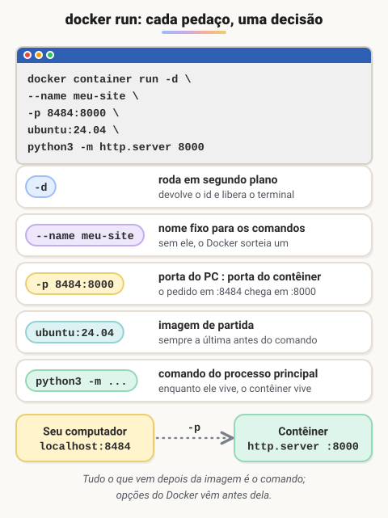
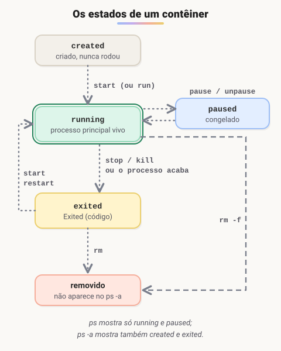
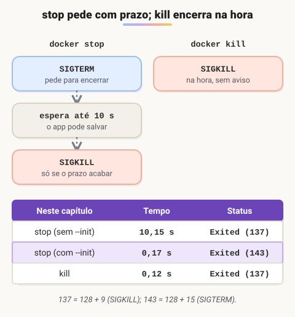

# 4. Ciclo de vida do contêiner pela linha de comando

> 🗺️ **Neste capítulo:** o ciclo de vida de um contêiner pelo terminal: rodar com porta publicada, listar, ler os logs, entrar nele, parar, iniciar de novo e remover. No fim, uma tabela com todos os comandos.

## De onde paramos

Nos capítulos 2 e 3 você instalou o Docker no Windows, no Linux ou no Mac, e o `docker run hello-world` funcionou. Agora vem o uso de verdade: um contêiner que fica no ar, atende pedidos numa porta e precisa ser cuidado do começo ao fim. Tudo aqui é pela linha de comando, que é igual nos três sistemas; o capítulo 5 mostra as mesmas tarefas pela interface do Docker Desktop.

## A forma nova e o atalho

Os primeiros comandos do Docker eram soltos (`docker run`, `docker ps`, `docker rm`). Com o tempo vieram imagens, volumes e redes, e cada um ganhou o seu grupo. Por isso existe a **forma nova,** `docker container <ação>`**, que agrupa tudo o que se faz com contêineres; a forma curta continua valendo como atalho (alias)**.

```bash
# a ajuda de cada comando lista os dois nomes
docker stop --help | grep -A1 Aliases
```

Saída real:

```
Aliases:
  docker container stop, docker stop
```

| Forma nova | Atalho |
| --- | --- |
| `docker container run` | `docker run` |
| `docker container ls` | `docker ps` |
| `docker container rm` | `docker rm` |
| `docker container logs` | `docker logs` |

Os dois fazem exatamente a mesma coisa. Neste livro usamos o atalho no dia a dia e a forma nova quando ela deixa o comando mais claro. Só o `prune` não tem atalho: é sempre `docker container prune`.

## Anatomia do docker run

Um `docker run` faz duas coisas de uma vez: **cria o contêiner a partir de uma imagem e inicia o processo principal dele**. Tudo o que vem antes da imagem são opções do Docker; tudo o que vem depois é o comando que vai rodar lá dentro.

```bash
# -d: segundo plano; --name: nome fixo;
# -p: porta 8484 do PC leva à 8000 do contêiner
docker container run -d \
  --name meu-site \
  -p 8484:8000 \
  ubuntu:24.04 \
  python3 -m http.server 8000
```

Saída real (o id é sorteado e muda a cada contêiner):

```
5cc5b89638b0df2492a1a68fa2cef5c211561b00f3517a4ab213145006eeb65d
```



> 💡 **Analogia:** o `-p 8484:8000` funciona como o PABX de uma empresa. O número que o cliente disca (8484) é o do seu computador; a central encaminha a ligação para o ramal interno (8000), onde o servidor atende. O ramal não é discado direto de fora, e duas linhas externas não podem ter o mesmo número: é por isso que duas publicações na mesma porta do PC dão erro.

As opções que você mais vai usar:

| Opção | O que faz | Quando usar |
| --- | --- | --- |
| `-d` | roda em segundo plano e devolve o id | servidores, que ficam no ar |
| `--name` | dá um nome fixo | sempre; sem ele o Docker sorteia um, como `optimistic_noyce` |
| `-p PC:contêiner` | publica uma porta | quando algo de fora precisa acessar |
| `--rm` | remove o contêiner quando ele termina | testes e comandos rápidos |
| `-e NOME=valor` | define uma variável de ambiente | configuração (senhas, modos) |
| `-it` | terminal interativo (`-i` entrada aberta, `-t` terminal) | para usar um shell lá dentro |

Exemplo com `--rm` e `-e`, que roda, responde e some:

```bash
# aspas simples: quem expande $NOME é o bash
# do contêiner, não o do seu computador
docker run --rm -e NOME="Ana Souza" ubuntu:24.04 \
  bash -c 'echo "Olá, $NOME"'
```

Saída real: `Olá, Ana Souza`. Depois disso, `docker ps -a` não mostra o contêiner: o `--rm` já o apagou.

E com `-it`, para conversar com um shell:

```bash
# -it: você digita e vê o prompt do contêiner;
# exit encerra o bash e, com ele, o contêiner
docker run -it --rm ubuntu:24.04 bash
```

Saída real (o que está depois do `#` foi digitado):

```
root@7dc7c6c70538:/# cat /etc/os-release | head -1
PRETTY_NAME="Ubuntu 24.04.5 LTS"
root@7dc7c6c70538:/# exit
```

O `7dc7c6c70538` do prompt é o início do id do contêiner: ele vira o nome da máquina lá dentro.

> ⚠️ **Armadilha:** opção depois da imagem não é opção do Docker. Em `docker run ubuntu:24.04 -d`, o `-d` vai para o processo do contêiner, e não para o Docker. A ordem é sempre `docker run [opções] imagem [comando]`. Outra: `-it` só funciona num terminal de verdade. Num script com entrada redirecionada, o Docker 29 recusa com `cannot attach stdin to a TTY-enabled container because stdin is not a terminal`; ali, use só `-i` ou nenhum dos dois.

## Os estados de um contêiner

Um contêiner não é só "ligado" ou "desligado". Saber o estado explica por que um nome está "em uso" mesmo com nada rodando, ou por que um arquivo criado lá dentro continua lá depois de parar. **O estado diz em que ponto da vida o contêiner está: criado (created), rodando (running), pausado (paused) ou encerrado (exited)**; removido é quando ele deixa de existir.

| Estado | O que significa | Aparece em |
| --- | --- | --- |
| `created` | criado, o processo nunca começou | `ps -a` |
| `running` | o processo principal está vivo | `ps` e `ps -a` |
| `paused` | processos congelados, sem CPU | `ps` e `ps -a` |
| `exited` | o processo terminou, com um código de saída | `ps -a` |



> 💡 **Analogia:** pense num jogo de videogame. Created é o jogo instalado que você nunca abriu. Running é a partida em andamento. Paused é o botão de pausa: a tela congela exatamente onde estava. Exited é sair do jogo: a partida acabou, mas o save continua no console, e dá para abrir de novo (`start`). Removido é apagar o save: aí não volta mais.

Os quatro estados apareceram de verdade na produção deste capítulo. O `created`, por exemplo, surgiu de um erro: a porta escolhida já estava ocupada por outro contêiner, e o Docker criou o contêiner mas não conseguiu iniciá-lo.

```
$ docker ps -a --filter name=^site$
CONTAINER ID   IMAGE          COMMAND                  CREATED         STATUS    PORTS     NAMES
62ba18e5ee02   ubuntu:24.04   "python3 -m http.ser…"   5 seconds ago   Created             site
```

> ⚠️ **Armadilha:** um contêiner encerrado ainda existe e ainda ocupa o nome. Se você rodar de novo `docker run --name meu-site ...`, o Docker recusa porque o nome está em uso. Ou você inicia o antigo com `docker start meu-site`, ou o remove com `docker rm meu-site` antes de criar outro.

## Listar: docker ps e ps -a

`docker ps` **lista os contêineres rodando (e pausados);** `docker ps -a` **lista todos, inclusive os encerrados e os só criados.** A forma nova é `docker container ls`, com as mesmas opções.

```bash
# --filter mostra só o que interessa: útil quando
# há muitos contêineres na máquina
docker container ls --filter name=meu-site
```

Saída real:

```
CONTAINER ID   IMAGE          COMMAND                  CREATED         STATUS         PORTS                    NAMES
5cc5b89638b0   ubuntu:24.04   "python3 -m http.ser…"   2 seconds ago   Up 2 seconds   0.0.0.0:8484->8000/tcp   meu-site
```

Como ler cada coluna:

| Coluna | Neste exemplo | O que diz |
| --- | --- | --- |
| CONTAINER ID | `5cc5b89638b0` | os 12 primeiros caracteres do id |
| STATUS | `Up 2 seconds` | estado e há quanto tempo |
| PORTS | `0.0.0.0:8484->8000/tcp` | porta do PC -> porta do contêiner |
| NAMES | `meu-site` | o nome que você deu |

Dois atalhos úteis: `docker ps -q` mostra só os ids (bom para scripts) e `--format '{{.Names}}: {{.Status}}'` escolhe as colunas.

> ⚠️ **Armadilha:** "rodei e sumiu". Se o processo principal termina, o contêiner vai para `exited` e some do `docker ps`. Antes de achar que algo deu errado, rode `docker ps -a` e olhe o código em `Exited (código)`; depois, os logs.

## Parar: stop x kill

Um servidor precisa de um jeito de ser desligado com calma, para fechar arquivos e conexões. `docker stop` **envia o sinal SIGTERM (um pedido para encerrar), espera um prazo e, se o processo não terminar, envia SIGKILL (encerramento forçado);** `docker kill` **envia SIGKILL na hora.** O prazo padrão é de 10 segundos em contêineres Linux (30 s em contêineres Windows) e muda com `-t` (`--timeout`).

O código de saída conta o que aconteceu: um processo morto por sinal termina com 128 mais o número do sinal. SIGKILL é o 9 (dá 137); SIGTERM é o 15 (dá 143).

```bash
# time mede quanto o stop demorou
time docker stop meu-site
docker inspect -f '{{.State.ExitCode}}' meu-site
```

Saída real:

```
meu-site

real  0m10.150s
user  0m0.008s
sys  0m0.013s
137
```

Dez segundos e código 137: o `stop` esperou o prazo inteiro e teve de forçar. O motivo é um detalhe do Linux: o processo de número 1 (PID 1) de um contêiner ignora o SIGTERM se não tiver programado uma resposta para ele, e o `python3 -m http.server` não programa. A opção `--init` coloca um processo pequeno como PID 1, que repassa o sinal ao Python. Com ela, o mesmo servidor parou em 0,17 s, com `Exited (143)`.



> 💡 **Analogia:** é o fim de uma prova. O `stop` é o fiscal que avisa "faltam 10 minutos, entreguem" (SIGTERM) e, quando o tempo acaba, recolhe a folha de quem ainda está escrevendo (SIGKILL). O `kill` é recolher todas as folhas na hora, sem aviso. O aluno que ouviu o aviso entrega com a resposta completa (143); o que teve a folha arrancada fica com a resposta pela metade (137).

> ⚠️ **Armadilha:** usar `kill` por hábito, "porque é mais rápido". Num banco de dados, o encerramento forçado pode deixar escritas pela metade. Use `stop`; se ele sempre demora os 10 s inteiros, o problema é o processo não tratar o SIGTERM (resolva com `--init` ou no próprio programa), e não o `stop`.

## Iniciar de novo, pausar e reiniciar

`docker start` **põe para rodar de novo um contêiner encerrado, com a mesma configuração e os mesmos arquivos;** `docker restart` **faz stop e start em seguida.** Arquivos criados dentro do contêiner continuam lá até ele ser removido.

```bash
# start reaproveita nome, porta e arquivos
docker start meu-site
docker ps --filter name=meu-site \
  --format '{{.Names}}: {{.Status}}'
```

Saída real: `meu-site` e depois `meu-site: Up 1 second`.

`docker pause` congela todos os processos sem encerrá-los (o estado fica na memória) e `docker unpause` os solta. Enquanto pausado, o servidor não responde:

```bash
docker pause meu-site
# --format com Status mostra o "(Paused)"
docker ps --filter name=meu-site \
  --format '{{.Names}}: {{.Status}}'
# timeout desiste em 3 s: ninguém vai responder
timeout 3 curl -s localhost:8484/ \
  || echo "curl sem resposta (exit $?)"
docker unpause meu-site
```

Saída real:

```
meu-site
meu-site: Up 1 second (Paused)
curl sem resposta (exit 124)
meu-site
```

> ⚠️ **Armadilha:** confundir `start` com `run`. O `run` sempre cria um contêiner novo (e limpo); o `start` retoma um que já existe. Rodar `run` de novo para "ligar" o servidor cria um segundo contêiner, sem os arquivos do primeiro.

## Remover: rm, rm -f e prune

Contêineres encerrados ocupam disco e nomes. `docker rm` **apaga um contêiner encerrado;** `docker rm -f` **para (com SIGKILL) e apaga um que está rodando;** `docker container prune` **apaga de uma vez todos os encerrados.**

```bash
# rm recusa contêiner rodando, para proteger você
docker rm meu-site
# -f força: mata e remove
docker rm -f meu-site
```

Saída real:

```
Error response from daemon: cannot remove container "meu-site": container is running: stop the container before removing or force remove
meu-site
```

O `prune` pede confirmação (pule com `-f`) e aceita filtros. Na produção do livro, usamos um rótulo (label) para limpar só os contêineres deste capítulo:

```bash
# --label marca o contêiner; o filtro do prune
# apaga só os que têm essa marca
docker run --label capitulo=c04 ubuntu:24.04 true
docker container prune -f --filter label=capitulo=c04
```

Saída real (depois de dois `run` como o de cima):

```
Deleted Containers:
1e9e4c96e747c5eb90148ce8ef5e2a2f9605f37d9f6ac6026929236aac8ade65
db97ba38b6c1878425ab7e0f99adad8651723203079678e1c19b3206474b96f5

Total reclaimed space: 8.192kB
```

> ⚠️ **Armadilha:** remover um contêiner apaga tudo o que foi escrito dentro dele. O `/ola.txt` do laboratório sobrevive a `stop` e `start`, mas não a `rm`. Para guardar dados de verdade existem os volumes, assunto do capítulo 9.

## Ler os logs

Um contêiner em segundo plano não mostra nada no seu terminal. `docker logs` **mostra tudo o que o processo principal escreveu na saída padrão e na saída de erro**. Com `-f` (follow) ele fica acompanhando ao vivo, como um `tail -f`; com `--tail N` (ou `-n N`) mostra só as últimas N linhas; com `-t` acrescenta a data e a hora de cada linha.

```bash
# --tail 0 pula o histórico; -f fica esperando
# linhas novas até você apertar Ctrl+C
docker logs -f --tail 0 meu-site
```

Saída real, enquanto outro terminal fazia dois `curl` (um para `/` e outro para `/nao-existe`):

```
172.17.0.1 - - [16/Nov/2026 00:27:55] "GET / HTTP/1.1" 200 -
172.17.0.1 - - [16/Nov/2026 00:27:55] code 404, message File not found
172.17.0.1 - - [16/Nov/2026 00:27:55] "GET /nao-existe HTTP/1.1" 404 -
```

O `172.17.0.1` é o endereço pelo qual o seu computador aparece para o contêiner; o horário é o da sua máquina e muda a cada execução.

> ⚠️ **Armadilha:** "o log está vazio". O `docker logs` só vê o que o processo escreve no terminal. Se o programa grava num arquivo (como `/var/log/app.log`), nada aparece. Outro caso comum: programas em Python com saída em buffer só mostram as linhas mais tarde; a variável `-e PYTHONUNBUFFERED=1` resolve.

## Entrar no contêiner: exec

Às vezes é preciso olhar lá dentro: um arquivo, uma variável, um processo. `docker exec` **roda um comando extra dentro de um contêiner que já está rodando, sem reiniciá-lo.**

```bash
# exec sem -it: roda, mostra a saída e volta
docker exec meu-site ls /
# com -it: abre um shell para você digitar
docker exec -it meu-site bash
```

Dentro do shell, `ps` mostra que o servidor é o processo 1 e que o seu comando é só um visitante:

```
    PID CMD
      1 python3 -m http.server 8000
     20 ps -o pid,cmd -e
```

> ⚠️ **Armadilha:** `exit` no shell do `exec` fecha só o seu shell; o servidor continua. Já o `exit` num `docker run -it ... bash` encerra o contêiner, porque ali o bash é o processo principal. E o `exec` só funciona com o contêiner em `running`.

## Inspecionar: inspect e --format

`docker inspect` **mostra, em JSON, tudo o que o Docker sabe de um contêiner: estado, horário de início, portas, rede, comando.** A saída inteira tem centenas de linhas; o `--format` (ou `-f`) extrai um campo com a sintaxe de modelos do Go, `{{.Caminho.Do.Campo}}`.

```bash
# um campo por vez: ótimo para scripts
docker inspect -f '{{.State.Status}}' meu-site
docker inspect -f '{{.State.StartedAt}}' meu-site
docker inspect \
  -f '{{.NetworkSettings.Networks.bridge.IPAddress}}' \
  meu-site
```

Saída real:

```
running
2026-11-16T00:26:47.099438698Z
172.17.0.3
```

> ⚠️ **Correção:** muitos tutoriais ensinam `{{.NetworkSettings.IPAddress}}`. Esse campo antigo foi removido da API 1.52, que já é a do Docker Engine 29; hoje ele dá `map has no entry for key "IPAddress"`. Use o caminho por rede: `{{.NetworkSettings.Networks.bridge.IPAddress}}` (troque `bridge` pelo nome da rede, assunto do capítulo 10).

## 🧪 Laboratório

> ⚠️ **O que não foi executado na produção do livro:** o laboratório rodou de verdade no Docker Engine 29.9.2 (Linux), mas com uma imagem `ubuntu:24.04` local, que já traz Python 3.13 e curl. A `ubuntu:24.04` oficial do Docker Hub **não tem Python**: no seu computador, troque `ubuntu:24.04` por `python:3.13-slim` (imagem oficial do Python) nos passos 1 e 7; o resto é igual. Esse pull e a execução no terminal do Docker Desktop (Windows e Mac) não foram feitos aqui. Também mudam no seu ambiente: os ids, os horários, a lista de arquivos do passo 4 e, com IPv6 ativo, uma segunda entrada `[::]:8484->8000/tcp` na coluna PORTS.

Objetivo: subir um servidor web num contêiner, acessá-lo pela porta publicada e passar por todos os estados até removê-lo. No Windows, use o PowerShell e escreva `curl.exe` (no PowerShell, `curl` sozinho pode ser outro comando) ou abra o endereço no navegador.

**1. Rodar em segundo plano, com porta publicada.**

```bash
# servidor de arquivos do Python na porta 8000
# do contêiner, publicada na 8484 do PC
docker run -d --name meu-site -p 8484:8000 \
  ubuntu:24.04 python3 -m http.server 8000
```

```
5cc5b89638b0df2492a1a68fa2cef5c211561b00f3517a4ab213145006eeb65d
```

**2. Conferir que está no ar e acessar.**

```bash
docker ps --filter name=meu-site
# a página é a lista de arquivos da raiz (/)
curl -s http://localhost:8484/ | head -5
```

```
CONTAINER ID   IMAGE          COMMAND                  CREATED         STATUS         PORTS                    NAMES
5cc5b89638b0   ubuntu:24.04   "python3 -m http.ser…"   2 seconds ago   Up 2 seconds   0.0.0.0:8484->8000/tcp   meu-site
<!DOCTYPE HTML>
<html lang="en">
<head>
<meta charset="utf-8">
<title>Directory listing for /</title>
```

**3. Ver o acesso registrado no log.**

```bash
docker logs meu-site
```

```
172.17.0.1 - - [16/Nov/2026 00:26:52] "GET / HTTP/1.1" 200 -
```

**4. Entrar com exec, listar e criar um arquivo.**

```bash
docker exec meu-site ls /
# sh -c permite o redirecionamento > lá dentro
docker exec meu-site sh -c 'echo "Oi, Ana" > /ola.txt'
curl -s http://localhost:8484/ola.txt
```

```
bin
boot
dev
etc
lib
lib64
proc
sbin
sys
usr
var
Oi, Ana
```

**5. Parar e ver o código de saída.**

```bash
docker stop meu-site
# ps -a: sem o -a, o contêiner parado não aparece
docker ps -a --filter name=meu-site
```

```
meu-site
CONTAINER ID   IMAGE          COMMAND                  CREATED          STATUS                                PORTS     NAMES
5cc5b89638b0   ubuntu:24.04   "python3 -m http.ser…"   26 seconds ago   Exited (137) Less than a second ago             meu-site
```

O `stop` levou 10 s e terminou em 137 pelo motivo da seção "Parar": o Python, como PID 1, ignorou o SIGTERM.

**6. Iniciar de novo e conferir que o arquivo sobreviveu.**

```bash
docker start meu-site
curl -s http://localhost:8484/ola.txt
# os logs também sobrevivem ao stop/start
docker logs --tail 2 meu-site
```

```
meu-site
Oi, Ana
172.17.0.1 - - [16/Nov/2026 00:26:52] "GET /ola.txt HTTP/1.1" 200 -
172.17.0.1 - - [16/Nov/2026 00:27:19] "GET /ola.txt HTTP/1.1" 200 -
```

**7. Remover e repetir com --init.**

```bash
# -f: está rodando, então precisa forçar
docker rm -f meu-site
# --init repassa o SIGTERM; --rm apaga ao parar
docker run -d --rm --init --name meu-site \
  -p 8484:8000 ubuntu:24.04 \
  python3 -m http.server 8000
time docker stop meu-site
```

Agora o `stop` volta em menos de um segundo (aqui, 0,17 s) e, por causa do `--rm`, um `docker ps -a --filter name=meu-site` não mostra mais nada.

## Tabela de comandos

| Atalho | Forma nova | Para quê |
| --- | --- | --- |
| `docker run` | `docker container run` | criar e iniciar |
| `docker ps [-a]` | `docker container ls [-a]` | listar (todos com `-a`) |
| `docker stop` | `docker container stop` | SIGTERM, prazo, SIGKILL |
| `docker kill` | `docker container kill` | SIGKILL na hora |
| `docker start` | `docker container start` | iniciar um encerrado |
| `docker restart` | `docker container restart` | stop e start |
| `docker pause` / `unpause` | `docker container pause` / `unpause` | congelar e soltar |
| `docker logs [-f] [--tail N]` | `docker container logs` | ver a saída do processo |
| `docker exec [-it]` | `docker container exec` | rodar um comando dentro |
| `docker inspect -f` | `docker container inspect -f` | ler um campo da configuração |
| `docker rm [-f]` | `docker container rm [-f]` | remover (forçado com `-f`) |
| (sem atalho) | `docker container prune` | remover todos os encerrados |

## 🏋️ Pratique

**1.** Rode um servidor chamado `ola` com a porta 8000 do contêiner publicada na 9090 do PC. Faça quatro acessos com `curl` e mostre só as três últimas linhas do log.

<details>
<summary>Ver resposta</summary>

```bash
docker run -d --name ola -p 9090:8000 \
  ubuntu:24.04 python3 -m http.server 8000
# -w imprime só o código HTTP de cada acesso
for i in 1 2 3 4; do
  curl -s -o /dev/null -w '%{http_code}\n' \
    localhost:9090/
done
docker logs --tail 3 ola
docker rm -f ola
```

Saída real: quatro linhas `200` e três linhas de log como `172.17.0.1 - - [16/Nov/2026 00:30:58] "GET / HTTP/1.1" 200 -`. No seu computador, use `python:3.13-slim` no lugar de `ubuntu:24.04`.

</details>

**2.** Rode, sem `--rm`, um contêiner chamado `saida-3` que escreve "tchau" e termina com código 3. Descubra o estado e o código só com `inspect --format` e depois remova o contêiner.

<details>
<summary>Ver resposta</summary>

```bash
# exit 3 encerra o bash, o processo principal
docker run --name saida-3 ubuntu:24.04 \
  bash -c 'echo tchau; exit 3'
docker inspect \
  -f '{{.State.Status}} {{.State.ExitCode}}' saida-3
docker rm saida-3
```

Saída real: `tchau`, depois `exited 3` e `saida-3`. Sem `-d`, o `run` fica preso ao terminal até o processo acabar, e o próprio `docker run` devolve o código 3 ao shell (`echo $?` mostra 3).

</details>

**3.** Você quer que o servidor só aceite acessos do seu próprio computador, e não de outras máquinas da rede. Como publicar a porta? Confirme na coluna PORTS.

<details>
<summary>Ver resposta</summary>

Sem um endereço, o `-p` publica em todas as interfaces (`0.0.0.0`), e a porta fica acessível pela rede. Coloque o endereço local na frente:

```bash
# 127.0.0.1: só o próprio PC alcança a porta
docker run -d --rm --name local-so \
  -p 127.0.0.1:8486:8000 \
  ubuntu:24.04 python3 -m http.server 8000
docker ps --filter name=local-so \
  --format '{{.Names}}  {{.Ports}}'
docker stop -t 1 local-so
```

Saída real: `local-so  127.0.0.1:8486->8000/tcp`. Com `-t 1` o `stop` espera só 1 segundo, e o `--rm` apaga o contêiner ao parar.

</details>

## 🧠 Revisão rápida

**Qual a diferença entre `docker ps` e `docker ps -a`?**

O primeiro mostra só os contêineres rodando ou pausados; com `-a` aparecem também os criados e os encerrados.

**Um `docker stop` sempre demora 10 segundos e termina com `Exited (137)`. O que isso indica?**

Que o processo principal ignorou o SIGTERM e o Docker teve de mandar SIGKILL depois do prazo. Rode com `--init` ou trate o sinal no programa.

**Criei um arquivo dentro do contêiner, dei `stop` e depois `start`. O arquivo ainda existe? E depois de `rm`?**

Depois de stop e start, sim: o contêiner é o mesmo. Depois de `rm`, não: tudo o que foi escrito dentro dele é apagado junto.

> ➡️ **Próximo passo:** você fez todo o ciclo de vida pelo terminal. O próximo capítulo, **Docker Desktop na prática: interface x linha de comando**, repete estas tarefas na interface gráfica e mostra quando cada caminho é mais prático.

## 📚 Fontes

Conferido em 2026-11-15, com Docker Engine 29.9.2 (versão de referência do livro: Docker Desktop 4.96 e Docker Engine 29.9).

- [docker container run (referência da CLI)](https://docs.docker.com/reference/cli/docker/container/run/)
- [docker container stop (referência da CLI)](https://docs.docker.com/reference/cli/docker/container/stop/)
- [docker container logs (referência da CLI)](https://docs.docker.com/reference/cli/docker/container/logs/)
- [docker inspect (referência da CLI)](https://docs.docker.com/reference/cli/docker/inspect/)
- [Engine API version history (remoção dos campos de rede antigos na v1.52)](https://docs.docker.com/reference/api/engine/version-history/)
- [Docker Engine 29 release notes](https://docs.docker.com/engine/release-notes/29/)

## 📌 Resumo

| Item | Em uma frase |
| --- | --- |
| `docker container <ação>` | Forma nova dos comandos; `docker run`, `ps`, `rm` são atalhos que fazem o mesmo |
| `docker run` | Cria e inicia; opções antes da imagem, comando depois dela |
| `-p PC:contêiner` | Leva a porta do seu computador até a porta do processo no contêiner |
| Estados | created, running, paused e exited; removido deixa de existir |
| `ps` x `ps -a` | Só os que rodam x todos, inclusive os encerrados |
| `stop` x `kill` | SIGTERM com prazo de 10 s x SIGKILL na hora (137 = forçado, 143 = SIGTERM) |
| `start` | Retoma o mesmo contêiner, com os mesmos arquivos |
| `rm`, `rm -f`, `prune` | Remove um encerrado, força um rodando, limpa todos os encerrados |
| `logs -f --tail N` | Mostra o que o processo escreve, ao vivo e só o final |
| `exec -it` | Abre um shell dentro de um contêiner que já está rodando |
| `inspect -f` | Lê um campo da configuração; o IP fica em `.NetworkSettings.Networks.<rede>` |
