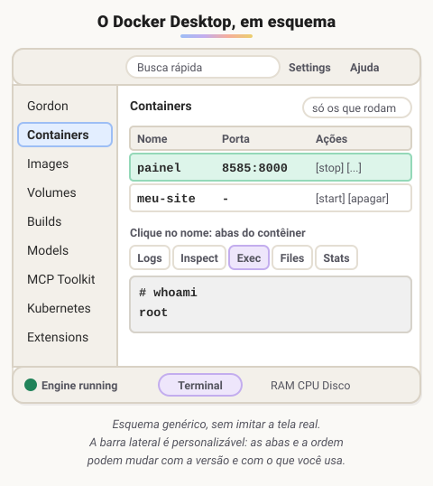
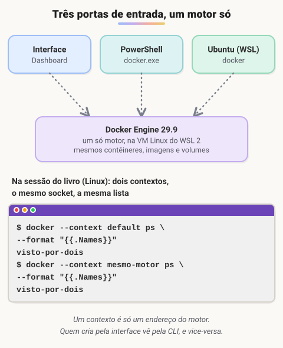

# 5. Docker Desktop na prática: interface x linha de comando

> 🗺️ **Neste capítulo:** um passeio pela janela do Docker Desktop, as tarefas do capítulo 4 feitas pela interface e pela linha de comando, lado a lado, as configurações que importam e o critério para escolher um ou outro caminho.

## De onde paramos

No capítulo 4 você fez o ciclo de vida inteiro de um contêiner pelo terminal: `run` com porta, `logs`, `exec`, `inspect`, `stop`, `start`, `rm` e `prune`. Quem instalou o Docker Desktop (capítulos 2 e 3) tem também uma janela que faz quase tudo isso com cliques. Este capítulo mostra onde fica cada coisa nela e compara os dois caminhos. As explicações dos comandos não se repetem aqui: quando precisar, volte ao capítulo 4.

## Duas portas para o mesmo motor

Por que existe uma interface se a linha de comando já faz tudo? Porque ver ajuda a entender. Uma lista com bolinhas verdes mostra na hora o que está rodando, e um gráfico de memória mostra um vazamento que o texto esconde. **O Docker Desktop é um aplicativo para Windows, Mac e Linux que instala e mantém o motor do Docker (Docker Engine) numa máquina virtual e oferece um painel gráfico (Dashboard) para usá-lo; a linha de comando (CLI, command-line interface) é o programa** `docker` **que conversa com esse mesmo motor.**

Isso tem uma consequência prática: o que você cria num lado aparece no outro. Um contêiner iniciado pelo botão **Run** aparece no `docker ps`; um contêiner criado no terminal aparece na lista da janela.

A versão de referência do livro é o Docker Desktop 4.96. Na data da conferência (2026-11-15), a mais recente era a 4.99.0, de 2026-11-09, com Docker Engine 29.9.3; os nomes de menus deste capítulo valem para as duas.

## Um passeio pela janela

A janela tem três partes fixas: o cabeçalho, a barra lateral e o rodapé. O conteúdo do meio muda conforme a aba escolhida.



> 💡 **Analogia:** a interface é o totem de autoatendimento de uma lanchonete; a linha de comando é pedir no balcão pelo número do prato. No totem você vê as fotos (as abas), toca no lanche (o contêiner) e escolhe os adicionais (Optional settings) sem decorar nada: ótimo para descobrir o cardápio. No balcão, quem já sabe diz "o 4 com batata" e sai mais rápido, e pode repetir o pedido igual todo dia (um script). Os dois pedidos caem na mesma cozinha: o motor do Docker.

**Cabeçalho.** Tem a busca rápida, que leva direto a um contêiner, imagem, volume, extensão ou página da documentação; o ícone de configurações (**Settings**); o **Troubleshoot**, para diagnosticar problemas e reiniciar o Docker Desktop; e o botão de login (**Sign in**) no canto direito.

**Barra lateral.** Cada item abre uma visão (view). As principais:

| Aba | O que mostra | Equivalente na CLI |
| --- | --- | --- |
| **Containers** | contêineres rodando e parados, com ações por linha | `docker ps -a` |
| **Images** | imagens locais (Local) e do seu Docker Hub (My Hub) | `docker images` |
| **Volumes** | volumes, onde ficam os dados persistentes | `docker volume ls` |
| **Builds** | histórico dos builds de imagem | `docker buildx history ls` |
| **Kubernetes** | cluster local, quando ativado | `kubectl` |
| **Extensions** | ferramentas de terceiros instaladas | (não há) |

A documentação também lista recursos de IA na janela: o **Gordon**, um assistente de IA que responde perguntas e sugere diagnósticos (por exemplo, numa linha de contêiner que terminou com erro); o **Docker Model Runner**, para rodar modelos de IA; e o **MCP Toolkit**, para servidores MCP em contêineres. Este livro não usa nenhum dos três. A barra é personalizável: clique com o botão direito nela e escolha **Customize** para mostrar, esconder ou reordenar as abas. Por isso a sua pode não ficar igual à do esquema.

O Docker Scout (análise de vulnerabilidades) aparece dentro das outras abas: em **Images**, cada imagem local mostra um resumo de vulnerabilidades, e na lista de contêineres há a ação de ver os pacotes e as CVEs da imagem. Volumes e Builds têm capítulos próprios (9 e 8).

**Rodapé.** Mostra o estado do motor e o botão do terminal integrado (veja adiante). O sino, no canto inferior direito, abre a central de notificações (novas versões, progresso de instalação).

> ⚠️ **Armadilha:** fechar a janela não desliga o Docker. O Docker Desktop continua na bandeja do sistema (Windows) ou na barra de menus (Mac), e os contêineres continuam rodando. Para desligar o motor, use o ícone da bandeja e escolha sair (Quit). O contrário também engana: se o Docker Desktop estiver fechado, a CLI do Windows responde com erro de conexão, porque o motor não está de pé.

## A aba Containers por dentro

É a aba que você mais vai usar. A lista tem uma busca por nome, a chave **Only show running containers** (só os que rodam) e o botão **Columns**, que acrescenta colunas como CPU %, memória e E/S de rede. Cada linha tem ações: iniciar, parar, pausar, reiniciar, apagar, abrir um terminal, abrir a porta publicada no navegador e **copiar o comando** `docker run` que recriaria aquele contêiner. Marcando várias caixas de seleção, a barra de ações em lote inicia, pausa, para ou apaga todos de uma vez.

Clicando no nome de um contêiner, abrem-se as abas de detalhe:

| Aba | O que faz | Comando do cap. 4 |
| --- | --- | --- |
| **Logs** | saída ao vivo, com busca (Ctrl+F) e horários | `docker logs -f -t` |
| **Inspect** | detalhes: imagem, portas, caminhos | `docker inspect` |
| **Bind mounts** | pastas do PC ligadas ao contêiner | `docker inspect` (Mounts) |
| **Exec** | um shell dentro do contêiner | `docker exec -it ... /bin/sh` |
| **Files** | navega, edita e baixa arquivos | `docker cp` e `exec` |
| **Stats** | CPU, memória, rede e disco no tempo | `docker stats` |

Quando o Docker Debug está ativado, a aba **Exec** dá lugar à **Debug**, que traz ferramentas extras (vim, htop, curl) mesmo em contêineres que não têm shell.

> ⚠️ **Armadilha:** a aba Exec abre `/bin/sh`, e não `bash`. Em imagens pequenas o `bash` nem existe; se você estiver acostumado a setas e Tab do bash, digite `bash` lá dentro quando a imagem tiver. E a aba Exec, como o `docker exec`, só funciona com o contêiner rodando.

## As mesmas tarefas, lado a lado

As tarefas do capítulo 4, agora com o caminho na janela. Os passos da interface seguem a documentação do Docker Desktop; os comandos rodaram de verdade (as saídas estão no Laboratório).

| Tarefa | Na interface | Na linha de comando |
| --- | --- | --- |
| Rodar uma imagem com porta | **Images** → passe o mouse na imagem → **Run** → **Optional settings** (nome, porta do host) → **Run** | `docker run -d --name painel -p 8585:8000 imagem` |
| Ver logs | **Containers** → nome → **Logs** | `docker logs -f painel` |
| Abrir um terminal | **Containers** → nome → **Exec** (ou a ação de terminal na linha) | `docker exec -it painel bash` |
| Inspecionar | **Containers** → nome → **Inspect** | `docker inspect -f '{{...}}' painel` |
| Parar, iniciar, remover | botões na linha (ou várias caixas e a barra de lote) | `docker stop`, `start`, `rm` |
| Limpar | marcar os parados e apagar; em **Images**, ordenar por **Unused** ou **Dangling** e apagar | `docker container prune`, `docker system prune` |
| Ver uso de disco | cabeçalho da aba **Images** (total e espaço usado); seleção mostra o que será liberado | `docker system df` |
| Ver CPU e memória | coluna extra pelo **Columns** ou aba **Stats** | `docker stats --no-stream` |

Repare na linha "Limpar": a janela não tem um botão equivalente ao `prune` com filtro. Você seleciona e apaga. Já a CLI limpa "tudo o que tem o rótulo `capitulo=c05`" numa linha só, coisa que na interface seria marcar caixa por caixa.

> ⚠️ **Armadilha:** no **Run** da aba Images, sem abrir o **Optional settings**, o contêiner sobe sem porta publicada e com nome sorteado. O servidor roda, mas o `localhost` não responde. Se aconteceu, apague o contêiner e rode de novo preenchendo a porta do host; a porta não se acrescenta a um contêiner que já existe (nem pela CLI).

## O terminal integrado

A documentação de configurações lista duas opções em **Settings → General**:

- **Enable integrated terminal**: liga um terminal do seu computador (host) dentro da própria janela do Docker Desktop, no rodapé, para rodar comandos sem trocar de programa;
- **Choose container terminal**: escolhe se o terminal de um contêiner (a ação "abrir terminal") abre na janela (**Integrated**, o padrão) ou no terminal do sistema.

O terminal integrado roda o mesmo programa `docker` do seu computador. É a ponte ideal enquanto você aprende: clica na interface, confere no terminal logo abaixo, e vice-versa.

## Configurações que importam

Abra **Settings** (ícone no cabeçalho). No Windows, estas são as que valem a pena conhecer desde o começo:

| Onde | Opção | Para quê |
| --- | --- | --- |
| General | **Start Docker Desktop when you sign in to your computer** | sobe o motor junto com o Windows (desligado por padrão) |
| General | **Open Docker Dashboard when Docker Desktop starts** | abre a janela ao iniciar (desligado por padrão) |
| General | **Use the WSL 2 based engine** | usa o WSL 2 como base (capítulo 2) |
| Resources | **Resource Saver** | desliga a VM quando o Docker fica ocioso |
| Resources | **WSL Integration** | quais distros do WSL têm o comando `docker` |
| Updates | **Automatically check for updates** / **Always download updates** | procura (ligado) e baixa (desligado) atualizações |

**Recursos (memória e CPU).** No Mac e no Linux, **Resources → Advanced** tem controles de CPU, memória e disco. No Windows com WSL 2, não: a própria página avisa que, no modo WSL 2, os limites de memória, CPU e swap são configurados na VM do WSL 2. Isso se faz no arquivo `.wslconfig`, que vale para todas as distros (veja *WSL do zero*, cap. 7). O WSL 2 já usa memória de forma dinâmica: o Docker pede só o que precisa.

**Integração com as distros do WSL.** Ela vem ativada na sua distro padrão do WSL. Para usar o `docker` em outra, vá em **Settings → Resources → WSL Integration**, ligue a distro e clique em **Apply**.

**Resource Saver.** Com o Docker parado há algum tempo, ele desliga a VM e economiza CPU e memória. Quando você roda um contêiner, ela volta sozinha; a documentação avisa que isso pode levar de 3 a 10 segundos. Se o primeiro `docker run` da manhã demora, é isso.

> ⚠️ **Armadilha:** procurar o controle de memória em Resources no Windows e não achar. Com WSL 2 ele não está ali: está no `.wslconfig`, e só vale depois de `wsl --shutdown` e de reabrir o Docker Desktop. Outra: uma atualização do Docker Desktop baixada fica esperando você aplicar; com **Always download updates** desligado, ele só avisa.

## Contextos: para qual motor a CLI está falando

O programa `docker` é só um cliente. Ele precisa saber o endereço do motor: um arquivo de socket no Linux e no Mac, um named pipe no Windows. **Um contexto (context) é um nome salvo para o endereço de um motor do Docker;** `docker context ls` **lista os contextos e marca com** `*` **o que está em uso.**

```bash
# NAME, endereço (DOCKER ENDPOINT) e o * do atual
docker context ls
```

Saída real, no Docker Engine 29.9.2 desta sessão (Linux):

```
NAME        DESCRIPTION                               DOCKER ENDPOINT               ERROR
default *   Current DOCKER_HOST based configuration   unix:///var/run/docker.sock
```

Para provar que o contexto é só um nome, criamos um segundo contexto apontando para o mesmo socket e listamos o mesmo contêiner pelos dois:

```bash
# dois nomes, um endereço só
docker context create mesmo-motor \
  --docker host=unix:///var/run/docker.sock
docker run -d --rm --init --name visto-por-dois \
  ubuntu:24.04 sleep 60
# --context escolhe o motor só para este comando
docker --context default ps --format '{{.Names}}'
docker --context mesmo-motor ps --format '{{.Names}}'
# limpeza: o contêiner e o contexto extra
docker rm -f visto-por-dois
docker context rm mesmo-motor
```

Os dois `ps` mostraram `visto-por-dois`: o mesmo motor, visto por dois nomes.



> 💡 **Analogia:** um contexto é um contato na agenda do celular: um nome que guarda um número. Ligar do celular, do telefone fixo ou do computador para o mesmo número cai na mesma pessoa, que é o motor. Salvar o número com dois nomes (`default` e `mesmo-motor`) não cria uma segunda pessoa. O `*` do `docker context ls` é o contato da discagem rápida; `docker context use` troca qual é.

**Por que a CLI do Windows e a do WSL veem os mesmos contêineres?** No Windows existe um só motor, dentro da VM Linux do WSL 2 que o Docker Desktop mantém. O `docker.exe` do PowerShell e o `docker` de uma distro com a integração ligada são dois clientes desse mesmo motor; a janela do Docker Desktop é o terceiro. Por isso um contêiner criado no Ubuntu aparece no PowerShell e na aba Containers.

> ⚠️ **Armadilha:** instalar o Docker Engine dentro do Ubuntu do WSL (o roteiro do capítulo 3, que é para Linux de verdade) com o Docker Desktop também instalado. Aí passam a existir dois motores, e os contêineres "somem" conforme o terminal. Para saber com qual você está falando, rode `docker context ls` e `docker info --format '{{.OperatingSystem}}'`; aqui na sessão a resposta foi `Ubuntu 24.04.5 LTS`, e com o motor do Docker Desktop o sistema informado é o da VM dele. No Windows e no Mac, escolha um: Docker Desktop com integração WSL, ou só o Engine na distro.

## Quando usar cada um

| Situação | Interface | Linha de comando |
| --- | --- | --- |
| Descobrir o que existe | ✅ tudo à vista, com busca | precisa saber o comando |
| Acompanhar CPU, memória, logs | ✅ gráficos e busca no log | ✅ `stats` e `logs -f`, em texto |
| Explorar arquivos de um contêiner | ✅ aba Files | `exec` e `cp` |
| Repetir a mesma tarefa | ❌ clique por clique | ✅ histórico, scripts |
| Ações com filtro (rótulo, nome) | ❌ marcar caixa por caixa | ✅ `--filter` |
| Documentar e ensinar | ❌ prints envelhecem | ✅ o texto copia e roda |
| Servidor Linux, CI, SSH | ❌ não existe lá | ✅ funciona igual |

**A recomendação do livro: aprenda pela linha de comando e use a interface para observar.** Os comandos são os mesmos no Windows, no Mac, no Linux, no servidor e no pipeline de CI; a janela só existe no seu computador e muda de layout a cada versão. Já para olhar (o que está rodando, quanto gasta, o que o log diz agora) a janela é ótima. A ação de copiar o comando `docker run`, na lista de contêineres, é uma boa ponte: crie pela janela e veja qual comando faria o mesmo.

## Licença: quem pode usar de graça

O Docker Desktop tem licença própria (o motor e a CLI, sozinhos, são de código aberto). Segundo a página de licença da documentação, conferida em 2026-11-15 (página atualizada em 2026-09-28), o uso é gratuito para:

- uso pessoal;
- educação;
- projetos de código aberto não comerciais;
- empresas pequenas: menos de 250 funcionários **e** menos de US$ 10 milhões de faturamento anual.

Uso profissional em empresas maiores e em órgãos de governo exige uma assinatura paga (Pro, Team ou Business). Estudar com este livro em casa está no uso pessoal.

> ⚠️ **Armadilha:** achar que "o Docker" ficou pago. A regra vale para o aplicativo Docker Desktop. O Docker Engine instalado pelo repositório oficial num Linux (capítulo 3) não entra nela. Se você usa o Docker Desktop no trabalho, confira o tamanho da empresa nos dois critérios: basta passar de um deles para precisar de assinatura.

## 🧪 Laboratório

> ⚠️ **O que não foi executado na produção do livro:** o lado da interface (Docker Desktop no Windows ou Mac) não rodou aqui. Os passos descritos seguem a documentação oficial, conferida em 2026-11-15; confira os nomes dos botões no seu ambiente. O lado da CLI rodou de verdade no Docker Engine 29.9.2 (Linux), com uma imagem `ubuntu:24.04` local que já traz Python. Com a imagem oficial, troque por `python:3.13-slim`, como no capítulo 4. Mudam no seu ambiente: ids, horários, a memória do `stats` e os tamanhos do `system df` (a imagem local desta sessão tem cerca de 16 GB; a oficial é muito menor).

Objetivo: fazer cada tarefa primeiro pela janela e depois pelo terminal, e conferir que os dois lados mostram o mesmo motor. Se puder, ligue o terminal integrado (**Settings → General → Enable integrated terminal**) e deixe-o aberto no rodapé.

**1. Rodar com porta.** Na janela: **Images** → passe o mouse em `python:3.13-slim` → **Run** → **Optional settings**: nome `painel`, porta do host `8585` para a `8000` do contêiner. Como essa imagem não roda um servidor sozinha, para este laboratório use o terminal:

```bash
# --init: o stop responde rápido (capítulo 4);
# --label: marca para limpar só o deste capítulo
docker run -d --init --name painel -p 8585:8000 \
  --label capitulo=c05 \
  ubuntu:24.04 python3 -m http.server 8000
docker ps --filter name=painel
```

```
203f8f3da32714c38a2693c90a794b7c5a95ef31191581442379b65991d39dbe
CONTAINER ID   IMAGE          COMMAND                  CREATED         STATUS         PORTS                    NAMES
203f8f3da327   ubuntu:24.04   "python3 -m http.ser…"   2 seconds ago   Up 2 seconds   0.0.0.0:8585->8000/tcp   painel
```

Na janela: o `painel` aparece em **Containers**, com a porta `8585:8000` clicável, que abre o navegador.

**2. Logs.** Abra `http://localhost:8585` uma vez. Na janela: **Containers** → `painel` → **Logs**. No terminal:

```bash
curl -s -o /dev/null -w '%{http_code}\n' localhost:8585/
docker logs --tail 2 painel
```

```
200
172.17.0.1 - - [16/Nov/2026 00:35:38] "GET / HTTP/1.1" 200 -
```

**3. Terminal dentro do contêiner.** Na janela: aba **Exec**, e digite `whoami`. No terminal:

```bash
# sh -c: dois comandos numa chamada só
docker exec painel sh -c \
  'cat /etc/os-release | head -1; whoami'
```

```
PRETTY_NAME="Ubuntu 24.04.5 LTS"
root
```

**4. Inspecionar.** Na janela: aba **Inspect**, procure a imagem e as portas. No terminal:

```bash
docker inspect -f '{{.State.Status}} {{.Config.Image}}' painel
docker inspect -f '{{json .NetworkSettings.Ports}}' painel
```

```
running ubuntu:24.04
{"8000/tcp":[{"HostIp":"0.0.0.0","HostPort":"8585"}]}
```

**5. CPU e memória.** Na janela: aba **Stats**. No terminal:

```bash
# --no-stream: uma leitura só, sem ficar atualizando
docker stats --no-stream \
  --format 'table {{.Name}}\t{{.CPUPerc}}\t{{.MemUsage}}' \
  painel
```

```
NAME      CPU %     MEM USAGE / LIMIT
painel    0.02%     9.762MiB / 7.836GiB
```

**6. Parar e iniciar.** Na janela: botão de parar na linha; a bolinha fica cinza. Depois, iniciar. No terminal:

```bash
docker stop painel
docker ps -a --filter name=painel \
  --format '{{.Names}}: {{.Status}}'
docker start painel
docker ps --filter name=painel \
  --format '{{.Names}}: {{.Status}}'
```

```
painel
painel: Exited (143) Less than a second ago
painel
painel: Up Less than a second
```

O 143 mostra que o `--init` repassou o SIGTERM e o servidor parou sem precisar de SIGKILL (capítulo 4).

**7. Limpar com filtro.** Crie dois contêineres que terminam na hora e limpe só os deste capítulo. Na janela seria marcar as caixas dos dois e apagar; no terminal, uma linha:

```bash
# true termina na hora: sobram 2 contêineres parados
docker run --label capitulo=c05 ubuntu:24.04 true
docker run --label capitulo=c05 ubuntu:24.04 true
# só os parados com o rótulo; o painel está rodando
docker container prune -f --filter label=capitulo=c05
```

```
Deleted Containers:
2c6cb4cf8fb568796621437ea0e19fadfe15126dbc14f0ab29dc7ac1b52f84dc
eeb8875f63358a50214c7151aeaab081031dfc5500fbe9e9fe5bc6201a4e583c

Total reclaimed space: 8.192kB
```

O `painel` continuou de pé: o `prune` só apaga contêineres parados.

**8. Uso de disco.** Na janela: o cabeçalho da aba **Images** mostra quantas imagens há e quanto espaço ocupam. No terminal, o resumo de tudo:

```bash
docker rm -f painel
docker system df
```

```
painel
TYPE            TOTAL     ACTIVE    SIZE      RECLAIMABLE
Images          2         0         15.9GB    99.43kB (0%)
Containers      0         0         0B        0B
Local Volumes   0         0         0B        0B
Build Cache     17        0         16.15GB   250.3MB
```

RECLAIMABLE é o que uma limpeza liberaria. As imagens grandes desta sessão são a `ubuntu:24.04` local e uma imagem de outro capítulo construída sobre ela; como as camadas são compartilhadas, quase nada é recuperável. Para o detalhe por imagem, use `docker system df -v`.

**9. A limpeza geral, com cuidado.** O `docker system prune` avisa antes o que vai apagar. Responda `N` para só ler o aviso:

```bash
# echo N responde "não" à pergunta: nada é apagado
echo N | docker system prune
```

```
WARNING! This will remove:
  - all stopped containers
  - all networks not used by at least one container
  - all dangling images
  - unused build cache

Are you sure you want to continue? [y/N]
```

**10. Conferir o contexto.** Rode `docker context ls` no PowerShell e no Ubuntu do WSL e compare qual tem o `*`. Depois crie um contêiner num terminal e procure-o no outro e na janela. (Essa parte depende do Docker Desktop no Windows e não foi executada aqui.)

## 🏋️ Pratique

**1.** Você criou um contêiner pela janela do Docker Desktop e quer o comando equivalente para colocar num script. Como obter esse comando sem reescrevê-lo de cabeça? E como conferir na CLI a porta que ele publicou?

<details>
<summary>Ver resposta</summary>

Na aba **Containers**, use a ação de copiar o comando `docker run` (no menu de ações da linha do contêiner): ela copia o comando que o recriaria. Para a porta, a CLI mostra na coluna PORTS ou com o `inspect`:

```bash
# troque painel pelo nome do seu contêiner
docker ps --filter name=painel \
  --format '{{.Names}}  {{.Ports}}'
```

Saída real (com o `painel` do laboratório): `painel  0.0.0.0:8585->8000/tcp`.

</details>

**2.** No Windows, o Docker Desktop está usando memória demais e você quer limitá-la a 4 GB. Onde se configura isso, e o que é preciso fazer para valer?

<details>
<summary>Ver resposta</summary>

Com o WSL 2, não é em **Settings → Resources**: os limites ficam no `.wslconfig` da sua pasta de usuário do Windows, na seção `[wsl2]`, com `memory=4GB` (detalhes em *WSL do zero*, cap. 7). Depois, feche o Docker Desktop, rode `wsl --shutdown` e abra o Docker Desktop de novo. O limite vale para toda a VM do WSL 2, e não só para o Docker. Este exercício não foi executado na produção do livro.

</details>

**3.** Você roda `docker ps` no Ubuntu do WSL e não vê um contêiner que aparece na janela do Docker Desktop. Liste duas causas prováveis e como confirmar cada uma.

<details>
<summary>Ver resposta</summary>

1. A integração com essa distro está desligada e o `docker` do Ubuntu é de um Docker Engine instalado na própria distro (dois motores). Confirme com `docker context ls` e `docker info --format '{{.OperatingSystem}}'`: se aparecer o Ubuntu da distro, você está falando com o motor errado. Ligue a distro em **Settings → Resources → WSL Integration** e escolha um só motor.
2. O contêiner está parado e você esqueceu o `-a`: a janela mostra parados por padrão, o `docker ps` não. Rode `docker ps -a`.

Para provar o raciocínio de "mesmo endereço, mesma lista", o laboratório da seção Contextos mostrou dois contextos com o mesmo socket listando o mesmo `visto-por-dois`.

</details>

## 🧠 Revisão rápida

**Um contêiner criado pelo botão Run da janela aparece no `docker ps` do terminal?**

Sim. A janela e a CLI são dois clientes do mesmo motor; o que um cria, o outro vê.

**Onde se limita a memória do Docker Desktop no Windows com WSL 2?**

No `.wslconfig`, e não em Settings → Resources; vale para toda a VM do WSL 2 depois de `wsl --shutdown`.

**Qual tarefa é bem mais prática na CLI do que na interface, e por quê?**

Ações com filtro e repetidas, como `docker container prune --filter label=...`: numa linha, e dá para pôr num script; na janela seria marcar caixa por caixa.

> ➡️ **Próximo passo:** até aqui você usou uma imagem pronta. O próximo capítulo, **Imagens e o Docker Hub**, mostra o que é uma imagem, como baixar, marcar com tags, inspecionar e remover, pela CLI e pela aba Images que você acabou de conhecer.

## 📚 Fontes

Conferido em 2026-11-15. CLI executada no Docker Engine 29.9.2 (versão de referência do livro: Docker Desktop 4.96 e Docker Engine 29.9; mais recente na data: Docker Desktop 4.99.0).

- [Explore Docker Desktop (visão geral do Dashboard)](https://docs.docker.com/desktop/use-desktop/)
- [Explore the Containers view in Docker Desktop](https://docs.docker.com/desktop/use-desktop/container/)
- [Explore the Images view in Docker Desktop](https://docs.docker.com/desktop/use-desktop/images/)
- [Change your Docker Desktop settings](https://docs.docker.com/desktop/settings-and-maintenance/settings/)
- [Docker Desktop WSL 2 backend on Windows](https://docs.docker.com/desktop/features/wsl/)
- [Docker Desktop license agreement](https://docs.docker.com/subscription-billing/desktop-license/)

## 📌 Resumo

| Item | Em uma frase |
| --- | --- |
| Docker Desktop | Aplicativo que mantém o motor numa VM e oferece uma janela para usá-lo |
| Barra lateral | Containers, Images, Volumes, Builds e outras abas, personalizáveis |
| Abas do contêiner | Logs, Inspect, Bind mounts, Exec, Files e Stats, cada uma com um comando equivalente |
| Copiar o `docker run` | Ação da lista que mostra o comando que recriaria um contêiner feito pela janela |
| Terminal integrado | Liga-se em Settings → General e roda a CLI dentro da janela |
| Recursos no Windows | Com WSL 2, memória e CPU vêm do `.wslconfig` |
| WSL Integration | Escolhe quais distros têm o `docker`, falando com o mesmo motor |
| Contexto | Nome salvo para o endereço de um motor; `docker context ls` marca o atual com * |
| `docker system df` | Mostra o espaço de imagens, contêineres, volumes e cache, e quanto dá para liberar |
| Quando usar cada um | Aprender e automatizar pela CLI; observar pela interface |
| Licença | Grátis para uso pessoal, educação e empresas com menos de 250 pessoas e US$ 10 mi |
