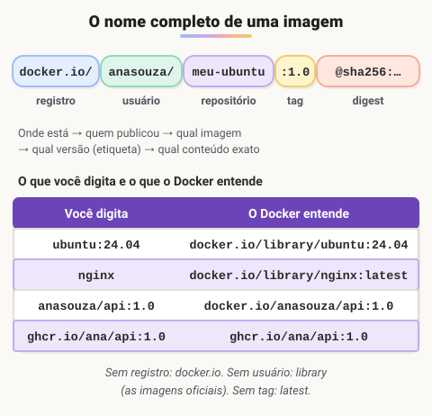
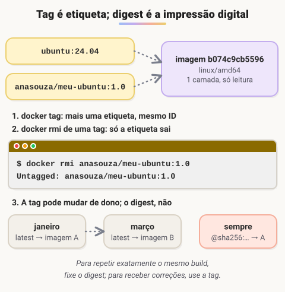

# 6. Imagens e o Docker Hub

> 🗺️ **Neste capítulo:** o que há dentro de uma imagem, como ler o nome completo dela (registro, usuário, repositório, tag e digest) e como baixar, listar, inspecionar, marcar, exportar e remover imagens pela linha de comando, sem apagar o que não devia.

## De onde paramos

Nos capítulos 4 e 5 você rodou contêineres a partir de imagens prontas, pela linha de comando e pela aba **Images** do Docker Desktop. Mas de onde vem uma imagem, o que ela guarda e por que a lista do `docker images` enche o disco tão depressa? Este capítulo responde, antes de você construir a sua no capítulo 7.

## O que é uma imagem

Um contêiner precisa de um sistema de arquivos para começar (programas, bibliotecas, configurações) e de instruções de como rodar. Se cada pessoa montasse isso à mão, nenhum contêiner seria igual ao outro. A imagem resolve isso: é o pacote fechado que todo mundo baixa igual.

**Uma imagem é um conjunto de camadas somente leitura (os arquivos) mais metadados (sistema, arquitetura, comando padrão, variáveis de ambiente), identificado por um hash.**

Duas consequências práticas:

- **Somente leitura.** O contêiner nunca altera a imagem. Ele ganha uma camada própria, gravável, por cima; ao removê-lo, essa camada vai embora e a imagem fica intacta (foi o que você viu no capítulo 4).
- **Camadas são compartilhadas.** Dez imagens feitas sobre a mesma base guardam a base uma vez só no disco. O capítulo 7 mostra como cada instrução do Dockerfile vira uma camada; aqui basta saber contá-las.

Os metadados se leem com `docker image inspect`. Com `--format` você escolhe só os campos que quer, no formato de modelo do Go (o mesmo `{{...}}` do capítulo 4):

```bash
# sistema/arquitetura e data de criação
docker image inspect --format \
  '{{.Os}}/{{.Architecture}} | {{.Created}}' ubuntu:24.04
# quantas camadas a imagem tem
docker image inspect --format \
  '{{len .RootFS.Layers}} camada(s)' ubuntu:24.04
```

Saída real, no Docker Engine 29.9.2 desta sessão:

```
linux/amd64 | 2026-11-15T21:24:07.343363616-03:00
1 camada(s)
```

A data é de quando a imagem local do livro foi criada nesta sessão; a `ubuntu:24.04` oficial mostra a data em que a Canonical a publicou. Outros campos úteis: `.Config.Cmd` (o comando padrão; aqui `["/bin/bash"]`), `.Config.Env`, `.RepoTags` e `.RepoDigests`. Para ver o JSON inteiro, rode o `inspect` sem `--format`.

> ⚠️ **Armadilha:** achar que dá para "consertar" uma imagem entrando num contêiner e instalando coisas. O que você instala fica na camada gravável **daquele contêiner**; a imagem continua igual, e o próximo `docker run` começa do zero. Para mudar uma imagem, construa outra (capítulo 7).

## O nome completo de uma imagem

Quando você escreve `ubuntu:24.04`, o Docker completa o resto do nome sozinho. Saber o nome inteiro evita baixar a imagem errada e é o que você vai usar para publicar a sua (capítulo 11).

**O nome completo de uma imagem tem a forma** `registro/usuário/repositório:tag@digest`**: onde ela está, quem a publicou, qual é, qual versão e qual conteúdo exato.**

| Parte | O que é | Se você omitir |
| --- | --- | --- |
| registro | servidor que guarda as imagens (`docker.io`, `ghcr.io`) | `docker.io` (o Docker Hub) |
| usuário | conta ou organização (namespace) | `library`, o das imagens oficiais |
| repositório | o nome da imagem | obrigatório |
| tag | etiqueta de versão ou variante | `latest` |
| digest | `sha256:...` do conteúdo exato | não usa (vale a tag) |

Exemplos lidos por inteiro:

| Você digita | O Docker entende |
| --- | --- |
| `ubuntu:24.04` | `docker.io/library/ubuntu:24.04` |
| `nginx` | `docker.io/library/nginx:latest` |
| `anasouza/api:1.0` | `docker.io/anasouza/api:1.0` |
| `ghcr.io/ana/api:1.0` | `ghcr.io/ana/api:1.0` (GitHub) |
| `localhost:5000/api:1.0` | registro na porta 5000 da sua máquina |
| `python:3.13-slim@sha256:...` | a tag é só informativa; vale o digest |



> 💡 **Analogia:** é como achar um produto num supermercado. O registro é a rede de supermercados (`docker.io`, `ghcr.io`); o usuário é a marca que fabrica (`anasouza`, ou a "marca da casa", `library`); o repositório é o produto (`meu-ubuntu`); a tag é a variação da embalagem ("500 g", "integral": `1.0`, `slim`); e o digest é o número do lote impresso na tampa, que aponta para uma fornada exata. Se você só pede "café", o atendente completa com a rede de sempre, a marca da casa e a embalagem padrão, que é o que o Docker faz com `docker.io`, `library` e `latest`.

> ⚠️ **Armadilha:** confundir o usuário com o repositório. `anasouza/nginx` **não** é a imagem oficial do nginx: é um repositório qualquer da conta `anasouza`, que pode conter qualquer coisa. Só o nome sem barra (`nginx`, ou seja, `library/nginx`) é o oficial.

## Tag x digest

A tag é cômoda de ler, mas pode mudar: quem publica pode apontar `1.0` ou `latest` para outra imagem amanhã. Para builds repetíveis você precisa de algo que não mude.

**Uma tag é uma etiqueta móvel que aponta para uma imagem; o digest é o hash SHA-256 do conteúdo, e por isso nunca muda: outro conteúdo daria outro digest.**

|  | Tag | Digest |
| --- | --- | --- |
| Exemplo | `ubuntu:24.04` | `ubuntu@sha256:b074...` |
| Pode mudar de imagem? | sim, quem publica decide | não, é calculado do conteúdo |
| Boa para | receber correções de segurança | reproduzir exatamente o mesmo build |
| Uso | `docker pull ubuntu:24.04` | `docker pull ubuntu@sha256:...` |

**O** `latest` **não é "a mais nova".** É só o nome da tag que o Docker usa quando você não escreve nenhuma. Ela aponta para onde o publicador mandou: em muitos repositórios é a versão estável atual, em outros está esquecida há anos, e no seu computador ela é a que você baixou da última vez, não a que existe hoje no registro. Por isso, em Dockerfiles e scripts, escreva sempre a tag (`python:3.13-slim`) e, quando precisar de repetição exata, o digest.

Para ver o digest das imagens locais:

```bash
docker images --digests ubuntu
```

```
REPOSITORY   TAG       DIGEST                                                                    IMAGE ID       CREATED          SIZE
ubuntu       24.04     sha256:b074c9cb5596a02b0aca282dec03aa1cfc2717ee8bd32bf0b963ba541edfca67   b074c9cb5596   56 minutes ago   15.9GB
```

Repare que o IMAGE ID é o começo do digest. No armazenamento de imagens do containerd (padrão em instalações novas do Docker Engine 29, veja adiante), o ID da imagem é o digest do índice dela. No armazenamento antigo, o ID era o hash da configuração e não batia com o digest do registro.



> 💡 **Analogia:** a tag é um crachá preso no jaleco; o digest é a impressão digital de quem o veste. Uma pessoa pode usar dois crachás ao mesmo tempo (`ubuntu:24.04` e `anasouza/meu-ubuntu:1.0`, mesmo ID). Tirar um crachá (`docker rmi` de uma tag) não manda a pessoa embora: só aparece `Untagged`. O crachá "plantonista" (`latest`) passa de mão em mão conforme a escala, e quem o usava em janeiro pode não ser quem o usa em março. Já a impressão digital não se transfere: `@sha256:...` sempre acha a mesma pessoa.

> ⚠️ **Armadilha:** fixar o digest e esquecer dele. A documentação do `docker pull` lembra que, com o digest, o Docker não baixa versões atualizadas, que podem trazer correções de segurança. Fixe o digest onde a repetição exata importa e atualize-o de propósito, com frequência.

## Imagens oficiais e verificadas: como escolher

O Docker Hub tem milhões de repositórios, e qualquer conta pode publicar. Escolher mal é baixar uma imagem abandonada, enorme ou até maliciosa. Segundo a documentação (página de conteúdo confiável, atualizada em 2026-09-09), o Hub marca com selo quatro categorias de conteúdo confiável:

| Categoria | O que é |
| --- | --- |
| **Docker Official Images** | bases curadas (Ubuntu, Python, Node, nginx...), revisadas e atualizadas, no namespace `library` |
| **Docker Hardened Images** | imagens reforçadas para segurança, mantidas pela Docker |
| **Verified Publisher** | imagens publicadas por empresas verificadas, com o nome delas |
| **Docker-Sponsored Open Source** | projetos de código aberto patrocinados pelo programa da Docker |

Na hora de escolher:

1. **Prefira as categorias com selo**, nessa ordem de confiança para começar: oficial ou de editor verificado.
2. **Leia a página da imagem**: ela lista as tags suportadas, as variantes (`slim`, `alpine`) e as variáveis de ambiente que a imagem espera.
3. **Confira a data da última atualização** na aba Tags: uma imagem sem atualização há anos não recebe correções.
4. **Escolha uma tag específica e uma variante enxuta**: `python:3.13-slim` em vez de `python` (que é `latest`, maior e mutável).
5. **Veja as arquiteturas** listadas na tag (`linux/amd64`, `linux/arm64`), assunto da seção multi-arquitetura.

O Hub também limita downloads. Na documentação conferida (página de 2025-03-27): sem login, 100 pulls a cada 6 horas por endereço IP; com conta gratuita (Personal), 200 a cada 6 horas. Fazer `docker login` (capítulo 11) já dobra a cota.

## Baixar, listar, marcar e remover

### docker pull

`docker pull nome:tag` baixa uma imagem do registro sem rodá-la. O `docker run` faz o pull sozinho quando a imagem não existe localmente; o `pull` explícito serve para baixar antes (ou atualizar a tag local para o que o registro tem agora). Ele baixa as camadas em paralelo (três por vez, por padrão) e pula as que você já tem.

```bash
# tag explícita: nunca dependa do latest
docker pull nginx:1.29
# por digest: sempre o mesmo conteúdo
docker pull ubuntu@sha256:<digest>
# outra arquitetura (ex.: testar a versão ARM)
docker pull --platform linux/arm64 ubuntu:24.04
```

O pull não roda na produção do livro (o Docker Hub está bloqueado; o erro real está no Laboratório). A documentação mostra uma saída típica, para você saber o que esperar: `latest: Pulling from library/debian`, uma linha `... Pull complete` por camada, depois `Digest: sha256:...`, `Status: Downloaded newer image for debian:latest` e, por fim, o nome completo `docker.io/library/debian:latest`.

### docker images (ou docker image ls)

Lista as imagens locais. `docker images`, `docker image ls` e `docker image list` são o mesmo comando.

```bash
docker images
```

```
IMAGE          ID             DISK USAGE   CONTENT SIZE   EXTRA
c07-api:1.0    c3d1088f89e9       15.9GB         5.56GB
ubuntu:24.04   b074c9cb5596       15.9GB         5.56GB
```

Se você aprendeu com tutoriais antigos, as colunas mudaram. Com o armazenamento do containerd, o Docker guarda as camadas comprimidas (como vieram do registro) e também extraídas. **CONTENT SIZE** é o tamanho comprimido; **DISK USAGE** soma as duas formas. A coluna **EXTRA** mostra marcas como `U` (em uso por um contêiner). Os 15.9GB são da imagem local deste livro, que não é a oficial (a oficial tem dezenas de MB). E a `c07-api` aparece porque o livro foi produzido em sequência; no seu computador, a lista é a das suas imagens.

Os filtros (`--filter`, ou `-f`) mais úteis:

| Filtro | Mostra |
| --- | --- |
| `reference='ubuntu:*'` | imagens cujo nome casa com o padrão |
| `dangling=true` | imagens sem nome (veja adiante) |
| `label=capitulo=c06` | imagens com esse rótulo |
| `before=c07-api:1.0` | criadas antes dessa (há também `since=`) |

E para escolher as colunas, `--format`:

```bash
docker images --filter reference='ubuntu:*'
docker images --format '{{.Repository}}:{{.Tag}}  {{.ID}}'
```

```
IMAGE          ID             DISK USAGE   CONTENT SIZE   EXTRA
ubuntu:24.04   b074c9cb5596       15.9GB         5.56GB
c07-api:1.0  c3d1088f89e9
ubuntu:24.04  b074c9cb5596
```

O `-q` mostra só os IDs, útil para passar a outro comando; `--no-trunc` mostra o ID inteiro.

### docker history

`docker history` lista os passos que criaram a imagem, do mais recente para o mais antigo, com o tamanho de cada um:

```bash
docker history ubuntu:24.04
```

```
IMAGE          CREATED          CREATED BY   SIZE      COMMENT
b074c9cb5596   54 minutes ago                10.3GB    Imported from -
```

Uma linha só, com o comentário `Imported from -`: a imagem local do livro foi criada com `docker import` a partir de um arquivo, sem Dockerfile, e por isso não tem histórico. Numa imagem construída com Dockerfile, cada instrução vira uma linha (o capítulo 7 mostra isso com a API do livro). Linhas com `<missing>` na coluna IMAGE são normais: são passos intermediários que não existem como imagens separadas no seu disco.

### docker tag

`docker tag origem destino` **cria um nome a mais para uma imagem que já existe; não copia nada.** É assim que você prepara uma imagem para publicar na sua conta (capítulo 11).

```bash
docker tag ubuntu:24.04 anasouza/meu-ubuntu:1.0
docker images --format '{{.Repository}}:{{.Tag}}  {{.ID}}'
```

```
c07-api:1.0  c3d1088f89e9
anasouza/meu-ubuntu:1.0  b074c9cb5596
ubuntu:24.04  b074c9cb5596
```

Mesmo ID nas duas linhas: uma imagem, dois nomes. O espaço em disco não dobrou.

### docker rmi (ou docker image rm)

Remove imagens pelo nome ou pelo ID. Quando a imagem tem vários nomes, `rmi` de um nome só tira a etiqueta:

```bash
docker rmi anasouza/meu-ubuntu:1.0
```

```
Untagged: anasouza/meu-ubuntu:1.0
```

`Untagged` e nenhum `Deleted`: a `ubuntu:24.04` continua lá. Quando sai o último nome e nenhum contêiner usa a imagem, aparecem também as linhas `Deleted: sha256:...`, e o espaço é liberado.

> ⚠️ **Armadilha:** tentar remover uma imagem que algum contêiner (mesmo parado) usa. O Docker recusa com `conflict: unable to delete ... (must be forced) - container ... is using its referenced image`. A saída certa é remover o contêiner antes (`docker rm`). O `docker rmi -f` parece resolver, mas só tira o nome: a imagem continua no disco, sem nome, presa ao contêiner. É assim que nasce uma imagem dangling.

## Imagens dangling e a limpeza

**Uma imagem dangling ("pendurada") é uma imagem que perdeu todos os nomes: aparece como** `<untagged>` **na lista e não serve para nada além de ocupar espaço, a menos que um contêiner ainda dependa dela.**

```bash
docker images --filter dangling=true
```

```
IMAGE        ID             DISK USAGE   CONTENT SIZE   EXTRA
<untagged>   281d90515275       11.2kB            3kB   U
```

O `U` diz que um contêiner ainda a usa. Para limpar:

| Comando | Apaga |
| --- | --- |
| `docker image prune` | só as dangling que nenhum contêiner usa |
| `docker image prune -a` | **toda** imagem que nenhum contêiner usa, com ou sem nome |
| `docker image prune -a --filter label=capitulo=c06` | só as não usadas com esse rótulo |
| `docker image prune -a --filter until=240h` | só as não usadas criadas há mais de 10 dias |

Os comandos pedem confirmação; `-f` pula a pergunta. Filtros com chaves diferentes se combinam com "e"; com a mesma chave, com "ou".

> ⚠️ **Correção do que se costuma ensinar:** muitos tutoriais dizem que reconstruir uma imagem com a mesma tag deixa a anterior como `<none>:<none>`. No Docker Engine 29.9.2 com o armazenamento do containerd, isso não aconteceu na produção do livro: reconstruímos `c06-mini:1.0` três vezes, e a versão anterior não apareceu na lista nem com `-a`. A dangling só surgiu quando um contêiner prendia a imagem e a tag foi tirada à força, e o nome mostrado é `<untagged>`. No armazenamento antigo (instalações atualizadas de versões anteriores), o comportamento clássico continua.

> ⚠️ **Armadilha:** rodar `docker image prune -a` (ou `docker system prune -a`) "para limpar" e perder as imagens base que você usa todo dia. Elas não estão em uso se nenhum contêiner existe naquele momento, então vão embora, e o próximo build baixa tudo de novo (gastando a cota do Hub). Prefira o `prune` sem `-a` ou com filtro de rótulo ou de idade.

## Multi-arquitetura, em resumo

Um Mac com chip Apple e um Raspberry Pi usam processadores ARM (`arm64`); a maioria dos PCs e servidores usa `amd64`. Um binário de uma arquitetura não roda direto na outra. **Uma imagem multi-arquitetura (multi-platform) é um índice que aponta para uma variante por plataforma, todas sob o mesmo nome e tag; no pull, o Docker escolhe sozinho a que combina com a máquina.** As imagens oficiais costumam ter as duas.

- Para ver a arquitetura de uma imagem local: `docker image inspect --format '{{.Architecture}}'`. A `ubuntu:24.04` local é `amd64`.
- `docker image ls --tree` (experimental no Engine 29.9) mostra as plataformas de cada imagem; aqui, `└─ linux/amd64` sob cada nome.
- `--platform linux/arm64` no `pull` ou no `run` força outra arquitetura. O Docker Desktop vem com emulação (QEMU) para rodá-la, mas a documentação avisa que a emulação pode ser bem mais lenta que o nativo.

> ⚠️ **Armadilha:** construir uma imagem num Mac com chip Apple e rodá-la num servidor `amd64`. A imagem sai `arm64`, e o servidor responde com `exec format error` ou um aviso de plataforma diferente. Gerar imagens para várias arquiteturas (buildx) fica para um próximo livro da trilha.

## Levar uma imagem sem registro: docker save e docker load

Às vezes não há registro à mão: uma máquina sem internet, um laboratório isolado, um colega ao lado. `docker save` **grava uma ou mais imagens, com todas as camadas, tags e metadados, num arquivo .tar;** `docker load` **lê esse arquivo e recria as imagens em outro motor.**

```bash
# grava a imagem num arquivo
docker save -o c06-mini.tar c06-mini:1.0
# em outra máquina (ou depois de apagar), recria
docker load -i c06-mini.tar
```

O arquivo segue o formato de layout de imagens OCI (`index.json`, `oci-layout`, pasta `blobs/sha256/`) e, por isso, o ID da imagem carregada é o mesmo da original. Para imagens grandes, comprima no caminho: `docker save c06-mini:1.0 | gzip > c06-mini.tar.gz` (o `load` aceita o .gz direto).

> ⚠️ **Armadilha:** confundir `save`/`load` com `export`/`import`. `docker export` grava o sistema de arquivos de um **contêiner**, achatado numa camada só, sem histórico, sem `CMD` nem variáveis; `docker import` transforma isso numa imagem nova. Foi assim que a `ubuntu:24.04` local deste livro nasceu, e é por isso que ela tem uma camada só e o histórico `Imported from -`. Para levar uma imagem inteira, use `save`/`load`.

## 🧪 Laboratório

> ⚠️ **O que não foi executado na produção do livro:** o pull de imagens do Docker Hub (a rede da sessão bloqueia o registro; o erro real está no passo 1) e qualquer passo no Docker Desktop. Tudo o mais rodou de verdade no Docker Engine 29.9.2 (Linux, armazenamento do containerd) com uma `ubuntu:24.04` **local**, que não é a oficial: foi criada com `docker import` a partir do sistema da sessão, tem Python 3.13, uma camada só e cerca de 16 GB. Com a `ubuntu:24.04` oficial (baixe com `docker pull ubuntu:24.04`), mudam o ID, as datas, os tamanhos (dezenas de MB) e o `history`, que mostrará os passos da Canonical. Os IDs de `c06-mini` também mudam a cada build, porque incluem a data de criação.

Objetivo: inspecionar, marcar, exportar e limpar imagens, terminando sem deixar lixo e sem tocar em imagens que você queira manter.

**1. Tente um pull.** No seu computador, este comando baixa o nginx. Na sessão do livro, o registro está bloqueado:

```bash
docker pull nginx:1.29
```

```
Error response from daemon: failed to resolve reference "docker.io/library/nginx:1.29": failed to do request: Head "https://registry-1.docker.io/v2/library/nginx/manifests/1.29": Forbidden
```

Leia o erro de trás para a frente: o motor tentou consultar o manifesto em `registry-1.docker.io` e recebeu `Forbidden` (HTTP 403) de um proxy no caminho. Repare que o nome curto `nginx:1.29` virou `docker.io/library/nginx:1.29`, como na tabela do nome completo. Se você vir esse erro em casa ou no trabalho, suspeite de proxy ou firewall da rede; se vir `toomanyrequests`, é o limite de pulls do Hub (faça `docker login`).

**2. Liste e filtre.**

```bash
docker images
docker images --filter reference='ubuntu:*'
```

Saídas reais na seção "docker images". A sua lista terá as imagens que você baixou nos capítulos anteriores.

**3. Inspecione.**

```bash
# três perguntas à mesma imagem, um campo por vez
docker image inspect --format \
  '{{.Os}}/{{.Architecture}} | {{.Created}}' ubuntu:24.04
docker image inspect --format \
  '{{len .RootFS.Layers}} camada(s)' ubuntu:24.04
docker image inspect --format \
  '{{json .RootFS.Layers}}' ubuntu:24.04
```

```
linux/amd64 | 2026-11-15T21:24:07.343363616-03:00
1 camada(s)
["sha256:a065a65738fef4266906eb245e6774b209c97bc88f2a01e794203dae3f4836af"]
```

`RootFS.Layers` é a lista dos hashes das camadas, da base para o topo. Com a imagem oficial você verá a sua própria lista (e o número de camadas que a Canonical publicou).

**4. Veja o histórico.**

```bash
docker history ubuntu:24.04
```

```
IMAGE          CREATED          CREATED BY   SIZE      COMMENT
b074c9cb5596   54 minutes ago                10.3GB    Imported from -
```

**5. Dê um nome seu à imagem e tire-o.**

```bash
# mesmo ID, dois nomes
docker tag ubuntu:24.04 anasouza/meu-ubuntu:1.0
docker images --filter reference='*/meu-ubuntu'
# tira só a etiqueta; a ubuntu continua
docker rmi anasouza/meu-ubuntu:1.0
docker images ubuntu
```

```
IMAGE                     ID             DISK USAGE   CONTENT SIZE   EXTRA
anasouza/meu-ubuntu:1.0   b074c9cb5596       15.9GB         5.56GB
Untagged: anasouza/meu-ubuntu:1.0
IMAGE          ID             DISK USAGE   CONTENT SIZE   EXTRA
ubuntu:24.04   b074c9cb5596       15.9GB         5.56GB
```

**6. Crie uma imagem mínima para treinar.** Uma imagem `FROM scratch` parte do nada: sem sistema, sem shell. Serve aqui porque é minúscula (save e load em segundos). O Dockerfile será explicado no capítulo 7; por ora, copie:

```bash
mkdir -p ~/c06-mini && cd ~/c06-mini
echo 'Olá do capítulo 6' > ola.txt
# LABEL: o rótulo permite limpar só o que é
# deste capítulo, no passo 9
cat > Dockerfile <<'EOF'
FROM scratch
LABEL capitulo=c06
COPY ola.txt /
EOF
docker build -q -t c06-mini:1.0 .
docker images c06-mini
docker history c06-mini:1.0
```

```
sha256:281d90515275dd62582208eb24f4f237f19c90f9dc2b2a9fa1b561335577a21a
IMAGE          ID             DISK USAGE   CONTENT SIZE   EXTRA
c06-mini:1.0   281d90515275       11.2kB            3kB
IMAGE          CREATED                  CREATED BY                  SIZE      COMMENT
281d90515275   Less than a second ago   COPY ola.txt / # buildkit   8.19kB    buildkit.dockerfile.v0
<missing>      Less than a second ago   LABEL capitulo=c06          0B        buildkit.dockerfile.v0
```

Repare no `<missing>`: o passo do `LABEL` não existe como imagem separada.

**7. Exporte, apague e recarregue.**

```bash
docker save -o c06-mini.tar c06-mini:1.0
ls -lh c06-mini.tar
# apaga: era o único nome, então sai de vez
docker rmi c06-mini:1.0
docker load -i c06-mini.tar
docker images c06-mini
```

```
-rw------- 1 root root 14K Nov 15 22:20 c06-mini.tar
Untagged: c06-mini:1.0
Deleted: sha256:281d90515275dd62582208eb24f4f237f19c90f9dc2b2a9fa1b561335577a21a
Loaded image: c06-mini:1.0
IMAGE          ID             DISK USAGE   CONTENT SIZE   EXTRA
c06-mini:1.0   281d90515275       11.2kB            3kB
```

Mesmo ID antes e depois: o conteúdo voltou idêntico. Como a imagem não tem shell, não dá para rodar um `cat` dentro dela; mas dá para criar um contêiner (sem iniciá-lo) e copiar o arquivo para fora:

```bash
# create não executa nada; /x é um comando de enfeite
docker create --name c06-caixa c06-mini:1.0 /x
# cp com - devolve um tar; o tar -xO mostra o arquivo
docker cp c06-caixa:/ola.txt - | tar -xO
```

```
17d3896664cf3f95f70b2e076bab9cb73b9429e893f02d7ccafc883da9ae6e1c
Olá do capítulo 6
```

**8. Fabrique (e limpe) uma imagem dangling.** O contêiner `c06-caixa` ainda usa a imagem:

```bash
docker rmi c06-mini:1.0
# -f tira o nome, mas a imagem fica presa
docker rmi -f c06-mini:1.0
docker images --filter dangling=true
# não apaga: o contêiner ainda a usa
docker image prune -f
docker rm c06-caixa
# agora sim
docker image prune -f
```

```
Error response from daemon: conflict: unable to delete c06-mini:1.0 (must be forced) - container 17d3896664cf is using its referenced image 281d90515275
Untagged: c06-mini:1.0
IMAGE        ID             DISK USAGE   CONTENT SIZE   EXTRA
<untagged>   281d90515275       11.2kB            3kB   U
Total reclaimed space: 0B
c06-caixa
Deleted Images:
untagged: sha256:281d90515275dd62582208eb24f4f237f19c90f9dc2b2a9fa1b561335577a21a
deleted: sha256:281d90515275dd62582208eb24f4f237f19c90f9dc2b2a9fa1b561335577a21a
deleted: sha256:7d0d2e340e1886f10e8ed4a21d084546514995535ef6d1ab64c771bf53569f55
deleted: sha256:659957bf4267e520aaf0694041acfc4b9b193d884c3a72407f06420ffbb4c44f

Total reclaimed space: 11.92kB
```

**9. Prune com rótulo.** Recarregue a imagem, dê a ela um segundo nome e apague só o que tem o rótulo deste capítulo:

```bash
docker load -i c06-mini.tar
docker tag c06-mini:1.0 c06-mini:copia
# -a apaga mesmo com nome; o filtro protege o resto
docker image prune -a -f --filter label=capitulo=c06
docker images
```

```
Loaded image: c06-mini:1.0
Deleted Images:
untagged: c06-mini:1.0
untagged: c06-mini:copia
deleted: sha256:281d90515275dd62582208eb24f4f237f19c90f9dc2b2a9fa1b561335577a21a
deleted: sha256:7d0d2e340e1886f10e8ed4a21d084546514995535ef6d1ab64c771bf53569f55
deleted: sha256:659957bf4267e520aaf0694041acfc4b9b193d884c3a72407f06420ffbb4c44f

Total reclaimed space: 11.92kB
IMAGE          ID             DISK USAGE   CONTENT SIZE   EXTRA
c07-api:1.0    c3d1088f89e9       15.9GB         5.56GB
ubuntu:24.04   b074c9cb5596       15.9GB         5.56GB
```

As duas tags e a imagem saíram; a `ubuntu` e as outras imagens ficaram. Apague o arquivo `c06-mini.tar` se não for usá-lo nos exercícios. No Docker Desktop, a aba **Images** mostra a mesma lista, e as imagens `<untagged>` aparecem com o filtro de dangling (capítulo 5).

## 🏋️ Pratique

**1. Dois nomes, uma imagem.** Dê à `ubuntu:24.04` os nomes `anasouza/base:24.04` e `anasouza/base:latest`. Prove, com um único comando de listagem, que são a mesma imagem, e depois remova os dois nomes sem apagar a `ubuntu:24.04`.

<details>
<summary>Ver resposta</summary>

```bash
docker tag ubuntu:24.04 anasouza/base:24.04
docker tag ubuntu:24.04 anasouza/base:latest
# o filtro pega todos os repositórios da conta
docker images --filter reference='anasouza/*' \
  --format '{{.Repository}}:{{.Tag}}  {{.ID}}'
# rmi aceita vários nomes de uma vez
docker rmi anasouza/base:24.04 anasouza/base:latest
```

```
anasouza/base:24.04  b074c9cb5596
anasouza/base:latest  b074c9cb5596
Untagged: anasouza/base:24.04
Untagged: anasouza/base:latest
```

Mesmo ID, e só `Untagged`: a `ubuntu:24.04` ainda tem o nome dela, por isso nada foi apagado. Repare também que `latest` aqui é só mais um nome que você escolheu; ele não diz nada sobre ser a versão mais nova.

</details>

**2. Leia o nome.** Para cada nome, diga registro, usuário, repositório e tag que o Docker vai usar: (a) `postgres`; (b) `anasouza/api`; (c) `ghcr.io/anasouza/api:2.1`; (d) `python:3.13-slim@sha256:abc...` (digest abreviado aqui).

<details>
<summary>Ver resposta</summary>

| Nome | Registro / usuário | Repositório:tag |
| --- | --- | --- |
| (a) `postgres` | `docker.io` / `library` | `postgres:latest` |
| (b) `anasouza/api` | `docker.io` / `anasouza` | `api:latest` |
| (c) `ghcr.io/anasouza/api:2.1` | `ghcr.io` / `anasouza` | `api:2.1` |
| (d) `python:3.13-slim@sha256:...` | `docker.io` / `library` | `python`, fixado pelo digest |

Em (d), quando há digest, é ele que decide o conteúdo; a tag `3.13-slim` fica só para quem lê. Em (a) e (b), escreva a tag no seu Dockerfile: o `latest` implícito pode mudar sem aviso.

</details>

**3. Por dentro do .tar.** Construa de novo a `c06-mini:1.0` do laboratório e, sem carregá-la em lugar nenhum, descubra quais arquivos o `docker save` gera e em que formato o `index.json` está. No fim, limpe só as imagens do capítulo.

<details>
<summary>Ver resposta</summary>

```bash
cd ~/c06-mini
docker build -q -t c06-mini:1.0 .
# o save pode escrever na saída padrão (sem -o)
docker save c06-mini:1.0 | tar -tf - \
  | grep -v blobs/sha256/
docker save c06-mini:1.0 | tar -xOf - index.json \
  | python3 -m json.tool
docker image prune -a -f \
  --filter label=capitulo=c06
```

Saída real (o digest muda a cada build):

```
blobs/
index.json
manifest.json
oci-layout
{
  "schemaVersion": 2,
  "mediaType": "application/vnd.oci.image.index.v1+json",
  "manifests": [
    {
      "mediaType": "application/vnd.oci.image.index.v1+json",
      "digest": "sha256:fa2a2729a64e6bf3c4921b6e32cffbe5acec39e2bf445ed13011fe1c6e466838",
      "size": 855,
      "annotations": {
        "io.containerd.image.name": "docker.io/library/c06-mini:1.0",
        "org.opencontainers.image.ref.name": "1.0"
      }
    }
  ]
}
```

O arquivo é um layout OCI: um índice (`index.json`) que aponta, por digest, para manifestos e camadas guardados em `blobs/sha256/`, cada um com o nome igual ao próprio hash. O `manifest.json` é o formato antigo do Docker, mantido para compatibilidade. Repare no nome completo gravado: `docker.io/library/c06-mini:1.0`.

</details>

## 🧠 Revisão rápida

**O que o Docker entende quando você escreve `nginx`?**

`docker.io/library/nginx:latest`: Docker Hub, namespace das imagens oficiais e a tag padrão `latest`.

**`docker rmi minha:tag` mostrou só `Untagged`. A imagem foi apagada?**

Não. Saiu só aquele nome; a imagem tinha outro nome (ou um contêiner ainda a usa). Ela só é apagada quando aparecem as linhas `Deleted`.

**Qual a diferença entre `docker image prune` e `docker image prune -a`?**

Sem `-a`, apaga só as imagens dangling (sem nome) que nenhum contêiner usa. Com `-a`, apaga toda imagem sem contêiner, inclusive as bases com nome que você usa sempre; use com filtro.

> ➡️ **Próximo passo:** até aqui todas as imagens foram feitas por outra pessoa (ou importadas). No capítulo 7, **Seu primeiro Dockerfile**, você escreve as instruções de uma imagem sua, para a API de tarefas do livro, e vê no `docker history` cada instrução virar uma camada.

## 📚 Fontes

Conferido em 2026-11-15. Comandos executados no Docker Engine 29.9.2 (versão de referência do livro: Docker Desktop 4.96 e Docker Engine 29.9).

- [docker image tag (formato do nome)](https://docs.docker.com/reference/cli/docker/image/tag/)
- [docker image pull (digest, --platform)](https://docs.docker.com/reference/cli/docker/image/pull/)
- [docker image prune](https://docs.docker.com/reference/cli/docker/image/prune/)
- [Trusted content no Docker Hub](https://docs.docker.com/docker-hub/image-library/trusted-content/)
- [Limites de uso do Docker Hub](https://docs.docker.com/docker-hub/usage/)
- [containerd image store](https://docs.docker.com/engine/storage/containerd/) e [multi-platform](https://docs.docker.com/build/building/multi-platform/)

## 📌 Resumo

| Item | Em uma frase |
| --- | --- |
| Imagem | Camadas somente leitura mais metadados, identificadas por um hash |
| Nome completo | `registro/usuário/repositório:tag@digest`; o padrão é `docker.io`, `library` e `latest` |
| Tag x digest | A tag é uma etiqueta que pode mudar; o digest é o hash do conteúdo e não muda |
| `latest` | Só a tag padrão, não "a mais nova" |
| Imagens confiáveis | Prefira as oficiais e as de editor verificado, com tag específica e variante enxuta |
| `docker pull` | Baixa uma imagem (por tag, digest ou plataforma) sem rodá-la |
| `docker images` | Lista as imagens; filtre com `--filter` e escolha colunas com `--format` |
| `inspect` e `history` | Mostram os metadados (Os, Architecture, RootFS.Layers) e os passos de criação |
| `docker tag` e `rmi` | Criam e tiram nomes; a imagem só é apagada quando sai o último nome |
| Dangling e `prune` | Imagens sem nome; `prune` as limpa, e `-a` apaga também as não usadas com nome |
| Multi-arquitetura | Um nome, uma variante por plataforma; o Docker escolhe a da máquina |
| `save` e `load` | Levam imagens inteiras num .tar, sem precisar de registro |
