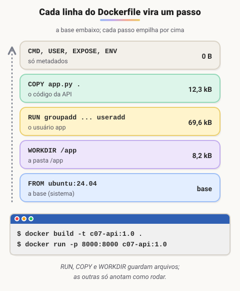
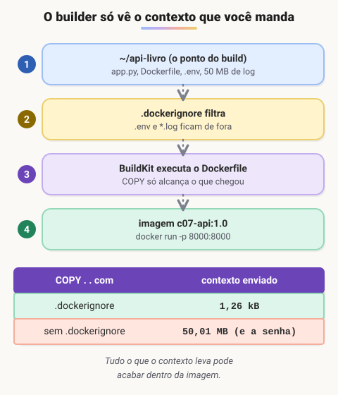

# 7. Seu primeiro Dockerfile

> 🗺️ **Neste capítulo:** você escreve o Dockerfile da API de tarefas que acompanha o resto do livro, constrói a imagem com `docker build` e a coloca para responder no seu navegador. No caminho: as instruções essenciais, o contexto de build, o `.dockerignore` e duas boas práticas que evitam dor de cabeça.

## De onde paramos

No capítulo 6 você baixou, inspecionou, marcou e removeu imagens prontas, e viu que uma imagem é feita de camadas. Toda imagem que você usou até aqui foi feita por outra pessoa. Agora é a sua vez: vamos empacotar uma aplicação nossa numa imagem, do jeito que qualquer colega consiga rodar com um único comando.

## A API do livro

Para ter algo real para empacotar, o livro usa uma API pequena de tarefas, escrita em Python **só com a biblioteca padrão** (`http.server` e `json`): nada de pip, nada de framework. Ela responde em três rotas, na porta 8000:

| Rota | Método | Responde |
| --- | --- | --- |
| `/saude` | GET | `{"status": "ok", "versao": ...}` |
| `/tarefas` | GET | a lista de tarefas, em JSON |
| `/tarefas` | POST | cria uma tarefa a partir de `{"titulo": ...}` |

A lista fica em memória: quando o contêiner é removido, ela some. Isso é proposital, porque o capítulo 9 (volumes) e o capítulo 12 (projeto final, com banco) partem exatamente desse problema. Os capítulos 8, 9, 10 e 12 reaproveitam estes três arquivos, numa pasta `~/api-livro`:

- `app.py`: o código da API;
- `Dockerfile`: as instruções para montar a imagem;
- `.dockerignore`: o que **não** deve ir para o build.

**`app.py` completo (crie em `~/api-livro/app.py`)**

```python
# API de tarefas do livro "Docker do zero".
# Só biblioteca padrão: a imagem não precisa de pip.
import json
import os
from http.server import BaseHTTPRequestHandler
from http.server import ThreadingHTTPServer

# a porta vem do ambiente para o Dockerfile (ENV)
# ou o docker run (-e) poderem trocá-la
PORTA = int(os.environ.get("PORTA", "8000"))
VERSAO = os.environ.get("APP_VERSAO", "dev")

# lista em memória: some quando o contêiner
# for removido (os volumes do cap. 9 resolvem)
TAREFAS = [{"id": 1, "titulo": "Estudar Docker"}]

class Api(BaseHTTPRequestHandler):
    def responder(self, codigo, dados):
        corpo = json.dumps(dados, ensure_ascii=False)
        corpo = corpo.encode("utf-8")
        self.send_response(codigo)
        self.send_header("Content-Type",
                         "application/json; charset=utf-8")
        self.send_header("Content-Length", str(len(corpo)))
        self.end_headers()
        self.wfile.write(corpo)

    def do_GET(self):
        if self.path == "/saude":
            self.responder(200, {"status": "ok",
                                "versao": VERSAO})
        elif self.path == "/tarefas":
            self.responder(200, TAREFAS)
        else:
            self.responder(404, {"erro": "rota não existe"})

    def do_POST(self):
        if self.path != "/tarefas":
            self.responder(404, {"erro": "rota não existe"})
            return
        tamanho = int(self.headers.get("Content-Length", 0))
        try:
            dados = json.loads(self.rfile.read(tamanho))
            titulo = str(dados["titulo"])
        except (ValueError, KeyError, TypeError):
            self.responder(400, {"erro": "falta o titulo"})
            return
        nova = {"id": len(TAREFAS) + 1, "titulo": titulo}
        TAREFAS.append(nova)
        self.responder(201, nova)

if __name__ == "__main__":
    # 0.0.0.0, e não 127.0.0.1: dentro do contêiner,
    # 127.0.0.1 só aceita conexões do próprio contêiner
    # e o -p do docker run não conseguiria chegar aqui
    servidor = ThreadingHTTPServer(("0.0.0.0", PORTA), Api)
    print(f"API ouvindo na porta {PORTA}")
    servidor.serve_forever()
```

Você não precisa entender cada linha do Python. O que importa para o Docker são três detalhes: a porta vem da variável de ambiente `PORTA`, a versão vem de `APP_VERSAO`, e o servidor escuta em `0.0.0.0`. Os três voltam mais adiante.

## O que é um Dockerfile

Sem Dockerfile, montar a imagem seria um ritual manual: subir um contêiner, instalar coisas, copiar arquivos e torcer para lembrar de tudo na próxima vez. Ninguém consegue revisar nem repetir esse processo.

**Um Dockerfile é um arquivo de texto com as instruções, em ordem, para construir uma imagem; o** `<b>docker build</b>` **lê esse arquivo e executa cada instrução.**

Cada linha começa com uma instrução em maiúsculas (`FROM`, `COPY`, `RUN`...) seguida dos argumentos. Linhas que começam com `#` são comentários. Como é texto, o Dockerfile entra no Git junto com o código, e qualquer mudança aparece no histórico.

Este é o Dockerfile da API, salvo em `~/api-livro/Dockerfile`:

```docker
# Imagem da API de tarefas do livro "Docker do zero".
# Na vida real, parta de uma imagem oficial menor,
# que já traz o Python:
# FROM python:3.13-slim
FROM ubuntu:24.04

# ARG só existe durante o build: troque com
# docker build --build-arg VERSAO=1.1.0
ARG VERSAO=1.0.0

# ENV fica gravado na imagem e vale no contêiner;
# PYTHONUNBUFFERED faz o print aparecer no docker logs
ENV PORTA=8000 \
    PYTHONUNBUFFERED=1 \
    APP_VERSAO=${VERSAO}

# pasta de trabalho: criada se não existir, e é
# a base dos caminhos relativos de COPY e CMD
WORKDIR /app

# usuário sem privilégios, com UID fixo, para a
# API não rodar como root dentro do contêiner
RUN groupadd --gid 10001 app \
 && useradd --uid 10001 --gid app --no-create-home app

# só o código: a imagem leva o mínimo
COPY app.py .

# documenta a porta; quem publica é o docker run -p
EXPOSE 8000

# daqui em diante (e ao rodar) o usuário é app
USER app

# forma exec (lista JSON): o Python vira o PID 1
# e recebe o sinal do docker stop
CMD ["python3", "app.py"]
```

> ⚠️ **Por que** `<b>FROM ubuntu:24.04</b>` **aqui:** na produção do livro, o Docker Hub estava bloqueado, e a única imagem disponível era uma `ubuntu:24.04` local que já tinha Python 3.13. A `ubuntu:24.04` **oficial não traz Python**: com ela, este Dockerfile falharia no `CMD`. No seu computador, troque a linha por `FROM python:3.13-slim` (está comentada logo acima). É uma imagem oficial com Python pronto e cerca de 41 MB comprimida (linux/amd64, conferido em 2026-11-15 no Docker Hub). O resto do arquivo funciona igual nas duas.

## As instruções essenciais

Cada instrução responde a uma pergunta sobre a imagem:

| Instrução | Pergunta que responde | Na API |
| --- | --- | --- |
| `FROM` | de qual imagem eu parto? | `python:3.13-slim` (ou a ubuntu local) |
| `WORKDIR` | em que pasta eu trabalho? | `/app`, criada se não existir |
| `COPY` | que arquivos meus entram? | `app.py` |
| `RUN` | que comando roda durante o build? | cria o usuário `app` |
| `ENV` | que variáveis o contêiner terá? | `PORTA`, `APP_VERSAO` |
| `EXPOSE` | em que porta a aplicação escuta? | 8000 (só documenta) |
| `CMD` | o que roda quando o contêiner sobe? | `python3 app.py` |

O ponto que mais confunde é a diferença entre `RUN` e `CMD`. `RUN` executa **uma vez, durante o build**, e o resultado (arquivos criados, pacotes instalados) fica gravado na imagem. `CMD` não executa nada no build: ele só anota o comando padrão que vai rodar **cada vez que um contêiner nascer** dessa imagem. Se houver vários `CMD`, vale o último.

Prefira a forma exec do `CMD`, com colchetes e aspas duplas: `CMD ["python3", "app.py"]`. Na forma shell (`CMD python3 app.py`), o Docker embrulha o comando num `/bin/sh -c`; o shell vira o processo principal e pode não repassar ao Python o sinal de parada do `docker stop`.

Depois do build, o `docker history` (que você conheceu no capítulo 6) mostra cada instrução como um passo da imagem, com o tamanho que ela acrescentou:

```bash
docker history --format \
  '{{.CreatedBy}} | {{.Size}}' c07-api:1.0
```

```
CMD ["python3" "app.py"] | 0B
USER app | 0B
EXPOSE [8000/tcp] | 0B
COPY app.py . # buildkit | 12.3kB
RUN |1 VERSAO=1.0.0 /bin/sh -c groupadd --gi… | 69.6kB
WORKDIR /app | 8.19kB
ENV PORTA=8000 PYTHONUNBUFFERED=1 APP_VERSAO… | 0B
ARG VERSAO=1.0.0 | 0B
 | 10.3GB
```

A última linha é a imagem base. Os 10.3GB são da `ubuntu:24.04` local usada na produção do livro; com `python:3.13-slim` você verá um número bem menor, em várias linhas (uma por camada da imagem oficial).



> 💡 **Analogia:** pense numa apresentação com transparências de retroprojetor. O `FROM` é a folha de fundo que você compra já impressa. `WORKDIR`, `RUN` e `COPY` são transparências que você desenha e empilha por cima, cada uma com o seu traço (e o seu peso na pasta). `CMD`, `USER`, `EXPOSE` e `ENV` não são folhas: são o post-it colado na capa da pasta dizendo "projete assim, comece por aqui". Não pesam nada, mas sem eles ninguém sabe como apresentar.

> ⚠️ **Armadilha comum:** achar que `EXPOSE 8000` abre a porta. Ele só **documenta** em que porta a aplicação escuta. Quem publica a porta no seu computador é o `docker run -p 8000:8000` (capítulo 4). Sem o `-p`, o contêiner roda, mas o `curl` no seu computador não chega até ele.

## ENTRYPOINT x CMD

Existe uma segunda instrução para dizer o que roda ao subir o contêiner: `ENTRYPOINT`. As duas convivem, com papéis diferentes:

|  | CMD | ENTRYPOINT |
| --- | --- | --- |
| Papel | comando padrão | executável fixo da imagem |
| Argumentos no `docker run` | **substituem** o CMD | são **acrescentados** ao final |
| Como trocar | qualquer argumento no `docker run` | só com `--entrypoint` |
| Uso típico | aplicações como a API | imagens que são "um comando" |

Juntas, em forma exec, o `ENTRYPOINT` dá o programa e o `CMD` dá os argumentos padrão. Um teste rápido, com um Dockerfile de três linhas:

```docker
FROM ubuntu:24.04
# o programa é sempre o echo...
ENTRYPOINT ["echo", "Olá,"]
# ...e "mundo" é só o argumento padrão
CMD ["mundo"]
```

```bash
# ENTRYPOINT fixo; o CMD é só o argumento padrão
docker build -q -t c07-eco .
docker run --rm c07-eco
docker run --rm c07-eco Ana Souza
docker run --rm --entrypoint date c07-eco +%Y
```

```
sha256:ec9f85b9d5b1846392fbb168990a0bb97fe8a61c09cf04c9fb77d195902fffe6
Olá, mundo
Olá, Ana Souza
2026
```

O `-q` deixa o build silencioso e mostra só o id da imagem. Repare que `Ana Souza` substituiu o `mundo`, mas o `echo Olá,` continuou. A API usa só `CMD`, e por isso `docker run --rm c07-api:1.0 python3 --version` troca o comando inteiro e responde `Python 3.13.17`, útil para investigar a imagem sem subir a API.

## O contexto de build e o .dockerignore

O comando que constrói a imagem é:

```bash
# -t dá nome:tag à imagem; o ponto final é o contexto
docker build -t c07-api:1.0 .
```

Aquele ponto no fim não é enfeite. **O contexto de build é o conjunto de arquivos que o** `<b>docker build</b>` **entrega ao construtor (o BuildKit); o ponto quer dizer "a pasta atual".** O `COPY` só enxerga o que está no contexto: um `COPY ../segredo.txt .` falha, porque o arquivo está fora da pasta entregue.

O problema aparece quando a pasta tem coisas que não deveriam ir para a imagem: o `.git`, logs enormes, um `.env` com senha. É para isso que serve o `.dockerignore`: **um arquivo na raiz do contexto com padrões (um por linha, como** `<b>*.log</b>`**) do que fica de fora do build.** O da API, em `~/api-livro/.dockerignore`:

```
# O que não vai para o contexto de build:
# nada disso deve entrar na imagem
.git
__pycache__/
*.pyc
.env
.venv/
*.log
```

Linhas com `#` no começo são comentários, e um `!` na frente de um padrão cria uma exceção (`!importante.log` volta a incluir esse arquivo).

Na produção do livro, a pasta ganhou um `depuracao.log` de 50 MB e um `.env` com `SENHA_DO_BANCO=segredo123`, e o Dockerfile usou `COPY . .` (copiar a pasta toda, um padrão muito comum). O resultado real:

| Situação | Contexto enviado | Entrou na imagem |
| --- | --- | --- |
| com `.dockerignore` | 1.26kB | `.dockerignore`, `Dockerfile`, `app.py` |
| sem `.dockerignore` | 50.01MB | tudo, inclusive o `.env` com a senha |



> 💡 **Analogia:** é como entregar a pasta de documentos ao contador na época do imposto de renda. O contador (o BuildKit) só pode usar o que está na pasta que você entregou (o contexto); não adianta pedir para ele "pegar aquele recibo lá na sua gaveta" (um `COPY` de fora do contexto). O `.dockerignore` é a lista que você confere antes de fechar o envelope: "extrato velho e senha do banco não vão". O que você esquecer na pasta, o contador pode acabar anexando à declaração (a imagem).

> ⚠️ **Armadilha comum:** deixar `.env`, chaves ou tokens na pasta do projeto sem um `.dockerignore` e usar `COPY . .`. A senha vai parar dentro da imagem, e quem baixar a imagem (inclusive do Docker Hub, no capítulo 11) consegue lê-la. Crie o `.dockerignore` **antes** do primeiro build.

Um detalhe que muda o que muitos tutoriais antigos dizem: o BuildKit, construtor padrão do Docker Engine atual, envia só os arquivos que as instruções `COPY` pedem. Com `COPY app.py .`, o log de 50 MB não foi enviado nem com nem sem `.dockerignore` (o contexto ficou em poucos bytes). O `.dockerignore` continua essencial porque basta alguém trocar para `COPY . .` para tudo entrar.

## ARG e ENV: variáveis no build e no contêiner

**ARG é uma variável que só existe durante o build** (troque com `--build-arg VERSAO=1.1.0`); **ENV fica gravada na imagem e existe dentro de todo contêiner**. No Dockerfile da API, o `ARG VERSAO` alimenta a `ENV APP_VERSAO`, e é assim que a versão chega até a rota `/saude`. A prova, com a imagem pronta:

```bash
docker run --rm c07-api:1.0 sh -c \
  'echo "VERSAO=[$VERSAO] APP_VERSAO=$APP_VERSAO"'
```

```
VERSAO=[] APP_VERSAO=1.0.0
```

O `VERSAO` (ARG) sumiu; o `APP_VERSAO` (ENV) ficou. Mas o valor do ARG não é secreto: o `docker history` acima mostrou `RUN |1 VERSAO=1.0.0`. Nunca passe senha por ARG nem por ENV.

## Boas práticas mínimas

**Um processo por contêiner.** A imagem da API roda a API e nada mais. O banco de dados vai para outro contêiner (capítulos 9 e 10), e os dois conversam pela rede. Assim cada parte é trocada, reiniciada e escalada sem mexer na outra. A documentação do Docker trata isso como diretriz, não como lei, mas é o ponto de partida certo.

**Não rode como root.** Por padrão, o processo dentro do contêiner roda como `root`. Se alguém explorar uma falha na API, ganha poderes de administrador dentro do contêiner. Por isso o Dockerfile cria o usuário `app` com UID fixo (10001) e troca para ele com `USER app`. O `USER` vale para os `RUN` seguintes e para o `CMD`; por isso ele vem depois do `RUN` que precisa de root para criar o usuário. Confira:

```bash
docker exec c07-api id
```

```
uid=10001(app) gid=10001(app) groups=10001(app)
```

> ⚠️ **Armadilha comum:** a aplicação escutar em `127.0.0.1` dentro do contêiner. Esse endereço só aceita conexões vindas do próprio contêiner, então o `-p` não consegue entregar nada. Na produção do livro, um servidor preso em `127.0.0.1` com `-p 8002:8000` respondeu assim: `curl: (56) Recv failure: Connection reset by peer`. Por isso o `app.py` usa `0.0.0.0` (todas as interfaces).

## 🧪 Laboratório

> ⚠️ **O que não foi executado na produção do livro:** o pull e o build com `FROM python:3.13-slim` (o Docker Hub estava bloqueado). Tudo abaixo rodou de verdade com a `ubuntu:24.04` local, que já tinha Python 3.13, no Docker Engine 29.9.2 no Linux. Com a imagem oficial, mudam o tamanho, os ids e o passo `FROM` (você verá o download das camadas). No Docker Desktop (Windows ou Mac), os comandos são os mesmos; no Windows, rode-os no terminal do Ubuntu do WSL, onde o `curl` é o de verdade.

**1. Monte a pasta.** Crie `~/api-livro` com os três arquivos deste capítulo: `app.py` (no toggle do começo), `Dockerfile` (com a linha `FROM python:3.13-slim` ativa) e `.dockerignore`.

```bash
mkdir -p ~/api-livro && cd ~/api-livro
# depois de criar os arquivos, confira:
ls -A
```

```
.dockerignore
Dockerfile
app.py
```

**2. Construa a imagem.** O nome `c07-api` e a tag `1.0` identificam a imagem; o ponto é o contexto.

```bash
docker build -t c07-api:1.0 .
```

```
#0 building with "default" instance using docker driver

#1 [internal] load build definition from Dockerfile
#1 transferring dockerfile: 1.08kB done
#1 DONE 0.0s

#2 [internal] load metadata for docker.io/library/ubuntu:24.04
#2 DONE 0.0s

#3 [internal] load .dockerignore
#3 transferring context: 160B done
#3 DONE 0.0s

#4 [internal] load build context
#4 transferring context: 2.21kB done
#4 DONE 0.0s

#5 [1/4] FROM docker.io/library/ubuntu:24.04@sha256:b074c9cb5596a02b0aca282dec03aa1cfc2717ee8bd32bf0b963ba541edfca67
#5 resolve docker.io/library/ubuntu:24.04@sha256:b074c9cb5596a02b0aca282dec03aa1cfc2717ee8bd32bf0b963ba541edfca67 0.0s done
#5 DONE 0.0s

#6 [3/4] RUN groupadd --gid 10001 app  && useradd --uid 10001 --gid app --no-create-home app
#6 CACHED

#7 [2/4] WORKDIR /app
#7 CACHED

#8 [4/4] COPY app.py .
#8 CACHED

#9 exporting to image
#9 exporting layers done
#9 exporting manifest sha256:7e27e72868d1240722ef689a999e9f96e42f8a4258584c679e7d3b694f6665a6 done
#9 exporting config sha256:3c677a1d71a1a978970ecea2bc312edbee0d6b247e020d2764cdff21a706cb40 done
#9 exporting attestation manifest sha256:e86e9f283155d86ac72cbbfd5094a803c25e120509c8502fa5f1b3b3544e66c8 done
#9 exporting manifest list sha256:c3d1088f89e907eae4c714d771c76e5960b5dad0236e2c98c3b1a61f4bdfd69f done
#9 naming to docker.io/library/c07-api:1.0 done
#9 unpacking to docker.io/library/c07-api:1.0 done
#9 DONE 0.0s
```

Como ler: cada `#N` é um passo do BuildKit. Os quatro primeiros são internos (ler o Dockerfile, o `.dockerignore` e o contexto); os marcados `[1/4]` a `[4/4]` são as instruções que geram camadas; o último grava a imagem e dá o nome. Os passos aparecem como `CACHED` porque a imagem já tinha sido construída antes, na produção do livro. No seu primeiro build eles mostram `DONE` e um tempo, como neste trecho real de um build anterior: `#7 [3/4] RUN groupadd ... app` seguido de `#7 DONE 0.1s`. Esse reaproveitamento é o cache, tema do próximo capítulo.

**3. Veja a imagem na lista.**

```bash
docker images c07-api
```

```
IMAGE         ID             DISK USAGE   CONTENT SIZE   EXTRA
c07-api:1.0   c3d1088f89e9       15.9GB         5.56GB
```

Os 15.9GB vêm da base local usada no livro. Com `python:3.13-slim`, a sua imagem fica na casa das dezenas de MB comprimida, e o id será outro.

**4. Rode a API com a porta publicada.**

```bash
# -d: em segundo plano; -p host:contêiner
docker run -d --name c07-api -p 8000:8000 c07-api:1.0
docker ps --filter name=c07-api
```

```
dc97bba28059da28b661fda72fb82a1cb2094c420d15f27c1a25694af738c1ad
CONTAINER ID   IMAGE         COMMAND            CREATED         STATUS         PORTS                    NAMES
dc97bba28059   c07-api:1.0   "python3 app.py"   2 seconds ago   Up 2 seconds   0.0.0.0:8000->8000/tcp   c07-api
```

A coluna `COMMAND` é o `CMD` do Dockerfile.

**5. Converse com a API.** Use o `curl` no terminal ou abra `http://localhost:8000/tarefas` no navegador.

```bash
# -s tira a barra de progresso; -w '\n' quebra a
# linha no fim, porque a API não manda uma
curl -s -w '\n' localhost:8000/saude
curl -s -w '\n' localhost:8000/tarefas
# cria uma tarefa (POST com corpo JSON)
curl -s -w '\n' -X POST localhost:8000/tarefas \
  -H 'Content-Type: application/json' \
  -d '{"titulo": "Escrever o Dockerfile"}'
curl -s -w '\n' localhost:8000/tarefas
```

```
{"status": "ok", "versao": "1.0.0"}
[{"id": 1, "titulo": "Estudar Docker"}]
{"id": 2, "titulo": "Escrever o Dockerfile"}
[{"id": 1, "titulo": "Estudar Docker"}, {"id": 2, "titulo": "Escrever o Dockerfile"}]
```

A tarefa 2 só existe na memória deste contêiner: remova-o e ela some (o capítulo 9 resolve isso).

**6. Leia os logs e confira o usuário.**

```bash
docker logs c07-api
docker exec c07-api id
```

```
API ouvindo na porta 8000
172.17.0.1 - - [16/Nov/2026 00:30:07] "GET /saude HTTP/1.1" 200 -
172.17.0.1 - - [16/Nov/2026 00:30:07] "GET /tarefas HTTP/1.1" 200 -
172.17.0.1 - - [16/Nov/2026 00:30:07] "POST /tarefas HTTP/1.1" 201 -
172.17.0.1 - - [16/Nov/2026 00:30:07] "GET /tarefas HTTP/1.1" 200 -
uid=10001(app) gid=10001(app) groups=10001(app)
```

A primeira linha é o `print` do `app.py`, que só aparece na hora graças ao `PYTHONUNBUFFERED=1`. O `172.17.0.1` é o endereço do seu computador visto de dentro da rede do Docker (capítulo 10). A data está em UTC, o fuso do contêiner.

**7. Veja a imagem por dentro, em uma linha.**

```bash
docker history c07-api:1.0
```

A saída é a mesma tabela da seção "As instruções essenciais": uma linha por instrução, a mais recente no topo.

**8. Arrume a casa.** A imagem fica para os próximos capítulos; o contêiner, não.

```bash
docker rm -f c07-api
```

```
c07-api
```

## 🏋️ Pratique

**1. Uma nova versão sem mexer no Dockerfile.** Construa a tag `c07-api:1.1` com `VERSAO=1.1.0` e rode-a na porta 8001 do seu computador, sem parar nada que esteja na 8000. A rota `/saude` deve mostrar a versão nova.

<details>
<summary>Ver resposta</summary>

```bash
# o ARG muda só neste build; o Dockerfile fica igual
docker build -t c07-api:1.1 \
  --build-arg VERSAO=1.1.0 .
# 8001 no host, 8000 dentro do contêiner
docker run -d --rm --name c07-api11 \
  -p 8001:8000 c07-api:1.1
curl -s localhost:8001/saude
docker stop c07-api11
```

```
{"status": "ok", "versao": "1.1.0"}
c07-api11
```

O `--rm` apaga o contêiner sozinho quando ele para. A porta de dentro continua 8000, porque é a que a API escuta; só o lado do host muda.

</details>

**2. O que o .dockerignore protege.** Numa cópia da pasta, troque `COPY app.py .` por `COPY . .`, crie um `.env` com uma senha falsa e um log grande, e construa com e sem o `.dockerignore`. Compare a linha `transferring context` e liste o `/app` da imagem.

<details>
<summary>Ver resposta</summary>

```bash
# log de 50 MB e uma senha falsa na pasta
head -c 50000000 /dev/urandom > depuracao.log
echo 'SENHA_DO_BANCO=segredo123' > .env
docker build -t c07-api:teste . 2>&1 \
  | grep "transferring context: [0-9.]*[kM]B"
docker run --rm c07-api:teste ls -A
# agora sem o .dockerignore
mv .dockerignore /tmp/di.bak
docker build -t c07-api:teste . 2>&1 \
  | grep "transferring context: [0-9.]*[kM]B"
docker run --rm c07-api:teste cat .env
# devolva tudo ao normal
mv /tmp/di.bak .dockerignore
rm depuracao.log .env
docker rmi c07-api:teste
```

Saídas reais da produção do livro:

```
#4 transferring context: 1.26kB 0.0s done
.dockerignore
Dockerfile
app.py
#5 transferring context: 50.01MB 0.2s done
SENHA_DO_BANCO=segredo123
```

Sem o `.dockerignore`, o build ficou 40 mil vezes maior e a senha foi parar na imagem. Volte o `COPY app.py .` no Dockerfile depois do teste.

</details>

**3. Rodar outra coisa com a mesma imagem.** Sem subir a API, use a imagem `c07-api:1.0` para descobrir a versão do Python e o usuário com que os comandos rodam. Explique por que funciona.

<details>
<summary>Ver resposta</summary>

```bash
docker run --rm c07-api:1.0 python3 --version
docker run --rm c07-api:1.0 whoami
```

```
Python 3.13.17
app
```

Funciona porque a imagem usa `CMD`, e qualquer argumento depois do nome da imagem substitui o `CMD` inteiro. O usuário é `app` porque o `USER` do Dockerfile vale para tudo o que roda no contêiner. Se a imagem usasse `ENTRYPOINT ["python3", "app.py"]`, esses argumentos seriam acrescentados ao final do comando em vez de substituí-lo.

</details>

## 🧠 Revisão rápida

**Se o Dockerfile tem `EXPOSE 8000`, preciso do `-p` no `docker run`?**

Sim. O `EXPOSE` só documenta a porta; quem a publica no seu computador é o `-p 8000:8000`.

**Qual a diferença entre `RUN` e `CMD`?**

`RUN` executa durante o build e grava o resultado na imagem; `CMD` só define o que roda cada vez que um contêiner sobe.

**Um valor passado com `--build-arg` existe dentro do contêiner?**

Não: o ARG só vive no build. Para chegar ao contêiner, ele precisa ser copiado para uma ENV, como o `APP_VERSAO=${VERSAO}` da API. E ele aparece no `docker history`, então nada de senhas.

> ➡️ **Próximo passo:** o build mostrou passos `CACHED`, e a ordem das instruções decide quanto desse cache você aproveita. No capítulo 8, **Builds rápidos e imagens enxutas**, você mede o tempo e o tamanho desta mesma API e os reduz com cache bem usado e builds em vários estágios (multi-stage).

## 📚 Fontes

Conferido em 2026-11-15, com Docker Engine 29.9.2 (BuildKit/buildx 0.38.1).

- [Dockerfile reference](https://docs.docker.com/reference/dockerfile/) (CMD x ENTRYPOINT, EXPOSE, ARG, ENV, USER, WORKDIR)
- [Build context e .dockerignore](https://docs.docker.com/build/concepts/context/)
- [Building best practices](https://docs.docker.com/build/building/best-practices/) (um processo por contêiner, USER)
- [Docker Best Practices: RUN, CMD e ENTRYPOINT](https://docker.com/blog/docker-best-practices-choosing-between-run-cmd-and-entrypoint) (blog oficial do Docker)
- [Imagem oficial python no Docker Hub](https://hub.docker.com/_/python) (tag 3.13-slim)

## 📌 Resumo

| Item | Em uma frase |
| --- | --- |
| Dockerfile | Arquivo de texto com as instruções, em ordem, para construir uma imagem |
| `FROM` | A imagem de partida; na vida real, uma oficial pequena como `python:3.13-slim` |
| `WORKDIR`, `COPY`, `RUN` | Criam a pasta, trazem seus arquivos e rodam comandos no build, gerando camadas |
| `ENV` x `ARG` | ENV vai para a imagem e o contêiner; ARG só existe durante o build |
| `EXPOSE` | Documenta a porta; quem publica é o `docker run -p` |
| `CMD` x `ENTRYPOINT` | CMD é o comando padrão trocável; ENTRYPOINT é o executável fixo que recebe argumentos |
| `docker build -t nome:tag .` | Constrói a imagem usando a pasta atual como contexto |
| `.dockerignore` | Tira do contexto o que não pode ir para a imagem, como `.env` e logs |
| `USER` | Faz a aplicação rodar sem ser root dentro do contêiner |
| Um processo por contêiner | A API num contêiner, o banco em outro, conversando pela rede |
