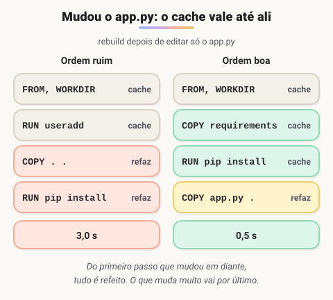
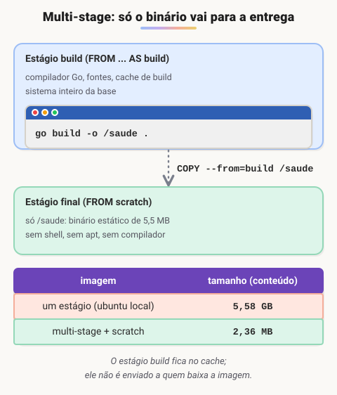

# 8. Builds rápidos e imagens enxutas

> 🗺️ **Neste capítulo:** você mede quanto tempo um build leva e quanto a imagem pesa, e aprende a reduzir os dois: ordem certa das instruções para aproveitar o cache, limpeza no mesmo `RUN`, builds em vários estágios (multi-stage) até chegar a uma imagem `FROM scratch` de 2,36 MB, e a escolha da imagem base.

## De onde paramos

No capítulo 7 você escreveu o Dockerfile da API de tarefas e viu, no fim do build, passos marcados como `CACHED`. Aquilo é o Docker reaproveitando trabalho feito antes. Neste capítulo você aprende a controlar esse reaproveitamento e a tirar da imagem tudo o que não precisa ir para produção. A pasta `~/api-livro` continua valendo; os experimentos usam cópias dela.

## Medir antes de otimizar

Otimizar "no olho" engana: um passo que parece pesado pode ser instantâneo, e o lento pode estar onde você não imagina. Antes de mexer, meça. Três comandos bastam:

| Pergunta | Comando | O que olhar |
| --- | --- | --- |
| Quanto tempo leva o build? | `time docker build ...` | a linha `real` |
| Quanto pesa a imagem? | `docker images` | `CONTENT SIZE` e `DISK USAGE` |
| Qual passo pesa mais? | `docker history` | a coluna de tamanho por instrução |

O `time` é do shell, não do Docker: ele roda o comando e diz quanto tempo levou. No Docker Engine 29 com o armazenamento de imagens do containerd, o `docker images` mostra duas colunas de tamanho. `CONTENT SIZE` é o conteúdo comprimido, o que viaja num pull ou push; `DISK USAGE` soma também a cópia descompactada que fica no disco. Use a primeira para comparar imagens.

Um exemplo real, com a imagem em Go que você vai construir no laboratório:

```bash
docker images c08-go
```

```
IMAGE               ID             DISK USAGE   CONTENT SIZE   EXTRA
c08-go:scratch      99e72e1f0618       7.89MB         2.36MB
c08-go:um-estagio   dae7be0bbeb4         16GB         5.58GB
```

Mesmo programa, mesmo binário de 5,5 MB. A diferença de tamanho está toda no que veio junto. As duas próximas seções atacam o tempo; as seguintes, o tamanho.

## Cache de camadas: o que o invalida

Cada instrução do Dockerfile vira um passo do build. **O cache de build é o reaproveitamento do resultado de um passo já executado, desde que nada que ele usa tenha mudado; quando um passo muda, ele e todos os passos depois dele são refeitos.**

O que invalida um passo:

- **o texto da instrução mudou** (um `RUN` com outro comando, outro `ENV`);
- **os arquivos de um** `<b>COPY</b>` **ou** `<b>ADD</b>` **mudaram**: o Docker compara o conteúdo, não a data do arquivo;
- **algum passo anterior foi refeito**: daí para baixo, nada é reaproveitado.

E o que **não** invalida: o mundo lá fora. Um `RUN apt-get update` em cache continua em cache mesmo que o repositório tenha pacotes novos. Por isso o `apt-get update` vem sempre no mesmo `RUN` do `apt-get install`, e por isso existe o `--no-cache`, que manda refazer tudo do zero:

```bash
# ignora o cache: útil para pegar atualizações
# de pacotes ou desconfiar de um cache estranho
docker build --no-cache -t c08-api:bom .
```

Daí sai a regra de ouro: **o que muda pouco vem primeiro; o que muda sempre vem por último**. Num projeto real, a lista de dependências (`requirements.txt` no Python, `package.json` no Node, `go.mod` no Go) muda de vez em quando, mas o código muda o dia inteiro. Então:

1. copie só a lista de dependências;
2. instale as dependências (o passo caro);
3. copie o código.

Para medir isso com a API, ela ganhou um `requirements.txt` e um `RUN` que cria um ambiente virtual (venv) e instala o que estiver na lista. A API não usa bibliotecas externas, então a lista só tem comentários; mesmo assim, criar o venv leva uns 2 segundos, o bastante para medir. Compare as duas ordens:

```docker
# ORDEM RUIM (trecho): o código entra antes
# das dependências, e qualquer mudança no
# app.py refaz o RUN caro logo abaixo
COPY . .
RUN python3 -m venv /opt/venv \
 && /opt/venv/bin/pip install -r requirements.txt
```

```docker
# ORDEM BOA (trecho)
# 1) só a lista de dependências, que muda pouco
COPY requirements.txt .
# 2) a parte cara: só refaz se requirements.txt mudar
RUN python3 -m venv /opt/venv \
 && /opt/venv/bin/pip install -r requirements.txt
# 3) o código, que muda o tempo todo, por último
COPY app.py .
```

Depois de editar só o `app.py`, o rebuild na produção do livro levou **3,0 s** na ordem ruim e **0,5 s** na ordem boa (o laboratório mostra as saídas). Com bibliotecas de verdade, baixadas da internet, o passo de instalação leva dezenas de segundos ou minutos, e a diferença cresce na mesma proporção.



> 💡 **Analogia:** pense numa pilha de caixas num depósito. Para trocar uma caixa do meio, você tira e recoloca todas as que estão em cima dela (os passos depois do que mudou são refeitos); as de baixo ficam onde estão (o cache). Quem organiza bem põe embaixo as caixas que quase nunca abre (a base e as dependências) e no topo a caixa que mexe todo dia (o código). Se a caixa do dia estiver no fundo, toda manhã a pilha inteira vem abaixo.

> ⚠️ **Armadilha comum:** usar `COPY . .` no começo do Dockerfile "porque é mais simples". Qualquer arquivo alterado na pasta (até um README) invalida esse passo e tudo o que vem depois, inclusive a instalação das dependências. Copie primeiro só o arquivo de dependências e deixe o `COPY` do código para o fim. O `.dockerignore` do capítulo 7 ajuda: arquivos ignorados não entram no contexto e, portanto, não invalidam nada.

### Cache mounts: um atalho para o passo caro

Mesmo na ordem certa, quando a lista de dependências muda, o passo de instalação é refeito do zero e baixa tudo de novo. **Um cache mount é uma pasta de cache que o BuildKit guarda entre builds e monta só durante um** `<b>RUN</b>`**; ela não entra na imagem.** O gerenciador de pacotes encontra ali o que já baixou ou compilou e só refaz o que mudou. A sintaxe é uma opção do próprio `RUN`:

```docker
# o cache de compilação do Go sobrevive entre
# builds, mas não vai para a imagem
RUN --mount=type=cache,target=/root/.cache/go-build \
  go build -o /saude .
```

A documentação do Docker traz o alvo de cada ferramenta: `/root/.cache/pip` para o pip, `/root/.cache/go-build` e `/go/pkg/mod` para o Go, `/var/cache/apt` e `/var/lib/apt` (com `sharing=locked`, porque o apt exige acesso exclusivo) para o apt. Na produção do livro, recompilar o servidor em Go do laboratório depois de mudar uma linha levou **14,9 s** sem cache mount e **2,5 s** com ele.

## Imagem enxuta 1: limpe no mesmo RUN

Cada passo que grava arquivos vira uma camada, e camadas só somam. Apagar um arquivo num passo posterior esconde o arquivo, mas os bytes continuam na camada de baixo, e quem baixar a imagem baixa tudo.

O teste da produção do livro, com um "pacote" de 50 MB:

```docker
# Dockerfile.separado
FROM ubuntu:24.04
# um "pacote" de 50 MB baixado num RUN...
RUN head -c 50000000 /dev/urandom > /pacote.tar
# ...e apagado no RUN seguinte: tarde demais
RUN rm /pacote.tar
```

```docker
# Dockerfile.junto
FROM ubuntu:24.04
# cria, usa e apaga no MESMO RUN:
# a camada só guarda o resultado final
RUN head -c 50000000 /dev/urandom > /pacote.tar \
 && rm /pacote.tar
```

```bash
# o tamanho de cada camada nas duas versões
docker history --format '{{.CreatedBy}} | {{.Size}}' \
  c08-limpeza:separado | head -2
docker history --format '{{.CreatedBy}} | {{.Size}}' \
  c08-limpeza:junto | head -1
```

```
RUN /bin/sh -c rm /pacote.tar # buildkit | 4.1kB
RUN /bin/sh -c head -c 50000000 /dev/urandom… | 50MB
RUN /bin/sh -c head -c 50000000 /dev/urandom… | 16.4kB
```

A imagem "separada" ficou com 50 MB a mais (`CONTENT SIZE` de 5.61GB contra 5.56GB, sobre a base local do livro). Na vida real, o caso típico é a instalação de pacotes:

```docker
# update, install e limpeza no mesmo RUN: a lista
# de pacotes baixada não fica guardada na camada
RUN apt-get update \
 && apt-get install -y --no-install-recommends curl \
 && rm -rf /var/lib/apt/lists/*
```

> ⚠️ **Armadilha comum:** juntar **tudo** num `RUN` gigante para "ter menos camadas". Juntar ajuda quando um passo cria lixo que o mesmo passo apaga; fora disso, separar passos que mudam em ritmos diferentes é o que preserva o cache. Pense em "o que este passo deixa para trás", não em "quantas camadas eu tenho".

## Imagem enxuta 2: builds multi-stage

Para compilar um programa você precisa de compilador, cabeçalhos e ferramentas; para rodá-lo, só do resultado. Numa imagem de um estágio, tudo isso vai para produção. **Um build multi-stage é um Dockerfile com vários** `<b>FROM</b>`**, cada um começando um estágio novo; a imagem final é só o último estágio, que copia dos anteriores apenas o que precisa com** `<b>COPY --from=</b>`**.**

O exemplo do laboratório é um servidor HTTP mínimo em Go. O Go é bom para isso porque, com `CGO_ENABLED=0`, gera um **binário estático**: um executável que não depende de nenhuma biblioteca do sistema, nem da libc. Um binário assim roda até numa imagem vazia, e `scratch` é exatamente isso: **uma imagem reservada e vazia, sem shell, sem arquivos, que não é baixada de lugar nenhum**.

```docker
# Estágio 1: a "oficina", com o compilador Go
# (no seu computador: FROM golang:1.27 AS build)
FROM ubuntu:24.04 AS build
WORKDIR /src
COPY go.mod main.go ./
# CGO_ENABLED=0 gera binário estático (sem libc);
# -s -w tira dados de depuração. O mkdir é só
# para a ubuntu local do livro, que não tem /tmp
RUN mkdir -p /tmp \
 && CGO_ENABLED=0 /usr/local/go/bin/go build \
      -ldflags "-s -w" -o /saude .

# Estágio 2: a imagem final, vazia de verdade
FROM scratch
# só o binário atravessa de um estágio ao outro
COPY --from=build /saude /saude
EXPOSE 8080
# scratch não tem shell: só a forma exec funciona
ENTRYPOINT ["/saude"]
```

O `AS build` dá nome ao estágio, e o `COPY --from=build` usa esse nome (também daria para usar o número, `--from=0`, mas o nome sobrevive a uma reordenação). O `docker history` da imagem final mostra que só o binário entrou:

```bash
docker history --format '{{.CreatedBy}} | {{.Size}}' \
  c08-go:scratch
```

```
ENTRYPOINT ["/saude"] | 0B
EXPOSE [8080/tcp] | 0B
COPY /saude /saude # buildkit | 5.53MB
```

Não há linha da base: com `scratch`, a primeira camada é o seu binário. A mesma compilação num estágio só (`c08-go:um-estagio`) ficou com 5.58GB; a versão multi-stage, com 2.36MB de conteúdo comprimido.



> 💡 **Analogia:** é a diferença entre a marcenaria e a entrega do móvel. Na oficina (o estágio `build`) há serra, cola, serragem e sobras de madeira (compilador, fontes, cache). O cliente recebe só o armário pronto (o binário), que sai da oficina pela porta de carga (`COPY --from=build`) e chega numa sala vazia (`scratch`). Ninguém entrega a serra junto com o móvel, e a oficina continua lá para a próxima encomenda (o cache do estágio de build).

### --target: parar num estágio

O `--target` constrói só até o estágio indicado. Serve para depurar o estágio de build (que tem shell e ferramentas) ou para ter, no mesmo Dockerfile, um estágio de testes ou de desenvolvimento:

```bash
# para no estágio build: dá para olhar o binário
docker build -q --target build -t c08-go:build .
docker run --rm c08-go:build file /saude
```

```
sha256:28fa629afb9646b6c5390367e5a4d1267f40b95c35a3a5f22104916ece7eeacb
/saude: ELF 64-bit LSB executable, x86-64, version 1 (SYSV), statically linked, BuildID[sha1]=98866f9564d221b0709a7b67baa0ad5a9ef9d042, stripped
```

O `statically linked` confirma o binário estático. Com o BuildKit, o build pula os estágios de que o alvo não depende; o construtor antigo processava todos até o alvo.

> ⚠️ **Armadilha comum:** levar para `scratch` um programa que não é estático (Python, Node, ou Go compilado com CGO ligado). O contêiner nem sobe, porque o executável procura bibliotecas que não existem ali. Outra surpresa: `scratch` não tem certificados de CA nem fuso horário, então um programa que chama APIs por HTTPS falha. Para esses casos, a base mínima é uma `distroless` (próxima seção).

## Escolher a imagem base

Na maior parte dos projetos, a base é o que mais pesa na imagem. As famílias mais comuns, com os tamanhos comprimidos para linux/amd64 que o Docker Hub e o repositório do distroless mostravam na conferência:

| Base | O que traz | Tamanho | Quando usar |
| --- | --- | --- | --- |
| `python:3.13` (Debian trixie) | sistema completo, compiladores, git | ~395 MB | estágio de build que compila extensões em C |
| `python:3.13-slim` | Debian mínimo, glibc, Python | ~41 MB | o padrão seguro para a API do livro |
| `python:3.13-alpine` | Alpine, com musl no lugar da glibc | ~16 MB | quando todas as dependências funcionam com musl |
| `gcr.io/distroless/python3-debian13` | só o Python e as bibliotecas dele; sem shell nem apt | não informado | estágio final de produção |
| `gcr.io/distroless/static-debian13` | quase nada; feita para binários estáticos | ~2 MiB | Go estático que precisa de certificados e fuso |
| `scratch` | nada | 0 | binário estático que não precisa de nada |

Três critérios para decidir:

- **slim** é o ponto de partida: pequena, com a glibc que quase toda biblioteca espera, e ainda com shell para depurar.
- **alpine** é bem menor, mas usa a musl. A própria página da imagem `golang` no Docker Hub avisa que isso pode causar comportamento inesperado; no Python, bibliotecas com partes em C às vezes não têm pacote pronto para musl e precisam ser compiladas, o que deixa o build mais lento e a imagem nem sempre menor.
- **distroless** tira até o shell e o gerenciador de pacotes: menos coisa para um atacante usar e menos alertas de vulnerabilidade. Em troca, não dá para entrar com `docker exec ... sh`; para depurar, existe a variante com a tag `:debug`, que inclui um shell do busybox.

> ⚠️ **Armadilha comum:** escolher a base só pelo número. Uma imagem alpine que obriga a instalar compilador para montar uma biblioteca pode terminar maior e mais lenta de construir que a slim. Meça as duas com o seu projeto, como neste capítulo, antes de decidir.

## 🧪 Laboratório

> ⚠️ **O que não foi executado na produção do livro:** builds com as imagens oficiais `python:3.13-slim`, `golang:1.27`, alpine e distroless (o Docker Hub e o gcr.io estavam bloqueados). Tudo abaixo rodou de verdade no Docker Engine 29.9.2 (Linux) com a `ubuntu:24.04` local, que já tinha Python 3.13 e Go 1.24, por isso os tamanhos de GB. No seu computador, com `FROM python:3.13-slim` e `FROM golang:1.27 AS build`, os tempos, os ids e os tamanhos serão outros (a imagem de um estágio do Go fica perto de 1 GB, não 5,58 GB); as proporções e o comportamento do cache são os mesmos. Na imagem `golang` o Go está no `PATH`, então troque `/usr/local/go/bin/go` por `go` e dispense o `mkdir -p /tmp`.

### Parte 1: a ordem que estraga o cache

**1. Monte duas cópias da API.** Cada uma tem o `app.py` e o `.dockerignore` do capítulo 7, mais um `requirements.txt`:

```bash
mkdir -p ~/c08 && cd ~/c08
cp -r ~/api-livro ruim && cp -r ~/api-livro bom
# lista de dependências: só comentários, porque a
# API usa apenas a biblioteca padrão do Python
printf '%s\n' '# bibliotecas do projeto' \
  > ruim/requirements.txt
cp ruim/requirements.txt bom/
```

**2. Escreva os dois Dockerfiles.** O `~/c08/ruim/Dockerfile`:

```docker
# API do livro, na ordem ERRADA
# (no seu computador: FROM python:3.13-slim)
FROM ubuntu:24.04
ARG VERSAO=1.0.0
ENV PORTA=8000 \
    PYTHONUNBUFFERED=1 \
    APP_VERSAO=${VERSAO}
WORKDIR /app
RUN groupadd --gid 10001 app \
 && useradd --uid 10001 --gid app --no-create-home app
# o código entra antes das dependências: mudar
# o app.py invalida o RUN caro logo abaixo
COPY . .
RUN python3 -m venv /opt/venv \
 && /opt/venv/bin/pip install -r requirements.txt
EXPOSE 8000
USER app
CMD ["/opt/venv/bin/python", "app.py"]
```

E o `~/c08/bom/Dockerfile`, igual até o `RUN` do usuário:

```docker
# API do livro, com as camadas na ordem certa
# (no seu computador: FROM python:3.13-slim)
FROM ubuntu:24.04
ARG VERSAO=1.0.0
ENV PORTA=8000 \
    PYTHONUNBUFFERED=1 \
    APP_VERSAO=${VERSAO}
WORKDIR /app
RUN groupadd --gid 10001 app \
 && useradd --uid 10001 --gid app --no-create-home app
# 1) só a lista de dependências, que muda pouco
COPY requirements.txt .
# 2) a parte cara: só refaz se requirements.txt mudar
RUN python3 -m venv /opt/venv \
 && /opt/venv/bin/pip install -r requirements.txt
# 3) o código, que muda o tempo todo, por último
COPY app.py .
EXPOSE 8000
USER app
CMD ["/opt/venv/bin/python", "app.py"]
```

**3. Construa as duas uma vez**, para encher o cache:

```bash
cd ~/c08/ruim && docker build -q -t c08-api:ruim .
cd ~/c08/bom && docker build -q -t c08-api:bom .
```

**4. Edite só o** `<b>app.py</b>` **e meça o rebuild da ordem ruim.** O `--progress=plain` mostra cada passo em texto corrido:

```bash
cd ~/c08/ruim
# uma mudança mínima, como num dia de trabalho
echo '# mudança pequena' >> app.py
time docker build --progress=plain -t c08-api:ruim .
```

Trecho real da saída (só as linhas dos passos e o tempo):

```
#6 [2/5] WORKDIR /app
#6 CACHED
#7 [3/5] RUN groupadd --gid 10001 app  && useradd --uid 10001 --gid app --no-create-home app
#7 CACHED
#8 [4/5] COPY . .
#8 DONE 0.0s
#9 [5/5] RUN python3 -m venv /opt/venv  && /opt/venv/bin/pip install -r requirements.txt
#9 DONE 2.3s

real  0m3.036s
```

O `COPY . .` viu o `app.py` novo, e o `RUN` do venv, que não tinha nada a ver com a mudança, foi refeito.

**5. A mesma mudança na ordem boa:**

```bash
cd ~/c08/bom
echo '# mudança pequena' >> app.py
time docker build --progress=plain -t c08-api:bom .
```

```
#6 [4/6] COPY requirements.txt .
#6 CACHED
#7 [2/6] WORKDIR /app
#7 CACHED
#8 [3/6] RUN groupadd --gid 10001 app  && useradd --uid 10001 --gid app --no-create-home app
#8 CACHED
#9 [5/6] RUN python3 -m venv /opt/venv  && /opt/venv/bin/pip install -r requirements.txt
#9 CACHED
#10 [6/6] COPY app.py .
#10 DONE 0.0s

real  0m0.456s
```

Só o último `COPY` foi refeito: 0,46 s contra 3,0 s, seis vezes mais rápido. A ordem dos números `#N` não importa; o BuildKit resolve passos independentes em paralelo e imprime na ordem em que terminam.

**6. Meça o build do zero e o peso de cada passo.**

```bash
time docker build -q --no-cache -t c08-api:bom .
docker history --format '{{.CreatedBy}} | {{.Size}}' \
  c08-api:bom
```

```
sha256:5d871724441b86db672b08b426296537d6caf0f9b64c38fd0f185adb378806ba

real  0m3.336s
CMD ["/opt/venv/bin/python" "app.py"] | 0B
USER app | 0B
EXPOSE [8000/tcp] | 0B
COPY app.py . # buildkit | 12.3kB
RUN |1 VERSAO=1.0.0 /bin/sh -c python3 -m ve… | 13.3MB
COPY requirements.txt . # buildkit | 12.3kB
RUN |1 VERSAO=1.0.0 /bin/sh -c groupadd --gi… | 69.6kB
WORKDIR /app | 8.19kB
ENV PORTA=8000 PYTHONUNBUFFERED=1 APP_VERSAO… | 0B
ARG VERSAO=1.0.0 | 0B
 | 10.3GB
```

O venv acrescenta 13.3MB, e a base local, 10.3GB. Com `python:3.13-slim`, a base cai para algumas dezenas de MB: a escolha da base é a maior economia possível nesta imagem.

### Parte 2: Go, multi-stage e scratch

**7. Crie o servidor.** Numa pasta nova, `~/c08/go`, crie o `main.go`:

```go
// Servidor HTTP mínimo: só a biblioteca padrão do Go.
package main

import (
  "fmt"
  "log"
  "net/http"
)

func main() {
  // uma rota só, para provar que o binário funciona
  http.HandleFunc("/saude", func(w http.ResponseWriter,
    r *http.Request) {
    fmt.Fprintln(w, `{"status": "ok"}`)
  })
  log.Println("ouvindo na porta 8080")
  log.Fatal(http.ListenAndServe(":8080", nil))
}
```

E o `go.mod`, que identifica o módulo:

```
module exemplo.com/saude

go 1.24
```

(O `gofmt` do Go troca os 2 espaços do livro por tabulação; para o compilador, tanto faz.)

**8. Escreva o Dockerfile multi-stage** (o da seção "Builds multi-stage") e um `Dockerfile.um-estagio` para comparar:

```docker
# Tudo num estágio só: compilador, fontes e
# binário vão juntos para a imagem final
FROM ubuntu:24.04
WORKDIR /src
COPY go.mod main.go ./
RUN mkdir -p /tmp \
 && CGO_ENABLED=0 /usr/local/go/bin/go build \
      -ldflags "-s -w" -o /saude .
EXPOSE 8080
ENTRYPOINT ["/saude"]
```

**9. Construa as duas e compare os tamanhos.**

```bash
cd ~/c08/go
docker build -q -t c08-go:scratch .
# -f escolhe outro Dockerfile na mesma pasta
docker build -q -f Dockerfile.um-estagio \
  -t c08-go:um-estagio .
docker images c08-go
```

```
sha256:99e72e1f061864a566d197510df2dd9957c74df3b36d88d2b2a008bb729ee882
sha256:dae7be0bbeb4cb4dce5330e6d293d5f860db9c59b196360ac8193a424a08153f
IMAGE               ID             DISK USAGE   CONTENT SIZE   EXTRA
c08-go:scratch      99e72e1f0618       7.89MB         2.36MB
c08-go:um-estagio   dae7be0bbeb4         16GB         5.58GB
```

**10. Rode a imagem de 2,36 MB e tente entrar nela.**

```bash
docker run -d --name c08-go -p 8080:8080 c08-go:scratch
curl -s localhost:8080/saude
docker logs c08-go
# não há shell em scratch: este comando falha
docker exec c08-go sh
```

```
5348985c41eff32c0c92698c899639d97ec5ef83f90c2629371cf0f957273243
{"status": "ok"}
2026/11/16 01:26:26 ouvindo na porta 8080
OCI runtime exec failed: exec failed: unable to start container process: exec: "sh": executable file not found in $PATH
```

O servidor responde normalmente; só não existe nada além dele dentro do contêiner. Essa falha do `docker exec` é o preço (e a vantagem) de uma imagem sem shell.

**11. Arrume a casa.** As imagens `c08-*` não serão usadas nos próximos capítulos:

```bash
docker rm -f c08-go
docker rmi c08-api:ruim c08-api:bom c08-go:scratch \
  c08-go:um-estagio c08-go:build
# -f não pede confirmação; o cache de build
# ocupa disco e pode ser apagado sem medo
docker builder prune -f
```

A saída lista as imagens desmarcadas (`Untagged`) e apagadas (`Deleted`) e, no fim do `prune`, o total liberado (`Total: ...`); os números variam a cada máquina.

## 🏋️ Pratique

**1. O cache lembra conteúdos antigos.** Na pasta `~/c08/bom`, acrescente uma linha de comentário ao `requirements.txt` e reconstrua. Quais passos são refeitos? Depois, desfaça a mudança e reconstrua de novo. O que acontece, e por quê?

<details>
<summary>Ver resposta</summary>

```bash
# muda só as dependências e mede o rebuild
cd ~/c08/bom
cp requirements.txt /tmp/req.bak
echo '# requests entraria aqui' >> requirements.txt
docker build --progress=plain -t c08-api:bom . 2>&1 \
  | grep -E '^#[0-9]+ (\[[0-9]|CACHED|DONE [0-9])'
```

Trecho real da saída:

```
#6 [2/6] WORKDIR /app
#6 CACHED
#7 [3/6] RUN groupadd --gid 10001 app  && useradd --uid 10001 --gid app --no-create-home app
#7 CACHED
#8 [4/6] COPY requirements.txt .
#8 DONE 0.0s
#9 [5/6] RUN python3 -m venv /opt/venv  && /opt/venv/bin/pip install -r requirements.txt
#9 DONE 2.1s
#10 [6/6] COPY app.py .
#10 DONE 0.0s
```

Do `COPY requirements.txt` em diante tudo é refeito, inclusive o `COPY app.py`, que não mudou: depois do primeiro passo invalidado, não há mais cache. Ao voltar o arquivo antigo (`cp /tmp/req.bak requirements.txt`) e reconstruir, todos os passos aparecem como `CACHED`: o Docker compara o conteúdo dos arquivos, e aquele conteúdo já tinha um resultado guardado.

</details>

**2. Limpeza no mesmo RUN.** Crie os arquivos `Dockerfile.separado` e `Dockerfile.junto` da seção "Limpe no mesmo RUN", construa as tags `c08-limpeza:separado` e `c08-limpeza:junto` e prove com `docker images` que uma delas carrega 50 MB inúteis.

<details>
<summary>Ver resposta</summary>

```bash
# as duas versões lado a lado
docker build -q -f Dockerfile.separado \
  -t c08-limpeza:separado .
docker build -q -f Dockerfile.junto \
  -t c08-limpeza:junto .
docker images c08-limpeza
```

```
sha256:7f9a5e8134f34c1987eb09bc0cc8f6a1d4e4ba320bc0f46755fa9dcb906ca65d
sha256:6faeba8fd751f834c26492e8614cf115774938eaade3fc5538deaf42b0b7f1db
IMAGE                  ID             DISK USAGE   CONTENT SIZE   EXTRA
c08-limpeza:junto      6faeba8fd751       15.9GB         5.56GB
c08-limpeza:separado   7f9a5e8134f3         16GB         5.61GB
```

A versão separada tem 0,05 GB (os 50 MB) a mais, mesmo sem o arquivo existir no contêiner: ele continua na camada do primeiro `RUN`. Com `python:3.13-slim` ou `ubuntu:24.04` oficial, os totais são bem menores, mas a diferença de 50 MB é a mesma. Ao terminar, `docker rmi c08-limpeza:separado c08-limpeza:junto`.

</details>

**3. Cache mount no Go.** Crie um `Dockerfile.cache` igual ao multi-stage, mas com `--mount=type=cache,target=/root/.cache/go-build` no `RUN` do `go build`. Construa uma vez, mude a mensagem do `log.Println` e compare o tempo do rebuild com e sem o cache mount.

<details>
<summary>Ver resposta</summary>

O `RUN` fica assim (o resto do arquivo não muda):

```docker
# a pasta de cache do compilador é montada só
# durante este RUN e sobrevive entre builds
RUN --mount=type=cache,target=/root/.cache/go-build \
    mkdir -p /tmp \
 && CGO_ENABLED=0 /usr/local/go/bin/go build \
      -ldflags "-s -w" -o /saude .
```

```bash
docker build -q -f Dockerfile.cache -t c08-go:cache .
# mudança mínima no código
sed -i 's/ouvindo na porta/servidor no ar, porta/' \
  main.go
time docker build -q -t c08-go:scratch .
time docker build -q -f Dockerfile.cache \
  -t c08-go:cache .
```

Tempos reais (linha `real`) na produção do livro: **14,9 s** sem cache mount e **2,5 s** com ele. Sem o cache mount, o `RUN` invalidado recompila do zero até a biblioteca padrão do Go; com ele, o compilador encontra o trabalho anterior e só refaz o pacote que mudou. O cache mount não aparece no `docker history` nem aumenta a imagem. Ao terminar, `docker rmi c08-go:cache`.

</details>

## 🧠 Revisão rápida

**Por que o `COPY` do código deve vir depois da instalação das dependências?**

Porque o código muda o tempo todo, e um passo que muda refaz todos os seguintes. Com o código por último, a instalação continua em cache.

**Apagar um arquivo grande num `RUN` posterior diminui a imagem?**

Não: os bytes continuam na camada que criou o arquivo. Para não pesar, crie e apague no mesmo `RUN`.

**O que vai para a imagem final num build multi-stage?**

Só o último estágio (ou o indicado com `--target`) e o que ele copiou com `COPY --from=`. Compiladores e fontes dos estágios anteriores ficam de fora.

> ➡️ **Próximo passo:** a API está rápida de construir e leve, mas continua esquecendo as tarefas a cada contêiner novo. No capítulo 9, **Volumes: dados que sobrevivem**, você guarda dados fora da camada do contêiner e mantém um PostgreSQL funcionando mesmo depois de recriá-lo.

## 📚 Fontes

Conferido em 2026-11-15, com Docker Engine 29.9.2 (BuildKit/buildx 0.38.1).

- [Optimize cache usage in builds](https://docs.docker.com/build/cache/optimize/) (ordem das camadas, cache mounts e `sharing=locked`)
- [Docker build cache](https://docs.docker.com/build/cache/) (o que invalida o cache)
- [Multi-stage builds](https://docs.docker.com/build/building/multi-stage/) (`AS`, `COPY --from`, `--target`)
- [Imagem oficial python no Docker Hub](https://hub.docker.com/_/python) (tamanhos de `3.13`, `3.13-slim` e `3.13-alpine`)
- [Imagem oficial golang no Docker Hub](https://hub.docker.com/_/golang) (tag `1.27`, aviso sobre musl no Alpine)
- [Distroless (GoogleContainerTools)](https://github.com/GoogleContainerTools/distroless) (imagens `-debian13`, tamanho da `static`, tag `:debug`)

## 📌 Resumo

| Item | Em uma frase |
| --- | --- |
| Medir | `time docker build` para o tempo, `docker images` para o peso e `docker history` para o peso de cada passo |
| Cache de build | Um passo é reaproveitado se nada que ele usa mudou; o primeiro que muda refaz todos os seguintes |
| Ordem das instruções | Dependências primeiro, código por último |
| `--no-cache` | Refaz o build do zero, por exemplo para pegar pacotes atualizados |
| Cache mount | `RUN --mount=type=cache` guarda o cache do gerenciador de pacotes entre builds, fora da imagem |
| Limpar no mesmo `RUN` | Arquivo apagado em outro passo continua pesando na camada que o criou |
| Multi-stage | Vários `FROM`; a imagem final só leva o que copia com `COPY --from=` |
| `FROM scratch` | Imagem vazia, para binários estáticos como Go com `CGO_ENABLED=0` |
| `--target` | Constrói só até o estágio indicado, útil para depurar o build |
| Imagem base | slim é o padrão seguro; alpine usa musl; distroless não tem shell; meça antes de escolher |
