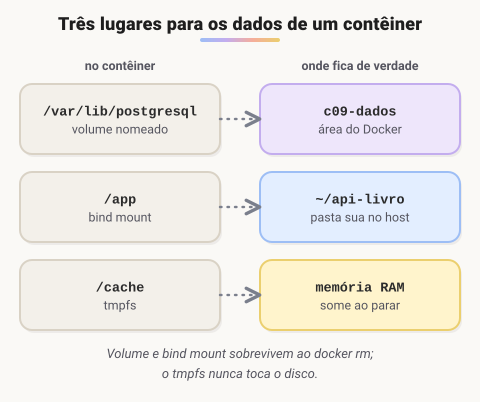
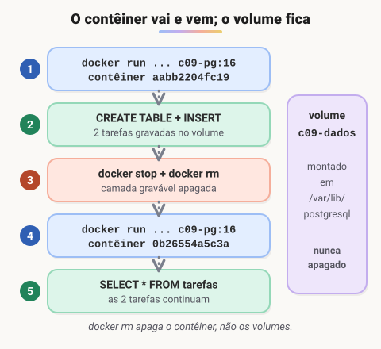
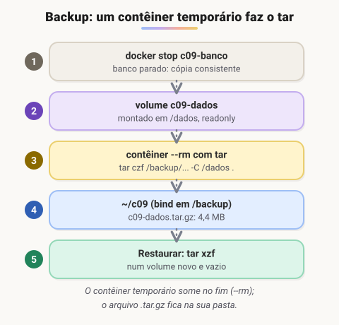

# 9. Volumes: dados que sobrevivem

> 🗺️ **Neste capítulo:** você descobre por que os dados somem quando um contêiner é removido e aprende os três jeitos de guardá-los fora dele (volume nomeado, bind mount e tmpfs). No fim, um PostgreSQL de verdade sobrevive a um `docker rm`, ganha um backup em `.tar.gz` e é restaurado num volume novo.

## De onde paramos

No capítulo 8 a API ficou rápida de construir e leve. Mas ela ainda tem memória de peixe: o capítulo 7 já tinha mostrado que, ao remover o contêiner e criar outro, a tarefa cadastrada some e só sobra `"Estudar Docker"`. Para uma API de estudo, tudo bem. Para um banco de dados, seria um desastre. Este capítulo guarda os dados num lugar que não morre junto com o contêiner.

## A camada gravável morre com o contêiner

No capítulo 7 você viu que uma imagem é uma pilha de camadas somente leitura. Ao criar um contêiner, o Docker põe por cima delas uma camada fina onde tudo o que o contêiner grava vai parar. **A camada gravável (writable layer) é a camada própria de cada contêiner, criada no** `<b>docker run</b>` **e apagada no** `<b>docker rm</b>`**.** Parar e iniciar de novo (`docker stop`, `docker start`, `docker restart`) não a apaga; remover, sim.

Veja na prática. O contêiner abaixo grava um arquivo e termina; o `docker diff` lista o que mudou na camada gravável em relação à imagem (`A` = adicionado):

```bash
docker run --name c09-efemero ubuntu:24.04 \
  bash -c 'echo "anotação importante" > /notas.txt'
docker diff c09-efemero
docker rm c09-efemero
# um contêiner novo, da mesma imagem
docker run --rm ubuntu:24.04 cat /notas.txt
```

```
A /notas.txt
c09-efemero
cat: /notas.txt: No such file or directory
```

O arquivo existia, mas morava na camada do contêiner `c09-efemero`. O contêiner novo nasce com uma camada gravável vazia, a partir da mesma imagem, e não sabe nada do anterior.

> ⚠️ **Armadilha comum:** achar que `docker commit` ou "nunca remover o contêiner" resolve. Contêineres são feitos para ser descartados: atualizar a imagem do banco, mudar uma porta ou uma variável de ambiente exige criar um contêiner novo. Se os dados moram na camada gravável, cada uma dessas mudanças vira uma perda de dados. Além disso, gravar muito na camada gravável é mais lento que gravar num volume, porque passa pelo driver de armazenamento das camadas.

## Três jeitos de pôr dados fora do contêiner

O Docker monta (mount) uma pasta de fora num caminho de dentro do contêiner. O programa grava em `/var/lib/postgresql` como sempre, sem saber que os bytes estão indo para outro lugar. São três tipos de montagem:

| Tipo | Onde os dados ficam | Quem gerencia | Uso típico |
| --- | --- | --- | --- |
| **Volume nomeado** | numa área do Docker (`/var/lib/docker/volumes` no Linux) | o Docker (`docker volume ...`) | dados de banco e de aplicação |
| **Bind mount** | numa pasta sua, em qualquer lugar do host | você (é uma pasta comum) | código em desenvolvimento, arquivos de configuração |
| **tmpfs** | na memória RAM do host | o kernel; some quando o contêiner para | dados temporários ou sensíveis que não devem ir para o disco |



> 💡 **Analogia:** pense numa rodoviária. O **volume nomeado** é o guarda-volumes: você entrega a mala, recebe um tíquete com um nome (`c09-dados`) e não precisa saber em qual prateleira ela está; quem cuida do espaço é a rodoviária (o Docker). O **bind mount** é você levar a sua própria mochila (uma pasta sua): o conteúdo é seu, você mexe nele quando quiser, e o ônibus só usa. O **tmpfs** é o recado escrito no vidro embaçado da janela: serve durante a viagem e some sozinho quando ela acaba.

Na documentação do Docker, o volume é o mecanismo recomendado para dados que precisam persistir: funciona igual em Linux, Mac e Windows, é gerenciado pela CLI e não depende da estrutura de pastas do host.

## Volumes nomeados: os comandos

**Um volume nomeado é uma área de armazenamento criada e gerenciada pelo Docker, com um nome escolhido por você, que existe independentemente de qualquer contêiner.** Os comandos ficam todos sob `docker volume`:

| Comando | O que faz |
| --- | --- |
| `docker volume create nome` | cria um volume vazio |
| `docker volume ls` | lista os volumes |
| `docker volume inspect nome` | mostra os detalhes, inclusive onde ele está no disco |
| `docker volume rm nome` | apaga um volume (se nenhum contêiner o usa) |
| `docker volume prune` | apaga os volumes anônimos sem uso (com `-a`, também os nomeados) |

```bash
docker volume create c09-dados
docker volume ls
docker volume inspect c09-dados
```

```
c09-dados
DRIVER    VOLUME NAME
local     c09-dados
[
  {
    "CreatedAt": "2026-11-15T22:35:08-03:00",
    "Driver": "local",
    "Labels": null,
    "Mountpoint": "/var/lib/docker/volumes/c09-dados/_data",
    "Name": "c09-dados",
    "Options": null,
    "Scope": "local"
  }
]
```

O `Mountpoint` é a pasta real do volume no Linux que roda o Docker Engine. No Docker Desktop (Windows e Mac), esse caminho fica dentro da máquina virtual Linux do Desktop, e não no seu disco do Windows ou do Mac; para ver o conteúdo, use a aba **Volumes** do Docker Desktop (capítulo 5) ou um contêiner, como na seção de backup. O driver `local` é o padrão: os dados ficam no disco da própria máquina.

Um volume em uso não pode ser apagado, o que protege contra acidentes:

```bash
docker volume rm c09-dados
```

```
Error response from daemon: remove c09-dados: volume is in use - [0b26554a5c3a4e25bec430e1bdb91e478442018b73f473c76d5b002ed5a3ff0a]
```

> ⚠️ **Armadilha comum:** rodar `docker volume prune -a` (ou `docker system prune --volumes`) para "liberar espaço" sem olhar a lista antes. A partir da API 1.42 (Docker Engine 23), o `prune` sem `-a` só apaga volumes **anônimos** sem uso; com `-a`, apaga também todo volume nomeado que não esteja montado num contêiner naquele momento, inclusive o do banco que você parou ontem. Na produção do livro, um `docker volume prune -f` deixou intacto um volume nomeado sem uso (`c09-sobra`), como a documentação descreve.

## PostgreSQL com volume: os dados sobrevivem

Agora o objetivo do capítulo. O PostgreSQL guarda tudo numa pasta de dados (o "cluster"). Se essa pasta estiver num volume, o contêiner do banco pode ser apagado e recriado à vontade.

Com a imagem oficial `postgres` do Docker Hub, basta uma variável e um volume. A partir do PostgreSQL 18, a página da imagem manda montar o volume em `/var/lib/postgresql`; os dados ficam numa subpasta com a versão (`/var/lib/postgresql/18/docker`):

```bash
# NÃO executado na produção do livro (sem acesso ao
# Docker Hub). POSTGRES_PASSWORD é a única variável
# obrigatória da imagem oficial.
docker run -d --name banco \
  -e POSTGRES_PASSWORD=senha-de-estudo \
  --mount type=volume,src=dados,dst=/var/lib/postgresql \
  -p 5432:5432 postgres:18
```

Na produção do livro, o Docker Hub estava bloqueado. Por isso o laboratório constrói uma imagem própria, `c09-pg:16`, com o PostgreSQL 16 que já vinha na `ubuntu:24.04` local, organizada do mesmo jeito que a oficial 18+: volume em `/var/lib/postgresql`, dados em `/var/lib/postgresql/16/docker`, banco rodando como o usuário `postgres`, não como root. O resultado, resumido (os passos completos estão no laboratório):

```bash
# 1) banco novo, dados no volume c09-dados
docker run -d --name c09-banco \
  -e POSTGRES_PASSWORD=senha-de-estudo \
  --mount type=volume,src=c09-dados,dst=/var/lib/postgresql \
  -p 5432:5432 c09-pg:16
# 2) uma tabela com duas tarefas
docker exec c09-banco psql -U postgres -c \
  "CREATE TABLE tarefas (
     id serial PRIMARY KEY, titulo text);"
docker exec c09-banco psql -U postgres -c \
  "INSERT INTO tarefas (titulo) VALUES
   ('Estudar Docker'), ('Fazer backup');"
# 3) o contêiner some; o volume, não
docker stop c09-banco && docker rm c09-banco
```

Recriando o contêiner com o mesmo volume, o PostgreSQL encontra a pasta de dados pronta, pula a criação do banco e mostra as tarefas:

```
2026-11-16 01:36:07.207 UTC [9] LOG:  database system was shut down at 2026-11-16 01:36:06 UTC
2026-11-16 01:36:07.210 UTC [1] LOG:  database system is ready to accept connections
 id |     titulo     
----+----------------
  1 | Estudar Docker
  2 | Fazer backup
(2 rows)
```

A linha `was shut down at` mostra que o banco achou dados de um desligamento limpo (o `docker stop`) em vez de criar um banco novo.



> 💡 **Analogia:** o contêiner é um carro alugado; o volume é a sua mala. O que você esquece no porta-luvas (a camada gravável) fica com a locadora quando devolve o carro (`docker rm`). A mala vai com você e entra no próximo carro alugado (o contêiner novo), mesmo que seja de outro modelo (uma versão nova da imagem). O carro é descartável; a mala, não.

> ⚠️ **Armadilha comum:** copiar de um tutorial antigo o caminho `/var/lib/postgresql/data` para o PostgreSQL 18, ou o caminho novo para o 17. A página da imagem oficial avisa que, no 17 e anteriores, montar o volume em `/var/lib/postgresql` **não** persiste os dados ao recriar o contêiner: nesses, o volume vai em `/var/lib/postgresql/data`. No 18 e seguintes, vai em `/var/lib/postgresql`. Confira a versão da tag antes de montar. Outra armadilha: `docker rm -f` mata o banco sem desligamento limpo; ele se recupera no próximo início (na produção do livro, o log mostrou `end-of-recovery`), mas o certo é `docker stop` antes.

## -v ou --mount?

As duas opções do `docker run` fazem a mesma coisa com sintaxes diferentes:

|  | `-v` (ou `--volume`) | `--mount` |
| --- | --- | --- |
| Formato | campos separados por `:` | pares `chave=valor` separados por vírgula |
| Exemplo | `-v c09-dados:/var/lib/postgresql` | `--mount type=volume,src=c09-dados,dst=/var/lib/postgresql` |
| Pasta do host que não existe (bind) | cria a pasta, vazia e de root | dá erro (a não ser com `bind-create-src`) |
| Opções | só `ro` e poucas outras | todas (subpasta do volume, tamanho do tmpfs etc.) |

A documentação diz que, em geral, o `--mount` é preferido: é mais explícito e aceita todas as opções. Este livro usa `--mount` nos exemplos, mas você vai ver `-v` em toda parte, porque é mais curto. No `--mount`, `src` é sinônimo de `source` e `dst`, de `target` e `destination`.

A diferença que mais morde é a da pasta inexistente. Com um erro de digitação no caminho:

```bash
# --mount: falha alto, e você percebe o erro
docker run --rm \
  --mount type=bind,src="$PWD/nao-existe",dst=/x \
  ubuntu:24.04 true
# -v: cria a pasta vazia em silêncio
docker run --rm -v "$PWD/nao-existe":/x ubuntu:24.04 true
ls -ld nao-existe
```

```
docker: Error response from daemon: invalid mount config for type "bind": bind source path does not exist: /root/c09/nao-existe

Run 'docker run --help' for more information
drwxr-xr-x 2 root root 4096 Nov 15 22:36 nao-existe
```

(O caminho `/root/c09` é a pasta pessoal da produção do livro; no seu computador aparece a sua.) Com `-v`, o contêiner sobe "funcionando", mas olhando para uma pasta vazia, e o seu código ou a sua configuração simplesmente não aparecem lá dentro.

## Volume anônimo

Se você passa só o caminho de dentro, sem nome, o Docker cria um volume com um nome aleatório. **Um volume anônimo é um volume sem nome dado por você, identificado por um hash de 64 caracteres.** A instrução `VOLUME` de um Dockerfile cria um desses a cada `docker run` que não monta nada naquele caminho (é o que a imagem oficial do `postgres` faz).

```bash
# volume anônimo: criado sem nome e esquecido
docker run -d --name c09-anon -v /dados \
  ubuntu:24.04 sleep infinity
docker volume ls
docker rm -f c09-anon
docker volume ls
```

```
8af5321ffc5255c199d7e80136ff107835d42054cdee431608a15eb7bcf1727d
DRIVER    VOLUME NAME
local     763c0bb98dec9419ad5000f71d1923a1611d1c5512214c3f0cddf4cbd03fbdea
local     c09-dados
c09-anon
DRIVER    VOLUME NAME
local     763c0bb98dec9419ad5000f71d1923a1611d1c5512214c3f0cddf4cbd03fbdea
local     c09-dados
```

O contêiner foi removido, mas o volume anônimo continuou, e agora ninguém sabe de quem ele era. Duas saídas: o `docker volume prune`, que apaga os anônimos sem uso, ou o `--rm` no `docker run`, que remove o volume anônimo junto com o contêiner (os volumes nomeados nunca são removidos assim).

> ⚠️ **Armadilha comum:** rodar a imagem oficial do `postgres` sem `--mount`, achando que "o `VOLUME` do Dockerfile já cuida disso". Ele cria um volume anônimo novo a cada contêiner: os dados existem, mas o próximo `docker run` não os encontra, e o disco vai enchendo de hashes órfãos. Dê sempre um nome ao volume do banco.

## Bind mount: editar código sem rebuild

**Um bind mount liga uma pasta (ou arquivo) que você escolhe no host a um caminho dentro do contêiner; os dois lados enxergam os mesmos arquivos, ao mesmo tempo.** O uso clássico é no desenvolvimento: em vez de rodar `docker build` a cada linha mudada, você monta a pasta do código por cima da que veio na imagem.

A imagem `c07-api:1.0` tem o `app.py` em `/app`. Montando `~/api-livro` ali, o contêiner passa a usar o arquivo da sua pasta:

```bash
docker run -d --name c09-api -p 8000:8000 \
  --mount type=bind,src="$HOME/api-livro",dst=/app,readonly \
  c07-api:1.0
curl -s localhost:8000/tarefas
# edite o código no host, sem build nenhum
sed -i 's/"Estudar Docker"/"Estudar volumes"/' \
  ~/api-livro/app.py
# a API não recarrega sozinha: reinicie o processo
docker restart c09-api
curl -s localhost:8000/tarefas
```

```
4a3e270bf34395acb0c8d0134c26cd2f3f1a9470d081a70400d3c66d3fd4ed9b
[{"id": 1, "titulo": "Estudar Docker"}]
c09-api
[{"id": 1, "titulo": "Estudar volumes"}]
```

A imagem continua a mesma de antes; só o arquivo da sua pasta mudou. Frameworks com recarga automática (Flask em modo debug, Uvicorn com `--reload`, nodemon) dispensam até o `docker restart`. Ao terminar o experimento, desfaça a mudança no `app.py` (troque `"Estudar volumes"` de volta) e remova o contêiner com `docker rm -f c09-api`.

> ⚠️ **Armadilha comum:** montar a pasta do código por cima de uma pasta da imagem que tinha outras coisas. O bind mount **esconde** tudo o que a imagem tinha naquele caminho: se o Dockerfile instalou dependências dentro de `/app` (um `node_modules`, um venv), elas somem do ponto de vista do contêiner. Por isso o capítulo 8 pôs o venv em `/opt/venv`, fora da pasta do código. E bind mount é ferramenta de desenvolvimento: em produção, o código vai dentro da imagem.

### Somente leitura: :ro e readonly

O contêiner da API não tem motivo para alterar o próprio código. A opção `readonly` no `--mount` (ou `:ro` no fim do `-v`) impede qualquer escrita, mesmo que o processo seja comprometido:

```bash
docker exec c09-api touch /app/teste.txt
docker inspect -f '{{range .Mounts}}{{.Type}} {{.Source}} -> {{.Destination}} RW={{.RW}}{{end}}' \
  c09-api
```

```
touch: cannot touch '/app/teste.txt': Read-only file system
bind /root/api-livro -> /app RW=false
```

Com `-v`, o equivalente é `-v "$HOME/api-livro":/app:ro`. Volumes também podem ser montados como somente leitura, e é exatamente isso que o backup, mais adiante, faz.

## tmpfs: dados que nunca tocam o disco

**Uma montagem tmpfs é uma pasta guardada só na memória RAM do host, que desaparece quando o contêiner para.** Serve para arquivos temporários de alto giro e para dados que não devem ficar gravados em disco, como segredos descriptografados. Só existe em contêineres Linux e não pode ser compartilhada entre contêineres.

```bash
# --mount: tmpfs-size limita o tamanho
docker run --rm \
  --mount type=tmpfs,dst=/cache,tmpfs-size=64m \
  ubuntu:24.04 df -h /cache
# a forma curta, --tmpfs, faz o mesmo
docker run --rm --tmpfs /cache:size=64m \
  ubuntu:24.04 df -h /cache
```

```
Filesystem      Size  Used Avail Use% Mounted on
tmpfs            64M     0   64M   0% /cache
Filesystem      Size  Used Avail Use% Mounted on
tmpfs            64M     0   64M   0% /cache
```

O que vai para o tmpfs conta no limite de memória do contêiner. Sem limite de tamanho, um programa com defeito pode encher a RAM do host; por isso, defina um.

## Permissões e o UID do contêiner

O Linux não guarda o nome do dono de um arquivo, guarda um número: o UID (user id). Dentro e fora do contêiner, os números são os mesmos, mas os nomes, não. A API do capítulo 7 roda como o usuário `app`, de UID **10001**; no seu Linux (ou no Ubuntu do WSL), o seu usuário costuma ter UID 1000. Para o kernel, são pessoas diferentes.

Na prática: uma pasta sua, montada com bind mount, não é gravável pelo usuário 10001.

```bash
mkdir -p ~/c09/dados
docker run -d --name c09-perm \
  --mount type=bind,src="$HOME/c09/dados",dst=/dados \
  c07-api:1.0
# o docker exec roda como o usuário da imagem (app)
docker exec c09-perm sh -c 'echo oi > /dados/teste.txt'
```

```
sh: 1: cannot create /dados/teste.txt: Permission denied
```

A solução é dar a pasta ao UID do contêiner. Repare que o host não precisa ter nenhum usuário 10001:

```bash
sudo chown 10001:10001 ~/c09/dados
docker exec c09-perm sh -c 'echo oi > /dados/teste.txt'
# -n mostra os números, não os nomes
ls -ln ~/c09/dados
```

```
total 4
-rw-rw-rw- 1 10001 10001 3 Nov 15 22:37 teste.txt
```

Com volumes nomeados o problema aparece de outro jeito. Quando um volume **vazio** é montado numa pasta que já existe na imagem, o Docker copia para ele o conteúdo, o dono e as permissões dessa pasta. Se a pasta não existe na imagem, ela nasce do root, e o usuário 10001 de novo não consegue gravar:

```bash
docker run --rm \
  --mount type=volume,src=c09-tarefas,dst=/dados \
  c07-api:1.0 sh -c 'ls -ldn /dados; echo oi > /dados/t.txt'
```

```
drwxr-xr-x 2 0 0 4096 Nov 16 01:37 /dados
sh: 1: cannot create /dados/t.txt: Permission denied
```

O remédio fica no Dockerfile: crie a pasta já com o dono certo, e o volume vazio herda esse dono.

```docker
# a API do cap. 7 com uma pasta de dados do app
FROM c07-api:1.0
# volta a root só para criar a pasta e dá-la ao
# usuário app (UID 10001)
USER root
RUN mkdir /dados && chown app:app /dados
# um volume vazio montado aqui herda este dono
USER app
```

```bash
docker volume rm c09-tarefas
docker build -q -t c09-api:dados .
docker run --rm \
  --mount type=volume,src=c09-tarefas,dst=/dados \
  c09-api:dados \
  sh -c 'ls -ldn /dados
    echo oi > /dados/t.txt && ls -ln /dados'
```

```
sha256:ae2760dece47bf9ec1c77d73fdc786f121227ce060018a139868d24d7580c29a
drwxr-xr-x 2 10001 10001 4096 Nov 16 01:37 /dados
total 4
-rw-r--r-- 1 10001 10001 3 Nov 16 01:37 t.txt
```

É o mesmo truque que mantém o PostgreSQL funcionando: a imagem `c09-pg:16` tem `/var/lib/postgresql` do usuário `postgres` (UID 102 na ubuntu local), e o volume `c09-dados`, vazio na primeira montagem, herdou esse dono. Ao terminar, apague o que sobrou: `docker rm -f c09-perm`, `docker volume rm c09-tarefas` e `docker rmi c09-api:dados`.

> ⚠️ **Armadilha comum:** "resolver" o `Permission denied` com `chmod 777` ou rodando o contêiner como root (`--user root`). Funciona, mas desfaz a proteção que o usuário sem privilégios trazia. Ajuste o dono para o UID do contêiner (`chown 10001:10001`) ou crie a pasta com o dono certo no Dockerfile. A cópia de dono e conteúdo só acontece com volume **vazio**; bind mounts nunca recebem cópia, e o que estava na imagem naquele caminho fica escondido. No Docker Desktop do Mac e do Windows, o compartilhamento de pastas do host com a máquina virtual pode mostrar donos e permissões diferentes dos acima; o comportamento mostrado é o do Linux e o do WSL com os arquivos no sistema de arquivos do Linux.

## Backup e restauração de um volume

Um volume é só uma pasta, e o jeito portátil de copiá-la é usar um contêiner temporário: ele monta o volume e uma pasta sua, roda o `tar` e some. Funciona igual no Linux, no Mac e no Windows, porque não depende de saber onde o Docker guarda o volume.

```bash
# 1) pare o banco: copiar arquivos de um banco
#    ligado pode gerar um backup inconsistente
docker stop c09-banco
# 2) volume em /dados (só leitura) e a pasta atual
#    em /backup; o tar compacta um no outro
docker run --rm \
  --mount type=volume,src=c09-dados,dst=/dados,readonly \
  --mount type=bind,src="$PWD",dst=/backup \
  ubuntu:24.04 \
  tar czf /backup/c09-dados.tar.gz -C /dados .
ls -lh c09-dados.tar.gz
```

```
c09-banco
-rw-r--r-- 1 root root 4.4M Nov 15 22:36 c09-dados.tar.gz
```

O `-C /dados .` faz o `tar` guardar os caminhos a partir da raiz do volume (`./16/docker/...`), e não `dados/16/...`; assim dá para extrair em qualquer volume. Para restaurar, o caminho inverso, num volume novo (aqui, `c09-copia`):

```bash
docker volume create c09-copia
# agora o volume é gravável e o backup é só leitura
docker run --rm \
  --mount type=volume,src=c09-copia,dst=/dados \
  --mount type=bind,src="$PWD",dst=/backup,readonly \
  ubuntu:24.04 \
  tar xzf /backup/c09-dados.tar.gz -C /dados
# confira os donos numéricos; depois apague a cópia
docker run --rm \
  --mount type=volume,src=c09-copia,dst=/d \
  ubuntu:24.04 ls -ln /d/16
docker volume rm c09-copia
```

```
c09-copia
total 4
drwx------ 19 102 104 4096 Nov 16 01:36 docker
c09-copia
```

O `tar` guarda o dono numérico de cada arquivo (o UID 102 do `postgres`) e, rodando como root no contêiner temporário, restaura esses donos. Por isso o PostgreSQL consegue abrir os arquivos restaurados sem nenhum `chown`. Se a imagem do banco tiver o usuário com outro UID, o banco vai reclamar das permissões.



> 💡 **Analogia:** é o chaveiro que vem até a sua casa. Ele chega com as ferramentas (o contêiner temporário com `tar`), pega a chave emprestada sem alterá-la (o volume montado como `readonly`), faz a cópia na sua frente e entrega na sua mão (o `.tar.gz` na pasta montada em `/backup`). Depois vai embora (`--rm`) e não deixa nada para trás. Para trocar a fechadura de casa (restaurar), ele faz o caminho inverso numa porta nova (um volume vazio).

> ⚠️ **Armadilha comum:** copiar os arquivos de um banco em funcionamento e confiar no resultado. Para um backup frio, como o acima, pare o contêiner antes. Para não parar o banco, use a ferramenta dele: `docker exec c09-banco pg_dump -U postgres > tarefas.sql` gera um arquivo SQL consistente com o banco no ar (exercício 2 do Pratique). E um backup só vale se a restauração foi testada: o laboratório restaura num volume novo e confere as tarefas.

## No Windows com WSL 2: onde guardar os bind mounts

Volumes nomeados ficam dentro da máquina virtual do Docker Desktop e funcionam bem em qualquer caso. Com bind mounts, o lugar da pasta faz muita diferença. A documentação do Docker Desktop recomenda guardar o código e os dados montados no sistema de arquivos do Linux (o `~` do Ubuntu no WSL), e não no do Windows (`/mnt/c/...`):

- **desempenho:** arquivos do Linux montados num contêiner são muito mais rápidos que arquivos do Windows atravessando a fronteira;
- **recarga automática:** o contêiner só recebe as notificações de mudança de arquivo (inotify) quando os arquivos originais estão no sistema de arquivos do Linux; com a pasta em `/mnt/c`, o `--reload` do seu framework pode simplesmente não perceber a edição.

Na prática: clone e edite os projetos em `~/projetos` dentro do Ubuntu e rode o `docker run --mount type=bind,src="$HOME/projetos/api",...` a partir do terminal do Ubuntu. Por que o `~` do Linux é o lugar certo e como abrir essa pasta no Explorador de Arquivos do Windows estão em *WSL do zero*, cap. 4 ("Arquivos entre Linux e Windows").

## 🧪 Laboratório

> ⚠️ **O que não foi executado na produção do livro:** a imagem oficial `postgres:18` (o Docker Hub estava bloqueado) e o Docker Desktop (Windows e Mac). O laboratório rodou de verdade no Docker Engine 29.9.2 (Linux) com uma imagem própria, `c09-pg:16`, feita sobre a `ubuntu:24.04` local do livro, que já trazia o PostgreSQL 16.15; por isso a imagem aparece com GB no `docker images`. Ids, horários e o caminho `/root` (a pasta pessoal da produção do livro) serão outros no seu computador. Com a imagem oficial, pule os passos 1 e 2 e use o comando da seção "PostgreSQL com volume"; o resto do laboratório é igual, trocando `c09-pg:16` por `postgres:18`.

**1. Crie a pasta do laboratório e o script de entrada do banco.** Ele faz o papel do script da imagem oficial: cria o banco só se a pasta de dados estiver vazia. Salve como `~/c09/pg/entrada.sh`:

```bash
#!/bin/sh
# Inicia o PostgreSQL; cria o banco só na 1a vez.
set -e
# PG_VERSION só existe depois do initdb: se ele
# já está no volume, os dados são reaproveitados
if [ ! -s "$PGDATA/PG_VERSION" ]; then
  echo "$POSTGRES_PASSWORD" > /tmp/senha
  initdb -U postgres --pwfile=/tmp/senha \
    --auth-host=scram-sha-256 --auth-local=trust
  rm /tmp/senha
  # aceita conexões de fora do contêiner
  echo "host all all all scram-sha-256" \
    >> "$PGDATA/pg_hba.conf"
fi
# exec: o postgres vira o PID 1 e recebe o
# sinal do docker stop (desligamento limpo)
exec postgres -c listen_addresses='*'
```

**2. Escreva o Dockerfile e construa a imagem.** Em `~/c09/pg/Dockerfile`:

```docker
# PostgreSQL 16 sobre a ubuntu:24.04 local do livro.
# No seu computador, use a imagem oficial postgres.
FROM ubuntu:24.04
# apaga o cluster de exemplo da imagem local e cria
# as pastas de socket e temporária, que faltam nela
RUN rm -rf /var/lib/postgresql/16 \
 && mkdir -p /run/postgresql /tmp \
 && chown postgres:postgres /run/postgresql \
 && chmod 1777 /tmp
# mesma organização da imagem oficial 18+: o volume
# vai em /var/lib/postgresql, os dados numa subpasta
ENV PATH=/usr/lib/postgresql/16/bin:$PATH \
    PGDATA=/var/lib/postgresql/16/docker
COPY entrada.sh /entrada.sh
# o banco não roda como root (o initdb nem deixa)
USER postgres
EXPOSE 5432
CMD ["/entrada.sh"]
```

```bash
# a imagem do banco usada no capítulo
cd ~/c09/pg
chmod +x entrada.sh
docker build -q -t c09-pg:16 .
docker images c09-pg
```

```
sha256:4231d1fc43e6f66feb67f2cbfb9aa5c65947178e2c4a79c0099103471d47caf1
IMAGE       ID             DISK USAGE   CONTENT SIZE   EXTRA
c09-pg:16   4231d1fc43e6       15.9GB         5.56GB
```

**3. Crie o volume e suba o banco.**

```bash
docker volume create c09-dados
docker run -d --name c09-banco \
  -e POSTGRES_PASSWORD=senha-de-estudo \
  --mount type=volume,src=c09-dados,dst=/var/lib/postgresql \
  -p 5432:5432 c09-pg:16
# espere uns segundos e procure as linhas-chave
docker logs c09-banco 2>&1 \
  | grep -E 'Success|ready to accept'
```

```
aabb2204fc19f272f510be97cfefe0e14cabb4ec35f7b8ae3d0baa28f665125d
Success. You can now start the database server using:
2026-11-16 01:36:02.167 UTC [1] LOG:  database system is ready to accept connections
```

O `Success.` é do `initdb`: o volume estava vazio e o banco foi criado.

**4. Grave dados.** O `psql` roda dentro do contêiner, pelo `docker exec`:

```bash
# cria a tabela e grava duas tarefas
docker exec c09-banco psql -U postgres -c \
  "CREATE TABLE tarefas (
     id serial PRIMARY KEY, titulo text);"
docker exec c09-banco psql -U postgres -c \
  "INSERT INTO tarefas (titulo) VALUES
   ('Estudar Docker'), ('Fazer backup');"
```

```
CREATE TABLE
INSERT 0 2
```

**5. Destrua o contêiner.** Pare antes, para o banco desligar de forma limpa:

```bash
docker stop c09-banco
docker rm c09-banco
docker volume ls
```

```
c09-banco
c09-banco
DRIVER    VOLUME NAME
local     c09-dados
```

**6. Recrie o contêiner com o mesmo volume.** Desta vez com `-v`, para ver que as duas sintaxes chegam ao mesmo lugar:

```bash
# banco novo no mesmo volume: os dados voltam
docker run -d --name c09-banco \
  -e POSTGRES_PASSWORD=senha-de-estudo \
  -v c09-dados:/var/lib/postgresql \
  -p 5432:5432 c09-pg:16
docker logs c09-banco 2>&1 \
  | grep -E 'Success|shut down at|ready to accept'
docker exec c09-banco psql -U postgres -c \
  "SELECT * FROM tarefas;"
```

```
0b26554a5c3a4e25bec430e1bdb91e478442018b73f473c76d5b002ed5a3ff0a
2026-11-16 01:36:07.207 UTC [9] LOG:  database system was shut down at 2026-11-16 01:36:06 UTC
2026-11-16 01:36:07.210 UTC [1] LOG:  database system is ready to accept connections
 id |     titulo     
----+----------------
  1 | Estudar Docker
  2 | Fazer backup
(2 rows)
```

Não há `Success.`: o script viu o `PG_VERSION` no volume e não recriou o banco. Contêiner novo (`0b26...`), dados antigos. O `docker inspect` confirma a montagem:

```bash
docker inspect -f '{{json .Mounts}}' c09-banco
```

```
[{"Type":"volume","Name":"c09-dados","Source":"/var/lib/docker/volumes/c09-dados/_data","Destination":"/var/lib/postgresql","Driver":"local","Mode":"z","RW":true,"Propagation":""}]
```

**7. Faça o backup.** Na pasta `~/c09`, com o banco parado:

```bash
cd ~/c09
docker stop c09-banco
docker run --rm \
  --mount type=volume,src=c09-dados,dst=/dados,readonly \
  --mount type=bind,src="$PWD",dst=/backup \
  ubuntu:24.04 \
  tar czf /backup/c09-dados.tar.gz -C /dados .
# confira o começo do arquivo: donos e caminhos
tar tzvf c09-dados.tar.gz | head -4
```

```
c09-banco
drwxr-xr-x postgres/postgres 0 2026-11-15 22:36 ./
drwx------ postgres/postgres 0 2026-11-15 22:36 ./16/
drwx------ postgres/postgres 0 2026-11-15 22:36 ./16/docker/
drwx------ postgres/postgres 0 2026-11-15 22:36 ./16/docker/pg_stat/
```

**8. Simule o desastre**: apague o contêiner **e** o volume.

```bash
docker rm c09-banco
docker volume rm c09-dados
docker volume ls
```

```
c09-banco
c09-dados
DRIVER    VOLUME NAME
```

**9. Restaure num volume novo e confira.**

```bash
docker volume create c09-dados
docker run --rm \
  --mount type=volume,src=c09-dados,dst=/dados \
  --mount type=bind,src="$PWD",dst=/backup,readonly \
  ubuntu:24.04 \
  tar xzf /backup/c09-dados.tar.gz -C /dados
docker run -d --name c09-banco \
  -e POSTGRES_PASSWORD=senha-de-estudo \
  --mount type=volume,src=c09-dados,dst=/var/lib/postgresql \
  -p 5432:5432 c09-pg:16
docker exec c09-banco psql -U postgres -c \
  "SELECT * FROM tarefas;"
```

```
c09-dados
f1949edd8721c3dfcba2901a3f823c7fe8e13e8e260e28af81a49ac4c25d0213
 id |     titulo     
----+----------------
  1 | Estudar Docker
  2 | Fazer backup
(2 rows)
```

O volume foi apagado e as tarefas voltaram do `.tar.gz`.

**10. Arrume a casa.** Pode apagar o `c09-dados` e a `c09-pg` quando terminar (depois do Pratique, porque o exercício 2 usa o banco); o projeto final (cap. 12) cria o seu próprio volume, `tarefas-dados`. Por ora, só o contêiner vai embora:

```bash
docker stop c09-banco && docker rm c09-banco
```

## 🏋️ Pratique

**1. Caçando o volume órfão.** Rode `docker run -d --name c09-anon -v /dados ubuntu:24.04 sleep infinity`, remova o contêiner com `docker rm -f` e prove que um volume ficou para trás. Depois, apague-o sem tocar no `c09-dados`. O que mudaria se o contêiner tivesse sido criado com `--rm`?

<details>
<summary>Ver resposta</summary>

```bash
# volume anônimo: criado sem nome e esquecido
docker run -d --name c09-anon -v /dados \
  ubuntu:24.04 sleep infinity
docker rm -f c09-anon
docker volume ls
# só anônimos sem uso: o c09-dados é nomeado
docker volume prune -f
docker volume ls
```

Saída real da produção do livro (o hash muda a cada vez):

```
8af5321ffc5255c199d7e80136ff107835d42054cdee431608a15eb7bcf1727d
c09-anon
DRIVER    VOLUME NAME
local     763c0bb98dec9419ad5000f71d1923a1611d1c5512214c3f0cddf4cbd03fbdea
local     c09-dados
Deleted Volumes:
763c0bb98dec9419ad5000f71d1923a1611d1c5512214c3f0cddf4cbd03fbdea

Total reclaimed space: 0B
DRIVER    VOLUME NAME
local     c09-dados
```

Com `--rm`, o volume anônimo é removido junto com o contêiner: `docker run --rm -v /dados ubuntu:24.04 true` seguido de `docker volume ls` mostrou só o `c09-dados`. Sem `-a`, o `prune` não encosta em volumes nomeados.

</details>

**2. Backup lógico com pg_dump.** Com o `c09-banco` rodando, gere um `tarefas.sql` sem parar o banco. Depois suba um segundo banco, `c09-banco2`, num volume novo (`c09-novo`), carregue o arquivo nele e confira as tarefas.

<details>
<summary>Ver resposta</summary>

```bash
cd ~/c09
# o passo 10 do lab removeu o contêiner:
# suba outro com o mesmo volume
docker run -d --name c09-banco \
  -e POSTGRES_PASSWORD=senha-de-estudo \
  --mount type=volume,src=c09-dados,dst=/var/lib/postgresql \
  -p 5432:5432 c09-pg:16
# pg_dump lê o banco no ar e gera SQL consistente;
# o > grava a saída num arquivo do host
docker exec c09-banco pg_dump -U postgres -t tarefas \
  > tarefas.sql
grep -A3 '^COPY' tarefas.sql
```

```
COPY public.tarefas (id, titulo) FROM stdin;
1  Estudar Docker
2  Fazer backup
\.
```

```bash
docker run -d --name c09-banco2 \
  -e POSTGRES_PASSWORD=outra-senha \
  --mount type=volume,src=c09-novo,dst=/var/lib/postgresql \
  c09-pg:16
# -i liga a entrada do docker exec ao arquivo
docker exec -i c09-banco2 psql -U postgres -q \
  < tarefas.sql
docker exec c09-banco2 psql -U postgres -c \
  "SELECT * FROM tarefas;"
```

A carga imprime antes algumas linhas de `set_config` e `setval` (ajustes que o próprio dump faz), que podem ser ignoradas. O `SELECT` mostrou, na produção do livro:

```
 id |     titulo     
----+----------------
  1 | Estudar Docker
  2 | Fazer backup
(2 rows)
```

O `c09-banco2` não publica porta, porque a 5432 do host já é do `c09-banco`. Diferença para o backup com `tar`: o dump é texto, independe da versão do PostgreSQL e não exige parar o banco; o `tar` copia a pasta inteira, só serve para a mesma versão e exige o banco parado. Ao terminar: `docker rm -f c09-banco2`, `docker volume rm c09-novo` e `docker stop c09-banco && docker rm c09-banco`.

</details>

**3. O tmpfs no restart.** Suba um contêiner com `--mount type=tmpfs,dst=/cache`, grave um arquivo em `/cache`, reinicie o contêiner com `docker restart` e veja se o arquivo continua. Compare com o que você sabe da camada gravável.

<details>
<summary>Ver resposta</summary>

```bash
docker run -d --name c09-tmpfs \
  --mount type=tmpfs,dst=/cache \
  ubuntu:24.04 sleep infinity
docker exec c09-tmpfs sh -c \
  'echo temporario > /cache/x.txt; ls /cache'
docker restart c09-tmpfs
docker exec c09-tmpfs ls -la /cache
docker rm -f c09-tmpfs
```

```
x.txt
c09-tmpfs
total 4
drwxr-xr-x 2 root root   40 Nov 16 01:37 .
drwxr-xr-x 1 root root 4096 Nov 16 01:37 ..
c09-tmpfs
```

O arquivo sumiu só com o `restart`, porque o tmpfs vive na memória e é desfeito quando o contêiner para. A camada gravável é mais durável que isso: sobrevive ao `restart` e só morre no `docker rm`. O volume sobrevive aos dois.

</details>

## 🧠 Revisão rápida

**O que acontece com os dados gravados num contêiner sem volume quando você roda `docker rm`?**

Somem: eles estavam na camada gravável, que é apagada junto com o contêiner. Um `docker stop` ou `restart` não os apaga.

**Qual a diferença entre `-v "$PWD/pasta-errada":/app` e `--mount type=bind,src="$PWD/pasta-errada",dst=/app` quando a pasta não existe?**

O `-v` cria uma pasta vazia em silêncio e o contêiner sobe sem o seu código; o `--mount` dá erro (`bind source path does not exist`), e você percebe na hora.

**A API roda como UID 10001 e não consegue gravar numa pasta montada. Qual é a correção certa?**

Dar a pasta a esse UID (`chown 10001:10001` no host, ou criar a pasta com `chown app:app` no Dockerfile, para volumes). Não use `chmod 777` nem rode como root.

> ➡️ **Próximo passo:** o banco já guarda os dados com segurança, mas está sozinho: a API ainda não sabe que ele existe. No capítulo 10, **Redes: contêineres que conversam**, você cria uma rede própria em que a API encontra o PostgreSQL pelo nome do contêiner, sem IPs fixos nem portas publicadas para o mundo.

## 📚 Fontes

Conferido em 2026-11-15, com Docker Engine 29.9.2 (Linux) e a documentação do Docker Desktop 4.96.

- [Volumes](https://docs.docker.com/engine/storage/volumes/) (volumes nomeados e anônimos, `--mount` x `-v`, cópia para volume vazio, backup e restauração)
- [Bind mounts](https://docs.docker.com/engine/storage/bind-mounts/) (`readonly`, pasta inexistente, `bind-create-src`)
- [tmpfs mounts](https://docs.docker.com/engine/storage/tmpfs/) (opções e limitações)
- [docker volume prune](https://docs.docker.com/reference/cli/docker/volume/prune/) (só anônimos por padrão; `--all` a partir da API 1.42)
- [Imagem oficial postgres no Docker Hub](https://hub.docker.com/_/postgres) (`POSTGRES_PASSWORD`, `PGDATA` e o caminho do volume no 18 e no 17)
- [WSL best practices (Docker Desktop)](https://docs.docker.com/desktop/features/wsl/best-practices/) (bind mounts no sistema de arquivos do Linux)

## 📌 Resumo

| Item | Em uma frase |
| --- | --- |
| Camada gravável | Cada contêiner tem a sua, e ela é apagada no `docker rm` |
| Volume nomeado | Área do Docker com nome, independente dos contêineres: o lugar dos dados de banco |
| Bind mount | Uma pasta sua montada no contêiner, ideal para editar código sem rebuild |
| tmpfs | Pasta na memória que some quando o contêiner para |
| `docker volume` | `create`, `ls`, `inspect`, `rm` e `prune` (este só apaga anônimos sem `-a`) |
| `--mount` x `-v` | O `--mount` é explícito e falha se a pasta não existe; o `-v` é curto e cria a pasta em silêncio |
| Volume anônimo | Volume com nome aleatório; some com `--rm`, senão vira lixo para o `prune` |
| `readonly` / `:ro` | Impede o contêiner de gravar na montagem |
| UID | Dono é número: dê a pasta ao UID do contêiner (10001 na API), sem `chmod 777` |
| PostgreSQL oficial | `-e POSTGRES_PASSWORD` e volume em `/var/lib/postgresql` no 18+ (`/var/lib/postgresql/data` até o 17) |
| Backup | Contêiner `--rm` com o volume em `readonly` e `tar czf` para uma pasta montada |
| WSL 2 | Bind mounts a partir do `~` do Linux, nunca de `/mnt/c` |
