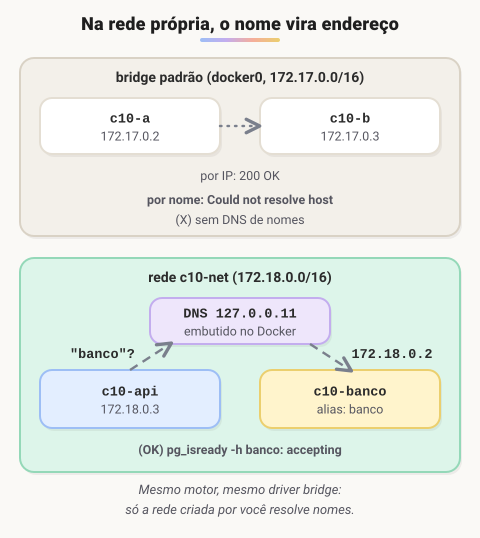
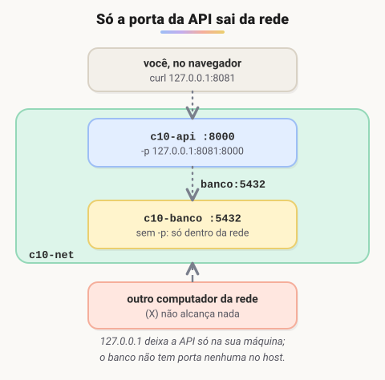

# 10. Redes: contêineres que conversam

> 🗺️ **Neste capítulo:** você vê por que dois contêineres na rede padrão não se acham pelo nome, cria uma rede própria em que a API encontra o PostgreSQL só pelo nome `banco` e publica para fora apenas a porta da API, presa a `127.0.0.1`.

## De onde paramos

No capítulo 9 o PostgreSQL ganhou um volume e passou a sobreviver a um `docker rm`. Mas ele está sozinho: a API do capítulo 7 não sabe onde ele mora. Escrever o IP do banco no código não serve, porque o IP muda a cada contêiner novo. Este capítulo resolve isso do jeito que o projeto final (cap. 12) vai usar: uma rede chamada `tarefas-net`, com os contêineres `banco` e `api` se chamando pelo nome.

## A rede padrão: IP sim, nome não

Todo contêiner criado sem a opção `--network` entra na mesma rede, chamada `bridge`. **A rede bridge padrão é uma rede virtual criada pelo Docker na instalação, ligada à interface** `<b>docker0</b>` **do host, que dá a cada contêiner um IP da faixa 172.17.0.0/16.** O host fica com o `172.17.0.1` (o gateway) e os contêineres recebem `.2`, `.3` e assim por diante, na ordem em que sobem.

```bash
docker network ls
docker network inspect bridge \
  -f '{{json .IPAM.Config}}'
```

```
NETWORK ID     NAME      DRIVER    SCOPE
5080109740d3   bridge    bridge    local
f08dbb97f395   host      host      local
70a18cd19544   none      null      local
[{"Subnet":"172.17.0.0/16","Gateway":"172.17.0.1"}]
```

As três redes da lista vêm com a instalação. Agora, dois contêineres nessa rede: `c10-b` roda um servidor web na porta 8000 e `c10-a` tenta falar com ele.

```bash
docker run -d --name c10-a ubuntu:24.04 sleep infinity
docker run -d --name c10-b ubuntu:24.04 \
  python3 -m http.server 8000
# o IP de cada um, na rede bridge
docker inspect \
  -f '{{.Name}} {{.NetworkSettings.Networks.bridge.IPAddress}}' \
  c10-a c10-b
# pelo IP: funciona
docker exec c10-a curl -sS -o /dev/null \
  -w '%{http_code}\n' http://172.17.0.3:8000/
# pelo nome: não
docker exec c10-a curl -sS http://c10-b:8000/
```

```
/c10-a 172.17.0.2
/c10-b 172.17.0.3
200
curl: (6) Could not resolve host: c10-b
```

Os dois estão na mesma rede e a conexão pelo IP funciona. O que falta é quem traduza o nome `c10-b` para `172.17.0.3`: na rede padrão, o Docker não oferece esse serviço. A documentação do Docker chama de legado a velha saída para isso, a opção `--link`, que precisava ser repetida nos dois sentidos para cada par de contêineres.

> ⚠️ **Armadilha comum:** anotar o IP do banco (`172.17.0.3`) e pôr no código ou na configuração da API. Funciona até o primeiro `docker rm`: o IP é dado na ordem de criação e o contêiner novo pode receber outro. Outra pegadinha, já vista no capítulo 4: no Docker Engine 29, o campo `.NetworkSettings.IPAddress` não existe mais no topo do `docker inspect` (o comando responde `map has no entry for key "IPAddress"`); o IP fica dentro de cada rede, em `.NetworkSettings.Networks`, como no comando acima.

## Rede própria: o Docker vira a lista de nomes

**Uma rede bridge definida pelo usuário é uma rede criada com** `<b>docker network create</b>`**; nela, o Docker roda um servidor DNS embutido que traduz o nome de cada contêiner (e os apelidos dados com** `<b>--network-alias</b>`**) para o IP atual dele.** O driver é o mesmo `bridge`; a diferença está no DNS e no isolamento: só os contêineres ligados a ela conversam entre si.

```bash
docker network create c10-net
# o banco ganha um apelido: "banco"
docker run -d --name c10-banco --network c10-net \
  --network-alias banco \
  -e POSTGRES_PASSWORD=senha-de-estudo c09-pg:16
docker run -d --name c10-api --network c10-net \
  -p 127.0.0.1:8081:8000 c07-api:1.0
# a API pergunta pelos dois nomes do banco
docker exec c10-api getent hosts c10-banco banco
docker exec c10-api pg_isready -h banco
```

```
91e0cbf249313803dbcd93f1e88f5a33177eaaa03fdfc5ebbad41ff8c01ce8a7
efd7592813edb5c6b15fcb50cbb53cb150dc1fd0a35d231d9bc0aa2b4ec118d7
00bedb1e6a0a702c4ce6abf4ee487ddb3bd4a609bc2b080c1b22d23e530af01b
172.18.0.2      c10-banco
172.18.0.2      banco
banco:5432 - accepting connections
```

O `getent hosts` pergunta ao sistema qual é o IP de um nome; o `pg_isready`, que vem com o PostgreSQL, testa se há um banco aceitando conexões naquele endereço. Os dois nomes levam ao mesmo IP. O DNS do Docker atende dentro de cada contêiner no endereço `127.0.0.11`, como mostra o `/etc/resolv.conf`:

```bash
docker exec c10-api grep nameserver /etc/resolv.conf
```

```
nameserver 127.0.0.11
```



> 💡 **Analogia:** pense numa escola no primeiro dia de aula. A bridge padrão é o pátio na hora da entrada: todo mundo está no mesmo lugar, mas só dá para achar alguém pela posição na fila (o IP), que muda todo dia. A rede própria é uma sala de aula com lista de chamada: a professora (o DNS em `127.0.0.11`) sabe em qual carteira cada aluno sentou hoje, e basta chamar pelo nome. O `--network-alias` é o apelido na lista: chamar "banco" ou "c10-banco" faz levantar a mesma mão.

Por que dar um apelido, se o contêiner já tem nome? Porque o nome do contêiner é único no Docker inteiro, e o apelido vale só dentro da rede. A API sempre procura `banco`, e você escolhe qual contêiner atende por esse nome em cada rede. No projeto final o contêiner vai se chamar `banco` de verdade, na rede `tarefas-net`, e os dois jeitos dão no mesmo.

> ⚠️ **Armadilha comum:** configurar a API para falar com o banco em `localhost` ou `127.0.0.1`. Dentro de um contêiner, `localhost` é o próprio contêiner, não o seu computador nem o vizinho: a API vai procurar um PostgreSQL dentro dela mesma e não achar. Use o nome do outro contêiner (`banco`), e deixe-o numa variável de ambiente, para trocar sem rebuild.

## Os comandos de rede

Tudo fica sob `docker network`:

| Comando | O que faz |
| --- | --- |
| `docker network create nome` | cria uma rede bridge própria |
| `docker network ls` | lista as redes |
| `docker network inspect nome` | mostra faixa de IPs, gateway e contêineres ligados |
| `docker network connect rede ctr` | liga um contêiner já rodando à rede |
| `docker network disconnect rede ctr` | desliga o contêiner da rede, sem pará-lo |
| `docker network rm nome` | apaga a rede (se ninguém estiver nela) |
| `docker network prune` | apaga as redes sem nenhum contêiner |

O `inspect` devolve um JSON longo. Com `-f`, você pega só o que interessa, como a faixa de IPs e quem está na rede:

```bash
docker network inspect c10-net \
  -f '{{json .IPAM.Config}}'
# uma linha por contêiner ligado à rede
docker network inspect c10-net \
  -f '{{range .Containers}}{{.Name}} {{.IPv4Address}}{{println}}{{end}}'
```

```
[{"Subnet":"172.18.0.0/16","Gateway":"172.18.0.1"}]
c10-api 172.18.0.3/16
c10-banco 172.18.0.2/16
```

Cada rede própria ganha uma faixa livre (aqui, `172.18.0.0/16`; no seu computador pode ser outra). Diferente da rede padrão, a rede própria aceita entrar e sair com o contêiner rodando, com `connect` e `disconnect`; o laboratório faz isso ao vivo.

> ⚠️ **Armadilha comum:** rodar `docker network prune` sem olhar. Ele apaga **toda** rede sem contêineres naquele momento, inclusive a do projeto que está parado. Para limpar só o que é seu, use um filtro: crie as redes de teste com `--label` e apague com `docker network prune -f --filter label=livro=c10`. Já o `docker network rm` se recusa a apagar uma rede em uso e responde `network c10-net has active endpoints`, com a lista dos contêineres que ainda estão nela.

## Publicar só o que precisa ser acessado de fora

Contêineres na mesma rede conversam por qualquer porta, sem `-p`. O `-p` (publicar porta, visto no capítulo 4) serve para outra coisa: abrir uma porta do **host** que leva até o contêiner. **Publicar uma porta é criar uma passagem de uma porta do host para uma porta do contêiner; quem não está na rede do Docker só alcança o contêiner por ela.**

Daí sai a regra deste capítulo: o banco fica **sem** `-p`, porque só a API fala com ele, e a API publica a sua porta presa a `127.0.0.1`, para ser vista só no seu computador:

```bash
docker ps --filter name=c10- \
  --format 'table {{.Names}}\t{{.Ports}}\t{{.Networks}}'
# do host, a API responde na porta publicada
curl -s 127.0.0.1:8081/tarefas
```

```
NAMES       PORTS                      NETWORKS
c10-api     127.0.0.1:8081->8000/tcp   c10-net
c10-banco   5432/tcp                   c10-net
[{"id": 1, "titulo": "Estudar Docker"}]
```

O `5432/tcp` sem seta quer dizer que a porta existe dentro do contêiner, mas não foi publicada: nenhuma porta do host leva até ela.

| Forma | Quem alcança |
| --- | --- |
| sem `-p` | só contêineres da mesma rede |
| `-p 127.0.0.1:8080:8000` | também o próprio computador (host) |
| `-p 8080:8000` | também qualquer máquina que alcance o host |



> 💡 **Analogia:** um restaurante. O salão (a API) tem uma porta para a rua, por onde entram os clientes (o `-p`). A cozinha (o banco) não tem porta para a rua: só quem trabalha lá dentro (os contêineres da mesma rede) passa por ela. O `127.0.0.1` é trocar a porta do salão por uma que só abre por dentro do prédio: o dono (você, no seu computador) entra; quem passa na calçada (outra máquina da sua rede), não.

> ⚠️ **Armadilha comum:** copiar `-p 5432:5432` para o banco "por garantia". Sem endereço, o `-p` abre a porta em todos os endereços do host, e a documentação do Docker avisa que publicar portas é inseguro por padrão: o banco fica acessível a qualquer máquina que alcance o seu computador. Outra mensagem comum ao publicar é `Bind for 0.0.0.0:8080 failed: port is already allocated`: outro contêiner (ou programa) já usa aquela porta do host. Na produção do livro, a 8080 estava ocupada pelo projeto do capítulo 12, por isso o laboratório usa a 8081. Escolha outra porta do host; a do contêiner (8000) continua igual.

## Os drivers host e none

**O driver de uma rede é o tipo de rede que o Docker monta para o contêiner.** Até aqui só apareceu o `bridge`. Os outros dois que vêm instalados servem para casos especiais:

| Driver | O que o contêiner ganha | Quando usar |
| --- | --- | --- |
| `bridge` | rede virtual própria, IP próprio | quase sempre |
| `host` | a rede do próprio host, sem isolamento | desempenho de rede ou muitas portas |
| `none` | só a interface `lo`, sem rede | tarefas que não devem falar com ninguém |

```bash
# none: só a interface de loopback
docker run --rm --network none ubuntu:24.04 \
  ls /sys/class/net
# host: o -p perde o sentido
docker run --rm --network host -p 9999:80 \
  ubuntu:24.04 true
```

```
lo
WARNING: Published ports are discarded when using host network mode
```

No modo `host`, o programa do contêiner abre portas direto no host, e o Docker descarta o `-p` com um aviso. Esse modo existe no Linux; no Docker Desktop (Windows e Mac), a documentação diz que ele é suportado a partir da versão 4.34, mas é opcional: é preciso entrar com a conta Docker e ligá-lo em **Settings** → **Resources** → **Network**, e ele tem limitações (só contêineres Linux, só TCP e UDP).

## Do contêiner para o seu computador: host.docker.internal

Às vezes o caminho é o inverso: um programa no contêiner precisa falar com algo que roda direto no seu computador (um banco instalado fora do Docker, uma API em desenvolvimento). `localhost` não serve, pela armadilha vista acima. No Docker Desktop, o nome especial `host.docker.internal` resolve para o endereço do seu computador, de dentro de qualquer contêiner; a documentação também cita `gateway.docker.internal`, o gateway da máquina virtual do Desktop. Com uma API ouvindo na porta 3000 do Windows ou do Mac, um contêiner chega a ela em `http://host.docker.internal:3000`.

No Docker Engine do Linux, esse nome não existe sozinho; você o cria com `--add-host` e o valor especial `host-gateway`, que o Docker troca pelo IP do host na rede bridge:

```bash
# sem a opção, o nome não existe (saída vazia)
docker run --rm ubuntu:24.04 \
  getent hosts host.docker.internal
# com a opção, aponta para o docker0 do host
docker run --rm \
  --add-host=host.docker.internal:host-gateway \
  ubuntu:24.04 getent hosts host.docker.internal
```

```
172.17.0.1      host.docker.internal
```

No Docker Desktop vale também o contrário do que o Linux permite: o `docker0` e os IPs `172.x` dos contêineres ficam dentro da máquina virtual, e a documentação avisa que o seu Windows ou Mac não consegue chegar a eles pelo IP. Do computador para o contêiner, o caminho é sempre uma porta publicada.

## 🧪 Laboratório

> ⚠️ **O que não foi executado na produção do livro:** o Docker Desktop (Windows e Mac), portanto o `host.docker.internal` do Desktop e o modo `host` nele estão descritos pela documentação. O resto rodou de verdade no Docker Engine 29.9.2 (Linux), com a imagem `c09-pg:16` do capítulo 9 no lugar da oficial `postgres` (o Docker Hub estava bloqueado) e a `c07-api:1.0` do capítulo 7. Como outro projeto usava o mesmo Docker, o laboratório usa nomes com prefixo (`c10-net`, `c10-banco`, `c10-api`) e a porta 8081; no capítulo 12 você repete tudo com os nomes definitivos `tarefas-net`, `banco` e `api`. Ids, IPs e a faixa da rede (`172.18`) podem ser outros no seu computador.

**1. Comprove o problema na rede padrão.** Se você já rodou os comandos da primeira seção, pule para o passo 2; senão, rode-os agora e veja o `Could not resolve host`. Confirme também com `getent`, que não imprime nada e sai com código 2 (nome não encontrado), e remova os dois:

```bash
docker exec c10-a getent hosts c10-b; echo "saida=$?"
docker rm -f c10-a c10-b
```

```
saida=2
c10-a
c10-b
```

**2. Crie a rede e suba o banco e a API nela.** O banco não publica porta nenhuma; a API publica a 8000 só em `127.0.0.1`:

```bash
docker network create c10-net
docker run -d --name c10-banco --network c10-net \
  --network-alias banco \
  -e POSTGRES_PASSWORD=senha-de-estudo c09-pg:16
docker run -d --name c10-api --network c10-net \
  -p 127.0.0.1:8081:8000 c07-api:1.0
# espere uns segundos para o banco iniciar
docker exec c10-api pg_isready -h banco
```

```
91e0cbf249313803dbcd93f1e88f5a33177eaaa03fdfc5ebbad41ff8c01ce8a7
efd7592813edb5c6b15fcb50cbb53cb150dc1fd0a35d231d9bc0aa2b4ec118d7
00bedb1e6a0a702c4ce6abf4ee487ddb3bd4a609bc2b080c1b22d23e530af01b
banco:5432 - accepting connections
```

**3. Conecte-se de verdade, pelo nome.** O `psql` roda dentro da API (a imagem local já o traz) e faz login no banco com a senha:

```bash
# PGPASSWORD evita a pergunta da senha
docker exec -e PGPASSWORD=senha-de-estudo c10-api \
  psql -h banco -U postgres -tAc 'SELECT current_user'
```

```
postgres
```

Nenhum IP apareceu no comando: a API achou o banco pelo nome `banco`, e é isso que o projeto final vai pôr na configuração dela.

**4. Veja quem está na rede.**

```bash
docker network inspect c10-net \
  -f '{{range .Containers}}{{.Name}} {{.IPv4Address}}{{println}}{{end}}'
```

```
c10-api 172.18.0.3/16
c10-banco 172.18.0.2/16
```

**5. Ligue e desligue um contêiner com ele rodando.** O `c10-avulso` nasce na rede padrão e não acha o banco; ligado à `c10-net`, passa a achar; desligado, perde de novo, sem ter sido parado em nenhum momento:

```bash
docker run -d --name c10-avulso ubuntu:24.04 \
  sleep infinity
docker exec c10-avulso getent hosts banco
echo "saida=$?"
docker network connect c10-net c10-avulso
docker exec c10-avulso getent hosts banco
# agora ele está em duas redes, com um IP em cada
docker inspect c10-avulso -f \
  '{{range $n, $c := .NetworkSettings.Networks}}{{$n}} {{$c.IPAddress}}{{println}}{{end}}'
docker network disconnect c10-net c10-avulso
docker exec c10-avulso getent hosts banco
echo "saida=$?"
```

```
d0b04708520b1ca31c855f57e1a26cebdf4b1de302a9c174bb5788e442fe484d
saida=2
172.18.0.2      banco
bridge 172.17.0.2
c10-net 172.18.0.4
saida=2
```

**6. Arrume a casa.** A rede só pode ser apagada quando ficar vazia; as imagens `c09-pg:16` e `c07-api:1.0` ficam, porque os próximos capítulos as usam:

```bash
docker rm -f c10-avulso c10-api c10-banco
docker network rm c10-net
docker network ls --filter name=c10
```

```
c10-avulso
c10-api
c10-banco
c10-net
NETWORK ID   NAME      DRIVER    SCOPE
```

## 🏋️ Pratique

**1. Um segundo apelido.** Com o `c10-banco` e a `c10-api` do laboratório rodando (refaça o passo 2 se já limpou), faça o banco atender também pelo nome `db`, sem recriar o contêiner, e prove com `pg_isready -h db`.

<details>
<summary>Ver resposta</summary>

O apelido é dado ao ligar o contêiner à rede, então desligue e ligue de novo, passando os dois apelidos:

```bash
docker network disconnect c10-net c10-banco
# --alias pode se repetir
docker network connect --alias banco --alias db \
  c10-net c10-banco
docker exec c10-api getent hosts db
docker exec c10-api pg_isready -h db
```

Saída na produção do livro (nessa rodada, a rede tinha recebido a faixa `172.19`):

```
172.19.0.2      db
db:5432 - accepting connections
```

Se você passar só `--alias db`, o apelido `banco` some: ao reconectar, o contêiner fica só com os apelidos dados no novo `connect` (além do próprio nome).

</details>

**2. Redes não se enxergam.** Crie uma rede `c10-outra` e, a partir de um contêiner nela, tente achar o `banco` pelo nome e chegar à API pelo IP dela na `c10-net`. O que acontece, e por quê?

<details>
<summary>Ver resposta</summary>

```bash
docker network create c10-outra
docker run --rm --network c10-outra ubuntu:24.04 \
  getent hosts banco; echo "saida=$?"
# troque pelo IP que o inspect mostrou para a API
docker run --rm --network c10-outra ubuntu:24.04 \
  curl -sS --max-time 3 http://172.19.0.3:8000/tarefas
docker network rm c10-outra
```

```
4555c8bb9ea44cd8ba6ddf0b8bd2ce9f15899d7a0a1ed8ff50b391e0cf1cd48f
saida=2
curl: (28) Connection timed out after 3002 milliseconds
c10-outra
```

O DNS de cada rede só conhece os contêineres dela, e o Docker bloqueia o tráfego entre redes bridge diferentes, até pelo IP. É esse isolamento que permite rodar dois projetos no mesmo computador, cada um com o seu `banco`, sem um enxergar o outro.

</details>

**3. Onde a porta foi aberta?** Suba uma segunda API, `c10-api2`, na mesma rede, com `-p 8082:8000` (sem endereço), e compare a saída de `docker port` das duas. Qual delas outra máquina da sua rede consegue acessar?

<details>
<summary>Ver resposta</summary>

```bash
# 2ª API publicada noutra porta, para comparar
docker run -d --name c10-api2 --network c10-net \
  -p 8082:8000 c07-api:1.0
docker port c10-api2
docker port c10-api
docker rm -f c10-api2
```

```
8000/tcp -> 0.0.0.0:8082
8000/tcp -> 127.0.0.1:8081
c10-api2
```

`0.0.0.0` quer dizer "todos os endereços do host": a `c10-api2` pode ser acessada por qualquer máquina que alcance o seu computador (se o firewall deixar). A `c10-api` só responde em `127.0.0.1`, ou seja, só para o próprio computador. Num host com IPv6 ligado, a `c10-api2` mostraria também uma linha com `[::]:8082`. Ao terminar, rode o passo 6 do laboratório.

</details>

## 🧠 Revisão rápida

**Por que dois contêineres na rede padrão não se acham pelo nome?**

Porque o DNS embutido do Docker só funciona em redes criadas pelo usuário. Na bridge padrão, eles só se alcançam pelo IP, que muda a cada contêiner novo.

**O banco precisa de `-p 5432:5432` para a API, na mesma rede, conseguir falar com ele?**

Não. Contêineres da mesma rede conversam por qualquer porta. O `-p` só abre uma passagem do host para o contêiner, e no banco ele só aumenta o risco.

**A API, num contêiner, está configurada para achar o banco em `localhost:5432`. Por que falha?**

Dentro do contêiner, `localhost` é o próprio contêiner da API. Use o nome do contêiner do banco (`banco`) numa rede própria.

> ➡️ **Próximo passo:** a API e o banco já conversam, mas a imagem da API só existe no seu computador. No capítulo 11, **Publicar a imagem**, você a envia para o Docker Hub com uma tag de versão, para rodá-la em qualquer máquina com um `docker run`.

## 📚 Fontes

Conferido em 2026-11-15, com Docker Engine 29.9.2 (Linux) e a documentação do Docker Desktop 4.96.

- [Bridge network driver](https://docs.docker.com/engine/network/drivers/bridge/) (rede padrão x rede própria, DNS por nome, `--link` legado, `connect` e `disconnect`)
- [Port publishing and mapping](https://docs.docker.com/engine/network/port-publishing/) (publicar é inseguro por padrão, `-p 127.0.0.1:...`, rede interna sem `-p`)
- [Host network driver](https://docs.docker.com/engine/network/drivers/host/) (`-p` descartado, suporte opcional no Docker Desktop 4.34+)
- [Networking how-tos on Docker Desktop](https://docs.docker.com/desktop/features/networking/networking-how-tos/) (`host.docker.internal`, `gateway.docker.internal`, IPs dos contêineres fora do alcance do host)
- [docker network](https://docs.docker.com/reference/cli/docker/network/) (referência dos subcomandos)

## 📌 Resumo

| Item | Em uma frase |
| --- | --- |
| Bridge padrão | Rede do `docker0` (172.17.0.0/16) em que os contêineres só se acham pelo IP |
| Rede própria | Criada com `docker network create`, tem DNS embutido em `127.0.0.11` e isola o projeto |
| `--network-alias` | Apelido válido só naquela rede; a API procura sempre `banco` |
| `docker network` | `create`, `ls`, `inspect`, `connect`, `disconnect`, `rm` e `prune` (este, com filtro) |
| `-p` | Passagem do host para o contêiner: só no que precisa ser acessado de fora |
| `-p 127.0.0.1:8080:8000` | Publica só para o próprio computador |
| Banco sem `-p` | Alcançável só pelos contêineres da mesma rede |
| `localhost` no contêiner | É o próprio contêiner; para outro contêiner, use o nome dele |
| `host` e `none` | Rede do próprio host (sem isolamento) ou nenhuma rede |
| `host.docker.internal` | Nome do seu computador visto de dentro do contêiner no Docker Desktop; no Linux, crie com `--add-host` |
