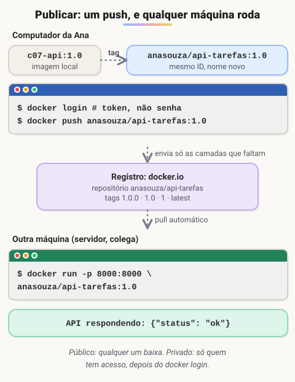
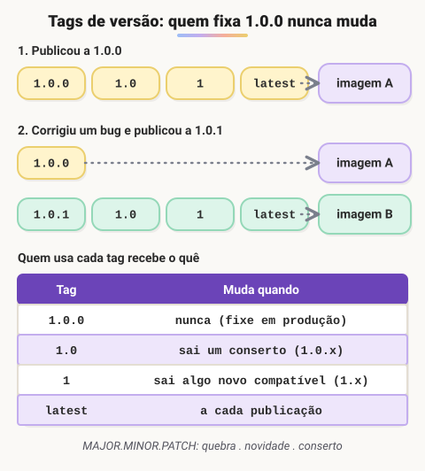

# 11. Publicar a imagem

> 🗺️ **Neste capítulo:** você dá à API de tarefas um nome publicável, entra no Docker Hub com um token em vez da senha, envia a imagem com `docker push` e a roda em outra máquina com um único `docker run`. No caminho: tags de versão, o GitHub Container Registry e como não publicar um segredo por engano.

## De onde paramos

No capítulo 10 a API passou a conversar com outros contêineres numa rede própria. Mas tudo ainda mora no seu computador: a imagem `c07-api:1.0` só existe no seu disco. Para um colega, um servidor ou o projeto final do capítulo 12 usarem a mesma imagem, ela precisa ir para um lugar de onde qualquer motor Docker consiga baixá-la. Esse lugar é um registro.

## O que é um registro

Sem um registro, levar uma imagem de uma máquina para outra é copiar arquivos à mão (o `docker save`/`docker load` do capítulo 6). Funciona para um caso isolado, mas não para uma equipe ou um servidor que precisa da versão nova toda semana.

**Um registro (registry) é um servidor que guarda imagens organizadas em repositórios e tags; o** `docker push` **envia uma imagem para ele, e o** `docker pull` **(ou o** `docker run`**) a baixa de lá.**

Você já leu no capítulo 6 que a primeira parte do nome de uma imagem é o registro, e que sem ela o Docker completa com `docker.io`. É exatamente isso que decide para onde o push vai. Os registros mais comuns:

| Registro | Endereço no nome | Bom para |
| --- | --- | --- |
| Docker Hub | `docker.io` (implícito) | imagens públicas, o padrão do Docker |
| GitHub Container Registry | `ghcr.io` | projetos que já vivem no GitHub |
| Amazon ECR | `<conta>.dkr.ecr.<região>.amazonaws.com` | quem roda na AWS |
| Google Artifact Registry | `<região>-docker.pkg.dev` | quem roda no Google Cloud |
| Azure Container Registry | `<nome>.azurecr.io` | quem roda na Azure |

Todos falam o mesmo protocolo (a especificação de distribuição da OCI), então os comandos deste capítulo são os mesmos em qualquer um: muda o endereço no nome da imagem e o jeito de conseguir a credencial. Há também registros que você mesmo hospeda, como o que aparece nos exemplos da documentação, `registry-host:5000`.

## Conta e repositório no Docker Hub

**Um repositório no Docker Hub é a pasta de uma imagem dentro da sua conta (**`anasouza/api-tarefas`**), que guarda todas as tags dela e tem uma visibilidade: pública ou privada.**

Para criar, segundo a documentação (página de 2026-09-03):

1. Crie uma conta gratuita em hub.docker.com e entre nela. O nome de usuário vira o seu namespace: `anasouza`.
2. Vá em **My Hub** > **Repositories** e clique em **Create repository**.
3. Escolha o namespace (a sua conta ou uma organização), o nome (`api-tarefas`: de 2 a 255 caracteres, só minúsculas, números, hífen e sublinhado, e **não dá para renomear depois**) e uma descrição curta.
4. Escolha a visibilidade e clique em **Create**.

|  | Público | Privado |
| --- | --- | --- |
| Quem baixa | qualquer pessoa, sem login | só você e quem você autorizar |
| Aparece na busca do Hub | sim | não |
| Plano gratuito (Personal) | ilimitados (uso justo) | 1 repositório |

Os números do plano gratuito são da página de preços da Docker, conferida em 2026-11-15: **1 repositório privado** e públicos ilimitados, sujeitos a uso justo; o plano Pro libera privados ilimitados. Para baixar imagens, vale a página de limites de uso do Docker Hub (a mesma do capítulo 6): 100 pulls a cada 6 horas sem login (contados por endereço IP) e 200 a cada 6 horas com uma conta Personal. A página de preços resume isso de outro jeito; na dúvida, siga a de limites de uso e confira antes de planejar algo em cima deles.

> ⚠️ **Armadilha:** gastar o único repositório privado do plano gratuito num teste e depois não conseguir criar o privado de verdade. Para treinar, use um repositório público com uma imagem sem nada sensível (como a API do livro) e apague-o depois.

## docker login com token, não com a senha

O `docker push` precisa provar que você é dono do namespace `anasouza`. Usar a senha da conta funciona em alguns casos, mas é arriscado: ela fica guardada na máquina, dá acesso a tudo (inclusive trocar a própria senha) e, se vazar, você precisa trocá-la em todo lugar.

**Um token de acesso pessoal (personal access token, PAT) é uma senha alternativa, gerada no site, que só serve para o Docker (CLI e API), pode ter permissões limitadas e pode ser apagado a qualquer momento sem mexer na sua senha.** Com a verificação em duas etapas ligada, o CLI nem aceita a senha: o PAT passa a ser obrigatório (documentação de tokens, atualizada em 2026-10-16).

Na prática:

1. No Docker Hub, abra as configurações da conta e a seção de tokens de acesso pessoal; gere um token com uma descrição que diga onde ele vai ser usado ("notebook da Ana").
2. Escolha a menor permissão que resolve: leitura e escrita para quem publica; só leitura para um servidor que só baixa.
3. Copie o token na hora e guarde-o num gerenciador de senhas.
4. Entre pelo terminal, passando o token pela entrada padrão:

```bash
# o token vem de uma variável, não da linha de
# comando: assim não fica no histórico do shell
export DOCKER_TOKEN='cole-o-token-aqui'
echo "$DOCKER_TOKEN" | docker login \
  -u anasouza --password-stdin
```

Se der certo, a última linha é `Login Succeeded`. O `--password-stdin` existe justamente para a credencial não aparecer no histórico nem em logs. Sem `-u`, as versões atuais do `docker login` abrem um login pelo navegador, com um código de confirmação (a documentação mostra `USING WEB-BASED LOGIN`); é o caminho mais simples num computador com navegador. No Docker Desktop, entrar pelo botão **Sign in** da janela já deixa o terminal logado.

> 💡 **Analogia:** o PAT é a chave de manobrista do carro. Ela liga o motor e abre a porta (envia e baixa imagens), mas não abre o porta-malas nem o porta-luvas (não troca a senha, não mexe na conta). Se o manobrista sumir com ela, você invalida aquela chave e continua com a sua original intacta. E você pode ter uma chave para cada manobrista: um token para o notebook, outro para o servidor, outro para a automação.

### Onde a credencial fica guardada

Depois do login, o Docker guarda a credencial para não pedir de novo. Onde, depende da instalação:

| Instalação | Onde fica |
| --- | --- |
| Docker Desktop | no cofre do sistema (Keychain, Gerenciador de Credenciais do Windows), automaticamente |
| Linux com credential helper | no programa indicado em `credsStore` do `~/.docker/config.json` (`pass` ou `secretservice`) |
| Linux sem helper | no próprio `~/.docker/config.json`, em base64 |

**Um credential helper é um programinha separado (**`docker-credential-osxkeychain`**,** `-wincred`**,** `-pass`**,** `-secretservice`**) que o Docker chama para guardar e ler a credencial num cofre do sistema, em vez de gravá-la num arquivo.**

> ⚠️ **Armadilha:** achar que base64 é criptografia. Não é: qualquer pessoa que leia o `~/.docker/config.json` recupera o token com um comando. A documentação do `docker login` avisa que guardar ali é menos seguro que usar um cofre. Num Linux sem Docker Desktop, configure um credential helper; e nunca copie esse arquivo para um repositório Git ou para dentro de uma imagem.

## Dar um nome publicável: docker tag

A imagem se chama `c07-api:1.0`. Se você der `docker push c07-api:1.0`, o Docker completa para `docker.io/library/c07-api`, o namespace das imagens oficiais, onde você não pode publicar. Primeiro, a imagem precisa de um nome com o seu usuário.

**Para publicar, a imagem precisa de um nome no formato** `[registro/]usuário/repositório:tag`**; o** `docker tag` **cria esse nome sem copiar nada (capítulo 6).**

```bash
# a versão exata e três atalhos para ela
docker tag c07-api:1.0 anasouza/api-tarefas:1.0.0
docker tag c07-api:1.0 anasouza/api-tarefas:1.0
docker tag c07-api:1.0 anasouza/api-tarefas:1
docker tag c07-api:1.0 anasouza/api-tarefas:latest
docker images --filter reference='anasouza/*'
```

Saída real, no Docker Engine 29.9.2 desta sessão:

```
IMAGE                         ID             DISK USAGE   CONTENT SIZE   EXTRA
anasouza/api-tarefas:1        c3d1088f89e9       15.9GB         5.56GB
anasouza/api-tarefas:1.0      c3d1088f89e9       15.9GB         5.56GB
anasouza/api-tarefas:1.0.0    c3d1088f89e9       15.9GB         5.56GB
anasouza/api-tarefas:latest   c3d1088f89e9       15.9GB         5.56GB
```

Quatro nomes, um só ID. Para ver todos os nomes de uma imagem num só lugar, pergunte à própria imagem:

```bash
docker image inspect --format '{{.RepoTags}}' \
  anasouza/api-tarefas:1.0
```

```
[anasouza/api-tarefas:1 anasouza/api-tarefas:1.0 anasouza/api-tarefas:1.0.0 anasouza/api-tarefas:latest c07-api:1.0]
```

Os 15.9GB vêm da `ubuntu:24.04` local usada na produção do livro (capítulo 7); com `FROM python:3.13-slim`, a sua imagem fica na casa das dezenas de MB, com outro ID. Também dá para dar todos os nomes já no build, repetindo o `-t`: `docker build -t anasouza/api-tarefas:1.0.0 -t anasouza/api-tarefas:latest .`

## Enviar: docker push

`docker push nome:tag` **envia ao registro a imagem com esse nome: primeiro as camadas que o registro ainda não tem, depois o manifesto que as amarra, e por fim aponta a tag para ele.**

```bash
# uma tag por vez...
docker push anasouza/api-tarefas:1.0.0
# ...ou todas as tags locais desse repositório
docker push --all-tags anasouza/api-tarefas
```

A documentação do `docker image push` mostra a saída do `--all-tags` (aqui encurtada, com o registro de exemplo dela):

```
The push refers to repository [registry-host:5000/myname/myimage]
195be5f8be1d: Pushed
latest: digest: sha256:edafc0a0fb05... size: 4527
195be5f8be1d: Layer already exists
v1: digest: sha256:edafc0a0fb05... size: 4527
```

Como ler: a primeira linha diz para qual repositório completo o push vai, e é o melhor lugar para pegar um nome errado. Cada camada aparece com o começo do hash: `Pushed` quando foi enviada e `Layer already exists` quando o registro já a tinha (por isso a segunda tag não reenviou nada). Cada tag termina com o digest do manifesto, o mesmo `sha256:...` que você usaria para fixar a versão (capítulo 6). Por padrão o Docker envia até cinco camadas ao mesmo tempo, e a barra de progresso mostra tamanhos descomprimidos, então o tráfego real é menor.



> 💡 **Analogia:** publicar uma imagem é como publicar um aplicativo numa loja de apps. No seu computador o app tem um nome de projeto qualquer (`c07-api`); para a loja, ele precisa do nome do desenvolvedor na frente (`anasouza/api-tarefas`, o `docker tag`). Você entra na conta de desenvolvedor (`docker login`) e envia a versão (`docker push`). Daí em diante, qualquer celular instala o app só pelo nome, sem você mandar o arquivo para ninguém (o `docker run` em outra máquina). Um app público aparece na busca da loja; um privado é como um app de teste, que só os convidados conseguem instalar.

> ⚠️ **Armadilha:** esquecer o usuário no nome ou usar o de outra pessoa. `docker push api-tarefas:1.0` tenta publicar em `docker.io/library/api-tarefas`, e `docker push anasousa/...` (com s) tenta publicar na conta de outra pessoa. Nos dois casos o registro recusa o acesso (a mensagem costuma ser `denied: requested access to the resource is denied`). Leia sempre a linha `The push refers to repository [...]`: se o repositório ali não for o seu, pare.

Depois do push, confira no site: em **My Hub** > **Repositories** > `api-tarefas`, a aba de tags lista cada tag com o digest, o tamanho comprimido, a arquitetura (`linux/amd64`) e a data do envio. É também a página que os outros veem: escreva ali uma descrição curta de como rodar a imagem.

## Rodar em outra máquina

Aqui está a recompensa. Em qualquer computador com Docker (um servidor, o notebook de um colega, uma máquina recém-instalada), basta:

```bash
docker run -d -p 8000:8000 anasouza/api-tarefas:1.0
```

Se a imagem não existe ali, o `docker run` faz o pull sozinho antes de criar o contêiner. A primeira linha da saída avisa isso; a mensagem é a mesma que a sessão do livro mostrou ao tentar uma tag que não existia localmente:

```
Unable to find image 'anasouza/api-tarefas:9.9' locally
```

Depois dela, numa máquina com acesso ao Hub, vêm as linhas do pull que você conheceu no capítulo 6 (`Pull complete` por camada, `Digest: sha256:...`, `Status: Downloaded newer image for ...`) e o ID do contêiner. Um `curl localhost:8000/saude` responde como no capítulo 7. Se o repositório for privado, a outra máquina precisa de um `docker login` antes, de preferência com um token só de leitura.

> ⚠️ **Armadilha:** publicar a versão nova com a mesma tag e esperar que as outras máquinas a recebam sozinhas. O `docker run` só baixa quando a tag **não existe** localmente; se a máquina já tem uma `anasouza/api-tarefas:latest` antiga, ela usa a antiga, sem perguntar ao registro. Rode `docker pull` antes ou use `docker run --pull always ...`, que confere o registro toda vez. Melhor ainda: publique uma tag nova para cada versão (próxima seção).

## Tags de versão e por que não só latest

Se toda publicação usar a tag `latest`, ninguém sabe qual versão está rodando, cada máquina pode estar numa diferente (conforme a data do último pull) e voltar para a versão anterior depois de um bug vira arqueologia.

**Versionamento semântico (SemVer) é a convenção de numerar versões como** `MAJOR.MINOR.PATCH`**: o PATCH sobe com uma correção, o MINOR com uma novidade compatível e o MAJOR quando algo deixa de funcionar como antes.**

O costume, seguido pelas imagens oficiais, é publicar cada versão com a tag exata e com tags "atalho" mais curtas que andam junto com a mais recente da série:

| Tag | Aponta para | Quem deve usar |
| --- | --- | --- |
| `1.0.0` | sempre a mesma imagem | produção, scripts, o capítulo 12 |
| `1.0` | o último conserto da série 1.0 | quem aceita correções automáticas |
| `1` | a última versão compatível da série 1 | quem aceita novidades compatíveis |
| `latest` | a última publicação, qualquer que seja | testes rápidos, nunca produção |



> 💡 **Analogia:** são as edições de um livro numa livraria. `1.0.0` é a ficha catalográfica de uma impressão específica: quem cita aquela impressão encontra sempre as mesmas páginas. `1.0` é "a 1ª edição", que pode ganhar uma reimpressão com erros de digitação corrigidos. `1` é "qualquer edição revista do mesmo texto". E `latest` é o exemplar que está na vitrine hoje: ótimo para folhear, péssimo para citar num trabalho, porque amanhã a vitrine muda.

> ⚠️ **Armadilha:** achar que o registro protege a tag `1.0.0`. Ele não protege: um novo `docker push` com o mesmo nome move a tag para a imagem nova, sem aviso. "`1.0.0` nunca muda" é uma disciplina sua: corrigiu algo, publique `1.0.1`. Para quem consome e precisa de garantia absoluta, o digest (`@sha256:...`, capítulo 6) é o que não muda.

## GitHub Container Registry, em resumo

Se o código da API está no GitHub, faz sentido a imagem morar ao lado. **O GitHub Container Registry (GHCR) é o registro de imagens do GitHub, no endereço** `ghcr.io`**, com o nome no formato** `ghcr.io/usuário/imagem:tag`**.**

Segundo a documentação do GitHub (conferida em 2026-11-15):

- a autenticação usa um **personal access token (classic)** do GitHub, com o escopo `write:packages` para publicar (ou `read:packages` só para baixar);
- a primeira publicação de um pacote nasce **privada**; para torná-la pública, mude a visibilidade nas configurações do pacote;
- sem o rótulo `org.opencontainers.image.source` (o endereço do repositório no GitHub), uma imagem enviada pelo terminal não fica ligada ao repositório do código.

```bash
# token do GitHub numa variável, nunca no comando
echo "$CR_PAT" | docker login ghcr.io \
  -u anasouza --password-stdin
docker tag c07-api:1.0 \
  ghcr.io/anasouza/api-tarefas:1.0.0
docker push ghcr.io/anasouza/api-tarefas:1.0.0
```

Para ligar a imagem ao repositório, acrescente ao Dockerfile uma linha como `LABEL org.opencontainers.image.source=https://github.com/anasouza/api-tarefas`. O login e o push seguem a mesma lógica do Docker Hub: o que muda é o `ghcr.io` no começo do nome. Um `docker login` sem endereço entra no Docker Hub; com `ghcr.io`, entra no GitHub, e as duas credenciais convivem.

## Sair: docker logout

`docker logout [registro]` **apaga a credencial guardada daquele registro (sem argumento, a do Docker Hub).** Faça isso em máquinas compartilhadas ou emprestadas, e sempre que terminar de usar um token temporário.

```bash
docker logout
docker logout ghcr.io
```

Saída real do primeiro comando na sessão do livro:

```
Removing login credentials for https://index.docker.io/v1/
```

O endereço `index.docker.io/v1/` é o nome histórico que o Docker usa internamente para a credencial do Hub. O logout só apaga a cópia local: se o token vazou, apague-o também no site, que é o que realmente o invalida.

## Nunca publique um segredo

Uma imagem pública é baixada por qualquer pessoa, e cada camada pode ser aberta e lida. Tudo o que entrou numa camada continua lá, mesmo que uma instrução posterior apague o arquivo.

- O `.dockerignore` do capítulo 7 é a primeira barreira: `.env`, chaves e logs não entram no contexto. Lá, sem ele, um `COPY . .` levou `SENHA_DO_BANCO=segredo123` para dentro da imagem.
- `ARG` e `ENV` aparecem no `docker history` e no `docker image inspect`: nunca passe senha por eles.
- Antes do primeiro push, olhe a imagem como um estranho olharia: liste o que está na pasta da aplicação e procure palavras suspeitas no histórico e nas variáveis (o passo 6 do Laboratório faz isso).

> ⚠️ **Armadilha:** perceber o segredo depois do push e só apagar a tag. Imagens públicas podem ter sido baixadas, copiadas e indexadas em minutos. Trate o segredo como vazado: **troque-o** (gere outra senha ou token e invalide o antigo), depois corrija a imagem e apague a versão publicada. Senhas de verdade entram no contêiner na hora de rodar, por variável de ambiente (`-e`) ou arquivo montado, nunca no build; o capítulo 12 faz assim com a senha do banco.

## 🧪 Laboratório

> ⚠️ **O que não foi executado na produção do livro:** o `docker login`, o `docker push` e o pull no Docker Hub e no GHCR, e a conferência no site. A rede da sessão bloqueia todos os registros públicos testados (`registry-1.docker.io`, `ghcr.io`, `quay.io`, `public.ecr.aws`, `mcr.microsoft.com`, `gcr.io`: o proxy recusou a conexão com 403), e não havia como baixar a imagem de um registro local. As saídas de sucesso (`Login Succeeded`, `Pushed`, `Layer already exists`) vêm da documentação oficial; os erros mostrados abaixo são reais. Tudo o mais rodou de verdade no Docker Engine 29.9.2, com a imagem `c07-api:1.0` do capítulo 7 (feita sobre a `ubuntu:24.04` local; com `python:3.13-slim`, mudam o ID e o tamanho). Sem acesso a registro nenhum, a saída para levar a imagem a outra máquina é o `docker save`/`docker load` do capítulo 6.

Objetivo: preparar a API para publicação, tentar o envio, conferir que nenhum segredo vai junto e terminar sem deixar nomes sobrando.

**1. Dê os nomes de publicação.** Use o seu usuário do Docker Hub no lugar de `anasouza`.

```bash
# os nomes de publicação
docker tag c07-api:1.0 anasouza/api-tarefas:1.0.0
docker tag c07-api:1.0 anasouza/api-tarefas:1.0
docker tag c07-api:1.0 anasouza/api-tarefas:1
docker tag c07-api:1.0 anasouza/api-tarefas:latest
docker image inspect --format '{{json .RepoTags}}' \
  c07-api:1.0
```

```
["anasouza/api-tarefas:1","anasouza/api-tarefas:1.0","anasouza/api-tarefas:1.0.0","anasouza/api-tarefas:latest","c07-api:1.0"]
```

**2. Rode pelo nome novo.** Antes de publicar, prove que o nome funciona localmente (aqui na porta 8011, para não brigar com nada na 8000):

```bash
# prova que o nome novo roda antes do push
docker run -d --rm --name c11-api -p 8011:8000 \
  anasouza/api-tarefas:1.0
curl -s -w '\n' localhost:8011/saude
docker stop c11-api
```

```
6b6e5877fcad5be80dff034361c034fcf251d197119b2ff8e4003d65554620bd
{"status": "ok", "versao": "1.0.0"}
c11-api
```

Nada foi baixado: a imagem com esse nome já existia no disco.

**3. Entre no Docker Hub.** Gere um PAT (seção "docker login com token") e entre:

```bash
echo "$DOCKER_TOKEN" | docker login \
  -u anasouza --password-stdin
```

No seu computador, a resposta esperada é `Login Succeeded`. Na sessão do livro, com um texto qualquer no lugar do token, o motor nem chegou a conversar com o Hub:

```
Error response from daemon: Get "https://registry-1.docker.io/v2/": Forbidden
```

Se você vir esse erro em casa ou no trabalho, a causa é a mesma do capítulo 6: um proxy ou firewall no caminho. Com a rede livre e um token errado, a mensagem fala em credenciais inválidas (`unauthorized`).

**4. Envie.**

```bash
docker push --all-tags anasouza/api-tarefas
```

Saída real na sessão do livro (as linhas `Waiting` se repetem enquanto o motor tenta):

```
The push refers to repository [docker.io/anasouza/api-tarefas]
2b02a3c9f70e: Waiting
1094ad74e92e: Waiting
44136fa355b3: Waiting
965c8c5397da: Waiting
failed to do request: Head "https://registry-1.docker.io/v2/anasouza/api-tarefas/blobs/sha256:965c8c5397da8682834ecadcea38e7e66401d68ff95327f4e2a5c9ec752e31f0": Forbidden
```

Mesmo falhando, ela ensina: a primeira linha confirma o destino (`docker.io/anasouza/api-tarefas`), e o erro mostra o primeiro passo do push, perguntar ao registro (`Head .../blobs/sha256:...`) se ele já tem cada camada, para só enviar as que faltam. No seu computador, cada camada termina em `Pushed` e cada tag numa linha `1.0.0: digest: sha256:... size: ...` (com o nome da tag no começo), como na saída da documentação mostrada acima.

**5. Confira no site e rode de outro lugar.** No Docker Hub, abra o repositório e veja as quatro tags com o mesmo digest. Depois, em outra máquina (ou na mesma, depois de apagar os nomes locais no passo 7), rode `docker run -d -p 8000:8000 anasouza/api-tarefas:1.0` e veja o pull acontecer sozinho. Na sessão do livro, o mesmo comando mostrou o começo certo e parou no bloqueio:

```
Unable to find image 'anasouza/api-tarefas:9.9' locally
docker: Error response from daemon: failed to resolve reference "docker.io/anasouza/api-tarefas:9.9": failed to do request: Head "https://registry-1.docker.io/v2/anasouza/api-tarefas/manifests/9.9": Forbidden
```

**6. Procure segredos antes de publicar.**

```bash
# o que a imagem leva na pasta da aplicação
docker run --rm c07-api:1.0 ls -A /app
# quantas linhas do histórico citam senha ou token
docker history --no-trunc --format '{{.CreatedBy}}' \
  c07-api:1.0 | grep -ciE 'senha|token|password|secret'
# variáveis de ambiente suspeitas (nenhuma = ok)
docker run --rm c07-api:1.0 env \
  | grep -iE 'senha|token|pass|secret'
```

```
app.py
0
```

Só o `app.py` na pasta, zero linhas suspeitas no histórico e nenhuma variável suspeita (o último `grep` não imprimiu nada). É uma checagem rápida, não uma auditoria; ferramentas de varredura de imagens ficam para o livro de segurança da trilha.

**7. Saia e arrume a casa.** Os nomes de publicação saem; a `c07-api:1.0` fica para o capítulo 12.

```bash
# sai do registro e tira os nomes de publicação
docker logout
docker rmi anasouza/api-tarefas:1.0.0 \
  anasouza/api-tarefas:1.0 anasouza/api-tarefas:1 \
  anasouza/api-tarefas:latest
```

```
Removing login credentials for https://index.docker.io/v1/
Untagged: anasouza/api-tarefas:1.0.0
Untagged: anasouza/api-tarefas:1.0
Untagged: anasouza/api-tarefas:1
Untagged: anasouza/api-tarefas:latest
```

Só `Untagged`: a imagem continua, com o nome `c07-api:1.0`. O que você publicou continua no Docker Hub, porque o `rmi` só mexe no seu disco.

## 🏋️ Pratique

**1. Publicar a 1.1.0 do jeito certo.** Construa a API com `VERSAO=1.1.0` já com as tags `1.1.0`, `1.1`, `1` e `latest` de `anasouza/api-tarefas`, num único build, e prove que a tag `1` leva a versão nova. Que comando enviaria as quatro de uma vez?

<details>
<summary>Ver resposta</summary>

```bash
cd ~/api-livro
# um -t por tag: todas apontam para o mesmo build
docker build -q --build-arg VERSAO=1.1.0 \
  -t anasouza/api-tarefas:1.1.0 \
  -t anasouza/api-tarefas:1.1 \
  -t anasouza/api-tarefas:1 \
  -t anasouza/api-tarefas:latest .
docker images --filter reference='anasouza/*' \
  --format '{{.Repository}}:{{.Tag}}  {{.ID}}'
docker run --rm anasouza/api-tarefas:1 \
  sh -c 'echo $APP_VERSAO'
```

Saída real (o ID muda a cada build):

```
sha256:ab949e0a9947d3127c56d6dc6807c3ef21c442f604fe6b6ac9044552dbd8e28e
anasouza/api-tarefas:1  ab949e0a9947
anasouza/api-tarefas:1.1  ab949e0a9947
anasouza/api-tarefas:1.1.0  ab949e0a9947
anasouza/api-tarefas:latest  ab949e0a9947
1.1.0
```

Para enviar: `docker push --all-tags anasouza/api-tarefas`. Repare que a `1.0.0` publicada antes não é tocada: só os atalhos `1` e `latest` passam a apontar para a 1.1.0 (e a `1.0` continua na série 1.0). É o desenho do diagrama de tags.

</details>

**2. Para onde vai cada push?** Sem rodar, diga a primeira linha que cada comando mostra (o repositório completo): (a) `docker push anasouza/api-tarefas:1.0.0`; (b) `docker push ghcr.io/anasouza/api-tarefas:1.0.0`; (c) `docker push localhost:5000/api-tarefas:1.0.0`. Em qual deles você precisa ter feito login antes?

<details>
<summary>Ver resposta</summary>

Saídas reais da sessão do livro (só a primeira linha, mais o erro do terceiro):

```
The push refers to repository [docker.io/anasouza/api-tarefas]
The push refers to repository [ghcr.io/anasouza/api-tarefas]
The push refers to repository [localhost:5000/api-tarefas]
dial tcp 127.0.0.1:5000: connect: connection refused
```

(a) vai para o Docker Hub, porque sem registro no nome o Docker completa com `docker.io`; (b) vai para o GitHub; (c) vai para um registro na porta 5000 da própria máquina, que não existia na sessão (daí o `connection refused`). Os dois primeiros exigem login no respectivo registro (`docker login` e `docker login ghcr.io`); o terceiro depende de como o registro local foi configurado. A regra é a do capítulo 6: o começo do nome decide o destino.

</details>

**3. Um colega achou um problema.** Ana publicou `anasouza/api-tarefas:1.0.0` como público e, uma hora depois, percebeu que um `.env` com a senha do banco entrou na imagem. Ela pensa em apagar a tag no site e seguir em frente. O que está faltando, e em que ordem?

<details>
<summary>Ver resposta</summary>

1. **Trocar a senha do banco agora** (e qualquer outro segredo do arquivo): a imagem foi pública por uma hora, então o segredo deve ser tratado como vazado. Apagar a tag não desfaz downloads.
2. Corrigir a causa: incluir `.env` no `.dockerignore` e, se o Dockerfile usa `COPY . .`, trocar por cópias explícitas (capítulo 7).
3. Reconstruir, conferir com os comandos do passo 6 do Laboratório e publicar como `1.0.1` (e mover `1.0`, `1` e `latest`).
4. Apagar a `1.0.0` com o segredo no Docker Hub.
5. Passar a senha nova ao contêiner na hora de rodar (`-e`), como no capítulo 12.

O passo 1 vem primeiro porque é o único que protege o banco; os outros só evitam que aconteça de novo.

</details>

## 🧠 Revisão rápida

**Por que `docker push c07-api:1.0` não publica na sua conta?**

Porque, sem usuário no nome, o Docker completa para `docker.io/library/c07-api`, o namespace das imagens oficiais. Antes, dê um nome com o seu usuário: `docker tag c07-api:1.0 anasouza/api-tarefas:1.0`.

**Por que entrar com um token de acesso pessoal em vez da senha?**

Porque o token só serve para o Docker, pode ter permissão limitada (só leitura, por exemplo) e pode ser apagado sem trocar a senha; com verificação em duas etapas, o CLI nem aceita a senha.

**Uma máquina já tem `anasouza/api-tarefas:latest` antiga. Um `docker run` dessa tag baixa a nova?**

Não: o `run` só faz pull quando a tag não existe localmente. Use `docker pull` antes, `--pull always`, ou, melhor, uma tag de versão nova.

> ➡️ **Próximo passo:** você já tem tudo o que o livro ensina: imagem própria, volumes, redes e agora uma imagem publicada. No capítulo 12, **Projeto final: API com banco em contêineres**, você junta as peças: a API publicada e um PostgreSQL, numa rede própria, com os dados num volume e a senha do banco entrando só na hora de rodar.

## 📚 Fontes

Conferido em 2026-11-15. Comandos executados no Docker Engine 29.9.2 (versão de referência do livro: Docker Desktop 4.96 e Docker Engine 29.9).

- [docker login (credential helpers, --password-stdin)](https://docs.docker.com/reference/cli/docker/login/)
- [docker image push (--all-tags, saída)](https://docs.docker.com/reference/cli/docker/image/push/)
- [Access tokens do Docker](https://docs.docker.com/security/access-tokens/) (atualizada em 2026-10-16)
- [Criar um repositório no Docker Hub](https://docs.docker.com/docker-hub/repos/create/) (2026-09-03)
- [Planos e preços da Docker](https://www.docker.com/pricing/) (limites do plano Personal) e [limites de uso do Docker Hub](https://docs.docker.com/docker-hub/usage/)
- [GitHub: Working with the Container registry](https://docs.github.com/en/packages/working-with-a-github-packages-registry/working-with-the-container-registry)

## 📌 Resumo

| Item | Em uma frase |
| --- | --- |
| Registro | Servidor que guarda imagens em repositórios e tags; o começo do nome diz qual é |
| Repositório no Hub | `usuário/nome`, público (qualquer um baixa) ou privado (1 no plano gratuito) |
| PAT | Token só para o Docker, com permissão limitada e revogável, usado no lugar da senha |
| `docker login` | Entra num registro; use `--password-stdin` para o token não ir ao histórico |
| Credential helper | Guarda a credencial no cofre do sistema em vez do `config.json` em base64 |
| `docker tag` | Dá à imagem o nome publicável `usuário/repositório:tag`, sem copiar nada |
| `docker push` | Envia só as camadas que faltam e aponta a tag; `--all-tags` envia todas |
| `docker run` em outra máquina | Faz o pull sozinho quando a tag não existe ali |
| Tags SemVer | `1.0.0` fixa; `1.0`, `1` e `latest` acompanham a mais recente |
| GHCR | `ghcr.io/usuário/imagem`, login com token classic do GitHub, nasce privado |
| `docker logout` | Apaga a credencial local; token vazado se revoga no site |
| Segredos | Fora da imagem: `.dockerignore`, nada em ARG/ENV, e troca imediata se vazar |
