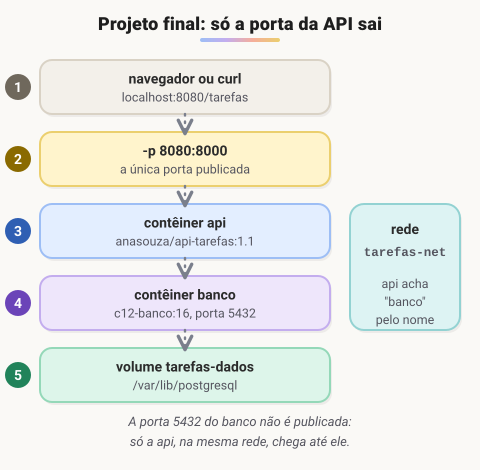
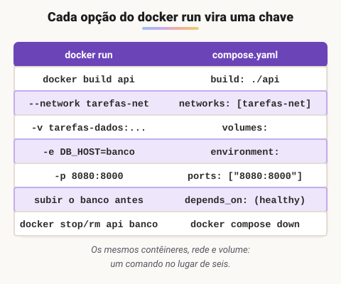

# 12. Projeto final: API com banco em contêineres

> 🗺️ **Neste capítulo:** você junta tudo o que o livro ensinou num projeto só: a API de tarefas, agora guardando os dados num PostgreSQL, os dois contêineres numa rede própria, o banco num volume e a imagem pronta para publicar. No fim, o mesmo projeto descrito num `compose.yaml`, como prévia do próximo livro.

## De onde paramos

No capítulo 11 a API ganhou um nome publicável (`anasouza/api-tarefas`) e você viu como enviá-la a um registro. Nos capítulos 9 e 10 você criou um volume para os dados de um PostgreSQL e uma rede em que um contêiner acha o outro pelo nome. Falta juntar as peças: até aqui, a API ainda guardava as tarefas numa lista em memória, que some quando o contêiner é removido. Neste capítulo ela passa a usar o banco de verdade.

## O que vamos entregar

Um projeto final precisa de uma definição de pronto. Esta é a nossa:

| Requisito | Como o projeto cumpre |
| --- | --- |
| A API responde no computador | `-p 8080:8000`: `localhost:8080` chega na API |
| As tarefas ficam num banco | PostgreSQL no contêiner `banco` |
| Os dois conversam pelo nome | rede própria `tarefas-net` |
| Os dados sobrevivem a recriar tudo | volume nomeado `tarefas-dados` |
| Senha fora da imagem | entra com `-e` só na hora de rodar |
| Imagem pronta para outra máquina | `anasouza/api-tarefas:1.1`, multi-stage |

Todos os arquivos do projeto ficam numa pasta com esta forma (na produção do livro, `/tmp/projeto-final`):

```
projeto-final/
  api/
    app.py          a API 1.1, com banco
    Dockerfile      dois estágios
    .dockerignore
  banco/
    Dockerfile      PostgreSQL (só no livro)
    entrada.sh
  compose.yaml      prévia do próximo livro
  .env              DB_SENHA=... (fora do Git)
```

## A arquitetura

Antes de digitar comandos, desenhe quem fala com quem. Isso decide quais portas publicar, quais nomes usar e onde os dados moram.

**A arquitetura do projeto é a lista de peças (contêineres, rede, volume, portas) e dos caminhos entre elas: só a API fica exposta ao computador; o banco só é alcançável de dentro da rede, e os dados dele moram num volume.**

Seguindo uma requisição: o `curl localhost:8080/tarefas` entra pela porta publicada, chega na porta 8000 do contêiner `api`, a API pergunta ao `banco` (porta 5432) pelo nome, graças ao DNS da rede `tarefas-net`, e o PostgreSQL lê as tarefas dos arquivos que estão no volume `tarefas-dados`.



> 💡 **Analogia:** pense numa biblioteca com acervo fechado. O leitor (navegador) só fala com o balcão de atendimento, que é a única porta aberta ao público (`-p 8080:8000`). O atendente (a `api`) entra pelo corredor interno (`tarefas-net`) e chama o arquivista pelo nome (`banco`), que busca o livro nas estantes (o volume). O leitor nunca entra no acervo. E se a biblioteca trocar toda a equipe, as estantes continuam no prédio com os mesmos livros: é o volume sobrevivendo à troca dos contêineres.

> ⚠️ **Armadilha:** publicar a porta do banco "para facilitar" (`-p 5432:5432`). A API não precisa disso, porque fala com o banco pela rede; a porta publicada só serve para expor o PostgreSQL a qualquer um que alcance o seu computador. Publique apenas o que um humano ou outro sistema de fora precisa acessar. Para olhar o banco você mesmo, use `docker exec banco psql ...` (passo 7 do Laboratório).

## A API 1.1: tarefas no PostgreSQL

A versão 1.0 guardava as tarefas numa lista do Python. Ela continua com as mesmas rotas (`GET /saude`, `GET /tarefas`, `POST /tarefas`); muda só onde os dados moram. Três mudanças:

1. **A conexão vem do ambiente.** `DB_HOST`, `DB_PORTA`, `DB_NOME`, `DB_USUARIO` e `DB_SENHA` são lidas na partida, com padrões razoáveis (`DB_HOST=banco`). A mesma imagem serve para o banco do seu computador e para o de um servidor: muda só o `-e`.
2. **A tabela é criada na partida**, com `CREATE TABLE IF NOT EXISTS`: se já existe (volume reaproveitado), nada acontece.
3. **A API espera o banco.** Ela tenta conectar por até 30 segundos antes de desistir, porque o banco pode ainda estar ligando.

### Como falar com o banco sem pip

Num projeto real, um programa Python fala com o PostgreSQL por um driver; o mais usado é o **psycopg**, instalado com `pip install "psycopg[binary]"` (versão 3.3.9 na documentação, conferida em 2026-11-15). A API do livro, porém, usa só a biblioteca padrão, e na produção do livro o PyPI estava bloqueado: conferimos e a imagem local não tem nem `psycopg` nem `psycopg2`.

A solução didática: a API chama o cliente de linha de comando `psql`, que já vem na imagem, com o `subprocess` do Python. Funciona, é fácil de ler e mostra uma ideia importante (passar valores com segurança), mas abre um processo por consulta. Use-a para aprender; num projeto de verdade, use o psycopg.

```python
def sql(comando, **valores):
  # Solução didática: chama o cliente psql.
  # Num projeto real, use o driver psycopg.
  # Cada valor vira uma variável do psql
  # (-v nome=valor) e entra no SQL como
  # :'nome', que o psql põe entre aspas e
  # escapa: nada de montar SQL com f-string.
  args = ["psql", "-X", "-q", "-A", "-t",
      "-v", "ON_ERROR_STOP=1"]
  for nome, valor in valores.items():
    args += ["-v", f"{nome}={valor}"]
  # o SQL vai pela entrada padrão, porque o
  # psql só troca :'nome' no que lê de lá
  feito = subprocess.run(
    args, input=comando, capture_output=True,
    text=True, env={**os.environ, **BANCO},
    timeout=10)
  if feito.returncode != 0:
    raise ErroBanco(feito.stderr.strip())
  return feito.stdout.strip()
```

O dicionário `BANCO` traduz as variáveis da API para as que o `psql` entende (`PGHOST`, `PGUSER`, `PGPASSWORD`...). As opções `-A -t` tiram a moldura da tabela, e o próprio PostgreSQL devolve JSON pronto (`json_agg` e `row_to_json`), então a API só repassa.

**app.py completo (versão 1.1)**

```python
# API de tarefas do livro "Docker do zero", versão 1.1:
# as tarefas agora moram no PostgreSQL.
# Só biblioteca padrão: a imagem não precisa de pip.
import json
import os
import subprocess
import time
from http.server import BaseHTTPRequestHandler
from http.server import ThreadingHTTPServer

PORTA = int(os.environ.get("PORTA", "8000"))
VERSAO = os.environ.get("APP_VERSAO", "dev")

# a conexão vem do ambiente (docker run -e ...):
# a mesma imagem serve para qualquer banco
BANCO = {
    "PGHOST": os.environ.get("DB_HOST", "banco"),
    "PGPORT": os.environ.get("DB_PORTA", "5432"),
    "PGDATABASE": os.environ.get("DB_NOME", "tarefas"),
    "PGUSER": os.environ.get("DB_USUARIO", "postgres"),
    "PGPASSWORD": os.environ.get("DB_SENHA", ""),
}

class ErroBanco(Exception):
    pass

def sql(comando, **valores):
    # Solução didática: chama o cliente psql.
    # Num projeto real, use o driver psycopg.
    # Cada valor vira uma variável do psql
    # (-v nome=valor) e entra no SQL como
    # :'nome', que o psql põe entre aspas e
    # escapa: nada de montar SQL com f-string.
    args = ["psql", "-X", "-q", "-A", "-t",
            "-v", "ON_ERROR_STOP=1"]
    for nome, valor in valores.items():
        args += ["-v", f"{nome}={valor}"]
    # o SQL vai pela entrada padrão, porque o
    # psql só troca :'nome' no que lê de lá
    feito = subprocess.run(
        args, input=comando, capture_output=True,
        text=True, env={**os.environ, **BANCO},
        timeout=10)
    if feito.returncode != 0:
        raise ErroBanco(feito.stderr.strip())
    return feito.stdout.strip()

def preparar_banco(tentativas=30):
    # o banco pode demorar a aceitar conexões:
    # tenta por até ~30 s antes de desistir
    for n in range(1, tentativas + 1):
        try:
            sql("CREATE TABLE IF NOT EXISTS tarefas ("
                " id serial PRIMARY KEY,"
                " titulo text NOT NULL);")
            print(f"banco pronto em {BANCO['PGHOST']}"
                  f" (tentativa {n})")
            return
        except ErroBanco as erro:
            print(f"aguardando o banco: {erro}")
            time.sleep(1)
    raise SystemExit("banco não respondeu")

class Api(BaseHTTPRequestHandler):
    def responder(self, codigo, dados):
        corpo = json.dumps(dados, ensure_ascii=False)
        corpo = corpo.encode("utf-8")
        self.send_response(codigo)
        self.send_header("Content-Type",
                         "application/json; charset=utf-8")
        self.send_header("Content-Length", str(len(corpo)))
        self.end_headers()
        self.wfile.write(corpo)

    def do_GET(self):
        if self.path == "/saude":
            self.responder(200, {"status": "ok",
                                "versao": VERSAO})
        elif self.path == "/tarefas":
            try:
                # o próprio PostgreSQL monta o JSON
                saida = sql(
                    "SELECT coalesce(json_agg(t ORDER BY"
                    " id), '[]') FROM tarefas t;")
                self.responder(200, json.loads(saida))
            except ErroBanco as erro:
                self.responder(503, {"erro": str(erro)})
        else:
            self.responder(404, {"erro": "rota não existe"})

    def do_POST(self):
        if self.path != "/tarefas":
            self.responder(404, {"erro": "rota não existe"})
            return
        tamanho = int(self.headers.get("Content-Length", 0))
        try:
            dados = json.loads(self.rfile.read(tamanho))
            titulo = str(dados["titulo"])
        except (ValueError, KeyError, TypeError):
            self.responder(400, {"erro": "falta o titulo"})
            return
        try:
            saida = sql(
                "INSERT INTO tarefas (titulo)"
                " VALUES (:'titulo')"
                " RETURNING row_to_json(tarefas);",
                titulo=titulo)
            self.responder(201, json.loads(saida))
        except ErroBanco as erro:
            self.responder(503, {"erro": str(erro)})

if __name__ == "__main__":
    preparar_banco()
    # 0.0.0.0 para o -p do docker run chegar aqui
    servidor = ThreadingHTTPServer(("0.0.0.0", PORTA), Api)
    print(f"API {VERSAO} ouvindo na porta {PORTA}")
    servidor.serve_forever()
```

Se o banco cair com a API no ar, as rotas de tarefas respondem `503` com a mensagem do `psql`, em vez de derrubar a API.

> ⚠️ **Armadilha:** montar o SQL colando o texto do usuário, como em `f"INSERT ... VALUES ('{titulo}')"`. Um título com aspas quebra o comando, e um título malicioso vira SQL executado (a injeção de SQL, ou *SQL injection*). Com `:'titulo'` o `psql` trata o valor como dado; no psycopg, o equivalente é passar os valores separados (`cur.execute(sql, (titulo,))`). Teste real na sessão do livro:

```bash
curl -s -X POST localhost:8080/tarefas \
  -d "{\"titulo\": \"Ana's; DROP TABLE tarefas; --\"}"
```

```
{"id": 3, "titulo": "Ana's; DROP TABLE tarefas; --"}
```

A tarefa foi gravada com o título esquisito, e a tabela continua lá.

## O Dockerfile da nova versão: dois estágios

No capítulo 8 o multi-stage separou o compilador Go do binário entregue. Com Python não há compilação, mas a ideia vale do mesmo jeito: **um estágio confere o código, e a imagem final recebe só o arquivo conferido**. Se o `app.py` tiver um erro de sintaxe, o build para no primeiro estágio, e nenhuma imagem quebrada ganha a tag `1.1`.

```docker
# API de tarefas 1.1, com banco. Dois estágios
# (cap. 8): o primeiro confere, o segundo entrega.
# No seu computador: FROM python:3.13-slim nos dois
# e o cliente psql instalado no final (veja o texto)

# --- estágio 1: confere o código antes de empacotar
FROM ubuntu:24.04 AS teste
WORKDIR /src
COPY app.py .
# erro de sintaxe para o build aqui, e não em produção
RUN python3 -m py_compile app.py

# --- estágio 2: só o que roda
FROM ubuntu:24.04 AS final
ARG VERSAO=1.1.0
ENV PORTA=8000 \
    PYTHONUNBUFFERED=1 \
    APP_VERSAO=${VERSAO}
WORKDIR /app
RUN groupadd --gid 10001 app \
 && useradd --uid 10001 --gid app --no-create-home app
# do estágio teste vem só o app.py já conferido
COPY --from=teste /src/app.py .
EXPOSE 8000
USER app
CMD ["python3", "app.py"]
```

O `.dockerignore` do capítulo 7 continua valendo, com `.env` na lista: é ali que mora a senha do banco, e ela não pode entrar na imagem.

Construa com a versão nova e duas tags (a exata e o atalho, como no capítulo 11):

```bash
# a versão nova, com a tag exata e o atalho
cd projeto-final
docker build --build-arg VERSAO=1.1.0 \
  -t anasouza/api-tarefas:1.1.0 \
  -t anasouza/api-tarefas:1.1 api
```

Trecho real do build (com `--no-cache --progress=plain`, para mostrar todos os passos):

```
#8 [teste 3/4] COPY app.py .
#9 [teste 4/4] RUN python3 -m py_compile app.py
#9 DONE 0.2s
#10 [stage-1 3/4] RUN groupadd --gid 10001 app ...
#11 [stage-1 4/4] COPY --from=teste /src/app.py .
#12 naming to docker.io/anasouza/api-tarefas:1.1.0 done
#12 naming to docker.io/anasouza/api-tarefas:1.1 done
```

Os passos dos dois estágios aparecem lado a lado, porque o BuildKit roda em paralelo o que não depende um do outro (esse build foi feito antes de o segundo estágio ganhar o nome `final`, por isso ele aparece como `stage-1`). A imagem tem os mesmos 15.9GB da `ubuntu:24.04` local usada no livro; com `python:3.13-slim`, fica na casa das centenas de MB e com outro ID.

**No seu computador: python:3.13-slim e psycopg (não executado)**

Fora da produção do livro, o mesmo desenho fica assim: o primeiro estágio instala o psycopg num ambiente virtual, e o final copia só esse ambiente. O `app.py` trocaria a função `sql()` por chamadas ao psycopg.

```docker
# estágio de build: pip e cache ficam aqui
FROM python:3.13-slim AS build
RUN python -m venv /opt/venv \
 && /opt/venv/bin/pip install "psycopg[binary]"

# final: só o venv pronto e o código
FROM python:3.13-slim
COPY --from=build /opt/venv /opt/venv
WORKDIR /app
COPY app.py .
USER 10001
CMD ["/opt/venv/bin/python", "app.py"]
```

O pacote `psycopg[binary]` traz a própria cópia da `libpq`, então a imagem final não precisa do cliente `psql`. Este Dockerfile não foi executado na produção do livro (Docker Hub e PyPI bloqueados).

## O banco: PostgreSQL num contêiner

Na vida real, o banco vem pronto: a imagem oficial `postgres`. Com o Docker Hub bloqueado na produção do livro, usamos a mesma receita do capítulo 9: o PostgreSQL 16 que já existe dentro da `ubuntu:24.04` local, iniciado com `initdb` e `postgres` pelo usuário `postgres` (não root), com os dados no volume. A única novidade é criar o banco `tarefas` na primeira partida, imitando a variável `POSTGRES_DB` da imagem oficial.

```docker
# PostgreSQL 16 sobre a ubuntu:24.04 local do livro
# (o mesmo do cap. 9). No seu computador, use a
# imagem oficial: postgres:18.
FROM ubuntu:24.04
# a imagem local traz um cluster de exemplo: sai,
# e entram as pastas de socket e temporária
RUN rm -rf /var/lib/postgresql/16 \
 && mkdir -p /run/postgresql /tmp \
 && chown postgres:postgres /run/postgresql \
 && chmod 1777 /tmp
# como na oficial 18+: o volume vai em
# /var/lib/postgresql e os dados numa subpasta
ENV PATH=/usr/lib/postgresql/16/bin:$PATH \
    PGDATA=/var/lib/postgresql/16/docker
COPY entrada.sh /entrada.sh
# o banco não roda como root (o initdb recusa)
USER postgres
EXPOSE 5432
CMD ["/entrada.sh"]
```

```bash
#!/bin/sh
# Inicia o PostgreSQL; cria o banco só na 1a vez.
set -e
# PG_VERSION só existe depois do initdb: se ele
# já está no volume, os dados são reaproveitados
if [ ! -s "$PGDATA/PG_VERSION" ]; then
  echo "$POSTGRES_PASSWORD" > /tmp/senha
  initdb -U postgres --pwfile=/tmp/senha \
    --auth-host=scram-sha-256 --auth-local=trust
  rm /tmp/senha
  # aceita conexões de outros contêineres
  echo "host all all all scram-sha-256" \
    >> "$PGDATA/pg_hba.conf"
  # sobe só pelo socket local, cria o banco
  # pedido em POSTGRES_DB e desliga
  pg_ctl -w -o "-c listen_addresses=''" start
  createdb "${POSTGRES_DB:-postgres}" || true
  pg_ctl -w stop
fi
# exec: o postgres vira o PID 1 e recebe o
# sinal do docker stop (desligamento limpo)
exec postgres -c listen_addresses='*'
```

Com a imagem oficial, nada disso é necessário. O comando equivalente ao passo 3 do Laboratório seria este (**não executado** na produção do livro, porque o Hub estava bloqueado):

```bash
# imagem oficial: só POSTGRES_PASSWORD é obrigatória
docker run -d --name banco --network tarefas-net \
  -v tarefas-dados:/var/lib/postgresql \
  -e POSTGRES_PASSWORD="$DB_SENHA" \
  -e POSTGRES_DB=tarefas \
  postgres:18
```

Segundo a página da imagem no Docker Hub (conferida em 2026-11-15, última versão 18.7), a partir da 18 o volume declarado mudou para `/var/lib/postgresql`, e os dados ficam em `/var/lib/postgresql/18/docker`. Por isso o projeto monta o volume em `/var/lib/postgresql`, e não em `/var/lib/postgresql/data`, como se ensinava nas versões até a 17.

> ⚠️ **Armadilha:** trocar o `POSTGRES_PASSWORD` e esperar que a senha mude. As variáveis da imagem (senha, banco, usuário) só têm efeito quando o volume está vazio; com dados lá, elas são ignoradas, tanto na oficial quanto na nossa. Teste real: recriamos o `banco` no mesmo volume com `POSTGRES_PASSWORD=senha-nova`, e a API, usando a senha nova, recebeu:

```
aguardando o banco: psql: error: connection to server at "banco" (172.18.0.3), port 5432 failed: FATAL:  password authentication failed for user "postgres"
```

A senha que vale é a do primeiro `initdb`. Para trocá-la, use SQL dentro do banco (exercício 3 do Pratique).

## Prévia: o mesmo projeto num compose.yaml

No Laboratório você vai digitar seis comandos longos, na ordem certa, para subir o projeto, e mais alguns para desmontar. Funciona, mas é fácil esquecer um `-e` ou subir a API antes do banco. O próximo livro da trilha resolve isso.

**O Docker Compose lê um arquivo** `compose.yaml` **que descreve os serviços (contêineres), redes e volumes de um projeto, e sobe ou derruba tudo com um comando (**`docker compose up` **e** `docker compose down`**).**

```yaml
# O projeto final inteiro num arquivo: o mesmo que
# os docker run do capítulo, lido pelo Compose.
name: tarefas

services:
  banco:
    build: ./banco
    image: c12-banco:16
    environment:
      # a senha vem do arquivo .env (fora do Git)
      POSTGRES_PASSWORD: ${DB_SENHA:?defina DB_SENHA}
      POSTGRES_DB: tarefas
    volumes:
      - tarefas-dados:/var/lib/postgresql
    networks: [tarefas-net]
    # "pronto" = aceita conexões, não só "rodando"
    healthcheck:
      test: ["CMD", "pg_isready", "-U", "postgres"]
      interval: 2s
      retries: 15

  api:
    build: ./api
    image: anasouza/api-tarefas:1.1
    environment:
      DB_HOST: banco
      DB_NOME: tarefas
      DB_USUARIO: postgres
      DB_SENHA: ${DB_SENHA:?defina DB_SENHA}
    ports:
      - "8080:8000"
    networks: [tarefas-net]
    # só sobe depois do healthcheck do banco passar
    depends_on:
      banco:
        condition: service_healthy

volumes:
  tarefas-dados:

networks:
  tarefas-net:
```

No seu computador, troque `build: ./banco` e `image: c12-banco:16` por `image: postgres:18`. O arquivo `.env`, ao lado, tem uma linha só (`DB_SENHA=troque-esta-senha`) e fica fora do Git e da imagem.



> 💡 **Analogia:** subir o projeto com `docker run` é o maestro gritando, um a um, quando cada músico entra e em que tom. O `compose.yaml` é a partitura: está escrito quem toca o quê (serviços), em que sala (rede), com que instrumento guardado (volume), e quando cada um entra. O `depends_on` com `service_healthy` é a marcação "o piano só entra depois que o violino afinar": não basta o violinista estar no palco, ele precisa estar pronto.

> ⚠️ **Armadilha:** achar que `depends_on` sozinho espera o banco. A documentação do Compose é clara: ele espera o contêiner estar **rodando**, não **pronto**. Um PostgreSQL que acabou de iniciar ainda recusa conexões por alguns segundos. Por isso o arquivo tem um `healthcheck` com `pg_isready` e a condição `service_healthy`, e por isso a API ainda tenta reconectar sozinha: as duas defesas se completam.

## 🧪 Laboratório

> ⚠️ **O que não foi executado na produção do livro:** o `docker login` e o `docker push` para o Docker Hub (passo 8), o pull da imagem a partir do registro e o banco com a imagem oficial `postgres:18`, porque a rede da sessão bloqueia o Docker Hub (o mesmo `Forbidden` do capítulo 11). No lugar da oficial, o banco é a imagem `c12-banco:16` descrita acima (PostgreSQL 16.15 da `ubuntu:24.04` local). Todo o resto rodou de verdade no Docker Engine 29.9.2, com Docker Compose v5.6.1; os IDs, horários e tamanhos (15.9GB, da imagem local) mudam no seu computador.

Objetivo: subir o projeto do zero, criar e listar tarefas, destruir os dois contêineres, recriá-los e encontrar as tarefas no lugar. Os arquivos estão em `projeto-final/`, como na seção "O que vamos entregar".

**1. Construa as imagens.**

```bash
# as duas imagens do projeto
cd projeto-final
docker build -q -t c12-banco:16 banco
docker build -q --build-arg VERSAO=1.1.0 \
  -t anasouza/api-tarefas:1.1.0 \
  -t anasouza/api-tarefas:1.1 api
```

```
sha256:02780e404a0db09142c7de37de1feb1afb3dfbf5559421b00f38e6b06c296c70
sha256:6bfe93ee867cc5db9c640fc29e1a7c458dd9113cd0a4f30ff562576716752fe8
```

**2. Crie a rede e o volume.** Os mesmos comandos dos capítulos 9 e 10:

```bash
docker network create tarefas-net
docker volume create tarefas-dados
```

```
c915ec88dd37e3983d6ebe8c715af60a40e3c7a7060d7e4180a065ac5f719299
tarefas-dados
```

**3. Suba o banco.** A senha fica numa variável do shell, para não ser repetida nos comandos; use uma sua.

```bash
export DB_SENHA='troque-esta-senha'
# sem -p: o banco só é visto de dentro da rede
docker run -d --name banco --network tarefas-net \
  -v tarefas-dados:/var/lib/postgresql \
  -e POSTGRES_PASSWORD="$DB_SENHA" \
  -e POSTGRES_DB=tarefas \
  c12-banco:16
docker logs --tail 2 banco
```

```
d65445be4cb4ad538eee75df6c42ab5bf76e5845abb62a27ede1725b64459e7f
2026-11-16 01:44:55.634 UTC [36] LOG:  database system was shut down at 2026-11-16 01:44:55 UTC
2026-11-16 01:44:55.637 UTC [1] LOG:  database system is ready to accept connections
```

O `was shut down` logo antes do `ready` é o `pg_ctl stop` do `entrada.sh`, depois de criar o banco `tarefas`.

**4. Suba a API.** Ela entra na mesma rede, recebe a conexão por variáveis de ambiente e é a única com porta publicada:

```bash
# DB_HOST=banco: o nome do contêiner, via DNS da rede
docker run -d --name api --network tarefas-net \
  -p 8080:8000 \
  -e DB_HOST=banco -e DB_NOME=tarefas \
  -e DB_USUARIO=postgres -e DB_SENHA="$DB_SENHA" \
  anasouza/api-tarefas:1.1
docker logs api
docker ps --format \
  'table {{.Names}}\t{{.Image}}\t{{.Status}}\t{{.Ports}}'
```

```
2e70630b524586a7f35d97309fde9abc2d735aa00a9f338ff91511b800e738dd
banco pronto em banco (tentativa 1)
API 1.1.0 ouvindo na porta 8000
NAMES     IMAGE                      STATUS          PORTS
api       anasouza/api-tarefas:1.1   Up 3 seconds    0.0.0.0:8080->8000/tcp
banco     c12-banco:16               Up 13 seconds   5432/tcp
```

Repare na coluna PORTS: a API tem `0.0.0.0:8080->8000` (publicada); o banco só `5432/tcp` (exposta dentro da rede, não publicada).

> ⚠️ **Armadilha:** subir a API antes do banco. Sem a espera do `preparar_banco()`, a API morreria na primeira tentativa. Teste real, com a API iniciada 3 segundos antes do banco:

```
aguardando o banco: psql: error: could not translate host name "banco" to address: Name or service not known
aguardando o banco: psql: error: could not translate host name "banco" to address: Name or service not known
aguardando o banco: psql: error: could not translate host name "banco" to address: Name or service not known
aguardando o banco: psql: error: could not translate host name "banco" to address: Name or service not known
banco pronto em banco (tentativa 5)
API 1.1.0 ouvindo na porta 8000
```

Enquanto o contêiner `banco` não existe, o DNS da rede nem conhece o nome; quando ele aparece, a API conecta. Ordem certa e uma espera no código: as duas coisas.

**5. Teste com curl.**

```bash
# saúde, duas tarefas novas e a lista
curl -s -w '\n' localhost:8080/saude
curl -s -w '\n' -X POST localhost:8080/tarefas \
  -d '{"titulo": "Estudar Docker"}'
curl -s -w '\n' -X POST localhost:8080/tarefas \
  -d '{"titulo": "Ler o livro de Compose"}'
curl -s -w '\n' localhost:8080/tarefas
```

```
{"status": "ok", "versao": "1.1.0"}
{"id": 1, "titulo": "Estudar Docker"}
{"id": 2, "titulo": "Ler o livro de Compose"}
[{"id": 1, "titulo": "Estudar Docker"}, {"id": 2, "titulo": "Ler o livro de Compose"}]
```

No navegador, `http://localhost:8080/tarefas` mostra a mesma lista.

**6. Prove a persistência.** Pare e remova os **dois** contêineres, recrie-os com os mesmos comandos dos passos 3 e 4 e liste as tarefas:

```bash
# stop antes do rm: o PostgreSQL desliga limpo
docker stop api banco
docker rm api banco
# ...repita os docker run dos passos 3 e 4...
curl -s -w '\n' localhost:8080/tarefas
```

```
api
banco
api
banco
[{"id": 1, "titulo": "Estudar Docker"}, {"id": 2, "titulo": "Ler o livro de Compose"}]
```

Contêineres novos, IDs novos, e as mesmas duas tarefas: elas estavam no volume, não no contêiner. Na versão 1.0 da API, esse mesmo teste devolvia a lista inicial.

> ⚠️ **Armadilha:** derrubar o banco com `docker rm -f`. Ele mata o processo na hora (SIGKILL), sem o desligamento limpo. Os dados confirmados sobrevivem, mas o PostgreSQL acorda em modo de recuperação, e o log mostra `database system was interrupted` em vez de `was shut down`. Na sessão do livro houve um efeito curioso: depois de um `rm -f`, a tarefa seguinte ganhou o `id` 34 em vez de 4, porque o PostgreSQL reserva números de sequência em lotes e descarta a reserva numa recuperação. Não é perda de dados, mas mostra por que usar `docker stop` (e não depender de ids sem buracos).

**7. Leia os logs e olhe o banco por dentro.**

```bash
# o que a API e o banco registraram
docker logs api
docker logs --tail 3 banco
docker exec banco psql -U postgres -d tarefas \
  -c 'SELECT count(*) FROM tarefas;'
```

```
banco pronto em banco (tentativa 1)
API 1.1.0 ouvindo na porta 8000
172.18.0.1 - - [16/Nov/2026 01:45:17] "GET /tarefas HTTP/1.1" 200 -
2026-11-16 01:45:11.571 UTC [1] LOG:  listening on Unix socket "/var/run/postgresql/.s.PGSQL.5432"
2026-11-16 01:45:11.572 UTC [9] LOG:  database system was shut down at 2026-11-16 01:45:01 UTC
2026-11-16 01:45:11.576 UTC [1] LOG:  database system is ready to accept connections
 count
-------
     2
(1 row)
```

Cada requisição aparece no log da API, com o IP de quem chamou (`172.18.0.1` é o gateway da rede, por onde chega o tráfego da porta publicada). Para acompanhar ao vivo enquanto usa a API, `docker logs -f api` (Ctrl+C sai). O `docker exec` roda o `psql` dentro do contêiner do banco, pelo socket local: é o jeito de olhar o banco sem publicar a porta 5432.

Quando a senha está errada, o log do banco é o primeiro lugar para olhar. Saída real de uma tentativa com `DB_SENHA=errada`:

```
FATAL:  password authentication failed for user "postgres"
DETAIL:  Connection matched file "/var/lib/postgresql/16/docker/pg_hba.conf" line 127: "host all all all scram-sha-256"
```

**8. Publique a imagem da API** (não executado: Hub bloqueado). São os comandos do capítulo 11, com a versão nova:

```bash
# token numa variável, nunca no comando (cap. 11)
echo "$DOCKER_TOKEN" | docker login \
  -u anasouza --password-stdin
docker push anasouza/api-tarefas:1.1.0
docker push anasouza/api-tarefas:1.1
```

No seu computador, espere `Login Succeeded` e, para cada tag, as camadas com `Pushed` (ou `Layer already exists`) e uma linha `1.1.0: digest: sha256:...`. A imagem do banco não é publicada: em produção, ele usa a oficial `postgres:18`. A partir daí, a entrega numa máquina nova é só: criar a rede e o volume (passo 2), o `docker run` do `postgres:18` mostrado acima e o `docker run` do passo 4, que baixa a `anasouza/api-tarefas:1.1` sozinho.

> ⚠️ **Armadilha:** achar que `-e DB_SENHA=...` esconde a senha. Ela fica fora da imagem (o que é o mais importante, porque a imagem é pública), mas aparece para quem tem acesso ao Docker da máquina. Saída real de `docker exec api env | grep '^DB_'`: `DB_SENHA=troque-esta-senha`, e o `docker inspect api` mostra o mesmo. Para um projeto pessoal, tudo bem; em produção, use os *secrets* do Compose ou do orquestrador, assunto dos próximos livros da trilha.

**9. Suba o mesmo projeto com o Compose.** Com o `compose.yaml` e o `.env` na pasta (e os contêineres dos passos anteriores removidos, para liberar a porta 8080):

```bash
# troca os docker run pelo Compose
docker stop api banco && docker rm api banco
docker compose up -d
docker compose ps
curl -s -w '\n' -X POST localhost:8080/tarefas \
  -d '{"titulo": "Subir tudo com o Compose"}'
docker compose logs api
```

Saída real (do `up`, sem as linhas repetidas que o Compose imprime enquanto atualiza o progresso):

```
 Network tarefas_tarefas-net Created
 Volume tarefas_tarefas-dados Created
 Container tarefas-banco-1 Created
 Container tarefas-api-1 Created
 Container tarefas-banco-1 Started
 Container tarefas-banco-1 Waiting
 Container tarefas-banco-1 Healthy
 Container tarefas-api-1 Started
NAME              IMAGE                      SERVICE   STATUS                   PORTS
tarefas-api-1     anasouza/api-tarefas:1.1   api       Up 2 seconds             0.0.0.0:8080->8000/tcp
tarefas-banco-1   c12-banco:16               banco     Up 4 seconds (healthy)   5432/tcp
{"id": 1, "titulo": "Subir tudo com o Compose"}
api-1  | banco pronto em banco (tentativa 1)
api-1  | API 1.1.0 ouvindo na porta 8000
api-1  | 172.19.0.1 - - [16/Nov/2026 01:44:27] "POST /tarefas HTTP/1.1" 201 -
```

(Na saída do `ps`, tiramos as colunas COMMAND e CREATED para caber.) Três coisas para notar. O `Waiting` e o `Healthy`: o Compose segurou a API até o `pg_isready` passar, e por isso ela conectou na tentativa 1. Os nomes ganharam o prefixo do projeto (`tarefas_tarefas-dados`, `tarefas-api-1`), então este volume é **outro**, diferente do `tarefas-dados` dos passos anteriores: por isso a lista começou do id 1. E dentro da rede o nome `banco` continua funcionando, porque o Compose registra o nome de cada serviço no DNS.

Para desmontar: `docker compose down` para e remove os contêineres e a rede, mas mantém o volume (as tarefas voltam no próximo `up`); `docker compose down -v` apaga o volume também.

**10. Arrume a casa.**

```bash
docker compose down
# apaga as tarefas para sempre: só se quiser
docker volume rm tarefas-dados tarefas_tarefas-dados
docker network rm tarefas-net
```

## ✅ Checklist final

Confira cada item no seu projeto antes de dar o livro por terminado:

- `curl localhost:8080/saude` responde com `"versao": "1.1.0"`
- `POST /tarefas` cria e `GET /tarefas` lista as tarefas
- `docker ps` mostra só a porta 8080 publicada; o banco, só `5432/tcp`
- `docker network inspect tarefas-net` lista `api` e `banco`
- Depois de `docker stop` e `docker rm` dos dois, as tarefas continuam
- A senha do banco não aparece no `docker history` da imagem (capítulo 11, passo 6)
- O `.env` está no `.dockerignore` e fora do Git
- A imagem tem a tag exata (`1.1.0`) e o atalho (`1.1`), prontas para o `docker push`
- `docker compose up -d` sobe tudo, e `docker compose ps` mostra o banco `healthy`

## 🏋️ Pratique

**1. Outra porta, mesma imagem.** Outro programa já usa a porta 8080 no seu computador. Faça a API responder em `localhost:9090` sem reconstruir a imagem e sem perder as tarefas.

<details>
<summary>Ver resposta</summary>

Só o contêiner da API muda; o banco e o volume ficam como estão.

```bash
docker stop api && docker rm api
# muda só o lado do host no -p
docker run -d --name api --network tarefas-net \
  -p 9090:8000 \
  -e DB_HOST=banco -e DB_NOME=tarefas \
  -e DB_USUARIO=postgres -e DB_SENHA="$DB_SENHA" \
  anasouza/api-tarefas:1.1
curl -s -w '\n' localhost:9090/tarefas
docker port api
```

Saída real:

```
3baf72ed6761...
[{"id": 1, "titulo": "Estudar Docker"}, {"id": 2, "titulo": "Ler o livro de Compose"}]
8000/tcp -> 0.0.0.0:9090
```

O lado de dentro (8000) não muda, porque é a porta em que a API escuta. As tarefas continuam porque estão no volume do banco, que nem foi tocado.

</details>

**2. O banco está mesmo escondido?** Prove, do seu computador (fora dos contêineres), que não dá para conectar no PostgreSQL pela porta 5432, e mostre o jeito certo de olhar o banco.

<details>
<summary>Ver resposta</summary>

```bash
# do host: ninguém escuta na 5432
psql -h localhost -U postgres -c 'SELECT 1'
curl -sS localhost:5432
# o jeito certo: de dentro do contêiner
docker exec banco psql -U postgres -d tarefas \
  -c 'SELECT count(*) FROM tarefas;'
```

Saída real dos dois primeiros (o terceiro mostra a contagem, como no passo 7 do Laboratório):

```
psql: error: connection to server at "localhost" (127.0.0.1), port 5432 failed: Connection refused
  Is the server running on that host and accepting TCP/IP connections?
curl: (7) Failed to connect to localhost port 5432 after 0 ms: Couldn't connect to server
```

`Connection refused`: nada escuta na 5432 do computador, porque o `banco` não tem `-p`. Se você não tem o `psql` instalado no computador, o `curl` sozinho já prova o ponto.

</details>

**3. Trocar a senha do banco.** A senha `troque-esta-senha` vazou. Troque-a sem apagar o volume, e faça a API usar a nova.

<details>
<summary>Ver resposta</summary>

Mudar `POSTGRES_PASSWORD` não adianta (o volume já tem dados). A troca é em SQL, dentro do banco, e depois a API é recriada com a senha nova:

```bash
export DB_SENHA='outra-senha-forte'
# o psql de dentro do contêiner entra pelo
# socket local, sem pedir senha (trust)
docker exec banco psql -U postgres \
  -c "ALTER USER postgres PASSWORD '$DB_SENHA';"
docker stop api && docker rm api
docker run -d --name api --network tarefas-net \
  -p 8080:8000 \
  -e DB_HOST=banco -e DB_NOME=tarefas \
  -e DB_USUARIO=postgres -e DB_SENHA="$DB_SENHA" \
  anasouza/api-tarefas:1.1
docker logs api
```

Saída real:

```
ALTER ROLE
fec33943e75a...
banco pronto em banco (tentativa 1)
API 1.1.0 ouvindo na porta 8000
```

As tarefas continuam lá (o `GET /tarefas` devolve as mesmas duas). Num banco compartilhado, prefira o comando `\password` do `psql` interativo, que não deixa a senha no histórico do shell.

</details>

## 🧠 Revisão rápida

**Por que o contêiner `banco` não tem `-p`?**

Porque só a API precisa falar com ele, e ela o alcança pela rede `tarefas-net`, pelo nome. Publicar a 5432 só exporia o banco ao mundo fora do Docker.

**Removi `api` e `banco` e recriei os dois. Por que as tarefas continuam?**

Porque elas estão nos arquivos do PostgreSQL, que ficam no volume `tarefas-dados`; o `docker rm` apaga os contêineres, não os volumes. O `entrada.sh` vê o `PG_VERSION` no volume e reaproveita os dados.

**No Compose, por que `depends_on` precisa de `condition: service_healthy`?**

Porque, sem condição, o Compose só espera o contêiner do banco estar rodando, não pronto para conexões. Com o `healthcheck` (`pg_isready`) e `service_healthy`, a API só sobe depois que o banco aceita conexões.

> ➡️ **Próximo passo:** você terminou o conteúdo do livro: imagem própria e enxuta, volume, rede, publicação e um projeto com dois contêineres de pé. No capítulo 13, **Próximos livros da trilha**, você vê para onde ir daqui, começando pelo Docker Compose, que transforma os comandos deste capítulo no `compose.yaml` que você acabou de rodar.

## 📚 Fontes

Conferido em 2026-11-15. Comandos executados no Docker Engine 29.9.2 com Docker Compose v5.6.1 (versão de referência do livro: Docker Desktop 4.96 e Docker Engine 29.9).

- [postgres: imagem oficial no Docker Hub](https://hub.docker.com/_/postgres) (volume em `/var/lib/postgresql` a partir da 18; variáveis só valem com o volume vazio)
- [Docker Compose: controlar a ordem de partida](https://docs.docker.com/compose/how-tos/startup-order/) (`depends_on` e `service_healthy`; atualizada em 2025-12-03)
- [psycopg 3: instalação](https://www.psycopg.org/psycopg3/docs/basic/install.html) (`psycopg[binary]`, versão 3.3.9)
- [Docker workshop](https://docs.docker.com/get-started/workshop/) (app com banco em contêineres e Compose)

## 📌 Resumo

| Item | Em uma frase |
| --- | --- |
| Arquitetura | Só a API publica porta; o banco fica na rede, os dados no volume |
| Configuração por ambiente | `DB_HOST=banco` e companhia: a mesma imagem serve para qualquer banco |
| `psql` via subprocess | Solução didática sem pip; num projeto real, o driver psycopg |
| `:'titulo'` | O valor entra como dado, não como SQL: sem injeção |
| Multi-stage da API | Um estágio confere o código, o final recebe só o `app.py` |
| `postgres:18` | Volume em `/var/lib/postgresql`; só `POSTGRES_PASSWORD` é obrigatória |
| Variáveis do banco | Só valem com o volume vazio; trocar senha depois é em SQL |
| Espera pelo banco | A API tenta de novo; no Compose, `healthcheck` e `service_healthy` |
| Persistência | `docker stop`, `docker rm`, recriar: as tarefas continuam |
| `docker logs` | Primeiro lugar para olhar quando algo não conecta |
| Publicação | `1.1.0` e `1.1` com `docker push`; o banco vem da imagem oficial |
| `compose.yaml` | O projeto inteiro num arquivo: `docker compose up -d` e `down` |
