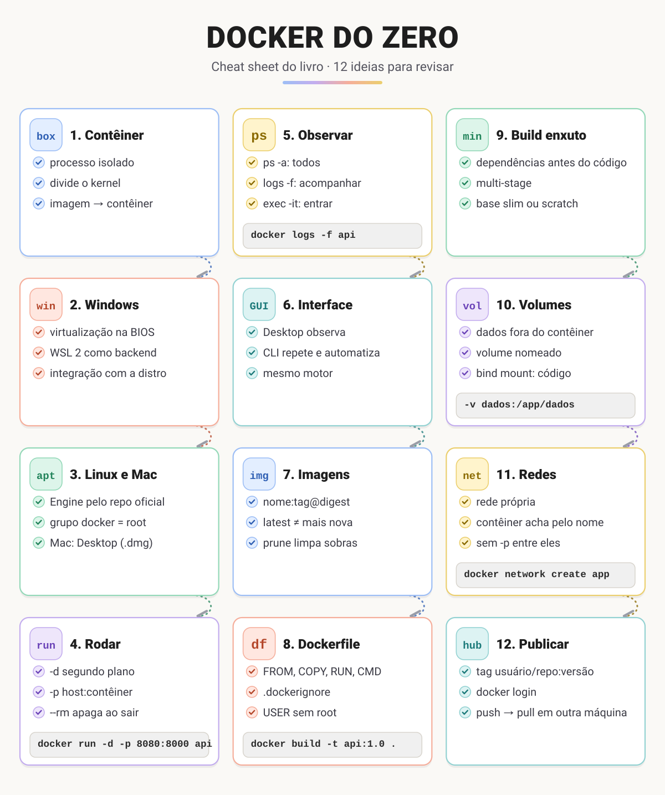

# 13. Próximos livros da trilha

> 🗺️ **Neste capítulo:** o que este livro deixou de fora de propósito e os próximos livros da trilha Docker, para continuar de onde você parou.

## De onde paramos

Você instalou o Docker no Windows, no Linux ou no Mac, aprendeu a rodar e observar contêineres pela linha de comando e pelo Docker Desktop, escreveu Dockerfiles enxutos, guardou dados em volumes, ligou contêineres numa rede e publicou uma imagem. O projeto final juntou tudo numa API com banco. Alguns temas ficaram de fora para o livro continuar para iniciantes: eles viram os próximos livros.

## Próximos livros

| Livro sugerido | Para quê | Parte de |
| --- | --- | --- |
| Docker Compose na prática | Descrever vários serviços num arquivo e subir tudo com um comando | caps. 9, 10 e 12 |
| Segurança de imagens | Escolher bases confiáveis, procurar vulnerabilidades e rodar sem privilégios | caps. 6, 7 e 8 |
| Build multiplataforma | Gerar a mesma imagem para amd64 e arm64 (PCs, Macs com Apple silicon, servidores ARM) | caps. 6 e 8 |
| Docker em produção | Logs, reinício automático, limites de recursos, atualização sem parar o serviço | caps. 4, 9 e 12 |
| Kubernetes do zero | Orquestrar contêineres em vários computadores | o livro inteiro |

> 💡 O próximo natural é o **Docker Compose na prática**: o projeto final deste livro, com API, banco, rede e volume, cabe num único arquivo `compose.yaml`.

## Como pedir o próximo livro

Abra um chat com a skill `criar-livro-tecnologia` e diga o tema. Ela lê o mapa das trilhas, vê o que este livro já cobre e propõe uma ementa que começa daqui, sem repetir o que você já viu.

## 🧭 Cheat sheet do livro

As 12 ideias do livro numa folha, para revisar antes de dockerizar um projeto novo.

## 🧠 Revisão rápida

**Qual livro vem depois deste na prática?**

O Docker Compose na prática: ele transforma os comandos do projeto final num arquivo só.

**Por que Kubernetes ficou de fora?**

Porque ele orquestra contêineres em vários computadores; antes é preciso dominar um contêiner, uma imagem e uma rede numa máquina só, que é o que este livro ensina.

**Onde ficou o WSL nesta trilha?**

No livro *WSL do zero*, que prepara o Linux no Windows e é a base do Docker Desktop com WSL 2.

> ➡️ **Próximo passo:** escolher um dos livros acima. Se você vai subir projetos com mais de um serviço, comece pelo Docker Compose.

## 📌 Resumo

| Item | Em uma frase |
| --- | --- |
| Este livro | Do primeiro contêiner a uma API com banco, volume, rede e imagem publicada |
| Próximo da trilha | Docker Compose na prática |
| Temas futuros | Segurança de imagens, build multiplataforma, Docker em produção, Kubernetes |
