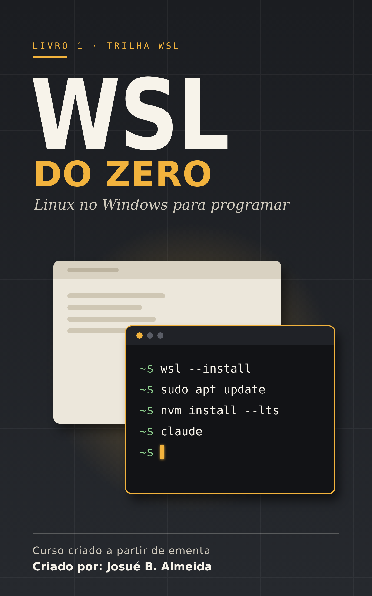

# Livro: WSL do zero: Linux no Windows para programar - Josué B. Almeida

📥 **[Baixar o EPUB](https://github.com/Joshpcbrrj/biblioteca-de-estudos/releases/download/epubs/wsl-do-zero.epub)**

Um Linux de verdade dentro do Windows, do zero ao ambiente completo: instalação do WSL e do Ubuntu 26.04, terminal personalizado, ferramentas de desenvolvimento (git, Node, Java, Python), backup, Claude Code e um projeto final com o Spec Kit. Cada capítulo tem laboratório, exercícios (respostas em **Ver resposta**) e as fontes conferidas.

> 🤖 Livro criado com IA a partir de fontes públicas, citadas em cada capítulo, e do guia pessoal do autor. Conferido em 2026-11-15. Trilha **wsl**, 1º livro ([mapa das trilhas](../)).

- [Sobre o livro](aulas/00-sobre-o-livro.md)

## Instalar e conhecer

- [1. O que é o WSL e quando usar](aulas/01-o-que-e-o-wsl-e-quando-usar.md)
- [2. Instalação do WSL e do Ubuntu](aulas/02-instalacao-do-wsl-e-do-ubuntu.md)
- [3. Primeiros passos no Ubuntu](aulas/03-primeiros-passos-no-ubuntu.md)

## Montar o ambiente

- [4. Arquivos entre Linux e Windows](aulas/04-arquivos-entre-linux-e-windows.md)
- [5. O terminal do seu jeito](aulas/05-o-terminal-do-seu-jeito.md)
- [6. Ferramentas de desenvolvimento e programas com janela](aulas/06-ferramentas-de-desenvolvimento-e-programas.md)

## Cuidar do ambiente

- [7. Gerenciar o WSL](aulas/07-gerenciar-o-wsl.md)
- [8. Backup e restauração](aulas/08-backup-e-restauracao.md)

## Programar com IA

- [9. Claude Code no WSL](aulas/09-claude-code-no-wsl.md)
- [10. Projeto final: um app com Spec Kit](aulas/10-projeto-final-um-app-com-spec-kit.md)
- [11. Próximos livros da trilha](aulas/11-proximos-livros-da-trilha.md)
