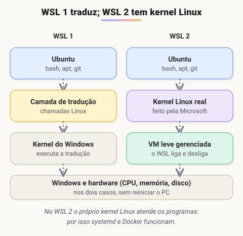
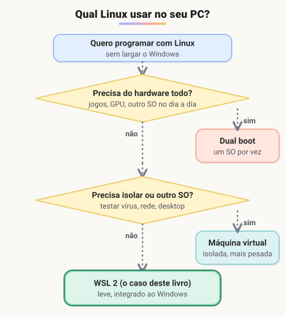

# 1. O que é o WSL e quando usar

> 🗺️ **Neste capítulo:** o que é o WSL, a diferença entre WSL 1 e WSL 2 e como decidir entre WSL, máquina virtual e dual boot. No laboratório, você confere se o seu Windows está pronto para o WSL 2.

## Por que um Linux dentro do Windows?

Boa parte das ferramentas de programação nasce e é testada primeiro no Linux: servidores web, bancos de dados, Docker, scripts em bash e muitos agentes de IA de linha de comando. Quem usa Windows tinha duas saídas: instalar o Linux ao lado do Windows (dual boot) ou rodar uma máquina virtual. As duas funcionam, mas cobram um preço: reiniciar o computador a cada troca ou carregar um segundo sistema inteiro, com tela própria e configuração própria.

O **WSL (Windows Subsystem for Linux, "subsistema do Windows para Linux") é um recurso do Windows que roda distribuições Linux, como o Ubuntu, ao lado dos programas do Windows, sem reiniciar e sem montar uma máquina virtual na mão.**

Na prática, você abre o Terminal do Windows, escolhe a aba do Ubuntu e tem um bash de verdade: `apt install` instala pacotes do Ubuntu, `git` e `node` rodam como num computador Linux, e a pasta do projeto aparece no Explorador de Arquivos do Windows. Neste livro, a distribuição é o **Ubuntu 26.04 LTS**, a que o `wsl --install` instala hoje por padrão.

## WSL 1 × WSL 2: tradução ou kernel de verdade

Todo programa Linux conversa com o **kernel** (o núcleo do sistema operacional) por meio de **chamadas de sistema** (system calls): "abra este arquivo", "reserve memória", "crie um processo". A diferença entre as duas versões do WSL está em quem responde a essas chamadas.

- **WSL 1:** não existe kernel Linux. Uma camada de tradução, escrita pela equipe do WSL, converte cada chamada do Linux numa chamada equivalente do Windows. Funciona para a maioria das ferramentas de linha de comando, mas nem toda chamada foi traduzida.
- **WSL 2:** roda um **kernel Linux completo**, compilado pela Microsoft a partir do ramo estável do kernel.org e atualizado pelo próprio WSL. Ele fica dentro de uma **máquina virtual leve e gerenciada**: o WSL liga, desliga e configura essa VM sozinho; você nunca abre um programa de virtualização.



> 💡 **Analogia:** o WSL 1 é uma reunião com intérprete: o Ubuntu fala, o intérprete (camada de tradução) repassa ao Windows, e uma expressão que ele não conhece se perde. O WSL 2 é contratar um falante nativo (o kernel Linux) que trabalha numa sala anexa ao escritório (a VM leve): ele entende tudo o que o Ubuntu diz, e quem cuida da sala, abre e fecha a porta, é o próprio WSL.

Como o WSL 2 tem kernel próprio, ele oferece **compatibilidade total de chamadas de sistema**: por isso o systemd (o gerenciador de serviços do Linux) e o Docker funcionam nele e não no WSL 1. A tabela da documentação oficial resume os pontos que mais importam para quem começa:

| Recurso | WSL 1 | WSL 2 |
| --- | --- | --- |
| Kernel Linux completo | Não | Sim |
| Compatibilidade total de chamadas de sistema | Não | Sim |
| systemd | Não | Sim |
| Desempenho em arquivos do outro sistema (Linux lendo o C:) | Melhor | Pior |
| Convive com versões atuais de VMware e VirtualBox | Sim | Com ressalvas |

O WSL 2 é o padrão em toda instalação nova e é o que este livro usa. Cada distribuição pode ser convertida entre as versões (`wsl --set-version`, visto no próximo capítulo), mas você raramente vai precisar do WSL 1.

> ⚠️ **Armadilha comum:** guardar o projeto em `/mnt/c/...` (o disco C visto pelo Linux) e achar que o WSL 2 é lento. A única linha da tabela em que o WSL 2 perde é justamente o acesso aos arquivos do outro sistema. Guarde projetos dentro do Linux, em `~/projetos`, e use o `/mnt/c` só para trocar arquivos (capítulo 4).

## O kernel do WSL 2 tem nome próprio

Uma forma rápida de saber se você está dentro do WSL 2 é perguntar ao Linux qual kernel está rodando. O comando `uname -r` mostra a versão do kernel; no WSL 2, ela **termina em** `-microsoft-standard-WSL2`, a marca do kernel compilado pela Microsoft. Num Ubuntu instalado direto no computador (ou numa VM comum), o final é outro, como `-generic`.

O mesmo kernel atende todas as distribuições WSL 2 instaladas: se você tiver Ubuntu e Debian, os dois mostram a mesma versão em `uname -r`. E ele é atualizado pelo WSL (com `wsl --update`), não pelo `apt upgrade` do Ubuntu. Isso vai importar quando você estiver procurando "por que o kernel não mudou depois do apt upgrade?".

## WSL, máquina virtual ou dual boot?

Os três caminhos colocam um Linux no seu PC, mas resolvem problemas diferentes. A pergunta certa não é "qual é o melhor", e sim "do que este trabalho precisa".

| Critério | WSL 2 | Máquina virtual | Dual boot |
| --- | --- | --- | --- |
| Usar junto com o Windows | Sim, lado a lado | Sim, numa janela | Não: reinicia para trocar |
| Peso no computador | Leve, liga em segundos | Pesada: memória e disco reservados | Nenhum (um SO por vez) |
| Acesso ao hardware | Via Windows (GPU com suporte) | Virtualizado | Direto e completo |
| Isolamento do Windows | Baixo: integrado de propósito | Alto | Total |
| Configuração | Um comando | Instalar o SO na VM | Particionar o disco |
| Melhor para | Programar no dia a dia | Testar outro SO, rede, software suspeito | Jogos, desempenho máximo, Linux como SO principal |



> 💡 **Analogia:** pense em onde morar. O **dual boot** são duas casas em cidades diferentes: cada uma é inteira sua, mas você só está numa de cada vez e precisa viajar (reiniciar) para trocar. A **máquina virtual** é um apartamento completo dentro de um prédio: isolado, com portas e contas próprias, mas você paga o condomínio inteiro (memória e disco reservados). O **WSL 2** é a edícula nos fundos da casa: cômodo próprio, mas com a mesma rua, a mesma água e a mesma luz da casa principal, e você passa de um lado ao outro por uma porta.

### Quando usar o WSL

- Desenvolvimento web, APIs, scripts e linha de comando com ferramentas que são "de Linux" (bash, apt, git, Node, Python, Java).
- Ferramentas que pedem Linux ou funcionam melhor nele, como o Claude Code e outros agentes de terminal (capítulo 9).
- Quando você quer o Windows para o resto (Office, jogos, navegador) sem reiniciar.

### Quando não usar (ou usar junto com outra coisa)

- **O projeto gera um programa ou instalador de Windows:** ele continua no lado Windows, com as ferramentas do Windows. No guia do autor, por exemplo, os projetos Linux ficam no WSL e o app de Windows fica no Windows; as duas instalações de ferramentas são independentes.
- **Você precisa de isolamento:** analisar um programa suspeito ou simular uma rede inteira pede uma máquina virtual. O WSL é integrado ao Windows de propósito (vê o disco C, roda `.exe`), então não é uma caixa de areia.
- **Hardware específico:** o WSL 2 não acessa portas seriais, e dispositivos USB exigem um projeto à parte (usbipd-win). Para jogos ou desempenho máximo de GPU, o dual boot ainda ganha.
- **Rede na mesma faixa do roteador:** por padrão o WSL 2 fica atrás de uma rede NAT (tradução de endereços), com um IP próprio que pode mudar a cada reinício. Expor um serviço para outros aparelhos da casa dá mais trabalho que numa VM em modo bridge.

> ⚠️ **Armadilha comum:** achar que o WSL 2 "não é máquina virtual". Ele usa, sim, uma VM, só que leve e gerenciada pelo próprio WSL. Por isso ele precisa da **virtualização ativada** no processador; sem ela, a instalação falha (o erro mais comum é o `0x80370102`, tratado no próximo capítulo).

## 🧪 Laboratório: o seu PC está pronto para o WSL 2?

> ⚠️ Os comandos do Windows deste laboratório vêm do guia do autor (executados em out/2026) e da documentação oficial; não foram executados na produção do livro. Confira a saída no seu computador.

**Passo 1. Versão do Windows.** Aperte **Windows + R**, digite `winver` e clique em OK. A janela "Sobre o Windows" mostra a versão e o build (compilação). Para o comando `wsl --install` do próximo capítulo, você precisa de:

- Windows 11 (qualquer versão atual), ou
- Windows 10 versão 2004 ou mais nova (build 19041 ou maior).

Se o seu Windows for mais antigo, rode o Windows Update antes de continuar.

**Passo 2. Virtualização.** Abra o Gerenciador de Tarefas (**Ctrl + Shift + Esc**) → aba **Desempenho** → **CPU**. No canto inferior, procure a linha **Virtualização**: ela deve mostrar **Habilitado**. Se mostrar "Desabilitado", ative na BIOS/UEFI do computador; a opção costuma se chamar Intel VT-x, Intel Virtualization Technology, AMD-V ou SVM.

**Passo 3. Do lado Linux: qual kernel e qual distribuição.** Este passo você repete no capítulo 2, já dentro do Ubuntu, para confirmar que está no WSL 2. Os comandos abaixo funcionam em qualquer Linux:

```bash
# versão do kernel: no WSL 2 ela termina
# em -microsoft-standard-WSL2
uname -r

# arquitetura do processador
uname -m

# nome e versão da distribuição
grep -E "^(PRETTY_NAME|VERSION_ID)=" /etc/os-release

# o /proc/version cita "microsoft" só
# quando o kernel é o do WSL
if grep -qi microsoft /proc/version; then
  echo "Rodando no WSL"
else
  echo "Fora do WSL"
fi
```

Saída real na produção do livro, num Ubuntu 24.04 em contêiner (fora do WSL):

```
6.18.44-fc-v470
x86_64
PRETTY_NAME="Ubuntu 24.04.5 LTS"
VERSION_ID="24.04"
Fora do WSL
```

No seu Ubuntu do WSL, três linhas mudam: a primeira termina em `-microsoft-standard-WSL2` (o número antes dela depende da versão do kernel que o WSL instalou), `VERSION_ID` mostra `"26.04"` e a última linha diz `Rodando no WSL`. Se quiser ver tudo de uma vez, `uname -a` junta kernel, nome do computador, data da compilação e arquitetura numa linha só.

## 🏋️ Pratique

**1.** Para cada situação, escolha WSL 2, máquina virtual ou dual boot: (a) uma API em Node.js com PostgreSQL; (b) abrir um anexo suspeito para ver o que ele faz; (c) jogar no Linux com o máximo de desempenho da placa de vídeo; (d) usar o Claude Code num projeto Python.

<details>
<summary>Ver resposta</summary>

(a) WSL 2: ferramentas de linha de comando e um banco, lado a lado com o Windows. (b) Máquina virtual: o WSL vê o disco C e roda `.exe`, então não isola nada. (c) Dual boot: acesso direto e completo ao hardware. (d) WSL 2: é o cenário principal deste livro (capítulo 9).

</details>

**2.** Um colega guarda o projeto em `/mnt/c/Users/ana/projetos/site` e reclama que o `npm install` no WSL 2 demora muito. O que ele deve fazer?

<details>
<summary>Ver resposta</summary>

Mover o projeto para dentro do sistema de arquivos do Linux, por exemplo `~/projetos/site`. O WSL 2 é rápido com arquivos do próprio Linux e lento com arquivos do Windows. O WSL 1 só faria sentido se os arquivos **precisassem** ficar no Windows, o que raramente é o caso.

</details>

**3.** Suponha que, em dois computadores, o `uname -r` termine assim: um em `-microsoft-standard-WSL2` e outro em `-generic`. Qual deles está no WSL 2? E por que o `sudo apt upgrade` não atualiza esse kernel?

<details>
<summary>Ver resposta</summary>

O que termina em `-microsoft-standard-WSL2`. O outro é um Ubuntu com o kernel padrão da distribuição (instalado direto ou numa VM). O kernel do WSL 2 não é um pacote do Ubuntu: ele é entregue e atualizado pelo próprio WSL (`wsl --update`), por isso o `apt` não mexe nele.

</details>

## 🧠 Revisão rápida

**Qual é a diferença essencial entre WSL 1 e WSL 2?**

O WSL 1 traduz as chamadas do Linux para o kernel do Windows; o WSL 2 roda um kernel Linux de verdade numa VM leve gerenciada.

**Em que caso o WSL 1 ainda pode ser melhor?**

Quando os arquivos do projeto precisam ficar no sistema de arquivos do Windows: ali o WSL 1 é mais rápido.

**Por que analisar um programa suspeito no WSL é má ideia?**

Porque o WSL é integrado ao Windows (acessa o disco C e roda programas do Windows); para isolar, use uma máquina virtual.

> ➡️ **Próximo passo:** com o Windows na versão certa e a virtualização ativada, é hora de instalar. O próximo capítulo usa um único comando para ativar o WSL, baixar o Ubuntu 26.04 e criar o seu usuário: **2. Instalação do WSL e do Ubuntu**.

## 📚 Fontes

Conferido em 2026-11-15.

- [Comparing WSL Versions (Microsoft Learn)](https://learn.microsoft.com/en-us/windows/wsl/compare-versions)
- [What is the Windows Subsystem for Linux? (Microsoft Learn)](https://learn.microsoft.com/en-us/windows/wsl/about)
- [How to install Linux on Windows with WSL (Microsoft Learn)](https://learn.microsoft.com/en-us/windows/wsl/install)
- [Release Notes for Windows Subsystem for Linux kernel (Microsoft Learn)](https://learn.microsoft.com/en-us/windows/wsl/kernel-release-notes)
- Guia do autor: [🐧Instalação do WSL](https://app.notion.com/p/Instala-o-do-WSL-401345e2044380d7a543eff07c6e9935?pvs=21) e [🤖Claude Code no WSL (com REA)](https://app.notion.com/p/Claude-Code-no-WSL-com-REA-401345e20443810fbd90d3e082d15ef6?pvs=21)

## 📌 Resumo

| Item | Em uma frase |
| --- | --- |
| WSL | Recurso do Windows que roda distribuições Linux ao lado dos programas do Windows, sem reiniciar |
| WSL 1 | Traduz as chamadas do Linux para o kernel do Windows; sem kernel Linux |
| WSL 2 | Kernel Linux real numa VM leve gerenciada; padrão das instalações novas |
| Kernel do WSL 2 | Feito pela Microsoft, atualizado pelo WSL; `uname -r` termina em `-microsoft-standard-WSL2` |
| Máquina virtual | Para isolar, testar outro SO ou simular redes; mais pesada |
| Dual boot | Um SO por vez, com hardware direto; para jogos e desempenho máximo |
| Requisitos | Windows 11, ou Windows 10 2004 (build 19041) ou mais novo, com virtualização habilitada |
