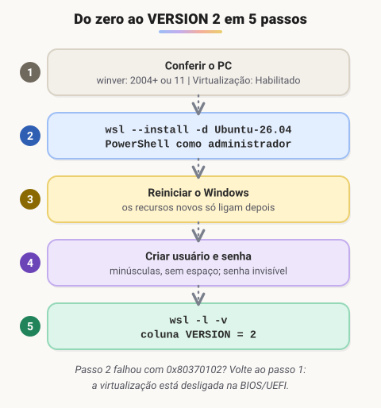

# 2. Instalação do WSL e do Ubuntu

> 🗺️ **Neste capítulo:** instalar o WSL e o Ubuntu 26.04 com um comando, criar o seu usuário do Linux e confirmar que a distribuição roda no WSL 2. No fim, uma tabela com os erros de instalação mais comuns.

## De onde paramos

No capítulo 1 você viu que o WSL 2 roda um kernel Linux de verdade numa máquina virtual leve e conferiu duas coisas no seu PC: a versão do Windows e a virtualização habilitada. Agora é hora de instalar. Tudo neste capítulo acontece em cinco passos, e o último prova que deu certo.



> 💡 **Analogia:** é como receber um carro zero. Antes, você confere se ele cabe na garagem (requisitos e virtualização). Depois assina o pedido (`wsl --install`), espera a entrega e o emplacamento (reinício), cadastra a sua chave e a senha do alarme (usuário e senha do Linux) e, por fim, confere no documento se veio o modelo certo (`VERSION 2`).

## Requisitos: Windows e virtualização

O comando de instalação depende de recursos que só existem em versões recentes do Windows, e o WSL 2 depende de uma máquina virtual. Se um dos dois faltar, a instalação falha com mensagens pouco claras. Por isso o primeiro passo é conferir, não instalar.

**Para usar o** `wsl --install`**, você precisa do Windows 11 ou do Windows 10 versão 2004 ou mais nova (build 19041 ou maior), com a virtualização do processador habilitada.**

O laboratório do capítulo 1 já mostrou como conferir cada um: `winver` para a versão e o Gerenciador de Tarefas (aba **Desempenho** → **CPU** → linha **Virtualização**) para a virtualização. Se a linha mostrar **Desabilitado**, a ativação é feita no firmware do computador, a BIOS/UEFI:

1. Abra o menu Iniciar, segure **Shift** e clique em **Reiniciar**.
2. Escolha **Solução de problemas** → **Opções avançadas** → **Configurações de Firmware UEFI** → **Reiniciar**.
3. Na tela da UEFI, procure nas opções do processador (CPU) um item com um destes nomes e mude para **Enabled**: **Intel Virtualization Technology** ou **Intel VT-x** (processadores Intel); **SVM Mode** ou **AMD-V** (processadores AMD).
4. Salve e saia (normalmente **F10**) e confira de novo no Gerenciador de Tarefas.

O lugar exato do item muda de fabricante para fabricante; o manual da placa-mãe ou do notebook diz onde fica.

> ⚠️ **Armadilha comum:** ativar a virtualização e esquecer de salvar ao sair da UEFI. O computador reinicia com tudo como antes, e o Gerenciador de Tarefas continua mostrando **Desabilitado**. Outro caso: processadores muito antigos (como o Intel Core 2 Duo) não têm o recurso SLAT, exigido pelo WSL 2, e não rodam o WSL 2 mesmo com tudo ligado.

## O comando `wsl --install`

Antes do `wsl --install`, instalar o WSL era uma sequência manual: ligar dois recursos opcionais do Windows, baixar o pacote do kernel, definir a versão padrão e só então buscar a distribuição. Um passo esquecido gerava erro lá na frente.

**O** `wsl --install` **é o comando único que prepara o Windows para o WSL e instala uma distribuição Linux, por padrão o Ubuntu.**

Segundo a documentação oficial, ele faz quatro coisas:

- ativa os componentes opcionais **WSL** e **Plataforma de Máquina Virtual** (Virtual Machine Platform), que é o que permite rodar a VM leve do WSL 2;
- baixa e instala o kernel Linux mais recente;
- define o WSL 2 como versão padrão para as distribuições novas;
- baixa e instala o Ubuntu.


> 💡 **Analogia:** é a matrícula numa academia, feita de uma vez só no balcão da recepção. A atendente cadastra o seu acesso na catraca (os componentes WSL e Plataforma de Máquina Virtual), libera o vestiário que todos os alunos dividem (o kernel, único para todas as distros), marca o plano completo como padrão para qualquer modalidade que você incluir depois (WSL 2 como padrão) e entrega a sua primeira ficha de treino (o Ubuntu). Mas o cadastro na catraca só passa a valer quando o sistema da academia é atualizado no dia seguinte: o reinício do Windows.

### Escolher a distribuição pelo nome

Sem opções, o comando instala a distribuição padrão (o Ubuntu da versão atual). Este livro usa o nome com a versão fixa, `Ubuntu-26.04`, para que todo mundo tenha o mesmo sistema. O nome certo vem da coluna `NAME` da lista de distribuições disponíveis:

```powershell
# lista o que dá para instalar (forma curta:
# wsl -l -o)
wsl --list --online
```

Trecho da saída, como aparece na documentação do Ubuntu para WSL:

```
The following is a list of valid distributions
that can be installed.
Install using 'wsl --install <Distro>'.

  NAME              FRIENDLY NAME
  Ubuntu            Ubuntu
  Ubuntu-26.04      Ubuntu 26.04 LTS
  Ubuntu-24.04      Ubuntu 24.04 LTS
  Ubuntu-22.04      Ubuntu 22.04 LTS
  ...
```

(As duas primeiras linhas aparecem numa só no seu terminal; foram quebradas aqui para caber na página.) Use sempre o valor da coluna `NAME`, nunca o `FRIENDLY NAME`:

```powershell
# -d (ou --distribution) escolhe a distro;
# o nome vem da coluna NAME, sem espaços
wsl --install -d Ubuntu-26.04
```

O comando precisa de um **PowerShell aberto como administrador** (clique com o botão direito no menu Iniciar → **Terminal (Admin)**), porque ativa recursos do Windows. Quando ele terminar, **reinicie o computador**: os componentes ativados só passam a funcionar depois do reinício.

> ⚠️ **Armadilha comum:** rodar só `wsl --install` num PC em que o WSL já está instalado e ver apenas o texto de ajuda. Esse comando sozinho só instala tudo quando o WSL ainda não existe. Com o WSL já presente, use `wsl --list --online` e depois `wsl --install -d Ubuntu-26.04`.

### Alternativa: instalar por um arquivo .wsl

As distribuições atuais do Ubuntu para WSL também são publicadas como uma imagem com extensão `.wsl` (no site de lançamentos do Ubuntu, na página da versão 26.04). Esse caminho não depende da Microsoft Store e serve para computadores com a loja bloqueada ou para instalar em vários PCs a partir de uma cópia na rede interna. A documentação do Ubuntu e a da Microsoft confirmam duas formas de usar o arquivo: clicar duas vezes nele ou rodar, na pasta em que ele foi baixado:

```powershell
# troque pelo nome do arquivo baixado
wsl --install --from-file <arquivo>.wsl
```

Esse formato novo (baseado em tar) exige o WSL 2.4.10 ou mais novo, o que qualquer instalação atual já tem. Para quem está começando, o caminho do `wsl --install -d` continua sendo o mais simples.

## Usuário e senha do Linux

Depois do reinício, o Ubuntu termina de se instalar (na primeira vez, ele descompacta os arquivos; nas próximas, abre em menos de um segundo) e pede duas coisas. Se ele não abrir sozinho, procure **Ubuntu** no menu Iniciar.

**O usuário criado na primeira abertura é a conta Linux padrão daquela distribuição: entra sozinha ao abrir o Ubuntu e pode rodar comandos de administrador com** `sudo`**.**

Três fatos que confundem quem começa:

- **Não tem relação com o usuário do Windows.** Pode ser outro nome e outra senha. Cada distribuição instalada (ou reinstalada) tem as próprias contas.
- **Use letras minúsculas, sem espaço nem acento.** Por exemplo `ana`, e não `Ana Souza`.
- **A senha não aparece enquanto você digita**, nem com asteriscos. É a digitação às cegas: digite normalmente e aperte Enter. Essa é a senha que o `sudo` vai pedir depois, e lá o comportamento muda: no Ubuntu 26.04, o `sudo` padrão (o sudo-rs, adotado desde o Ubuntu 25.10) mostra um asterisco por tecla. O capítulo 3 detalha essa diferença.

O Ubuntu valida o nome com as mesmas regras do `adduser`, o programa que cria usuários no sistema. Veja o que ele responde a dois nomes ruins, num Ubuntu de verdade:

```bash
# com espaço: recusado
sudo adduser "Ana Souza"

# com letra maiúscula: recusado pela regra
# NAME_REGEX (o padrão permitido de nomes)
sudo adduser Ana
```

Saída real (Ubuntu 24.04, na produção do livro):

```
err: To avoid problems, the username must not
  start with a dash, plus sign, or tilde, and it
  must not contain any of the following: colon,
  comma, slash, or any whitespace characters
  including spaces, tabs, and newlines.
err: Please enter a username matching the regular
  expression configured via the NAME_REGEX
  configuration variable.
```

(As linhas foram quebradas para caber na página.) A tela de criação do WSL pode mostrar outra redação, mas a regra é a mesma.

> ⚠️ **Armadilha comum:** achar que o teclado travou porque a senha não aparece, e digitar de novo por cima. Aí a senha gravada vira a soma das duas tentativas. Se esquecer a senha, dá para trocá-la entrando como root pelo PowerShell (`wsl -d Ubuntu-26.04 -u root`) e rodando `passwd ana` (com o seu usuário no lugar de `ana`).

## Conferir: `wsl -l -v` e `wsl --version`

Instalar não basta: a distribuição pode ter entrado no WSL 1 (por exemplo, se alguém mudou a versão padrão antes). E, quando algo der errado mais tarde, a primeira pergunta de qualquer ajuda será "qual versão do WSL você usa?".

**O** `wsl -l -v` **(forma curta de** `wsl --list --verbose`**) lista as distribuições instaladas, o estado de cada uma e a versão do WSL em que ela roda.**

```powershell
wsl -l -v
```

Exemplo de saída, da documentação do Ubuntu (com uma segunda distro instalada):

```
  NAME            STATE           VERSION
  Ubuntu-22.04    Stopped         2
* Ubuntu-26.04    Stopped         2
```

O asterisco marca a distribuição padrão, a que abre quando você digita só `wsl`. `STATE` é `Running` quando ela está aberta e `Stopped` quando não. O que importa aqui é a coluna `VERSION`: precisa ser `2`. Se for `1`, converta:

```powershell
# daqui para a frente, distros novas nascem
# no WSL 2
wsl --set-default-version 2

# converte a distro que já existe
# (pode demorar alguns minutos)
wsl --set-version Ubuntu-26.04 2
```

A conversão reescreve o sistema de arquivos da distro para o disco virtual do WSL 2. Numa instalação nova é rápida; numa distro com projetos grandes, a documentação recomenda fazer backup antes (capítulo 8).

O `wsl --version` mostra a versão do próprio WSL e dos componentes que vêm com ele, como o kernel e o WSLg (o suporte a programas com janela, capítulo 6). Na versão de referência deste livro, a primeira linha mostra o WSL 3.0 ou mais novo. Se o comando não for reconhecido, você está numa versão antiga do WSL embutida no Windows: rode `wsl --update` como administrador.

> ⚠️ **Armadilha comum:** confundir as duas versões. A coluna `VERSION` do `wsl -l -v` diz se a **distro** roda no WSL 1 ou no WSL 2. O `wsl --version` diz qual é a versão do **programa** WSL (3.0, por exemplo). Uma coisa não depende da outra.

## Erros de instalação mais comuns

| Sintoma | Causa provável | O que fazer |
| --- | --- | --- |
| Erro `0x80370102`: a VM não pôde ser iniciada porque falta um recurso | Virtualização desligada na BIOS/UEFI ou Plataforma de Máquina Virtual desativada | Ativar VT-x/AMD-V/SVM, conferir no Gerenciador de Tarefas, reiniciar e rodar a instalação de novo |
| O WSL diz que o nome da distribuição não é válido | Nome digitado diferente da coluna `NAME` (ex.: `Ubuntu 26.04` com espaço) | Rodar `wsl --list --online` e copiar o `NAME` exato: `Ubuntu-26.04` |
| A instalação termina pedindo reinício, e o Ubuntu não abre | Componentes recém-ativados só valem depois do reinício | Reiniciar; depois abrir **Ubuntu** pelo menu Iniciar |
| `wsl --install` só mostra a ajuda | O WSL já está instalado | Usar `wsl --install -d Ubuntu-26.04` |
| A instalação para em 0,0% | Problema no download pela loja | `wsl --install --web-download -d Ubuntu-26.04` |
| `wsl -l -v` mostra `VERSION 1` | Versão padrão estava em 1 | `wsl --set-version Ubuntu-26.04 2` |

## 🧪 Laboratório: instalar e provar que é WSL 2

> ⚠️ Os comandos do Windows deste laboratório vêm do guia do autor (executados em out/2026) e da documentação oficial; não foram executados na produção do livro. Confira a saída no seu computador.

**Passo 1. Abrir o PowerShell como administrador.** Clique com o botão direito no menu Iniciar → **Terminal (Admin)** e aceite o aviso do Controle de Conta de Usuário.

**Passo 2. Ver o nome da distro e instalar.**

```powershell
wsl --list --online
wsl --install -d Ubuntu-26.04
```

Confira se `Ubuntu-26.04` aparece na coluna `NAME` antes de rodar a segunda linha. Se o WSL ainda não existia no PC, o comando ativa os componentes e pede reinício.

**Passo 3. Reiniciar.** Reinicie o Windows. Na volta, o Ubuntu termina a instalação (abra-o pelo menu Iniciar se ele não aparecer sozinho).

**Passo 4. Criar o usuário e a senha.** Digite um nome em minúsculas (aqui, `ana`), depois a senha duas vezes, às cegas. Ao final, o prompt muda para algo como `ana@NOME-DO-PC:~$`: você está no bash do Ubuntu.

**Passo 5. Confirmar, do lado Linux, quem você é e onde está.** Ainda no Ubuntu:

```bash
# o usuário atual e os grupos dele; o grupo
# sudo é o que dá poder de administrador
whoami
id

# o sudo pede a senha criada no passo 4;
# no 26.04 cada tecla vira um asterisco
sudo whoami

# distribuição e kernel
grep -E "^(PRETTY_NAME|VERSION_ID)=" /etc/os-release
uname -r
```

Saída real na produção do livro, num Ubuntu 24.04 em contêiner (fora do WSL), com um usuário `bia` criado com `adduser` e posto no grupo `sudo`:

```
bia
uid=1001(bia) gid=1001(bia) groups=1001(bia),27(sudo),100(users)
[sudo] password for bia:
root
PRETTY_NAME="Ubuntu 24.04.5 LTS"
VERSION_ID="24.04"
6.18.44-fc-v470
```

(A linha do `id` passa de 60 caracteres; ela sai assim, inteira.) No seu WSL, o nome será o seu, o número do `uid` costuma ser `1000` (o primeiro usuário criado), a lista de grupos é maior e inclui `sudo`, `VERSION_ID` mostra `"26.04"` e o `uname -r` termina em `-microsoft-standard-WSL2`. O `root` depois do `sudo whoami` prova que a sua senha funciona e que você pode administrar o sistema.

**Passo 6. Confirmar, do lado Windows, a versão.** Volte ao PowerShell (pode ser sem administrador):

```powershell
wsl -l -v
wsl --version
```

No `wsl -l -v`, a linha do `Ubuntu-26.04` deve ter `2` na coluna `VERSION` e o asterisco de distro padrão (se for a única). No `wsl --version`, a primeira linha deve mostrar o WSL 3.0 ou mais novo. Se a coluna mostrar `1`, rode `wsl --set-version Ubuntu-26.04 2` e confira de novo.

## 🏋️ Pratique

**1.** Ao rodar `wsl --install -d Ubuntu-26.04`, aparece o erro `0x80370102`. No Gerenciador de Tarefas, a linha Virtualização mostra "Desabilitado". O que fazer, em ordem?

<details>
<summary>Ver resposta</summary>

(1) Reiniciar na UEFI (Shift + Reiniciar → Solução de problemas → Opções avançadas → Configurações de Firmware UEFI); (2) ativar Intel VT-x / Intel Virtualization Technology ou AMD-V / SVM Mode; (3) salvar e sair; (4) conferir no Gerenciador de Tarefas que agora está "Habilitado"; (5) rodar `wsl --install -d Ubuntu-26.04` de novo. Teste: `wsl -l -v` → `Ubuntu-26.04 ... 2`.

</details>

**2.** Um colega rodou `wsl --install -d "Ubuntu 26.04 LTS"` e o WSL disse que o nome não é válido. Qual é o comando certo, e de onde vem o nome?

<details>
<summary>Ver resposta</summary>

`wsl --install -d Ubuntu-26.04`. "Ubuntu 26.04 LTS" é o `FRIENDLY NAME`, só para leitura; o comando aceita o valor da coluna `NAME` do `wsl --list --online`, que não tem espaços.

</details>

**3.** Depois de instalar, o `wsl -l -v` mostra a linha abaixo. O que está errado e como corrigir para esta e para as próximas distros?

```
* Ubuntu-26.04    Stopped         1
```

<details>
<summary>Ver resposta</summary>

A distro está no WSL 1. Para ela: `wsl --set-version Ubuntu-26.04 2`. Para as próximas: `wsl --set-default-version 2`. Teste: rodar `wsl -l -v` de novo → a coluna `VERSION` mostra `2`.

</details>

## 🧠 Revisão rápida

**O que o `wsl --install` ativa no Windows além de instalar o Ubuntu?**

Os componentes opcionais WSL e Plataforma de Máquina Virtual; ele também instala o kernel Linux e define o WSL 2 como padrão.

**Você digita a senha na criação do usuário e nada aparece na tela. Está travado?**

Não: a tela de criação do usuário não mostra a senha (nem asteriscos). Digite e aperte Enter. Já o `sudo` do Ubuntu 26.04 mostra um asterisco por tecla (capítulo 3).

**Qual comando mostra se a distro roda no WSL 1 ou no WSL 2?**

`wsl -l -v`, na coluna `VERSION`. O `wsl --version` mostra outra coisa: a versão do programa WSL.

> ➡️ **Próximo passo:** o Ubuntu está instalado, mas com os pacotes da data da imagem e com uma senha que você ainda nem usou de verdade. O próximo capítulo atualiza o sistema com `apt`, explica por que usar `sudo` em vez de trabalhar como root e confere o systemd: **3. Primeiros passos no Ubuntu**.

## 📚 Fontes

Conferido em 2026-11-15.

- [How to install Linux on Windows with WSL (Microsoft Learn)](https://learn.microsoft.com/en-us/windows/wsl/install)
- [Set up a WSL development environment (Microsoft Learn)](https://learn.microsoft.com/en-us/windows/wsl/setup/environment)
- [Basic commands for WSL (Microsoft Learn)](https://learn.microsoft.com/en-us/windows/wsl/basic-commands)
- [Troubleshooting Windows Subsystem for Linux (Microsoft Learn)](https://learn.microsoft.com/en-us/windows/wsl/troubleshooting)
- [Install Ubuntu on WSL (Ubuntu on WSL docs)](https://ubuntu.com/wsl/docs/stable/howto/install-ubuntu-wsl2/)
- Guia do autor: [🐧Instalação do WSL](https://app.notion.com/p/Instala-o-do-WSL-401345e2044380d7a543eff07c6e9935?pvs=21) (seções 1 a 3)

## 📌 Resumo

| Item | Em uma frase |
| --- | --- |
| Requisitos | Windows 11, ou Windows 10 2004 (build 19041) ou mais novo, com virtualização habilitada |
| Virtualização | Ativada na BIOS/UEFI: Intel VT-x ou AMD-V/SVM; conferida no Gerenciador de Tarefas |
| `wsl --install` | Ativa WSL e Plataforma de Máquina Virtual, instala o kernel, define o WSL 2 como padrão e instala o Ubuntu |
| `wsl --list --online` | Lista as distros instaláveis; o nome usado no comando é o da coluna `NAME` |
| `wsl --install -d Ubuntu-26.04` | Instala a versão fixa usada no livro, em PowerShell como administrador |
| `wsl --install --from-file` | Instala a partir de uma imagem `.wsl` baixada, sem a Microsoft Store |
| Reinício | Necessário para os componentes ativados passarem a funcionar |
| Usuário e senha | Contas só do Linux, minúsculas sem espaço; a senha não aparece ao digitar |
| `wsl -l -v` | Mostra cada distro e a versão do WSL dela; a coluna `VERSION` deve ser 2 |
| `wsl --set-version` | Converte uma distro entre WSL 1 e WSL 2 |
| `wsl --version` | Mostra a versão do programa WSL e dos componentes (kernel, WSLg) |
| `0x80370102` | Virtualização ou Plataforma de Máquina Virtual desligada |
