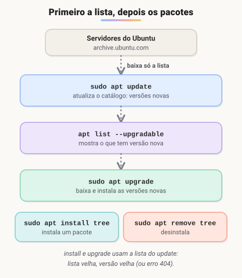
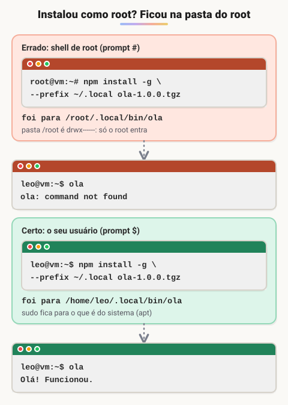

# 3. Primeiros passos no Ubuntu

> 🗺️ **Neste capítulo:** ler o prompt do Ubuntu, usar meia dúzia de comandos de sobrevivência, atualizar e instalar pacotes com `apt`, entender por que se usa `sudo` e nunca se trabalha como root, e conferir o systemd, que já vem ligado no Ubuntu do WSL.

## De onde paramos

No capítulo 2 você instalou o Ubuntu 26.04, criou o seu usuário e a senha e provou que a distro roda no WSL 2. Agora você está diante de um terminal com um cursor piscando. Este capítulo ensina o mínimo para não se perder nele e deixa o sistema atualizado, do jeito seguro.

## O terminal e o prompt

Antes de digitar qualquer coisa, vale saber ler o que o terminal já mostra. O texto antes do cursor responde a três perguntas: quem é você, em que máquina está e em que pasta está.

**O prompt é o texto que o bash mostra quando espera um comando; no Ubuntu, ele tem a forma** `usuario@maquina:pasta$`**.**

Saída real na produção do livro, com o usuário `leo` num computador chamado `vm`, e depois o mesmo terminal virado root:

```
leo@vm:~$
root@vm:~#
```

- `leo` é o usuário; `vm` é o nome da máquina. No WSL, aparece o nome do seu PC com Windows (ex.: `ana@NOTE-ANA:~$`).
- `~` é a pasta atual. O til é o atalho da sua pasta pessoal, `/home/leo` (o capítulo 4 explica a fundo).
- O último caractere diz **quem manda**: `$` é um usuário comum; `#` é o **root**, o administrador do Linux, que pode tudo.

**Armadilha comum:** copiar de um tutorial o `$` junto com o comando. O `$` é parte do prompt, não do comando. Neste livro, os blocos de código já vêm sem ele.

## Comandos de sobrevivência

Você não precisa decorar o Linux para programar no WSL. Precisa de seis comandos para andar pelas pastas, ver o que tem nelas e pedir ajuda.

**Comandos de sobrevivência são os que mostram onde você está (**`pwd`**), o que existe ali (**`ls`**), como mudar de pasta (**`cd`**), criar pasta (**`mkdir`**), ler (**`cat`**) e editar (**`nano`**) um arquivo.**

Exemplo real, como o usuário `leo`:

```bash
# onde estou? (o terminal abre na home)
pwd
# cria a pasta e entra nela
mkdir treino
cd treino
pwd
# cria um arquivo de uma linha e lista a pasta
echo "primeira linha" > nota.txt
ls
# -l = detalhes; -a = inclui os ocultos (. e ..)
ls -la
# mostra o conteúdo do arquivo
cat nota.txt
# cd sem nada volta para a home
cd
pwd
```

Saída:

```
/home/leo
/home/leo/treino
nota.txt
total 12
drwxrwxr-x 2 leo leo 4096 Nov 15 23:52 .
drwxr-x--- 5 leo leo 4096 Nov 15 23:52 ..
-rw-rw-r-- 1 leo leo   15 Nov 15 23:52 nota.txt
primeira linha
/home/leo
```

No `ls -la`, a terceira e a quarta colunas dizem de quem é o arquivo (`leo leo`: dono e grupo). Guarde isso: vai explicar o problema do root daqui a pouco. Outros atalhos do `cd`: `cd ..` sobe uma pasta, `cd -` volta para a anterior.

Para editar um arquivo no próprio terminal, use o `nano`: `nano nota.txt`. Os atalhos ficam no rodapé da tela (o `^` significa Ctrl): **Ctrl+O** e Enter salvam, **Ctrl+X** sai. Se você sair com alterações, ele pergunta se quer salvar: **Y** (sim) e Enter.

Para pedir ajuda, quase todo comando aceita `--help`, e o `man` abre o manual completo (setas para rolar, **q** para sair):

```bash
ls --help | head -3
```

Saída:

```
Usage: ls [OPTION]... [FILE]...
List information about the FILEs (the current directory by default).
Sort entries alphabetically if none of -cftuvSUX nor --sort is specified.
```

**Armadilha comum:** o `man` responder que o sistema foi "minimized" (reduzido) e não mostrar o manual. Foi o que aconteceu no contêiner da produção do livro, que não traz as páginas de manual. A mensagem manda rodar `unminimize`; antes disso, tente o `--help`, que funciona sempre.

## apt: atualizar e instalar programas

No Windows você baixa um instalador de um site. No Ubuntu, os programas vêm de repositórios oficiais, conferidos e assinados pela Canonical, e um único programa cuida de baixar, instalar, atualizar e remover tudo.

**O** `apt` **é o gerenciador de pacotes do Ubuntu: ele mantém uma lista local do que existe nos repositórios e instala, atualiza e remove programas a partir dela.**

| Comando | O que faz | Precisa de sudo? |
| --- | --- | --- |
| `apt update` | Baixa a lista nova de pacotes e versões (não instala nada) | Sim |
| `apt list --upgradable` | Mostra o que tem versão nova, segundo a lista | Não |
| `apt upgrade` | Baixa e instala as versões novas | Sim |
| `apt install` nome | Instala um pacote (e as dependências) | Sim |
| `apt remove` nome | Desinstala um pacote | Sim |
| `apt search` palavra | Procura pacotes pelo nome e pela descrição | Não |

**Por que o update vem antes:** o `apt` não consulta a internet na hora do `install` ou do `upgrade`. Ele decide o que baixar a partir da lista local. Se a lista for velha, ele não sabe que existe versão nova, ou pede um arquivo que o servidor já apagou e falha com erro 404. Num Ubuntu recém-instalado a lista é a da data da imagem; por isso a primeira coisa a fazer é:

```bash
# && = só roda o upgrade se o update der certo;
# -y = responde "sim" à confirmação
sudo apt update && sudo apt upgrade -y
```



> 💡 **Analogia:** é o aplicativo de delivery. Antes de pedir, você puxa a tela para baixo para recarregar o cardápio (`apt update`): só então aparecem os pratos novos e os preços do dia. A aba "itens com promoção" é o `apt list --upgradable`. Fazer o pedido é o `upgrade` ou o `install`. Se você pedir com o cardápio de ontem, o restaurante responde que aquele prato não existe mais: o erro 404.

Instalar e remover um pacote pequeno, como o `tree` (mostra as pastas em forma de árvore):

```bash
# confere se o pacote existe e o que ele faz
apt search tree
apt show tree
# instala; o apt mostra o tamanho e pede confirmação
sudo apt install tree
tree ~/treino
# remove o programa (as suas pastas não são tocadas)
sudo apt remove tree
```

Quer ver o que o `apt` faria sem fazer nada? A opção `-s` (simular) mostra o plano. Saída real na produção do livro, simulando a remoção do `jq` (um leitor de JSON):

```bash
sudo apt remove -s jq
```

```
The following packages will be REMOVED:
  jq yq
0 upgraded, 0 newly installed, 2 to remove and 0 not upgraded.
Remv yq [3.1.0-3]
Remv jq [1.7.1-3ubuntu0.24.04.2]
```

Repare que o `apt` também removeria o `yq`, que depende do `jq`. Por isso vale ler a lista antes de responder "Y". Depois de vários upgrades, `sudo apt autoremove` apaga as dependências que nenhum programa usa mais.

> ⚠️ **Armadilha comum:** rodar o `apt install` sem `sudo`. A saída real é esta, e não quer dizer que o pacote não existe:
>
> ```
> E: Could not open lock file /var/lib/dpkg/lock-frontend
>   - open (13: Permission denied)
> E: Unable to acquire the dpkg frontend lock
>   (/var/lib/dpkg/lock-frontend), are you root?
> ```
>
> (As linhas foram quebradas para caber na página.) O "are you root?" é a dica: instalar no sistema exige poder de administrador. Repita com `sudo` na frente. Outra mensagem comum, `E: Unable to locate package`, quase sempre significa que falta o `apt update` ou que o nome está errado (confira com `apt search`).

## sudo x root

O Linux separa o seu usuário do administrador por um motivo prático: um erro de digitação como usuário comum estraga, no máximo, os seus arquivos; como root, estraga o sistema. O `sudo` existe para você usar o poder de administrador só no comando que precisa dele.

**O** `sudo` **roda um único comando como root, depois de pedir a sua senha; o root é a conta de administrador, e "trabalhar como root" é abrir um terminal inteiro com ela (**`sudo -i`**,** `sudo su`**, prompt** `#`**).**

|  | `sudo comando` | Terminal de root (`#`) |
| --- | --- | --- |
| Dura | Um comando | Até você digitar `exit` |
| Pasta pessoal | A sua, `/home/leo` | A do root, `/root` |
| Arquivos criados | Do sistema, só quando o comando é do sistema (apt) | Todos do root, inclusive os da sua pasta |
| Erro de digitação | Afeta um comando | Afeta o que vier depois |

O problema que mais aparece no WSL não é segurança, é sumiço: **programas instalados como root vão para a pasta do root e não funcionam para o seu usuário**. Isso vale para tudo que se instala "por usuário": Node pelo nvm, pacotes globais do npm, ferramentas do uv, o instalador do Claude Code (capítulos 6 e 9). Todos gravam em pastas dentro de `~`, e o `~` do root é `/root`.

Exemplo real na produção do livro. O usuário `leo` abre um terminal de root e instala um programinha de linha de comando (`ola`, empacotado como `ola-1.0.0.tgz`) com o npm, na pasta `~/.local`, que é onde os instaladores por usuário costumam pôr os comandos:

```bash
# vira root: o prompt muda para #
sudo -i
whoami
echo $HOME
npm install -g --prefix ~/.local \
  /tmp/c03npm/ola-1.0.0.tgz
ls -la ~/.local/bin/ola
# volta a ser leo
exit
```

Saída (a linha do `ls` passa de 60 caracteres; ela sai assim, inteira):

```
root
/root

added 1 package in 340ms
lrwxrwxrwx 1 root root 30 Nov 15 23:51 /root/.local/bin/ola -> ../lib/node_modules/ola/ola.js
```

De volta como `leo`, o comando não existe, e nem dá para olhar onde ele foi parar:

```bash
whoami
ola
ls -la /root/.local/bin/ola
```

```
leo
-bash: line 1: ola: command not found
ls: cannot access '/root/.local/bin/ola': Permission denied
```

A pasta `/root` tem permissão `drwx------`: só o dono (root) entra. Agora o jeito certo, como `leo` e sem `sudo`:

```bash
npm install -g --prefix ~/.local \
  /tmp/c03npm/ola-1.0.0.tgz
ls -la ~/.local/bin
```

```
added 1 package in 197ms
total 8
drwxrwxr-x 2 leo leo 4096 Nov 15 23:52 .
drwxrwxr-x 4 leo leo 4096 Nov 15 23:52 ..
lrwxrwxrwx 1 leo leo   30 Nov 15 23:52 ola -> ../lib/node_modules/ola/ola.js
```

Num terminal novo (o `~/.profile` do Ubuntu põe o `~/.local/bin` no caminho de busca de comandos, o PATH, quando a pasta existe):

```bash
which ola
ola
```

```
/home/leo/.local/bin/ola
Olá! Funcionou.
```



> 💡 **Analogia:** pense num escritório com um cofre da diretoria. O `sudo` é pedir à gerente que abra o cofre para tirar um documento específico: ela confere o seu crachá (a senha), abre, você pega o que precisa e o cofre fecha. Trabalhar como root é passar o dia inteiro sentado dentro do cofre: tudo o que você produz fica guardado lá dentro, com a chave da diretoria. Quando você volta para a sua mesa (o prompt `$`), seus papéis não estão nela, e você nem tem a chave para buscá-los.

Regra prática: **use** `sudo` **só quando o comando mexe no sistema** (o `apt`, arquivos em `/etc`) **e nunca nos instaladores de ferramentas de desenvolvimento** (nvm, npm, uv, pip, Claude Code). Se o terminal mostrar `#` sem você querer, digite `exit`.

> ⚠️ **Armadilha comum:** "consertar" um `Permission denied` do npm ou do pip com `sudo npm install -g ...`. Funciona na hora e cria arquivos do root dentro das pastas do sistema ou da sua home, que depois dão erro de permissão para o seu usuário. O conserto certo é instalar a ferramenta como usuário (o Node pelo nvm, capítulo 6), e aí nenhum `sudo` é necessário.

Uma novidade do Ubuntu 26.04: desde o Ubuntu 25.10, o `sudo` padrão é o **sudo-rs**, uma reimplementação em Rust. O comando continua se chamando `sudo` e se usa do mesmo jeito; a diferença visível é que, no 26.04, ele mostra um asterisco por tecla enquanto você digita a senha. As saídas deste capítulo vêm de um Ubuntu 24.04, cujo `sudo` não mostra nada.

## systemd no WSL

Alguns programas não são apenas comandos: são serviços que ficam rodando em segundo plano (um banco de dados, o servidor do snap). No Linux, quem liga, desliga e vigia esses serviços é o primeiro processo do sistema.

**O systemd é o sistema de inicialização e gerenciador de serviços do Ubuntu: roda como o processo número 1 (PID 1) e liga os demais serviços.**

No WSL, ele é opcional e ligado por um arquivo de configuração da própria distro, o `/etc/wsl.conf`:

```
[boot]
systemd=true
```

**Ele já vem ligado?** Sim. A documentação da Microsoft diz que o systemd é o padrão do Ubuntu atual instalado pelo `wsl --install`, e o glossário do Ubuntu on WSL diz que ele vem habilitado por padrão no WSL 2. Mesmo assim, confira: uma distro importada de backup ou de outra origem pode ter vindo sem ele.

Para que ele serve no dia a dia:

- **snap**, o outro formato de pacotes do Ubuntu, depende do systemd. No Ubuntu, o pacote `firefox` do `apt` instala o Firefox em snap: sem systemd, ele não abre.
- **serviços**: com systemd, `systemctl status` mostra o estado do sistema e `sudo systemctl start nome` liga um serviço, como num Linux comum.

Como conferir, dentro do Ubuntu:

```bash
# o arquivo de configuração da distro
cat /etc/wsl.conf
# qual programa é o processo 1?
ps -p 1 -o comm=
```

Com o systemd ligado, o `ps` responde `systemd`. Na produção do livro (um contêiner, não o WSL) ele respondeu `process_api`, e o `systemctl is-system-running` respondeu `offline`: é o que se vê num Linux sem systemd.

Se faltar a seção `[boot]`, acrescente-a com `sudo nano /etc/wsl.conf` e reinicie o WSL. Fechar a janela do terminal não basta: o WSL continua rodando por alguns segundos e só lê o `wsl.conf` ao iniciar de novo. No PowerShell:

```powershell
# desliga todas as distros e a VM do WSL
wsl --shutdown
```

Depois abra o Ubuntu de novo. A documentação chama isso de "regra dos 8 segundos": sem o `--shutdown`, espere a distro parar de vez (`wsl --list --running` deve responder que não há distribuições rodando) antes de reabrir.

**Armadilha comum:** rodar `wsl --shutdown` dentro do Ubuntu. É um comando do Windows; digite-o no PowerShell (ou como `wsl.exe --shutdown`, se estiver no bash). E lembre que ele desliga **todas** as distros, com o que estiver rodando nelas.

## 🧪 Laboratório

> ⚠️ Os comandos do Windows deste laboratório vêm do guia do autor (executados em out/2026) e da documentação oficial; não foram executados na produção do livro. Confira a saída no seu computador. Os comandos do Ubuntu foram executados num Ubuntu 24.04 em contêiner, como usuário comum com `sudo`, sem acesso aos repositórios: o `apt update` e o `apt install` mostram aqui o erro real dessa situação.

**Passo 1. Conferir quem você é.** Abra o Ubuntu. O prompt deve terminar em `$`.

```bash
whoami
pwd
```

Saída na produção do livro (no seu, o seu usuário):

```
leo
/home/leo
```

**Passo 2. Atualizar a lista de pacotes.**

```bash
sudo apt update
```

No seu computador, com internet, aparecem linhas `Get:` e `Hit:` (uma por repositório) e, no fim, quantos pacotes podem ser atualizados. No ambiente de produção do livro, que não tem acesso aos servidores do Ubuntu, a saída real foi esta (trecho):

```
Err:1 http://archive.ubuntu.com/ubuntu noble InRelease
  Could not resolve 'archive.ubuntu.com'
Err:2 http://security.ubuntu.com/ubuntu noble-security InRelease
  Could not resolve 'security.ubuntu.com'
...
W: Some index files failed to download. They have
  been ignored, or old ones used instead.
```

`Could not resolve` quer dizer que o nome do servidor não foi encontrado: falta internet ou o DNS falhou. O `apt` não para com erro, só avisa (`W:`) e segue com a lista antiga, ou com nenhuma. Se isso acontecer no seu WSL, teste a rede com `ping -c 2 archive.ubuntu.com`; VPNs corporativas são a causa mais comum (o capítulo 7 trata dos erros do WSL). O `noble` é o apelido do 24.04; no seu aparece o do 26.04.

**Passo 3. Ver o que tem versão nova e atualizar.**

```bash
apt list --upgradable
sudo apt upgrade -y
```

Saída real do primeiro comando na produção do livro, sem lista de pacotes:

```
Listing...
```

Só o cabeçalho: sem lista nova, o `apt` não conhece nenhuma versão mais recente. No seu Ubuntu, cada linha mostra o pacote, a versão nova e, entre colchetes, a atual (`[upgradable from: ...]`).

**Passo 4. Instalar, usar e remover o** `tree`**.**

```bash
sudo apt install -y tree
tree ~/treino
sudo apt remove -y tree
```

No seu Ubuntu, o `tree ~/treino` desenha a pasta criada na seção de comandos de sobrevivência, com o `nota.txt` dentro. Na produção do livro, sem lista de pacotes, o `apt` respondeu:

```
E: Unable to locate package tree
```

É a mesma mensagem que aparece num Ubuntu novo em que ninguém rodou o `apt update`.

**Passo 5. Comparar root e usuário.** Repita o exemplo da seção "sudo x root": crie um pacote mínimo e instale-o primeiro como root, depois como você.

```bash
mkdir -p /tmp/ola && cd /tmp/ola
cat > package.json <<'FIM'
{
  "name": "ola",
  "version": "1.0.0",
  "bin": { "ola": "ola.js" }
}
FIM
printf '%s\n' '#!/usr/bin/env node' \
  'console.log("Olá! Funcionou.");' > ola.js
# empacota a pasta em ola-1.0.0.tgz
cd /tmp && npm pack ./ola
```

Este passo usa o `npm`, que você instala no capítulo 6. Se ainda não o tem, volte aqui depois. Em seguida rode os comandos de `sudo -i` e de usuário da seção anterior, trocando `/tmp/c03npm/` por `/tmp/`, e compare com `sudo ls -la /root/.local/bin` e `ls -la ~/.local/bin`. Para limpar:

```bash
sudo rm -rf /root/.local/bin/ola \
  /root/.local/lib/node_modules/ola
rm -rf ~/.local/bin/ola ~/.local/lib/node_modules/ola
```

**Passo 6. Conferir o systemd.**

```bash
cat /etc/wsl.conf
ps -p 1 -o comm=
```

Procure `[boot]` e `systemd=true` no arquivo, e `systemd` na resposta do `ps`. Se faltar, edite com `sudo nano /etc/wsl.conf`, salve (Ctrl+O, Enter, Ctrl+X), rode `wsl --shutdown` no PowerShell, reabra o Ubuntu e confira de novo.

## 🏋️ Pratique

**1.** Num Ubuntu recém-instalado, um colega roda `sudo apt install htop` e recebe `E: Unable to locate package htop`. O pacote existe. O que faltou?

<details>
<summary>Ver resposta</summary>

Faltou atualizar a lista antes. O `apt` procura o pacote na lista local, que ainda é a da imagem (ou está vazia).

```bash
sudo apt update
sudo apt install htop
```

Teste: `htop --version` mostra a versão instalada.

</details>

**2.** Você abriu o terminal e o prompt está assim: `root@NOTE-ANA:/home/ana#`. O que isso significa e o que fazer antes de instalar o nvm?

<details>
<summary>Ver resposta</summary>

O `#` e o `root@` mostram que o terminal está como root (alguém rodou `sudo -i` ou `sudo su`). Mesmo estando em `/home/ana`, o `~` do root é `/root`, e o nvm seria instalado lá. Digite `exit` até o prompt voltar a terminar em `$` e confira:

```bash
whoami
echo $HOME
```

Teste: a saída é `ana` e `/home/ana`.

</details>

**3.** Você trocou o `/etc/wsl.conf`, fechou a janela do Ubuntu, abriu de novo na mesma hora, e nada mudou. Por quê, e como garantir que a mudança valha?

<details>
<summary>Ver resposta</summary>

O WSL continuava rodando: ele só lê o `wsl.conf` quando a distro inicia de novo, e fechar a janela não a desliga na hora. No PowerShell:

```powershell
wsl --shutdown
```

Depois reabra o Ubuntu. Teste (para o systemd): `ps -p 1 -o comm=` → `systemd`.

</details>

## 🧠 Revisão rápida

**Qual a diferença entre `apt update` e `apt upgrade`?**

O `update` só baixa a lista de pacotes e versões; o `upgrade` instala as versões novas que essa lista aponta. Por isso o update vem antes.

**Por que um programa instalado com `sudo -i` some quando você volta ao seu usuário?**

Porque ele foi para a pasta do root (`/root`, que só o root abre), e o seu usuário procura comandos na própria home.

**Como saber se o systemd está ativo no Ubuntu do WSL?**

`/etc/wsl.conf` tem `[boot]` com `systemd=true`, e `ps -p 1 -o comm=` responde `systemd`. Mudou o arquivo? `wsl --shutdown` no PowerShell.

> ➡️ **Próximo passo:** o Ubuntu está atualizado e você sabe trabalhar nele como o seu usuário. Falta decidir onde os seus arquivos vão morar: o Linux e o Windows têm discos separados, e escolher o lado errado deixa tudo lento. É o assunto de **4. Arquivos entre Linux e Windows**.

## 📚 Fontes

Conferido em 2026-11-15.

- [Use systemd to manage Linux services with WSL (Microsoft Learn)](https://learn.microsoft.com/en-us/windows/wsl/systemd)
- [Advanced settings configuration in WSL: wsl.conf e a regra dos 8 segundos (Microsoft Learn)](https://learn.microsoft.com/en-us/windows/wsl/wsl-config)
- [Glossary for Ubuntu on WSL: systemd (Ubuntu on WSL docs)](https://ubuntu.com/wsl/docs/stable/reference/glossary/)
- [Adopting sudo-rs By Default in Ubuntu 25.10 (Ubuntu Discourse)](https://discourse.ubuntu.com/t/adopting-sudo-rs-by-default-in-ubuntu-25-10/60583)
- Guia do autor: [🐧Instalação do WSL](https://app.notion.com/p/Instala-o-do-WSL-401345e2044380d7a543eff07c6e9935?pvs=21) (seção "4. Primeira atualização do Ubuntu") e [🧰Programas complementares no WSL](https://app.notion.com/p/Programas-complementares-no-WSL-401345e2044381c0b931ea6687aacc0a?pvs=21) (aviso inicial sobre `sudo` e root)

## 📌 Resumo

| Item | Em uma frase |
| --- | --- |
| Prompt | `usuario@maquina:pasta$`; o `$` é usuário comum e o `#` é root |
| `pwd`, `ls`, `cd` | Onde estou, o que tem aqui, mudar de pasta (`cd` sozinho volta para a home) |
| `mkdir`, `cat`, `nano` | Criar pasta, ler arquivo, editar no terminal (Ctrl+O salva, Ctrl+X sai) |
| `--help` e `man` | Ajuda rápida e manual completo de um comando |
| `sudo apt update` | Baixa a lista nova de pacotes; sempre antes de instalar ou atualizar |
| `sudo apt upgrade` | Instala as versões novas que a lista aponta |
| `apt install`, `remove`, `search` | Instalar, desinstalar e procurar pacotes (os dois primeiros com `sudo`) |
| `sudo` | Roda um comando como root, pedindo a sua senha; só para o que mexe no sistema |
| Trabalhar como root | Programas vão para `/root` e não funcionam para o seu usuário: evite |
| systemd | Gerenciador de serviços (PID 1), já ligado no Ubuntu do WSL; necessário para snap |
| `wsl --shutdown` | No PowerShell, desliga o WSL para o `wsl.conf` valer na próxima abertura |
