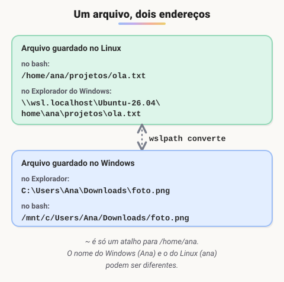
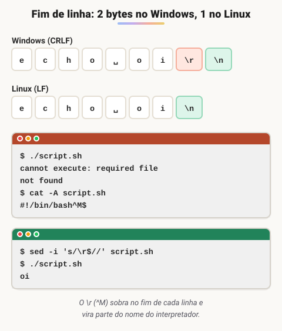

# 4. Arquivos entre Linux e Windows

> 🗺️ **Neste capítulo:** onde ficam os arquivos do Linux e do Windows, como chegar de um lado ao outro (`/mnt/c`, `\\wsl.localhost`, `explorer.exe .`, `wslpath`), por que o projeto precisa morar em `~/projetos` e como evitar o problema das quebras de linha CRLF × LF.

## De onde paramos

No capítulo anterior você atualizou o Ubuntu, aprendeu a usar `sudo` sem trabalhar como root e conferiu o systemd. O Ubuntu já está pronto para receber trabalho. A próxima pergunta é prática: **onde eu guardo os meus arquivos?** O WSL tem dois sistemas de arquivos convivendo na mesma máquina, e escolher o lado errado deixa tudo lento ou quebra scripts.

## Dois discos, dois jeitos de escrever o caminho

Quando você instala o Ubuntu no WSL, ganha um disco novo, separado do `C:` do Windows. No Linux não existem letras de unidade: tudo começa na raiz `/`, e os outros discos aparecem como pastas (pontos de montagem).

**A pasta pessoal (home) é a sua pasta no Linux:** `/home/<usuario>`**, que o terminal abrevia como** `~`**.** É ali que ficam os seus arquivos, configurações e projetos.

Exemplo real, com o usuário `teste` criado para este livro:

```bash
# ~ é só um atalho: o bash troca pelo caminho completo
echo ~
# a pasta em que o terminal abre é a home
pwd
```

Saída:

```
/home/teste
/home/teste
```

No seu computador aparece o nome que você criou na instalação (capítulo 2), por exemplo `/home/ana`.

Cada lado enxerga o outro por um caminho próprio:

| Onde o arquivo mora | No bash (Linux) | No Windows |
| --- | --- | --- |
| Disco do Linux | `/home/ana/projetos` | `\\wsl.localhost\Ubuntu-26.04\home\ana\projetos` |
| Disco C do Windows | `/mnt/c/Users/Ana` | `C:\Users\Ana` |

- `/mnt/c` é o disco C do Windows montado dentro do Linux. O `D:` vira `/mnt/d`, e assim por diante.
- `\\wsl.localhost\<distro>` (ou o nome antigo, `\\wsl$\<distro>`) é o caminho de rede pelo qual o Windows enxerga os arquivos do Linux. No Explorador, eles também aparecem no item **Linux** da barra lateral.



> 💡 **Analogia:** pense numa estação de metrô que fica embaixo de uma praça. Quem chega a pé procura "Praça da Sé"; quem chega de trem procura "Estação Sé". É o mesmo lugar com dois nomes, e cada um só faz sentido para quem vem por aquele caminho. O arquivo é a praça; o bash e o Explorador são os dois jeitos de chegar; o `wslpath` é a placa que diz o nome do lugar no outro sistema.

> ⚠️ **Armadilha:** o nome de usuário do Windows e o do Linux são independentes. Em `/mnt/c/Users/Ana` vale o nome do Windows (com a maiúscula que ele tiver); em `/home/ana` vale o do Linux. E nunca abra os arquivos do Linux mexendo no disco virtual dentro de `AppData`: a documentação avisa que isso pode corromper a distro. Use sempre `\\wsl.localhost`.

> ⚠️ **Correção do guia-base:** o guia do autor usa `\\wsl$\Ubuntu-24.04\...`. Neste livro a distro é `Ubuntu-26.04`, e o caminho preferido é `\\wsl.localhost\Ubuntu-26.04\...`: os dois funcionam, mas a documentação explica que o `\\wsl$` só responde com a distro ligada, enquanto o `\\wsl.localhost` consegue ligá-la sozinho no Windows 11.

## Abrir pastas e converter caminhos

Dentro do Ubuntu dá para chamar programas do Windows, desde que você escreva o nome com `.exe`. O mais útil no dia a dia é o Explorador.

`explorer.exe .` **abre a pasta atual do terminal no Explorador do Windows** (o ponto significa "esta pasta").

`wslpath` **converte um caminho de um formato para o outro.** Sem opção, ele transforma caminho do Windows em caminho do Linux; com `-w`, faz o contrário.

```bash
# abre ~/projetos no Explorador (o ponto é obrigatório)
cd ~/projetos
explorer.exe .

# Windows -> Linux: aspas simples para o bash não
# mexer nas barras invertidas
wslpath 'C:\Users\Ana\Downloads\foto.png'

# Linux -> Windows: útil para colar no Explorador
wslpath -w ~/projetos
```

Saída esperada, no formato mostrado na documentação da Microsoft (o nome da distro e do usuário mudam):

```
/mnt/c/Users/Ana/Downloads/foto.png
\\wsl.localhost\Ubuntu-26.04\home\ana\projetos
```

> ⚠️ Estes comandos dependem do WSL (eles chamam o Windows) e não foram executados na produção do livro. O formato da saída vem da documentação oficial; confira no seu computador.

**Armadilha comum:** esquecer o `.exe`. Sem ele, o bash procura um programa do Linux chamado `explorer` e responde `command not found`. Outra: digitar um caminho do Windows sem aspas; no bash, a barra invertida é um caractere especial.

## Desempenho: o projeto mora no Linux

Por que não deixar os projetos em `C:\Users\Ana\Documentos` e abrir pelo `/mnt/c`? Porque cada leitura atravessa uma ponte. O WSL 2 roda o Linux numa máquina virtual leve, e o acesso de um sistema de arquivos ao outro passa por um protocolo de compartilhamento de rede (o 9P). Para abrir uma foto, tanto faz. Para um `git status` ou um `npm install`, que mexem em milhares de arquivos pequenos, a soma das travessias pesa.

**Regra: ferramenta do Linux trabalha com arquivo no disco do Linux (**`~/projetos`**); ferramenta do Windows trabalha com arquivo no** `C:`**.** O `/mnt/c` e o `\\wsl.localhost` servem para trocar arquivos de vez em quando, não para o trabalho pesado.

Medição real no disco do Linux (ext4), com 5000 arquivos pequenos:

```bash
# 5000 arquivos no disco do Linux, com o tempo medido
mkdir -p ~/projetos/teste-velocidade
cd ~/projetos/teste-velocidade
# cria 5000 arquivos de uma linha
time (for i in $(seq 1 5000); do
  echo $i > arq$i.txt; done)
# lista com detalhes (lê os metadados de todos)
time ls -l > /dev/null
# copia a pasta inteira
time cp -r ~/projetos/teste-velocidade ~/copia
```

Saída (só a linha `real` de cada `time`, que é o tempo de relógio):

```
real  0m0.053s
real  0m0.013s
real  0m0.055s
```

Os números variam com a máquina. O que importa é a comparação: repita os mesmos comandos dentro de `/mnt/c/Users/<seu-usuario>` (no Laboratório) e veja quanto cresce.


> 💡 **Analogia:** é a diferença entre trabalhar com os papéis que estão na sua mesa e trabalhar com papéis guardados no arquivo do porão. Pegar um papel no porão de vez em quando não incomoda. Mas, se cada folha de um relatório de 5000 páginas exigir uma descida pela escada, o dia acaba. A mesa é o `~/projetos`; o porão é o `/mnt/c`; a escada é a ponte 9P.

**Armadilha comum:** clonar o repositório em `/mnt/c/...` "para ver os arquivos no Explorador". Não precisa: clone em `~/projetos` e abra com `explorer.exe .`. O guia do autor registra o sintoma "projeto muito lento" exatamente por isso.

## Quebras de linha: CRLF × LF

Um script criado no Bloco de Notas do Windows pode falhar no Linux mesmo estando "certo". O motivo é invisível: o fim de cada linha.

**O Windows termina cada linha com dois caracteres, CR e LF (**`\r\n`**, chamado CRLF); o Linux usa só o LF (**`\n`**).** O bash não ignora o `\r`: ele vira parte do texto da linha.

Exemplo real: um script com fim de linha do Windows.

```bash
cd ~/projetos
# printf com \r\n simula um arquivo salvo no Windows
printf '#!/bin/bash\r\necho "oi"\r\n' > script.sh
chmod +x script.sh
# o file denuncia o formato
file script.sh
./script.sh
# cat -A mostra o \r como ^M e o fim da linha como $
cat -A script.sh
```

Saída:

```
script.sh: Bourne-Again shell script, ASCII text executable, with CRLF line terminators
-bash: line 6: ./script.sh: cannot execute: required file not found
#!/bin/bash^M$
echo "oi"^M$
```

A mensagem confunde: o arquivo existe. O que não existe é o interpretador `/bin/bash\r`, com o `\r` grudado no nome. Em versões mais antigas do bash, a mesma falha aparece como `bad interpreter`.

Para corrigir, apague o `\r` do fim de cada linha:

```bash
# s/\r$// = troca o \r do fim da linha por nada
sed -i 's/\r$//' script.sh
file script.sh
./script.sh
```

Saída:

```
script.sh: Bourne-Again shell script, ASCII text executable
oi
```

O programa `dos2unix` faz o mesmo (`sudo apt install dos2unix` e depois `dos2unix script.sh`). Ele não pôde ser instalado no ambiente de produção do livro; o `sed` acima foi executado e dá o mesmo resultado.



> 💡 **Analogia:** os nomes vêm da máquina de escrever. Ao fim de cada linha, o datilógrafo fazia dois gestos: empurrar o carro de volta para a margem (CR, *carriage return*) e girar o rolo para descer uma linha (LF, *line feed*). O Windows guardou os dois gestos; o Linux ficou só com o segundo. Quando o Linux encontra o gesto extra, ele não sabe o que fazer com ele e o trata como uma letra a mais.

### O git e o `core.autocrlf`

O git pode converter os fins de linha sozinho. A configuração `core.autocrlf` diz como:

| Valor | Ao fazer commit | Ao baixar (checkout) |
| --- | --- | --- |
| `true` | CRLF vira LF | LF vira CRLF |
| `input` | CRLF vira LF | não mexe |
| `false` | não mexe | não mexe |

O `true` é o padrão do Git para Windows. No Ubuntu, use `input`: o que entra no repositório fica com LF e nada vira CRLF no seu disco.

```bash
git config --global core.autocrlf input
git config --global --get core.autocrlf
```

Saída real (o aviso aparece ao adicionar um arquivo com CRLF):

```
input
warning: in the working copy of 'nota.txt', CRLF will be replaced by LF the next time Git touches it
```

Melhor ainda é deixar a regra no próprio repositório, num arquivo `.gitattributes`: assim ela vale para todo mundo, no Windows ou no Linux.

```
* text=auto
*.sh text eol=lf
```

Depois de um commit com essa regra, o `git ls-files --eol` mostra o fim de linha no repositório (`i/`) e no disco (`w/`):

```
i/lf    w/lf    attr/text=auto          .gitattributes
i/lf    w/lf    attr/text eol=lf        rodar.sh
```

**Armadilha comum:** usar o mesmo clone pelo git do Windows e pelo git do Ubuntu. Cada um tem a sua configuração, e o resultado é um `git status` com dezenas de arquivos "modificados" que só diferem no fim de linha. Um clone por lado, e o `.gitattributes` resolve o resto.

## 🧪 Laboratório

> ⚠️ Os comandos do Windows deste laboratório vêm do guia do autor (executados em out/2026) e da documentação oficial; não foram executados na produção do livro. Confira a saída no seu computador. Isso vale para tudo que usa `/mnt/c`, `explorer.exe`, `wslpath` e o Explorador. Os comandos só de Linux foram executados no Ubuntu, com a saída real.

**Passo 1: criar a pasta de projetos.** No terminal do Ubuntu, como o seu usuário (prompt com `$`):

```bash
# -p cria só se não existir, sem erro
mkdir -p ~/projetos
cd ~/projetos
pwd
```

Saída (com o seu usuário no lugar de `teste`):

```
/home/teste/projetos
```

**Passo 2: criar um arquivo no Linux.**

```bash
echo "Olá do Linux" > ola.txt
ls -l
file ola.txt
```

Saída:

```
total 4
-rw-rw-r-- 1 teste teste 14 Nov 15 23:39 ola.txt
ola.txt: Unicode text, UTF-8 text
```

A data muda, e as permissões podem aparecer como `-rw-r--r--` no seu Ubuntu; as duas formas estão certas. São 14 bytes porque o "á" ocupa dois bytes em UTF-8, mais o LF do fim.

**Passo 3: achar o arquivo pelo Explorador.** Ainda em `~/projetos`:

```bash
explorer.exe .
```

O Explorador abre mostrando o `ola.txt`. Olhe a barra de endereço: ela mostra `\\wsl.localhost\Ubuntu-26.04\home\<usuario>\projetos`. O mesmo lugar aparece no item **Linux** da barra lateral.

**Passo 4: trazer um arquivo do Windows para o Linux.** Salve qualquer arquivo na pasta Downloads do Windows (por exemplo, `exemplo.pdf`) e copie:

```bash
# confira o nome exato da sua pasta de usuário do Windows
ls /mnt/c/Users/
# copie para a home do Linux (troque Ana pelo seu nome)
cp /mnt/c/Users/Ana/Downloads/exemplo.pdf ~/
ls -l ~/exemplo.pdf
```

**Passo 5: medir a diferença.** Primeiro no disco do Linux (executado; saída real acima, em "Desempenho"):

```bash
# 5000 arquivos no disco do Linux, com o tempo medido
mkdir -p ~/projetos/teste-velocidade
cd ~/projetos/teste-velocidade
time (for i in $(seq 1 5000); do
  echo $i > arq$i.txt; done)
time ls -l > /dev/null
```

Depois os mesmos comandos dentro do disco do Windows, e compare a linha `real`:

```bash
# o mesmo teste no disco do Windows, para comparar
mkdir -p /mnt/c/Users/Ana/teste-velocidade
cd /mnt/c/Users/Ana/teste-velocidade
time (for i in $(seq 1 5000); do
  echo $i > arq$i.txt; done)
time ls -l > /dev/null
```

**Passo 6: limpar.**

```bash
rm -rf ~/projetos/teste-velocidade ~/copia
rm -rf /mnt/c/Users/Ana/teste-velocidade
```

## 🏋️ Pratique

**1.** Você baixou `C:\Users\Ana\Documents\notas.txt` e quer abri-lo no bash. Qual é o caminho no Linux? Escreva também o comando que faz a conversão sozinho.

<details>
<summary>Ver resposta</summary>

O `C:` vira `/mnt/c` e as barras invertidas viram barras normais: `/mnt/c/Users/Ana/Documents/notas.txt`.

```bash
# aspas simples: o bash não interpreta as barras
wslpath 'C:\Users\Ana\Documents\notas.txt'
```

Teste: a saída deve ser `/mnt/c/Users/Ana/Documents/notas.txt`.

</details>

**2.** Um colega mandou um `instalar.sh` criado no Windows. Ao rodar `./instalar.sh`, aparece `cannot execute: required file not found`, mas o arquivo está ali. Como confirmar a causa e corrigir?

<details>
<summary>Ver resposta</summary>

```bash
# confirma: deve citar "with CRLF line terminators"
file instalar.sh
# remove o \r do fim de cada linha
sed -i 's/\r$//' instalar.sh
file instalar.sh
```

Teste: o segundo `file` não cita mais CRLF, e `./instalar.sh` roda.

</details>

**3.** Num repositório novo em `~/projetos/app`, garanta que todo `.sh` fique com LF, não importa quem faça o commit.

<details>
<summary>Ver resposta</summary>

```bash
# regra de fim de linha gravada no próprio repositório
cd ~/projetos/app
printf '* text=auto\n*.sh text eol=lf\n' \
  > .gitattributes
git add .gitattributes
git commit -m "fim de linha padronizado"
git ls-files --eol
```

Teste: cada `.sh` aparece com `i/lf w/lf attr/text eol=lf`.

</details>

## 🧠 Revisão rápida

**Onde guardar um projeto que você vai editar com git e npm no Ubuntu?**

No disco do Linux, em `~/projetos/...`. Em `/mnt/c` cada arquivo passa pela ponte entre os sistemas, e tudo fica mais lento.

**Como abrir no Explorador a pasta em que o terminal está?**

Com `explorer.exe .` (com o `.exe` e o ponto no fim).

**Por que um script salvo no Windows pode falhar no Linux?**

Porque cada linha termina com CRLF (`\r\n`); o `\r` sobra e vira parte dos comandos. Corrija com `sed -i 's/\r$//'` ou `dos2unix`, e previna com `.gitattributes`.

> ➡️ **Próximo passo:** os arquivos estão no lugar certo; agora é hora de deixar o lugar onde você passa o dia confortável. O próximo capítulo configura tema, fonte, prompt, idioma e teclado: **5. O terminal do seu jeito**.

## 📚 Fontes

Conferido em 2026-11-15.

- [Working across Windows and Linux file systems (Microsoft Learn)](https://learn.microsoft.com/en-us/windows/wsl/filesystems)
- [WSL interop: Windows and Linux integration (Microsoft Learn)](https://learn.microsoft.com/en-us/windows/dev-environment/wsl-interop)
- [Get started using Git on WSL: Git line endings (Microsoft Learn)](https://learn.microsoft.com/en-us/windows/wsl/tutorials/wsl-git)
- [git-config: core.autocrlf (documentação do Git)](https://git-scm.com/docs/git-config)
- Guia do autor: [🐧Instalação do WSL](https://app.notion.com/p/Instala-o-do-WSL-401345e2044380d7a543eff07c6e9935?pvs=21) (seção "5. Onde ficam os arquivos") e [🤖Claude Code no WSL (com REA)](https://app.notion.com/p/Claude-Code-no-WSL-com-REA-401345e20443810fbd90d3e082d15ef6?pvs=21) (projetos em `~/projetos`)

## 📌 Resumo

| Item | Em uma frase |
| --- | --- |
| `~` | Atalho para a pasta pessoal do Linux, `/home/<usuario>` |
| `~/projetos` | Onde moram os projetos: no disco do Linux, rápido para as ferramentas do Linux |
| `/mnt/c` | O disco C do Windows visto pelo Linux; bom para trocar arquivos, lento para projetos |
| `\\wsl.localhost\Ubuntu-26.04` | Os arquivos do Linux vistos pelo Windows (ou pelo item Linux do Explorador) |
| `explorer.exe .` | Abre a pasta atual do terminal no Explorador |
| `wslpath` | Converte caminhos entre os dois formatos (`-w` para o do Windows) |
| CRLF × LF | O Windows fecha a linha com `\r\n`, o Linux com `\n`; o `\r` quebra scripts |
| `core.autocrlf input` e `.gitattributes` | Mantêm o repositório com LF, sem converter nada no seu disco |
