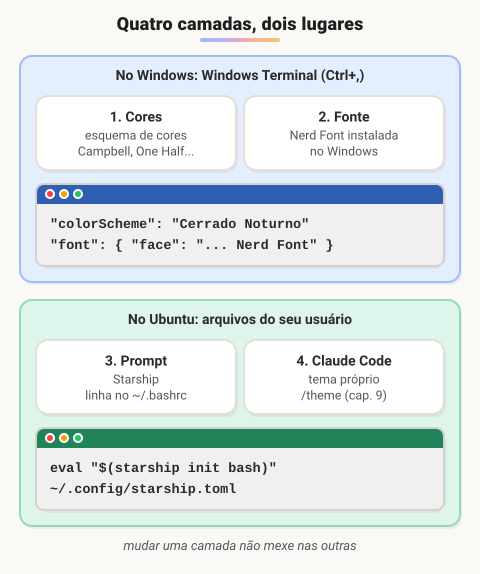
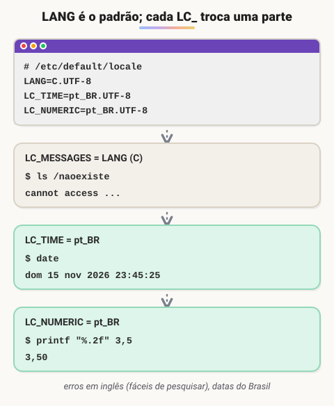

# 5. O terminal do seu jeito

> 🗺️ **Neste capítulo:** as quatro camadas da aparência do terminal e onde cada uma se configura: cores e fonte no Windows Terminal, prompt com o Starship e idioma e teclado no Ubuntu. No fim, como voltar tudo ao padrão.

## De onde paramos

No capítulo anterior você colocou os projetos no lugar certo (`~/projetos`) e aprendeu a trocar arquivos com o Windows. Agora vem o lugar onde você vai passar horas por dia: o terminal. Letra pequena, cores cansativas, data em inglês e um `ç` que não sai são detalhes que cansam. Este capítulo resolve cada um, sem quebrar nada.

## As quatro camadas da aparência

Quem tenta "mudar o tema do terminal" costuma mexer no lugar errado: instala uma fonte no Ubuntu e nada muda, ou procura as cores dentro do `~/.bashrc`. Isso acontece porque a aparência não é uma coisa só.

**A aparência do terminal tem quatro camadas independentes: as cores e a fonte, que o Windows Terminal desenha, e o prompt e o tema do Claude Code, que vêm de programas do Ubuntu.**

| Camada | O que é | Onde se configura |
| --- | --- | --- |
| 1. Cores | Fundo, texto e as 16 cores da paleta | Windows Terminal (esquema de cores) |
| 2. Fonte | O desenho das letras e dos ícones | Windows (fonte instalada) e Windows Terminal |
| 3. Prompt | A linha `ana@pc:~$` antes de cada comando | Ubuntu (`~/.bashrc`, Starship) |
| 4. Tema do Claude Code | As cores da interface do Claude Code | Dentro do Claude Code (`/theme`) |

O **Windows Terminal** é o programa com janela e abas; o **bash** é o programa que roda dentro dele e interpreta os comandos. O terminal desenha; o bash decide o que escrever. Por isso as camadas 1 e 2 ficam no Windows e as camadas 3 e 4, no Ubuntu.



> 💡 **Analogia:** pense num televisor e numa emissora. Brilho, cor e tamanho da legenda são ajustes da TV (o Windows Terminal) e valem para qualquer canal. O placar que aparece no canto da tela durante o jogo é colocado pela emissora (o Ubuntu, com o Starship). Se a TV não souber desenhar os símbolos do placar, aparecem quadradinhos: é o que acontece quando falta a Nerd Font. E um programa pode ter o próprio cenário (o tema do Claude Code), que não depende nem da TV nem do placar.

**Armadilha comum:** instalar uma fonte com `apt` no Ubuntu esperando que o terminal mude. Quem desenha as letras é o Windows Terminal, e ele só enxerga as fontes instaladas no Windows.

## Windows Terminal: configurações e perfis

O Windows Terminal guarda tudo num arquivo de configurações, mas você quase nunca precisa abri-lo: a tela de configurações faz o mesmo com cliques.

**Um perfil é uma entrada do Windows Terminal que diz qual programa abrir (PowerShell, Prompt de Comando, Ubuntu) e com qual aparência.** Quando o WSL instala uma distro, o terminal cria o perfil dela sozinho; o seu se chama **Ubuntu-26.04**.

- **Abrir as configurações:** com o terminal aberto, aperte **Ctrl + ,** (ou a setinha ao lado das abas → **Configurações**).
- **Um perfil ou todos:** na barra lateral, em **Perfis**, escolha **Ubuntu-26.04** para mudar só ele, ou **Padrões** para aplicar em todos.
- **O arquivo:** no canto inferior esquerdo, **Abrir arquivo JSON** abre o `settings.json`. Ele fica em `%LOCALAPPDATA%\Packages\Microsoft.WindowsTerminal_8wekyb3d8bbwe\LocalState`. Não confunda com o `~/.claude/settings.json` do Claude Code (capítulo 9): são arquivos diferentes, de programas diferentes.

Três ajustes valem para quase todo mundo:

| Ajuste | Onde, na tela de configurações |
| --- | --- |
| Ubuntu abre como aba padrão | **Inicialização** → **Perfil padrão** → Ubuntu-26.04 |
| Trocar as cores | Perfil → **Aparência** → **Esquema de cores** |
| Abrir na pasta pessoal (`~`) | Perfil Ubuntu-26.04 → **Linha de comando** |

O terceiro precisa de explicação. Sem ele, o Ubuntu pode abrir numa pasta do Windows, como `/mnt/c/Users/Ana`, e você corre o risco de trabalhar no lugar lento que o capítulo 4 mandou evitar. Na **Linha de comando** do perfil, escreva:

```
wsl.exe -d Ubuntu-26.04 --cd ~
```

O `-d` escolhe a distro e o `--cd ~` faz o bash começar na sua pasta pessoal. Clique em **Salvar**; as mudanças aparecem na hora, sem reiniciar.

Os esquemas que já vêm com o terminal incluem **Campbell** (o padrão), Campbell Powershell, Vintage, One Half Dark, One Half Light, Tango Dark e Tango Light. Escolha um no menu e veja o resultado antes de partir para os de terceiros.

**Armadilha comum:** mudar o esquema em **Padrões** e não ver efeito no Ubuntu. Uma configuração feita no próprio perfil vence a de **Padrões**; confira se o perfil Ubuntu-26.04 não tem um esquema próprio escolhido.

## Um esquema de cores seu, pelo JSON

Os esquemas de terceiros (e os que você mesmo criar) entram pelo `settings.json`. Vale aprender o formato uma vez, porque todo tema pronto da internet segue o mesmo.

**Um esquema de cores é um objeto JSON com um nome e cores em hexadecimal: fundo, texto, cursor, seleção e as 16 cores da paleta (8 normais e 8 "bright").** Os programas do Linux pedem "vermelho" ou "verde claro"; o esquema decide que tom de vermelho aparece.

Exemplo: um esquema escuro com tons de terra, criado para este livro. Abra o JSON (**Ctrl + ,** → **Abrir arquivo JSON**), ache a lista `"schemes": [` e cole o objeto dentro dela. Se a lista já tiver outros esquemas, separe com vírgula.

```json
{
  "name": "Cerrado Noturno",
  "background": "#1C1B22",
  "foreground": "#E6E1D6",
  "cursorColor": "#F2C14E",
  "selectionBackground": "#3D3A4B",
  "black": "#1C1B22",
  "red": "#E0665A",
  "green": "#8CC084",
  "yellow": "#F2C14E",
  "blue": "#6FA3D8",
  "purple": "#B48EC9",
  "cyan": "#5FBFB4",
  "white": "#D8D2C4",
  "brightBlack": "#5E5A6B",
  "brightRed": "#F08A7E",
  "brightGreen": "#A8D69F",
  "brightYellow": "#F7D57E",
  "brightBlue": "#93BDE8",
  "brightPurple": "#CDAEDD",
  "brightCyan": "#86D6CC",
  "brightWhite": "#F7F3EA"
}
```

O JSON acima foi validado (20 cores, nenhuma vírgula sobrando). Para ativá-lo em todos os perfis, ponha o nome dele em `profiles` → `defaults`:

```json
"profiles": {
  "defaults": {
    "colorScheme": "Cerrado Noturno"
  },
  "list": [ ...os perfis que já existem... ]
}
```

Salve com **Ctrl + S**. Se preferir, ative pelo menu: perfil → **Aparência** → **Esquema de cores** → Cerrado Noturno.

**Temas prontos:** o mesmo caminho serve para qualquer esquema de terceiros. O tema **Dracula**, por exemplo, publica o JSON e as instruções para o Windows Terminal na página oficial: [draculatheme.com/windows-terminal](https://draculatheme.com/windows-terminal). Copie o objeto de lá para `"schemes"` e ative pelo nome, como acima. O site [windowsterminalthemes.dev](https://windowsterminalthemes.dev/) reúne centenas de esquemas no mesmo formato.

**Armadilha comum:** uma vírgula a mais ou a menos. O terminal avisa que não conseguiu ler o arquivo e continua com a configuração anterior. Olhe a linha indicada no aviso: quase sempre falta a vírgula entre dois esquemas ou sobra uma depois do último item.

## Nerd Font: letras e ícones

Prompts modernos mostram ícones: um símbolo para a branch do git, outro para a versão do Node. As fontes comuns não têm esses desenhos, e o terminal mostra quadradinhos (`▯`) no lugar.

**Uma Nerd Font é uma fonte de programação acrescida de milhares de ícones (glifos), usada por prompts como o Starship.** Ela é instalada **no Windows**, porque é o Windows Terminal que desenha o texto.

1. Baixe uma Nerd Font em [nerdfonts.com](https://www.nerdfonts.com/font-downloads). Boas opções: **CaskaydiaCove Nerd Font** (a Cascadia, fonte padrão do terminal, com ícones) ou **JetBrainsMono Nerd Font**. A Microsoft também publica a **Cascadia Code NF** na página de versões da Cascadia Code.
2. Descompacte o zip, selecione os arquivos `.ttf`, clique com o botão direito → **Instalar**.
3. No Windows Terminal: perfil (ou **Padrões**) → **Aparência** → **Tipo de fonte** → escolha a fonte → **Salvar**.

No JSON, a mesma escolha fica dentro do objeto `font`:

```json
"defaults": {
  "colorScheme": "Cerrado Noturno",
  "font": {
    "face": "CaskaydiaCove Nerd Font",
    "size": 12
  }
}
```

**Armadilha comum:** a fonte não aparece na lista. Feche e abra o Windows Terminal depois de instalar. Se o nome no JSON estiver errado, o terminal volta para uma fonte padrão sem avisar; copie o nome exato que aparece no menu **Tipo de fonte**.

## Prompt com o Starship

O prompt padrão do Ubuntu mostra usuário, máquina e pasta. Quando você trabalha com git e várias linguagens, ajuda ver mais: a branch atual, se há mudanças não salvas, a versão do Node ou do Python do projeto.

**O Starship é um programa que monta o prompt a cada comando, mostrando só o que importa na pasta em que você está.** Ele não troca o bash: o bash continua lá, e o Starship só escreve a linha que aparece antes do cursor.

A instalação tem dois passos: baixar o programa e pedir ao bash que o chame. No terminal do Ubuntu, como o seu usuário:

```bash
# baixa e instala o programa starship (o script
# pergunta antes e pode pedir a senha do sudo)
curl -sS https://starship.rs/install.sh | sh

# acrescenta, no FIM do ~/.bashrc, a linha que
# entrega o prompt ao starship
echo 'eval "$(starship init bash)"' >> ~/.bashrc

# relê o ~/.bashrc sem fechar o terminal
source ~/.bashrc
```

> ⚠️ O download do Starship foi bloqueado pela rede do ambiente de produção do livro; o `curl` e os comandos `starship` deste capítulo não foram executados aqui. Eles vêm da documentação oficial (starship.rs) e do guia do autor, que os executou em out/2026. Confira a saída no seu computador. As linhas do `~/.bashrc` (acrescentar, conferir e remover) foram executadas.

O `~/.bashrc` é o arquivo que o bash lê toda vez que abre um terminal interativo. A linha nova tem duas partes: `starship init bash` imprime um trecho de código bash, e o `eval` executa esse trecho, que troca a variável do prompt. Para conferir que a linha entrou:

```bash
# mostra a última linha e o número dela no arquivo
tail -n 1 ~/.bashrc
grep -n "starship" ~/.bashrc
```

Saída real (o número da linha muda conforme o seu arquivo):

```
eval "$(starship init bash)"
118:eval "$(starship init bash)"
```

**Presets.** Um preset é uma configuração pronta do Starship. Ela fica em `~/.config/starship.toml`, e o comando `starship preset` grava o arquivo para você. Os presets com ícones precisam da Nerd Font da seção anterior:

```bash
mkdir -p ~/.config
# -o grava o preset no arquivo de configuração
starship preset tokyo-night -o ~/.config/starship.toml
```

A galeria de presets, com a prévia de cada um, fica em [starship.rs/presets](https://starship.rs/presets/). Para trocar, rode o mesmo comando com outro nome; para voltar ao visual padrão do Starship, apague o `~/.config/starship.toml`.

**Desfazer.** Para voltar ao prompt original do Ubuntu, remova a linha do `~/.bashrc` e abra um terminal novo:

```bash
# apaga a linha que contém "starship init bash"
sed -i '/starship init bash/d' ~/.bashrc
# conta quantas linhas ainda citam o starship
grep -c "starship" ~/.bashrc
```

Saída real:

```
0
```

Também dá para abrir o arquivo com `nano ~/.bashrc` e apagar a linha à mão.

**Armadilha comum:** acrescentar a linha ao `~/.bashrc` antes de o programa estar instalado (ou com a instalação falhando). Todo terminal novo passa a abrir com este erro, que foi reproduzido no ambiente do livro:

```
bash: starship: command not found
```

O terminal continua funcionando; o erro só diz que o `eval` não achou o programa. Instale o Starship ou remova a linha com o `sed` acima.

## Idioma do Ubuntu (locale)

O Ubuntu do WSL vem em inglês: datas como `Sun Nov 15` e números com ponto decimal. Para alguns, ótimo; para outros, um estranhamento diário. A escolha é sua, e dá para misturar.

**O locale é o conjunto de variáveis que diz aos programas qual idioma e quais formatos regionais usar.** A `LANG` define o padrão; as variáveis `LC_*` trocam uma parte de cada vez: `LC_TIME` (datas), `LC_NUMERIC` (números), `LC_MESSAGES` (idioma das mensagens) e outras. O comando `locale` mostra o estado atual:

```bash
locale
```

Saída real num Ubuntu recém-instalado (trecho):

```
LANG=C.UTF-8
LANGUAGE=
LC_CTYPE="C.UTF-8"
LC_NUMERIC="C.UTF-8"
LC_TIME="C.UTF-8"
LC_MESSAGES="C.UTF-8"
```

O `C.UTF-8` é o locale neutro: mensagens em inglês, formatos internacionais e suporte completo a acentos (UTF-8).

**Opção 1: tudo em português.**

```bash
# traduções e o locale pt_BR
sudo apt install -y language-pack-pt
# grava a escolha em /etc/default/locale
sudo update-locale LANG=pt_BR.UTF-8 \
  LANGUAGE=pt_BR:pt:en
```

O `LANGUAGE=pt_BR:pt:en` é uma lista de preferência: português do Brasil, depois português, depois inglês quando não houver tradução. Feche o terminal, rode `wsl --shutdown` no PowerShell e abra o Ubuntu de novo; o `locale` deve mostrar `LANG=pt_BR.UTF-8`.

**Opção 2: sistema em inglês, datas e números do Brasil.** Muitos desenvolvedores preferem mensagens de erro em inglês, porque são as que aparecem na documentação e nas buscas. Dá para manter o inglês e trocar só os formatos:

```bash
sudo update-locale LANG=C.UTF-8 \
  LC_TIME=pt_BR.UTF-8 LC_NUMERIC=pt_BR.UTF-8
```

Saída real, num terminal novo depois dessa configuração:

```bash
date
printf "%.2f\n" 3,5
ls /naoexiste
```

```
dom 15 nov 2026 23:45:25 UTC
3,50
ls: cannot access '/naoexiste': No such file or directory
```

A data saiu em português, o número aceitou a vírgula decimal e a mensagem de erro continuou em inglês, que é exatamente a proposta.



> 💡 **Analogia:** é como o celular configurado com idioma em inglês e região Brasil. Os menus continuam em inglês (a `LANG` e o `LC_MESSAGES`), mas o calendário mostra "dom, 15 nov" e a calculadora usa vírgula (o `LC_TIME` e o `LC_NUMERIC`). Cada ajuste regional mexe numa gaveta só; o idioma geral é o que vale para todas as gavetas que você não mexeu.

**Voltar ao inglês.** Use o `--reset`, que descarta todas as variáveis gravadas antes:

```bash
sudo update-locale --reset LANG=C.UTF-8
cat /etc/default/locale
```

Saída real:

```
LANG=C.UTF-8
```

> ⚠️ **Correção do guia-base:** o guia do autor desfaz o português com `sudo update-locale LANG=C.UTF-8 LANGUAGE=`. Isso funciona para a opção 1, mas, se você usou a opção 2, as linhas `LC_TIME` e `LC_NUMERIC` continuam no `/etc/default/locale` (teste feito no ambiente do livro). O `--reset` limpa tudo de uma vez.

**Armadilha comum:** gerar só o locale e esperar mensagens traduzidas. No ambiente do livro, sem rede para o `language-pack-pt`, o locale foi gerado com `sudo locale-gen pt_BR.UTF-8`: a data passou para o português, mas o `ls` continuou respondendo em inglês, porque as traduções vêm justamente no pacote `language-pack-pt`.

## Teclado ABNT2

O teclado tem dois caminhos no WSL, e cada um se acerta num lugar.

**No terminal, quem lê o teclado é o Windows; nos programas com janela do Linux (WSLg), quem lê é o servidor gráfico do Linux, que tem um layout próprio.**

- **No terminal:** ajuste no Windows, em **Configurações** → **Hora e idioma** → **Idioma e região** → Português (Brasil) → **Opções** → **Teclado** → adicione **Português (Brasil ABNT2)**. Com mais de um layout, **Win + Espaço** alterna entre eles.
- **Em programas com janela** (gedit, Firefox do Linux, que o capítulo 6 apresenta), o layout pode vir como americano: o `ç` não sai e os acentos trocam de lugar. Corrija com o `setxkbmap`:

```bash
# o pacote traz o programa setxkbmap
sudo apt install -y x11-xkb-utils
# modelo ABNT2, layout brasileiro
setxkbmap -model abnt2 -layout br
```

Para aplicar sempre que abrir o terminal, acrescente a linha ao `~/.bashrc`. O `2>/dev/null` esconde o erro quando não há tela gráfica disponível:

```bash
echo 'setxkbmap -model abnt2 -layout br 2>/dev/null' \
  >> ~/.bashrc
```

> ⚠️ O `setxkbmap` depende da tela gráfica do WSLg e não foi executado com efeito na produção do livro: sem tela, ele responde `Cannot open display`. Os comandos vêm do guia do autor (executados em out/2026); confira no seu computador, com um programa de janela aberto.

**Armadilha comum:** rodar o `setxkbmap` para consertar o terminal. Ele não muda nada ali: no terminal, o layout é o do Windows.

## Tema do Claude Code

O Claude Code, que o capítulo 9 instala, tem o próprio tema. Dentro dele, digite `/theme` e escolha entre os temas claros e escuros. Combine com o esquema do terminal: tema escuro do Claude Code sobre um esquema de fundo escuro, e vice-versa. Por enquanto, basta saber que essa é a quarta camada e que ela não depende das outras três.

## Voltar ao padrão

Tudo deste capítulo tem volta, camada por camada:

| Camada | Como desfazer |
| --- | --- |
| Cores | Perfil → **Aparência** → **Esquema de cores** → Campbell, ou apague a linha `"colorScheme"` |
| Fonte | Perfil → **Aparência** → **Tipo de fonte** → Cascadia Mono (a padrão) |
| Windows Terminal inteiro | Com o terminal fechado, renomeie o `settings.json` (ex.: `settings.old.json`); ele cria um novo ao abrir |
| Starship | `sed -i '/starship init bash/d' ~/.bashrc` e um terminal novo |
| Idioma | `sudo update-locale --reset LANG=C.UTF-8` e `wsl --shutdown` |
| Teclado das janelas | Apague a linha do `setxkbmap` no `~/.bashrc` |

Renomear em vez de apagar o `settings.json` deixa uma cópia para recuperar os seus perfis se você se arrepender.

## 🧪 Laboratório

> ⚠️ Os comandos do Windows deste laboratório vêm do guia do autor (executados em out/2026) e da documentação oficial; não foram executados na produção do livro. Confira a saída no seu computador. Isso vale para o Windows Terminal, a Nerd Font, o `wsl --shutdown` e o download do Starship. Os comandos só de Linux (locale e `~/.bashrc`) foram executados num Ubuntu, com a saída real.

**Passo 1: Ubuntu como padrão, abrindo em** `~`**.** No Windows Terminal, **Ctrl + ,** → **Inicialização** → **Perfil padrão** → Ubuntu-26.04. Depois, **Perfis** → Ubuntu-26.04 → **Linha de comando**: `wsl.exe -d Ubuntu-26.04 --cd ~` → **Salvar**. Abra uma aba nova e confira:

```bash
pwd
```

A saída deve ser a sua pasta pessoal, por exemplo `/home/ana`.

**Passo 2: o esquema Cerrado Noturno.** **Abrir arquivo JSON**, cole o esquema da seção "Um esquema de cores seu" em `"schemes"`, ponha `"colorScheme": "Cerrado Noturno"` em `defaults` e salve. O fundo fica quase preto e o cursor, amarelo.

**Passo 3: Nerd Font.** Instale a CaskaydiaCove Nerd Font no Windows e escolha-a em **Padrões** → **Aparência** → **Tipo de fonte**.

**Passo 4: Starship.** No Ubuntu:

```bash
# instala o Starship e liga no ~/.bashrc
curl -sS https://starship.rs/install.sh | sh
echo 'eval "$(starship init bash)"' >> ~/.bashrc
grep -n "starship" ~/.bashrc
source ~/.bashrc
```

O `grep` deve mostrar a linha com o número dela (no ambiente do livro, `118:eval "$(starship init bash)"`). Depois do `source`, o prompt muda. Entre em `~/projetos` e veja o Starship mostrar a pasta; dentro de um repositório git, ele mostra também a branch.

**Passo 5: datas brasileiras com o sistema em inglês.**

```bash
sudo update-locale LANG=C.UTF-8 \
  LC_TIME=pt_BR.UTF-8 LC_NUMERIC=pt_BR.UTF-8
cat /etc/default/locale
```

Saída real:

```
LANG=C.UTF-8
LC_NUMERIC=pt_BR.UTF-8
LC_TIME=pt_BR.UTF-8
```

Se o Ubuntu reclamar que o locale `pt_BR.UTF-8` não existe, instale antes o `language-pack-pt` (ou rode `sudo locale-gen pt_BR.UTF-8`). Feche o terminal, rode `wsl --shutdown` no PowerShell, abra o Ubuntu e teste:

```bash
date
locale | grep -E "LANG=|LC_TIME|LC_MESSAGES"
```

Saída real (a data e a hora mudam):

```
dom 15 nov 2026 23:45:25 UTC
LANG=C.UTF-8
LC_TIME=pt_BR.UTF-8
LC_MESSAGES="C.UTF-8"
```

**Passo 6: desfazer o idioma** (só se quiser voltar):

```bash
sudo update-locale --reset LANG=C.UTF-8
cat /etc/default/locale
```

Saída real: `LANG=C.UTF-8`.

## 🏋️ Pratique

**1.** Você quer que só o perfil do Ubuntu use o esquema "One Half Dark", e os outros perfis (PowerShell, Prompt de Comando) fiquem com o Campbell. Onde fica a configuração, e onde ela não deve ficar?

<details>
<summary>Ver resposta</summary>

No perfil **Ubuntu-26.04** → **Aparência** → **Esquema de cores** → One Half Dark. Não use **Padrões**, que vale para todos os perfis. No JSON, a chave `"colorScheme": "One Half Dark"` vai dentro do objeto do perfil Ubuntu, na lista `"list"`, e não em `"defaults"`.

Teste: abra uma aba do Ubuntu (fundo One Half Dark) e uma do PowerShell (fundo Campbell).

</details>

**2.** Depois de instalar o Starship com um preset, o prompt mostra quadradinhos `▯` no lugar dos ícones. Qual é a causa, e o que você faz no Windows e no Ubuntu?

<details>
<summary>Ver resposta</summary>

Falta a Nerd Font no Windows Terminal. No Ubuntu, nada a fazer: o Starship está certo. No Windows, instale uma Nerd Font (os `.ttf` → **Instalar**) e escolha-a em **Aparência** → **Tipo de fonte**. Se preferir não instalar fonte, troque para um preset sem ícones ou apague o `~/.config/starship.toml`.

Teste: depois de salvar, os quadradinhos viram ícones sem reiniciar o Ubuntu.

</details>

**3.** Você quer mensagens de erro em inglês, mas datas no formato brasileiro. Escreva o comando e diga como confirmar o resultado.

<details>
<summary>Ver resposta</summary>

```bash
sudo update-locale LANG=C.UTF-8 \
  LC_TIME=pt_BR.UTF-8
```

Feche o terminal, rode `wsl --shutdown` no PowerShell e abra o Ubuntu.

Teste: `date` mostra algo como `dom 15 nov 2026`, e `ls /naoexiste` continua com `No such file or directory`.

</details>

## 🧠 Revisão rápida

**Instalei uma fonte no Ubuntu com `apt`, e o terminal não mudou. Por quê?**

Porque quem desenha o texto é o Windows Terminal, e ele só usa fontes instaladas no Windows.

**O que a linha `eval "$(starship init bash)"` faz no `~/.bashrc`?**

Roda o `starship init bash`, que imprime um trecho de código, e o `eval` executa esse trecho, que passa o desenho do prompt para o Starship em todo terminal novo.

**Qual a diferença entre `LANG` e `LC_TIME`?**

A `LANG` é o padrão para tudo; a `LC_TIME` troca só o formato de datas e horas, por cima do padrão.

> ➡️ **Próximo passo:** o terminal está confortável; agora ele precisa de ferramentas. O próximo capítulo instala git, Node, Java e Python do lado Linux e abre os primeiros programas com janela pelo WSLg, onde o `setxkbmap` deste capítulo entra em ação: **6. Ferramentas de desenvolvimento e programas com janela**.

## 📚 Fontes

Conferido em 2026-11-15.

- [Color schemes in Windows Terminal (Microsoft Learn)](https://learn.microsoft.com/en-us/windows/terminal/customize-settings/color-schemes)
- [Appearance profile settings in Windows Terminal (Microsoft Learn)](https://learn.microsoft.com/en-us/windows/terminal/customize-settings/profile-appearance)
- [Custom prompt setup: install a Nerd Font (Microsoft Learn)](https://learn.microsoft.com/en-us/windows/terminal/tutorials/custom-prompt-setup)
- [Starship: guia de instalação](https://starship.rs/guide/) e [presets](https://starship.rs/presets/)
- [Manage the language and keyboard/input layout settings in Windows (Suporte Microsoft)](https://support.microsoft.com/en-us/help/4496404)
- Guia do autor: [🎨Troca de temas](https://app.notion.com/p/Troca-de-temas-401345e2044380848e13fede336a9c25?pvs=21) (toda) e [⌨️Usando o Claude Code no WSL](https://app.notion.com/p/Usando-o-Claude-Code-no-WSL-401345e20443811195e3e51f46929d88?pvs=21) (seção "8. Idioma")

## 📌 Resumo

| Item | Em uma frase |
| --- | --- |
| Quatro camadas | Cores e fonte no Windows Terminal; prompt e tema do Claude Code no Ubuntu |
| **Ctrl + ,** | Abre as configurações do Windows Terminal; **Abrir arquivo JSON** mostra o `settings.json` |
| Perfil e **Padrões** | O perfil vale para uma distro; **Padrões**, para todas, e o perfil vence |
| `wsl.exe -d Ubuntu-26.04 --cd ~` | Linha de comando do perfil que abre o Ubuntu na pasta pessoal |
| Esquema de cores | Objeto JSON em `"schemes"`, ativado pelo nome em `"colorScheme"` |
| Nerd Font | Fonte com ícones, instalada no Windows, exigida pelos presets do Starship |
| Starship | Prompt informativo, ligado por `eval "$(starship init bash)"` no `~/.bashrc` |
| `update-locale` | Grava `LANG` e `LC_*` em `/etc/default/locale`; `--reset` limpa tudo |
| ABNT2 | No terminal, pelo Windows; em programas com janela, com `setxkbmap -model abnt2 -layout br` |
| `/theme` | Escolhe o tema do Claude Code, independente do terminal |
