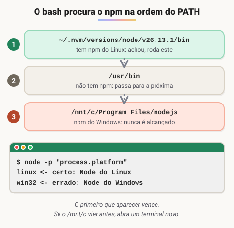
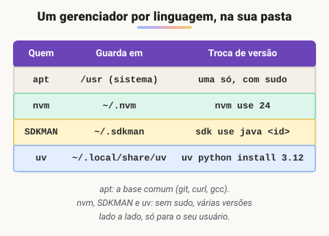
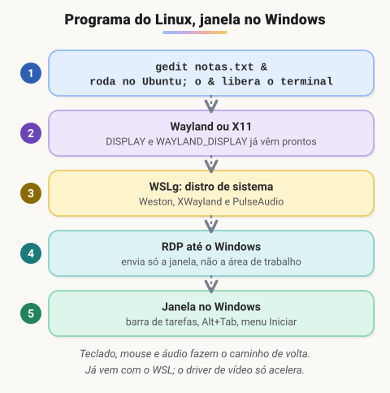

# 6. Ferramentas de desenvolvimento e programas com janela

> 🗺️ **Neste capítulo:** a caixa de ferramentas do lado Linux: pacotes básicos e git, Node com o nvm, Java com o SDKMAN e Python com o uv, cada um instalado na sua pasta pessoal. No fim, programas com janela (gedit, Thunar, Firefox, Chrome) abertos pelo WSLg.

## De onde paramos

No capítulo anterior o terminal ficou confortável: cores, fonte, prompt e idioma do seu jeito. Agora ele precisa de ferramentas. Tudo aqui é instalado **dentro do Ubuntu**, como o seu usuário (prompt terminando em `$`), e os projetos continuam em `~/projetos`, o lugar rápido que o capítulo 4 escolheu.

## Pacotes básicos e o git

Quase todo instalador de linguagem começa com um `curl` que baixa um script, e muitos pacotes compilam código na instalação. Sem as ferramentas certas, o erro aparece no meio do caminho, com mensagens pouco claras.

**Os pacotes básicos são as ferramentas de linha de comando que os outros instaladores assumem que já existem: baixar (**`curl`**,** `wget`**), compactar (**`zip`**,** `unzip`**), versionar (**`git`**), compilar (**`build-essential`**) e listar processos (**`procps`**).**

| Pacote | Para que serve aqui |
| --- | --- |
| `curl` e `wget` | Baixar scripts de instalação (nvm, SDKMAN, uv) e arquivos `.deb` |
| `zip` e `unzip` | O SDKMAN exige os dois para instalar o Java |
| `git` | Controle de versão, e o nvm usa para se atualizar |
| `build-essential` | Compilador C (`gcc`), `make` e afins, para pacotes npm e Python que compilam |
| `procps` | Comandos `ps`, `top` e `free`, usados por ferramentas que vigiam processos |

```bash
# atualiza a lista de pacotes e o que já está instalado
sudo apt update && sudo apt upgrade -y
# instala os básicos de uma vez
sudo apt install -y curl wget zip unzip git \
  build-essential procps
```

Saída real no ambiente do livro (um Ubuntu 24.04 em que eles já estavam instalados; no seu Ubuntu 26.04 recém-instalado, o `apt` vai baixar e instalar os que faltarem):

```
curl is already the newest version (8.5.0-2ubuntu10.16).
wget is already the newest version (1.21.4-1ubuntu4.5).
zip is already the newest version (3.0-13ubuntu0.2).
unzip is already the newest version (6.0-28ubuntu4.1).
git is already the newest version (1:2.43.0-1ubuntu7.4).
build-essential is already the newest version (12.10ubuntu1).
procps is already the newest version (2:4.0.4-4ubuntu3.3).
0 upgraded, 0 newly installed, 0 to remove and 0 not upgraded.
```

Rodar o mesmo `apt install` duas vezes não estraga nada: o que já está na versão mais nova é pulado.

### Configuração mínima do git

O git grava em cada commit o nome e o e-mail de quem fez. Sem essa configuração, o primeiro commit falha. Três linhas resolvem, uma vez só por usuário:

```bash
# quem assina os commits (troque pelos seus dados)
git config --global user.name "Ana Souza"
git config --global user.email "ana@exemplo.com"
# nome da branch inicial de todo repositório novo
git config --global init.defaultBranch main
# confere o que ficou gravado
git config --global --list
```

Saída real:

```
user.name=Ana Souza
user.email=ana@exemplo.com
init.defaultbranch=main
```

O `--global` grava no arquivo `~/.gitconfig`, que vale para todos os repositórios do seu usuário no Linux. Use o mesmo e-mail da sua conta no GitHub (ou GitLab) para que os commits apareçam no seu perfil.

**Armadilha comum:** esquecer essas linhas. No ambiente do livro, sem configuração nenhuma, o `git init` mostrou um aviso de várias linhas começando por `hint: Using 'master' as the name for the initial branch.` (git 2.43), e o primeiro commit parou com `Author identity unknown` e `*** Please tell me who you are.`. As duas mensagens somem com as três linhas acima. Lembre também que o git do Windows tem a sua própria configuração: configurar um lado não configura o outro.

## Node.js com o nvm

O `apt` do Ubuntu tem um pacote `nodejs`, mas ele traz uma versão só, fixa durante toda a vida da distro, e instala com `sudo`. Projetos diferentes pedem versões diferentes de Node, e pacotes globais instalados com `sudo npm` viram fonte de erros de permissão.

**O nvm (Node Version Manager) é um script que instala várias versões do Node dentro da sua pasta pessoal (**`~/.nvm`**) e troca entre elas com um comando, sem** `sudo`**.**

Versões conferidas em 2026-11-15: o nvm está na **v0.40.8**, e o Node **26** é a linha LTS ativa (26.13.1). O Node 24 saiu do suporte ativo em 20/10/2026 e recebe só correções de segurança até abril de 2028. Por isso, em vez de fixar um número, peça a LTS do momento:

```bash
# baixa e roda o instalador do nvm (versão no endereço)
curl -o- https://raw.githubusercontent.com/nvm-sh/nvm/v0.40.8/install.sh | bash
# relê o ~/.bashrc, onde o instalador pôs o nvm
source ~/.bashrc
# deve responder "nvm" (é uma função do bash)
command -v nvm
# instala a LTS atual e a deixa como padrão
nvm install --lts
nvm ls
node --version
npm --version
```

> ⚠️ A rede do ambiente de produção do livro bloqueou o GitHub e o site do Node.js: o instalador do nvm e o `nvm install` não foram executados aqui. Os comandos vêm da documentação do nvm e da Microsoft e do guia do autor, que os executou em out/2026. Confira a saída no seu computador: o `node --version` deve mostrar `v26` seguido do número da versão.

O `command -v nvm` responde `nvm`, e não um caminho, porque o nvm não é um programa: é uma função que o `~/.bashrc` carrega. Por isso `which nvm` não acha nada. Precisa de outra versão num projeto? `nvm install 24` e `nvm use 24`; `nvm alias default 26` escolhe a que abre em todo terminal novo.

### A armadilha do Node do Windows no PATH

Se você já instalou o Node no Windows, ele também aparece dentro do WSL. O motivo é a opção `appendWindowsPath` do `/etc/wsl.conf` (capítulo 7), ligada por padrão: ela acrescenta as pastas do Windows, como `/mnt/c/Program Files/nodejs`, no fim do `PATH` do Linux.

**O** `PATH` **é a lista de pastas onde o bash procura um comando, lida da esquerda para a direita; o primeiro arquivo com o nome pedido é o que roda.** Enquanto o Node do nvm vier antes, o do Windows é ignorado. O problema é quando ele vem antes (por exemplo, num terminal aberto antes de instalar o nvm) e o `npm` que roda é o do Windows, com erros confusos e pacotes instalados no lado errado.

Dois comandos tiram a dúvida:

```bash
# todos os node, npm e npx do PATH, na ordem
which -a node npm npx
# qual sistema o Node que respondeu acha que é
node -p "process.platform + ' ' + process.version"
```

O resultado certo tem o primeiro caminho de cada comando começando com `/home/<seu usuário>/.nvm/` e a segunda linha com `linux`. O Node do Windows responderia `win32`. Se aparecer `/mnt/c/Program Files/nodejs/...` **depois** do `.nvm`, está tudo bem: ele nunca é alcançado. (O Node do Windows se chama `node.exe`, então costuma aparecer só no `npm` e no `npx`, que têm cópias sem extensão.)

No ambiente do livro não há Node do Windows, mas há dois Node do Linux (22 e 20), e a regra é a mesma. Saída real, com o 22 no começo do `PATH` e o 20 no fim:

```
/opt/node22/bin/node
/opt/node20/bin/node
/opt/node22/bin/npm
/opt/node20/bin/npm
/opt/node22/bin/npx
/opt/node20/bin/npx
linux v22.23.4
```

Invertendo a ordem do `PATH`, o mesmo `node -p` respondeu `linux v20.20.0`: o arquivo era o mesmo, só mudou quem vinha primeiro.



> 💡 **Analogia:** pense na recepção de um consultório que chama os pacientes pela lista de chegada. Há duas pacientes chamadas Ana: a do nvm chegou cedo e está no alto da lista; a do Windows chegou depois e está no fim. Quando a recepcionista (o bash) chama "Ana", entra a primeira da lista, e a segunda nunca é atendida. O `which -a` é pedir para ver a lista inteira; o `process.platform` é perguntar à paciente que entrou de onde ela veio.

**Armadilha comum:** ver o `/mnt/c` em primeiro lugar e sair desinstalando o Node do Windows. Antes, rode `source ~/.bashrc` ou abra um terminal novo: o nvm só entra no `PATH` quando o `~/.bashrc` é lido. Se ainda assim o Windows vier primeiro, confira se a linha do nvm está no fim do `~/.bashrc` com `grep -n NVM_DIR ~/.bashrc`. Desligar o `appendWindowsPath` também resolve, mas tira do `PATH` atalhos úteis como `explorer.exe`.

## Java (Temurin) com o SDKMAN

Java tem várias distribuições (Temurin, Corretto, Zulu, a do próprio Ubuntu) e várias versões convivendo em produção. Um projeto antigo pede Java 17; o novo, 25. Trocar isso à mão, mexendo em `JAVA_HOME` e no `PATH`, é trabalhoso.

**O SDKMAN é um gerenciador de kits de desenvolvimento (Java, Maven, Gradle, Kotlin) que instala tudo em** `~/.sdkman` **e ajusta o** `JAVA_HOME` **sozinho.** O **Temurin** é o Java gratuito do projeto Eclipse Adoptium, um dos mais usados.

Versões conferidas em 2026-11-15: as linhas LTS (suporte longo) do Temurin em uso são a **25** (25.0.5, suporte até 2031) e a **21** (21.0.13, até 2029). A 27 é a mais nova, mas não é LTS.

```bash
# instala o SDKMAN (precisa de curl, zip e unzip)
curl -s "https://get.sdkman.io" | bash
# carrega o SDKMAN neste terminal (ou abra outro)
source "$HOME/.sdkman/bin/sdkman-init.sh"
sdk version
```

Na lista de Java, os identificadores do Temurin terminam em `-tem`. O `--` no `grep` avisa que o que vem depois é o texto a procurar, e não uma opção:

```bash
# só as versões Temurin
sdk list java | grep -- "-tem"
# instala a LTS mais nova (copie o identificador exato
# da lista; o formato é versão-tem, ex.: 25.0.5-tem)
sdk install java 25.0.5-tem
# opcional: a LTS anterior, para projetos mais velhos
sdk install java 21.0.13-tem
# escolhe a padrão de todo terminal novo
sdk default java 25.0.5-tem
java -version
echo $JAVA_HOME
```

O `JAVA_HOME` deve apontar para `~/.sdkman/candidates/java/current`, um atalho que o SDKMAN troca quando você muda a versão padrão. Para um terminal só, use `sdk use java 21.0.13-tem`.

> ⚠️ O site do SDKMAN foi bloqueado pela rede do ambiente de produção do livro: o instalador e os comandos `sdk` não foram executados aqui, e a lista de identificadores pode ter números mais novos quando você ler. Os comandos vêm da documentação do SDKMAN e do guia do autor (executados em out/2026). Confira a saída no seu computador.

Por que o `--` importa? Sem ele, o `grep` lê `-tem` como as opções `-t`, `-e` e `-m`. Saída real de `grep "-tem" lista.txt` no ambiente do livro:

```
grep: invalid option -- 't'
```

**Armadilha comum:** instalar também o `openjdk-25-jdk` pelo `apt` (o Ubuntu 26.04 traz o OpenJDK 25 como padrão). Os dois funcionam, mas ficam dois Java no `PATH` e a mesma briga da seção anterior: confira com `which -a java` e escolha um só gerenciador.

## Python e o uv

O Ubuntu 26.04 já vem com o Python **3.14** (o 24.04 trazia o 3.12). Ele é do sistema: ferramentas do próprio Ubuntu dependem dele. Por isso o Ubuntu bloqueia o `pip install` fora de um ambiente virtual. Saída real no ambiente do livro (Python 3.12 do Ubuntu 24.04; o 26.04 se comporta igual):

```
error: externally-managed-environment

× This environment is externally managed
╰─> To install Python packages system-wide, try apt install
  python3-xyz, where xyz is the package you are trying to
  install.
```

**O uv é um gerenciador de projetos Python que cria ambientes virtuais, instala pacotes, baixa outras versões do Python e instala ferramentas de linha de comando, tudo na sua pasta pessoal.** O capítulo 10 usa o uv para instalar o Spec Kit; por isso ele entra aqui.

Versão conferida em 2026-11-15: uv **0.13.8** (de 12/11/2026).

```bash
# instala o uv em ~/.local/bin
curl -LsSf https://astral.sh/uv/install.sh | sh
source ~/.bashrc
uv --version
```

> ⚠️ O instalador do uv e os downloads de Python e de pacotes foram bloqueados pela rede do ambiente de produção do livro. Os blocos abaixo com "saída real" usaram um uv 0.11.32 que já estava no ambiente, copiado para `~/.local/bin` (o mesmo lugar onde o instalador o põe), e só operações que não precisam de internet. O resto vem da documentação do uv; confira no seu computador.

### O Python do sistema × versões instaladas pelo uv

O uv usa o Python do sistema quando ele atende ao pedido. Saída real, criando um ambiente virtual com o Python 3.12 que o Ubuntu do ambiente já tinha:

```bash
mkdir -p ~/projetos/py && cd ~/projetos/py
# cria a pasta .venv com o Python pedido
uv venv --python 3.12
.venv/bin/python --version
```

```
Using CPython 3.12.3 interpreter at: /usr/bin/python3.12
Creating virtual environment at: .venv
Activate with: source .venv/bin/activate
Python 3.12.3
```

Quando o projeto pede uma versão que o sistema não tem, o uv baixa uma pronta, sem mexer no Python do Ubuntu:

```bash
# baixa o Python 3.13 para ~/.local/share/uv/python
uv python install 3.13
# lista o que está instalado: sistema e uv
uv python list --only-installed
```

No ambiente do livro, o `uv python install` tentou baixar a versão do GitHub (projeto python-build-standalone) e parou por falta de rede, o que mostra de onde ela vem. O `uv python list --only-installed` rodou e listou cada Python com o caminho, por exemplo `cpython-3.12.3-linux-x86_64-gnu /usr/bin/python3.12`. Por padrão, o uv cria só o comando com o número (`python3.13`); os comandos `python` e `python3` continuam sendo os do Ubuntu.

### Ferramentas de linha de comando: uv tool install

Alguns programas Python são ferramentas, não bibliotecas: o Spec Kit (`specify`), o `ruff`, o `httpie`. `uv tool install` dá a cada uma um ambiente isolado e põe o comando em `~/.local/bin`:

```bash
# instala a ferramenta e o comando dela
uv tool install ruff
# lista as ferramentas e os comandos de cada uma
uv tool list
# atualiza todas
uv tool upgrade --all
```

Sem internet, o livro testou o mecanismo instalando o `pip` a partir de um arquivo de pacote local (`uv tool install --offline /tmp/pip-24.0-py3-none-any.whl`). Saída real:

```
Installed 3 executables: pip, pip3, pip3.13
```

E o `uv tool list` respondeu `pip v24.0` com os três comandos, que apareceram como atalhos em `~/.local/bin` apontando para `~/.local/share/uv/tools/pip/bin`. Para remover: `uv tool uninstall pip`, que respondeu `Uninstalled 3 executables: pip, pip3, pip3.13`. Para rodar uma ferramenta uma vez, sem instalar, existe o `uvx` (ex.: `uvx ruff --version`).



> 💡 **Analogia:** numa empresa, o almoxarifado (o `apt`) entrega material igual para todos, um modelo de cada, e só com requisição assinada (o `sudo`). Já o armário pessoal de cada funcionário (`~/.nvm`, `~/.sdkman`, `~/.local/share/uv`) guarda o que você quiser, inclusive duas versões da mesma ferramenta, sem pedir licença a ninguém e sem atrapalhar o armário do vizinho. O nvm, o SDKMAN e o uv são as prateleiras organizadas desse armário, uma por linguagem.

**Armadilha comum:** o comando instalado não é encontrado (`command not found`). O `~/.local/bin` precisa estar no `PATH`: abra um terminal novo ou rode `uv tool update-shell`, que acrescenta a pasta ao arquivo de inicialização do shell.

## Programas com janela: o WSLg

Às vezes você quer uma janela de verdade: um editor de texto simples, um gerenciador de arquivos para arrastar coisas, um navegador do Linux para testar um site. Antes, isso exigia instalar um servidor gráfico no Windows e configurar variáveis à mão.

**O WSLg (Windows Subsystem for Linux GUI) é a parte do WSL que mostra os programas gráficos do Linux como janelas comuns do Windows, com Alt+Tab, barra de tarefas e copiar e colar entre os dois lados.** Ele já vem com o WSL 2: não há nada a instalar no Windows além de manter o WSL atualizado (`wsl --update`) e, para aceleração de vídeo, o driver da placa.

Por dentro, cada distro ganha uma "distro de sistema" mínima, só de leitura, que roda o servidor gráfico (Weston, com XWayland para programas antigos) e o de áudio (PulseAudio). As variáveis `DISPLAY` e `WAYLAND_DISPLAY` já chegam prontas no Ubuntu, e a imagem de cada janela viaja para o Windows pelo protocolo RDP, o mesmo da Área de Trabalho Remota.



> 💡 **Analogia:** é como uma videochamada em que um colega compartilha uma única janela e libera o controle para você. O programa continua rodando no computador dele (o Ubuntu); você vê só aquela janela (não a área de trabalho inteira dele) e o seu teclado e o seu mouse chegam até lá. O aplicativo de videochamada, que ninguém precisa configurar, é o WSLg.

### Instalar e abrir programas

Editores e utilitários pelo `apt`:

```bash
# gedit: editor de texto; thunar: gerenciador de arquivos
sudo apt install -y gedit thunar
# abre o arquivo e devolve o terminal na hora
gedit ~/.bashrc &
thunar &
```

O `gedit` deixou de ser o editor padrão do GNOME (o Ubuntu usa o `gnome-text-editor` desde o 22.10), mas continua disponível no Ubuntu 26.04 (pacote `gedit` 48.1, na seção universe). Os dois funcionam pelo WSLg. Programas instalados assim também aparecem no menu Iniciar do Windows, numa pasta com o nome da distro.

**Google Chrome** não está no `apt`: baixe o `.deb` oficial e instale com o caminho do arquivo:

```bash
cd /tmp
wget https://dl.google.com/linux/direct/google-chrome-stable_current_amd64.deb
# o ./ diz ao apt que é um arquivo local, não um nome
sudo apt install -y ./google-chrome-stable_current_amd64.deb
google-chrome &
```

**Firefox:** no Ubuntu, o pacote `firefox` do `apt` é uma ponte que instala o Firefox como **snap**, e o snap precisa do systemd. O Ubuntu do WSL já vem com o systemd ligado (capítulo 3: `systemd=true` no `/etc/wsl.conf`).

```bash
sudo apt install -y firefox
firefox &
```

> ⚠️ O WSLg e o systemd do WSL não existem no ambiente de produção do livro, e os downloads do `apt` e do Chrome foram bloqueados: os comandos desta seção não foram executados aqui. Eles vêm do guia do autor (executados em out/2026) e da documentação da Microsoft sobre apps gráficos no WSL. Confira no seu computador.

### O & no fim do comando

Sem o `&`, o terminal fica preso ao programa até você fechar a janela. Com ele, o programa vai para o segundo plano (*background*) e o prompt volta na hora. O mesmo vale para qualquer comando demorado. Saída real, com um `sleep` no lugar de uma janela:

```bash
# roda em segundo plano por 30 segundos
sleep 30 &
# lista o que este terminal deixou rodando
jobs
```

```
[1] 4866
[1]+  Running                 sleep 30 &
```

O `[1]` é o número do trabalho neste terminal e `4866`, o número do processo (muda a cada vez). `fg` traz o trabalho de volta para a frente; `kill %1` encerra.

**Armadilha comum:** fechar o terminal e a janela sumir junto. Programas abertos com `&` ainda pertencem àquele terminal. Se quiser que a janela sobreviva, abra pelo menu Iniciar ou use `nohup firefox >/dev/null 2>&1 &`. E se aparecer `cannot open display`, rode `wsl --shutdown` no PowerShell e abra o Ubuntu de novo; se persistir, siga o guia de diagnóstico do WSLg (link nas Fontes).

## Resumo das ferramentas

| Ferramenta | Instala com | Confere com |
| --- | --- | --- |
| Pacotes básicos | `sudo apt install -y curl wget zip unzip git build-essential procps` | `git --version`, `gcc --version` |
| git (identidade) | `git config --global user.name/user.email` e `init.defaultBranch main` | `git config --global --list` |
| nvm | script `install.sh` da v0.40.8, baixado com `curl` | `command -v nvm` |
| Node.js LTS | `nvm install --lts` | `which -a node npm npx` e `node -p "process.platform"` |
| SDKMAN | script de `get.sdkman.io`, baixado com `curl` | `sdk version` |
| Java Temurin | `sdk install java 25.0.5-tem` e `sdk default` | `java -version` e `echo $JAVA_HOME` |
| uv | script `astral.sh/uv/install.sh`, baixado com `curl` | `uv --version` |
| Outro Python | `uv python install 3.13` | `uv python list --only-installed` |
| Ferramenta Python | `uv tool install <nome>` | `uv tool list` |
| gedit e Thunar | `sudo apt install -y gedit thunar` | `gedit &` abre uma janela |
| Chrome | `sudo apt install -y ./google-chrome-stable_current_amd64.deb` | `google-chrome &` |
| Firefox (snap) | `sudo apt install -y firefox` | `firefox &` |

> ⚠️ **Correções do guia-base:** (1) o guia instala o nvm v0.40.3; a versão atual, conferida em 2026-11-15, é a v0.40.8. (2) O guia usa `nvm install 24`; o Node 24 saiu do suporte ativo em 20/10/2026, e a LTS ativa agora é a 26, por isso o livro usa `nvm install --lts`. (3) O guia do Spec Kit diz que o Ubuntu vem com Python 3.12; isso valia para o 24.04, e o Ubuntu 26.04 traz o 3.14.

## 🧪 Laboratório

> ⚠️ Os comandos do Windows deste laboratório vêm do guia do autor (executados em out/2026) e da documentação oficial; não foram executados na produção do livro. Confira a saída no seu computador. Isso vale para o `wsl --shutdown` e as janelas do WSLg. Do lado Linux, a rede do ambiente bloqueou o GitHub, o site do Node.js, o SDKMAN e o PyPI: nvm, Node, SDKMAN e downloads do uv não foram executados aqui; os passos com "saída real" foram.

Objetivo: deixar o Ubuntu com git configurado, Node LTS, Java 25 e uv, conferir cada um e abrir uma janela.

**Passo 1: base e git.**

```bash
# base, identidade do git e um repositório de teste
sudo apt update && sudo apt install -y curl wget \
  zip unzip git build-essential procps
git config --global user.name "Ana Souza"
git config --global user.email "ana@exemplo.com"
git config --global init.defaultBranch main
mkdir -p ~/projetos/ola && cd ~/projetos/ola
git init
git status
```

Saída real das duas últimas linhas de comando (a pasta muda com o seu usuário):

```
Initialized empty Git repository in /home/ana/projetos/ola/.git/
On branch main

No commits yet
```

O `On branch main`, sem o aviso `hint:`, confirma o `init.defaultBranch`.

**Passo 2: Node.**

```bash
# nvm, Node LTS e a conferência do PATH
curl -o- https://raw.githubusercontent.com/nvm-sh/nvm/v0.40.8/install.sh | bash
source ~/.bashrc
nvm install --lts
which -a node npm npx
node -p "process.platform + ' ' + process.version"
```

Confira: o primeiro caminho de cada comando começa com `/home/ana/.nvm/`, e a última linha começa com `linux v26`.

**Passo 3: Java.**

```bash
curl -s "https://get.sdkman.io" | bash
source "$HOME/.sdkman/bin/sdkman-init.sh"
sdk list java | grep -- "-tem"
sdk install java 25.0.5-tem
java -version
```

Troque `25.0.5-tem` pelo identificador 25 que aparecer na sua lista. O `java -version` deve citar `Temurin` e a versão 25.

**Passo 4: uv e um ambiente Python.**

```bash
# uv e um ambiente virtual com o Python do sistema
curl -LsSf https://astral.sh/uv/install.sh | sh
source ~/.bashrc
uv --version
mkdir -p ~/projetos/py && cd ~/projetos/py
uv venv
.venv/bin/python --version
```

No seu Ubuntu 26.04, sem `--python`, o `uv venv` usa o Python do sistema, e a última linha deve mostrar `Python 3.14` seguido do número de correção. No ambiente do livro (Ubuntu 24.04), com `--python 3.12`, a saída real foi a da seção do uv: `Using CPython 3.12.3 interpreter at: /usr/bin/python3.12` e `Python 3.12.3`.

**Passo 5: uma janela.**

```bash
sudo apt install -y gedit
gedit ~/projetos/ola/LEIAME.txt &
jobs
```

A janela do gedit abre no Windows e o prompt volta na hora; o `jobs` mostra o gedit como `Running`. Escreva uma linha, salve e feche a janela. De volta ao terminal:

```bash
cat ~/projetos/ola/LEIAME.txt
```

O texto que você digitou na janela aparece no terminal: a janela era do Windows, mas o arquivo está no Linux.

## 🏋️ Pratique

**1.** Um colega rodou `which -a npm` e recebeu, nesta ordem: `/mnt/c/Program Files/nodejs/npm` e `/home/bia/.nvm/versions/node/v26.13.1/bin/npm`. Qual `npm` roda, o que isso causa e o que ele deve fazer primeiro?

<details>
<summary>Ver resposta</summary>

Roda o primeiro, o do Windows, porque o bash usa o primeiro que achar no `PATH`. Os pacotes acabam instalados pelo lado errado e aparecem erros confusos. Primeiro passo: `source ~/.bashrc` (ou um terminal novo), para o nvm entrar no começo do `PATH`.

Teste: `which -a npm` passa a mostrar o caminho do `.nvm` em primeiro lugar, e `node -p "process.platform"` responde `linux`.

</details>

**2.** Você precisa de Java 21 só para um projeto antigo, mas quer que o Java 25 continue sendo o padrão. Quais comandos do SDKMAN usa?

<details>
<summary>Ver resposta</summary>

```bash
sdk install java 21.0.13-tem
sdk default java 25.0.5-tem
# só neste terminal, para o projeto antigo:
sdk use java 21.0.13-tem
```

Teste: no terminal do projeto, `java -version` mostra 21; num terminal novo, mostra 25.

</details>

**3.** Ao rodar `pip install requests` no Ubuntu, você recebe `error: externally-managed-environment`. Dê duas saídas com o uv: uma para um projeto e outra para uma ferramenta de linha de comando.

<details>
<summary>Ver resposta</summary>

Para um projeto: criar um ambiente virtual e instalar nele.

```bash
cd ~/projetos/py
uv venv
uv pip install requests
```

Para uma ferramenta (ex.: `ruff`): `uv tool install ruff`, que cria um ambiente só dela e põe o comando em `~/.local/bin`.

Teste: `.venv/bin/python -c "import requests"` não dá erro, e `uv tool list` mostra o `ruff`.

</details>

## 🧠 Revisão rápida

**Por que `which nvm` não encontra nada, se o nvm está instalado?**

Porque o nvm é uma função do bash carregada pelo `~/.bashrc`, não um arquivo no `PATH`. Confira com `command -v nvm`.

**O que `node -p "process.platform"` responde no Node do Linux e no do Windows?**

`linux` no do Linux e `win32` no do Windows.

**Para que serve o `&` em `gedit notas.txt &`?**

Põe o programa em segundo plano: a janela abre e o terminal fica livre para outros comandos.

> ➡️ **Próximo passo:** com Node, Java, Python e janelas abertas ao mesmo tempo, o WSL começa a pesar no computador. O próximo capítulo, **7. Gerenciar o WSL**, mostra como limitar a memória e a CPU com o `.wslconfig`, onde fica cada configuração (incluindo o `appendWindowsPath` que trouxe o Node do Windows para o `PATH`) e como resolver os erros mais comuns.

## 📚 Fontes

Conferido em 2026-11-15.

- [Install Node.js on WSL 2 (Microsoft Learn)](https://learn.microsoft.com/en-us/windows/dev-environment/javascript/nodejs-on-wsl) e [nvm: README oficial](https://github.com/nvm-sh/nvm/blob/master/README.md)
- [Node.js: linhas de versão e suporte (endoflife.date)](https://endoflife.date/nodejs) e [Eclipse Temurin (endoflife.date)](https://endoflife.date/eclipse-temurin)
- [SDKMAN: instalação](https://sdkman.io/install/)
- [uv: instalação](https://docs.astral.sh/uv/getting-started/installation/), [instalar Python](https://docs.astral.sh/uv/guides/install-python/), [ferramentas](https://docs.astral.sh/uv/guides/tools) e [changelog](https://raw.githubusercontent.com/astral-sh/uv/main/CHANGELOG.md)
- [Run Linux GUI apps on WSL (Microsoft Learn)](https://learn.microsoft.com/en-us/windows/wsl/tutorials/gui-apps) e [WSLg no GitHub](https://github.com/microsoft/wslg)
- [Ubuntu 26.04 LTS: resumo para quem vem do 24.04](https://documentation.ubuntu.com/release-notes/26.04/summary-for-lts-users/) e guia do autor: [🧰Programas complementares no WSL](https://app.notion.com/p/Programas-complementares-no-WSL-401345e2044381c0b931ea6687aacc0a?pvs=21) (seções 1 a 5) e [📐Spec Kit com Claude Code](https://app.notion.com/p/Spec-Kit-com-Claude-Code-401345e2044381bcb53ee87e78b634f0?pvs=21) (seção 1)

## 📌 Resumo

| Item | Em uma frase |
| --- | --- |
| Pacotes básicos | `curl wget zip unzip git build-essential procps`, a base que os outros instaladores assumem |
| `git config --global` | Nome, e-mail e `init.defaultBranch main`, gravados uma vez em `~/.gitconfig` |
| nvm | Várias versões do Node em `~/.nvm`; `nvm install --lts` traz a 26 (conferido em 2026-11-15) |
| `which -a` | Mostra todas as cópias de um comando na ordem do `PATH`; a primeira é a que roda |
| `process.platform` | `linux` no Node do Ubuntu, `win32` no do Windows |
| SDKMAN | Instala o Java Temurin (LTS 25 e 21) em `~/.sdkman` e ajusta o `JAVA_HOME` |
| uv | Ambientes, pacotes, versões de Python e ferramentas, sem mexer no Python 3.14 do Ubuntu |
| `uv tool install` | Instala uma ferramenta Python isolada, com o comando em `~/.local/bin` |
| WSLg | Mostra programas gráficos do Linux como janelas do Windows, sem instalar nada no Windows |
| `&` | Põe o programa em segundo plano e devolve o terminal |
| Firefox e Chrome | Firefox pelo `apt` (vira snap, precisa do systemd); Chrome pelo `.deb` oficial |
