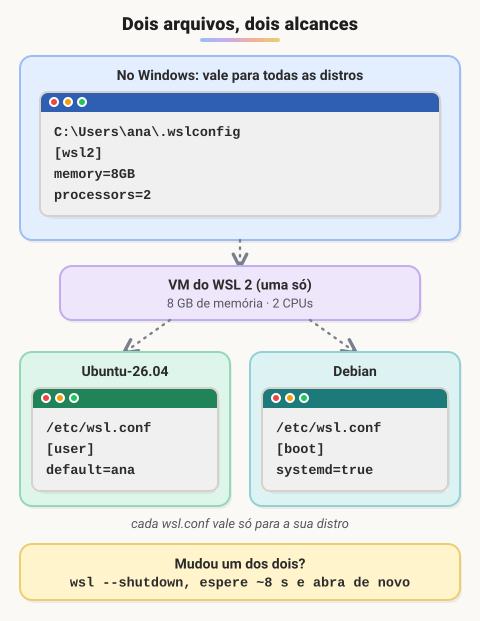

# 7. Gerenciar o WSL

> 🗺️ **Neste capítulo:** como limitar a memória e a CPU que o WSL usa, onde fica cada configuração (`.wslconfig` × `/etc/wsl.conf`), os comandos para atualizar, trocar e remover distros e uma tabela com os erros mais comuns e suas soluções.

## De onde paramos

No capítulo anterior você instalou git, Node, Java e Python do lado Linux e abriu programas com janela pelo WSLg. O ambiente está pronto para programar. Agora é hora de cuidar dele: decidir quanto do computador o WSL pode usar, mantê-lo atualizado, trocar de distro quando quiser e saber o que fazer quando algo dá errado.

## Dois arquivos de configuração: .wslconfig × wsl.conf

Por padrão, o WSL 2 pode usar até metade da memória do Windows e todos os processadores lógicos. Num notebook com 16 GB, um `npm install` pesado ou um build Java pode deixar o Windows lento. Para mudar isso, e outros comportamentos, o WSL lê dois arquivos diferentes, e confundir um com o outro é a fonte de metade das dúvidas.

**O** `.wslconfig` **é o arquivo do lado Windows que configura a máquina virtual do WSL 2, e vale para todas as distros; o** `/etc/wsl.conf` **é o arquivo de dentro de cada distro, e vale só para ela.**

|  | `.wslconfig` | `/etc/wsl.conf` |
| --- | --- | --- |
| Onde fica | Na sua pasta de usuário do Windows (`%UserProfile%`) | Dentro da distro, em `/etc` |
| Alcance | Todas as distros (a VM inteira) | Só a distro onde está |
| Exemplos | memória, processadores, swap, rede | systemd, usuário padrão, montagem do C:, hostname |
| Quem edita | Você, no Windows (ou o app WSL Settings) | Você, no Linux, com `sudo` |

Todas as distros WSL 2 rodam dentro de **uma única** máquina virtual (VM) leve. Por isso o limite de memória fica num arquivo só, do lado Windows: não faz sentido cada distro pedir a sua.



> 💡 **Analogia:** pense no quadro de energia de uma casa. O disjuntor geral (o `.wslconfig`) define quanta potência a casa inteira pode puxar da rua, não importa quantos aparelhos estejam ligados. Cada aparelho (cada distro) tem o seu próprio painel de ajustes (o `wsl.conf`): mudar o timer do micro-ondas não afeta a geladeira. E para trocar o disjuntor você desliga a chave geral e liga de novo (o `wsl --shutdown`).

### O .wslconfig: memória, CPU e mais

O arquivo não existe até você criá-lo. Ele fica em `%UserProfile%\.wslconfig` (por exemplo, `C:\Users\ana\.wslconfig`) e tem o formato de um arquivo .ini: uma seção entre colchetes e chaves `nome=valor` embaixo dela.

```
# vale para a VM inteira, ou seja, todas as distros
[wsl2]
# no máximo 8 GB de RAM (o padrão é 50% da memória)
memory=8GB
# no máximo 4 processadores lógicos (o padrão é todos)
processors=4
# swap em disco; o padrão é 25% da memória
swap=4GB
```

As chaves de tamanho aceitam unidade: `8GB`, `512MB`. Sem unidade, o valor é lido em bytes. Ajuste os números ao seu computador: uma regra prática é deixar pelo menos metade da memória para o Windows.

Duas chaves extras que valem a pena conhecer, ambas estáveis desde o **WSL 2.0.0** (atualização de setembro de 2023):

| Chave | Seção | Para que serve |
| --- | --- | --- |
| `networkingMode=mirrored` | `[wsl2]` | Espelha a rede do Windows no Linux: IPv6, VPN funcionando melhor e `localhost` nos dois sentidos. Exige Windows 11 22H2 ou mais novo |
| `autoMemoryReclaim=gradual` | `[experimental]` | Devolve aos poucos ao Windows a memória de cache que o Linux não usa mais. O padrão atual é `dropCache` (devolve de uma vez); `disabled` desliga |

```
[wsl2]
memory=8GB
processors=4
# rede espelhada (Windows 11 22H2 ou mais novo)
networkingMode=mirrored

[experimental]
# devolve a memória de cache aos poucos
autoMemoryReclaim=gradual
```

> 💡 A documentação da Microsoft recomenda editar essas opções pelo app **WSL Settings** (procure "WSL Settings" no menu Iniciar), que grava o mesmo `.wslconfig` por você. Editar o arquivo à mão continua valendo, e é o que mostra o que está acontecendo.

**Armadilha comum:** o Bloco de Notas pode salvar o arquivo como `.wslconfig.txt`. Com outro nome, o WSL simplesmente ignora o arquivo, sem erro nenhum. Ao salvar, escolha "Todos os arquivos" no tipo e confira a extensão no Explorador (Exibir → Extensões de nomes de arquivos). Outra: caminhos do Windows dentro dele precisam de barra invertida dobrada (`kernel=C:\\temp\\meuKernel`).

### O wsl.conf: ajustes de cada distro

Você já viu este arquivo no capítulo 3, quando conferiu o systemd. Ele fica em `/etc/wsl.conf` e, como está em `/etc`, só se edita com `sudo`. As seções mais úteis:

| Seção e chave | O que faz | Padrão |
| --- | --- | --- |
| `[boot] systemd` | Liga o systemd (necessário para snap e serviços) | `false` (o Ubuntu do WSL já vem com `true`) |
| `[user] default` | Usuário que entra ao abrir a distro | o criado na instalação |
| `[automount] enabled` | Monta C:, D:... em `/mnt` | `true` |
| `[interop] appendWindowsPath` | Põe as pastas do Windows no `PATH` do Linux | `true` |
| `[network] hostname` | Nome da máquina dentro da distro | o nome do Windows |

```
# /etc/wsl.conf do Ubuntu
[boot]
systemd=true

# quem entra ao abrir; o capítulo 8 usa isto
# para voltar ao seu usuário depois de restaurar
[user]
default=ana
```

**Armadilha comum:** pôr `memory=` no `wsl.conf` ou `systemd=true` no `.wslconfig`. Cada arquivo só entende as suas seções; uma chave no lugar errado é ignorada em silêncio.

### wsl --shutdown e a regra dos 8 segundos

Nenhum dos dois arquivos é lido enquanto o WSL está rodando: eles só valem na próxima vez que a VM liga. Fechar a janela do Ubuntu **não basta**, porque a VM continua ativa por alguns segundos. A documentação chama isso de "regra dos 8 segundos".

```powershell
# desliga TODAS as distros e a VM do WSL 2
wsl --shutdown

# confere se ainda há alguma distro rodando
wsl --list --running

# alternativa: desliga só uma distro
wsl --terminate Ubuntu-26.04
```

Quando nada está rodando, a documentação mostra a resposta `There are no running distributions.` (no Windows em português, a mensagem aparece traduzida). Aí é só abrir o Ubuntu de novo.

**Armadilha comum:** rodar `wsl --shutdown` com um build ou um servidor aberto no Linux. O comando derruba tudo na hora, sem perguntar. Salve o trabalho antes.

## Comandos de gerenciamento

Todos estes comandos rodam no PowerShell (ou no Prompt de Comando). De dentro do Linux, use `wsl.exe` no lugar de `wsl`.

```powershell
# distros instaladas, a padrão (com *), estado
# e versão do WSL de cada uma
wsl -l -v

# muda a distro que abre com "wsl" sem nome
wsl --set-default Ubuntu-26.04

# distros disponíveis para instalar
wsl --list --online

# instala outra distro ao lado da atual
wsl --install -d Debian

# atualiza o WSL (PowerShell como administrador)
wsl --update

# distro padrão e informações gerais
wsl --status

# versão do WSL, do kernel e do WSLg
wsl --version

# entra como root, por exemplo para trocar
# uma senha esquecida
wsl -d Ubuntu-26.04 -u root

# lista completa de opções
wsl --help
```

### Trocar de distro

Instalar uma distro nova não apaga a anterior: elas convivem, cada uma com seus arquivos e seu `wsl.conf`. O fluxo é `wsl --list --online` para ver os nomes, `wsl --install -d <nome>` para instalar e `wsl --set-default <nome>` para que ela seja a que abre por padrão. Todas dividem a mesma VM, e portanto o mesmo limite do `.wslconfig`.

### Remover uma distro

```powershell
# CUIDADO: apaga a distro e TODOS os arquivos dela
wsl --unregister Debian
```

> ⚠️ `wsl --unregister` não tem lixeira nem confirmação: a distro, seus programas e tudo o que estava em `/home` somem para sempre. Antes de rodar, faça o backup do capítulo 8 (`wsl --export`). Para desinstalar de vez, depois remova também o app da distro em Configurações → Aplicativos, como qualquer outro programa.

### Esqueci a senha do Linux

A senha do `sudo` não tem "esqueci minha senha". Mas o WSL deixa entrar como root sem senha pelo lado Windows, e o root pode trocar a senha de qualquer usuário:

```powershell
# no PowerShell: abre a distro como root
wsl -d Ubuntu-26.04 -u root
```

```bash
# já dentro do Linux, como root (prompt com #):
# define uma senha nova para a usuária ana
passwd ana
```

Saída (executado no ambiente do livro, digitando a senha duas vezes, sem que ela apareça):

```
New password:
Retype new password:
passwd: password updated successfully
```

Depois digite `exit` e abra o Ubuntu normalmente. **Armadilha comum:** continuar trabalhando como root depois de trocar a senha. Tudo o que você instalar ali vai para a pasta do root e não funciona para o seu usuário (capítulo 3).

## Problemas comuns

| Sintoma | Causa provável | Solução |
| --- | --- | --- |
| Erro `0x80370102` ao instalar ou abrir | Virtualização desligada na BIOS ou recurso "Plataforma de Máquina Virtual" desativado | Ativar a virtualização na BIOS (capítulo 2), ativar a Plataforma de Máquina Virtual nos Recursos do Windows e reiniciar |
| Pede atualização do kernel | WSL desatualizado | `wsl --update` no PowerShell como administrador |
| Esqueci a senha do Ubuntu | Não há recuperação pelo Linux | `wsl -d Ubuntu-26.04 -u root` e `passwd <usuario>` |
| Comando instalado não é encontrado | Instalado como root ou em pasta fora do `PATH` | Reinstalar como o seu usuário; abrir um terminal novo |
| Projeto muito lento | Arquivos em `/mnt/c/...` | Mover para `~/projetos/` (capítulo 4) |
| Mudança no `wsl.conf` ou no `.wslconfig` não teve efeito | A VM não reiniciou, ou a chave está no arquivo errado | `wsl --shutdown`, esperar ~8 s e abrir de novo; conferir a seção |

> ⚠️ **Correção:** o guia-base atribuía o erro `0x80370102` só à virtualização desligada na BIOS. A documentação oficial lista duas causas: a virtualização da BIOS **e** o recurso opcional "Plataforma de Máquina Virtual" do Windows, que precisa estar ativado (com reinício depois).

## 🧪 Laboratório

> ⚠️ Os comandos do Windows deste laboratório vêm do guia do autor (executados em out/2026) e da documentação oficial; não foram executados na produção do livro. Confira a saída no seu computador.

Objetivo: limitar o WSL a 8 GB e 2 processadores, garantir o systemd e o usuário padrão no Ubuntu e conferir, de dentro do Linux, que o limite foi aplicado.

**1. Criar o .wslconfig (Windows).** Abra o Explorador, digite `%UserProfile%` na barra de endereço e crie o arquivo `.wslconfig` (confira que não ficou `.txt` no fim). Conteúdo:

```
[wsl2]
memory=8GB
processors=2
```

**2. Escrever o wsl.conf (Linux).** No Ubuntu, como o seu usuário, grave o arquivo com `sudo tee`, que escreve em `/etc` com permissão de administrador, e leia de volta:

```bash
# tee grava o texto em /etc/wsl.conf como root;
# >/dev/null evita repetir o texto na tela
printf '[boot]\nsystemd=true\n\n[user]\ndefault=ana\n' \
  | sudo tee /etc/wsl.conf >/dev/null

# confere o que ficou gravado
cat /etc/wsl.conf
```

Saída (troque `ana` pelo seu usuário):

```
[boot]
systemd=true

[user]
default=ana
```

**3. Reiniciar o WSL (Windows).** Feche o Ubuntu e, no PowerShell:

```powershell
wsl --shutdown
wsl --list --running
```

Espere a resposta de que não há distros rodando e abra o Ubuntu de novo.

**4. Conferir memória e processadores (Linux).**

```bash
# memória total, usada e livre, em unidades legíveis
free -h

# quantos processadores o Linux enxerga
nproc
```

Saída no ambiente de produção do livro (um Ubuntu 24.04 em contêiner, também limitado a cerca de 8 GB e 2 processadores):

```
               total        used        free      shared  buff/cache   available
Mem:           7.8Gi       401Mi       7.4Gi        16Mi       290Mi       7.4Gi
Swap:             0B          0B          0B
2
```

O ponto central: dentro do WSL, `free -h` e `nproc` **não mostram o hardware do seu computador**, e sim o que a VM recebeu. Com `memory=8GB`, o `total` fica um pouco abaixo de 8 (parte vai para o próprio kernel); com `processors=2`, `nproc` responde `2`, mesmo que o processador tenha 16 núcleos. A linha `Swap` vai mostrar o swap do WSL (25% da memória, se você não mudou); no contêiner do livro ela é `0B`.

## 🏋️ Pratique

**1.** Seu notebook tem 16 GB e 8 processadores lógicos. Você quer deixar pelo menos 10 GB para o Windows e metade dos processadores livres. Escreva o `.wslconfig`.

<details>
<summary>Ver resposta</summary>

16 − 10 = 6 GB para o WSL; 8 ÷ 2 = 4 processadores.

```
[wsl2]
memory=6GB
processors=4
```

Teste: depois de `wsl --shutdown`, `nproc` mostra `4` e o `total` de `free -h` fica um pouco abaixo de 6Gi.

</details>

**2.** Você editou o `/etc/wsl.conf`, fechou a janela do Ubuntu, abriu de novo em seguida, e nada mudou. Explique por quê e o que fazer.

<details>
<summary>Ver resposta</summary>

A VM continuava ligada: fechar a janela não reinicia o WSL, e o `wsl.conf` só é lido quando a distro sobe. Rode `wsl --shutdown` (ou `wsl --terminate Ubuntu-26.04`), confira com `wsl --list --running` que nada está rodando e abra de novo.

</details>

**3.** Para cada ajuste, diga em qual arquivo ele vai: (a) ligar o systemd; (b) limitar a memória; (c) ativar a rede espelhada; (d) entrar sempre como `ana`.

<details>
<summary>Ver resposta</summary>

(a) `/etc/wsl.conf`, seção `[boot]`; (b) `.wslconfig`, seção `[wsl2]`; (c) `.wslconfig`, `[wsl2]` com `networkingMode=mirrored`; (d) `/etc/wsl.conf`, seção `[user]`. Regra: o que é da VM inteira vai no `.wslconfig`; o que é de uma distro, no `wsl.conf`.

</details>

## 🧠 Revisão rápida

**Se eu tiver Ubuntu e Debian instalados, quantos .wslconfig existem?**

Um só, na pasta de usuário do Windows. Ele vale para a VM que roda as duas distros; cada uma pode ter o seu `/etc/wsl.conf`.

**O que `wsl --unregister Ubuntu-26.04` faz com os meus projetos em `~/projetos`?**

Apaga para sempre, junto com a distro inteira. Faça o backup com `wsl --export` antes.

**Por que `nproc` mostra 2 se o meu processador tem 8 núcleos?**

Porque dentro do WSL ele mostra os processadores da VM, e o `.wslconfig` tem `processors=2`.

> ➡️ **Próximo passo:** você viu que `wsl --unregister` apaga tudo sem volta. O próximo capítulo, **8. Backup e restauração**, mostra como exportar o Ubuntu inteiro para um arquivo e restaurá-lo, usando a seção `[user]` do `wsl.conf` para voltar a entrar com o seu usuário.

## 📚 Fontes

Conferido em 2026-11-15.

- [Advanced settings configuration in WSL (Microsoft Learn)](https://learn.microsoft.com/en-us/windows/wsl/wsl-config)
- [Basic commands for WSL (Microsoft Learn)](https://learn.microsoft.com/en-us/windows/wsl/basic-commands)
- [Troubleshooting Windows Subsystem for Linux (Microsoft Learn)](https://learn.microsoft.com/en-us/windows/wsl/troubleshooting)
- [Accessing network applications with WSL: mirrored mode (Microsoft Learn)](https://learn.microsoft.com/en-us/windows/wsl/networking)
- [Windows Subsystem for Linux September 2023 update (WSL 2.0.0)](https://devblogs.microsoft.com/commandline/windows-subsystem-for-linux-september-2023-update/)
- Guia do autor, seções 6, 8 e 9: [🐧Instalação do WSL](https://app.notion.com/p/Instala-o-do-WSL-401345e2044380d7a543eff07c6e9935?pvs=21)

## 📌 Resumo

| Item | Em uma frase |
| --- | --- |
| `.wslconfig` | Arquivo do Windows (`%UserProfile%`) que configura a VM do WSL 2 para todas as distros |
| `/etc/wsl.conf` | Arquivo de cada distro: systemd, usuário padrão, montagem e interop |
| `memory` e `processors` | Limitam a VM; o padrão é 50% da memória e todos os processadores |
| `networkingMode=mirrored` | Rede espelhada do Windows (WSL 2.0.0 ou mais novo, Windows 11 22H2 ou mais novo) |
| `autoMemoryReclaim` | Em `[experimental]`, devolve ao Windows a memória de cache |
| `wsl --shutdown` | Desliga tudo; necessário para aplicar mudanças nos dois arquivos |
| `wsl -l -v` e `--set-default` | Listam as distros e escolhem a padrão |
| `wsl --update` e `--version` | Atualizam e mostram a versão do WSL |
| `wsl -u root` | Entra como root, por exemplo para trocar uma senha esquecida |
| `wsl --unregister` | Apaga a distro e todos os arquivos dela, sem volta |
| `free -h` e `nproc` | Mostram a memória e os processadores que a VM recebeu, não o hardware |
