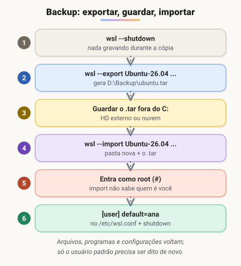
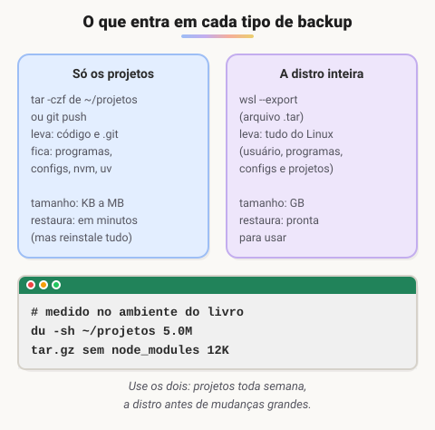

# 8. Backup e restauração

> 🗺️ **Neste capítulo:** como exportar o Ubuntu inteiro para um único arquivo com `wsl --export`, restaurá-lo (ou cloná-lo) com `wsl --import` voltando a entrar com o seu usuário, e quando basta um backup só dos projetos com `tar`.

## De onde paramos

No capítulo anterior você aprendeu a gerenciar o WSL e viu um aviso sério: `wsl --unregister` apaga a distro e tudo o que está nela, sem lixeira. Formatar o Windows tem o mesmo efeito. Seu ambiente já tem horas de trabalho (ferramentas, temas, projetos), e este capítulo garante que ele sobreviva a qualquer um desses acidentes.

## Exportar a distro inteira

Reinstalar tudo do zero leva uma tarde: Ubuntu, git, nvm, uv, Starship, fontes, chaves SSH. O WSL consegue empacotar a distro inteira num arquivo e recriá-la depois, em qualquer pasta ou em outro computador.

**O** `wsl --export` **grava uma cópia completa de uma distro (sistema, programas, usuários, configurações e a sua pasta pessoal) num único arquivo, por padrão no formato .tar.**

O formato .tar (de *tape archive*) é um "pacote" que junta muitos arquivos e pastas num só, preservando nomes, permissões e donos. É o mesmo formato que você vai usar no Laboratório para os projetos.

```powershell
# 1. desliga tudo: a cópia não pode pegar
# arquivos sendo gravados no meio do caminho
wsl --shutdown

# 2. confere o nome exato da distro
wsl -l -v

# 3. exporta para outro disco (a pasta D:\Backup
# precisa existir); demora alguns minutos
wsl --export Ubuntu-26.04 D:\Backup\wsl-2026-11-15.tar
```

A documentação não mostra uma saída para o export; quando ele termina, o prompt do PowerShell volta e o arquivo aparece na pasta. Confira o tamanho dele no Explorador.

### O formato .vhdx (opcional)

No WSL 2, cada distro vive num disco virtual, um arquivo `ext4.vhdx` guardado dentro de `%LOCALAPPDATA%\Packages\...`. A opção `--vhd` exporta esse disco em vez de um .tar:

```powershell
# exporta o disco virtual inteiro (só WSL 2)
wsl --export Ubuntu-26.04 D:\Backup\wsl.vhdx --vhd
```

|  | .tar (padrão) | .vhdx (`--vhd`) |
| --- | --- | --- |
| O que contém | Os arquivos da distro | O disco virtual inteiro |
| Tamanho | Perto do espaço usado no Linux | Pode ser maior: o disco cresce com o uso |
| Restaurar | `wsl --import` | `wsl --import ... --vhd` ou `wsl --import-in-place` |
| Quando usar | Quase sempre | WSL 2 apenas, quando você quer o disco como está |

Para quem está começando, fique com o .tar: é o formato que a documentação usa nos exemplos e funciona com qualquer versão.

**Armadilha comum:** copiar o `ext4.vhdx` direto da pasta `AppData` com o Explorador, com o WSL ligado. A documentação recomenda não mexer nesses arquivos com ferramentas do Windows, porque isso pode corromper a distro. Use sempre o `wsl --export`.

## Restaurar com wsl --import

O arquivo exportado não serve para nada até ser importado. A importação cria uma distro nova a partir dele, com o nome e a pasta que você escolher.

**O** `wsl --import <nome> <pasta> <arquivo>` **registra uma distro nova chamada** `<nome>`**, guarda o disco dela em** `<pasta>` **e preenche esse disco com o conteúdo do** `<arquivo>`**.**

Exemplo real: você formatou o Windows, instalou o WSL de novo (capítulo 2, com `wsl --install --no-distribution` para não baixar outro Ubuntu) e tem o backup no HD externo.

```powershell
# a pasta onde o disco da distro vai morar
mkdir D:\WSL\Linux

# nome da distro, pasta de instalação, backup
# o caminho do backup numa variável do PowerShell
$bkp = "D:\Backup\wsl-2026-11-15.tar"
wsl --import Ubuntu-26.04 D:\WSL\Linux $bkp

# a distro restaurada aparece na lista
wsl -l -v

# abre a distro restaurada
wsl -d Ubuntu-26.04
```

Para restaurar um backup .vhdx, acrescente `--vhd` no fim do `wsl --import`.



> 💡 **Analogia:** é como trocar de celular restaurando o backup da nuvem. O backup (o .tar) traz de volta apps, fotos e ajustes (programas, projetos e configurações), e o celular novo (a pasta do `--import`) pode até ser de outro modelo. Mas ele liga numa tela genérica até você entrar na sua conta: é o Ubuntu restaurado abrindo como root até você dizer, no `wsl.conf`, qual é o seu usuário.

### Voltar a entrar com o seu usuário

Uma distro importada não tem o "lançador" que a loja instala, e por isso a documentação avisa que ela abre como **root** por padrão. O seu usuário e a sua pasta continuam lá dentro; só falta dizer ao WSL quem deve entrar.

Você já conhece a ferramenta: a seção `[user]` do `/etc/wsl.conf` (capítulo 7). Dentro da distro restaurada, ainda como root:

```bash
# prompt com #: você é root, não precisa de sudo
whoami

# mostra o que já existe no arquivo
cat /etc/wsl.conf
```

Se a seção `[user]` não estiver lá, acrescente (troque `ana` pelo seu usuário):

```bash
# >> acrescenta no fim, sem apagar o [boot]
printf '\n[user]\ndefault=ana\n' >> /etc/wsl.conf
```

Depois saia com `exit` e reinicie a distro no PowerShell:

```powershell
wsl --terminate Ubuntu-26.04
wsl -d Ubuntu-26.04
```

Agora `whoami` responde `ana`, o prompt termina em `$` e o `cd ~` leva para `/home/ana`, com tudo como estava.

> 💡 Se você fez o Laboratório do capítulo 7, o seu `/etc/wsl.conf` já tem `[user] default=ana`, e ele viaja dentro do .tar. Mesmo assim, confira com `whoami` logo depois de importar.

**Armadilha comum:** não perceber que está como root e continuar trabalhando. Tudo o que você instalar vai para `/root` e os arquivos criados ficam com dono root, o que depois causa "Permission denied" para o seu usuário (capítulo 3). Outra: o comando `ubuntu config --default-user`, citado em tutoriais antigos, **não funciona** em distros importadas; o caminho é o `wsl.conf`.

## Clonar uma distro para testes

Como o `--import` aceita qualquer nome, o mesmo backup vira uma **cópia independente** para experimentos: testar um upgrade arriscado, uma ferramenta que mexe no sistema ou um tutorial que você não conhece.

```powershell
# o clone ganha outro nome e outra pasta;
# o Ubuntu-26.04 original não é tocado
$bkp = "D:\Backup\wsl-2026-11-15.tar"
wsl --import Ubuntu-teste D:\WSL\Testes $bkp

# abre o clone
wsl -d Ubuntu-teste

# terminou os testes? apaga SÓ o clone
wsl --unregister Ubuntu-teste
```

As duas distros dividem a mesma VM e o mesmo limite do `.wslconfig`, mas cada uma tem o seu disco: o que você apagar no clone não some do original.

**Armadilha comum:** errar o nome no `--unregister`. Ele apaga a distro indicada sem perguntar (capítulo 7). Rode `wsl -l -v` antes e copie o nome exato do clone.

## Projetos ou distro inteira?

Exportar a distro gera um arquivo de vários GB e exige desligar o WSL. Para o dia a dia, isso é pesado demais. Existem dois níveis de backup, e eles se completam:

**Backup de projetos guarda só o seu trabalho (código e histórico), em arquivos pequenos e frequentes; backup da distro guarda o ambiente inteiro, em arquivos grandes e ocasionais.**

|  | Só os projetos | Distro inteira |
| --- | --- | --- |
| Como | `git push` ou `tar` de `~/projetos` | `wsl --export` |
| O que leva | Código e histórico do git | Tudo: usuário, programas, configurações e projetos |
| Tamanho | KB a MB | Vários GB |
| Quando | Todo dia (git) ou toda semana (tar) | Antes de formatar o Windows ou de uma mudança grande |



> 💡 **Analogia:** o backup de projetos é o caderno de receitas: leve, cabe na bolsa, e com ele você refaz qualquer prato, mas vai precisar cozinhar tudo de novo (reinstalar nvm, uv, Starship). O backup da distro é a refeição pronta congelada: ocupa o freezer inteiro (GB), mas é só esquentar (`wsl --import`) e servir. Quem cozinha bem guarda os dois.

### Quando fazer cada um

- **Sempre:** projetos com git e um repositório remoto (GitHub, GitLab). Cada `git push` já é um backup.
- **Toda semana:** um `tar` de `~/projetos` pega o que ainda não foi para o git (arquivos `.env`, rascunhos, projetos sem repositório).
- **Antes de formatar o Windows** ou trocar de computador: `wsl --export`, obrigatoriamente.
- **Antes de mudanças grandes:** atualizar o Ubuntu para uma versão nova, mexer em muitos pacotes do sistema, rodar `--unregister` em qualquer distro.

### Quanto espaço ocupa

O .tar tem mais ou menos o tamanho do que está gravado dentro do Linux. Para estimar antes de exportar, rode no Ubuntu:

```bash
# espaço usado no disco da distro (coluna Used)
df -h /
```

Uma instalação com as ferramentas deste livro costuma passar de alguns GB; pastas como `node_modules`, `.venv` e caches do npm pesam mais que o código. Guarde o arquivo **fora do disco C:** (HD externo, outro disco ou nuvem): um backup no mesmo disco que vai ser formatado não protege nada.

**Armadilha comum:** guardar o .tar em `/mnt/c/...` ou na Área de Trabalho e formatar o Windows em seguida. Confira que o arquivo está no destino certo, e que abre, antes de apagar qualquer coisa.

## 🧪 Laboratório

> ⚠️ Os comandos do Windows deste laboratório vêm do guia do autor (executados em out/2026) e da documentação oficial; não foram executados na produção do livro. Confira a saída no seu computador.

Objetivo: fazer um backup de `~/projetos` com `tar`, conferir que ele está íntegro e que restaura, e depois exportar a distro inteira.

**1. Ver quanto os projetos ocupam (Linux).**

```bash
cd ~ && du -sh projetos
```

Saída no ambiente do livro (dois projetos de exemplo, um deles com uma pasta `node_modules` de 5 MB):

```
5,0M  projetos
```

**2. Criar o backup sem as pastas que se reinstalam (Linux).**

```bash
mkdir -p ~/backups

# c = criar, z = compactar com gzip, f = arquivo;
# node_modules se reinstala com npm install,
# então não precisa ir para o backup;
# -C ~ grava caminhos relativos (projetos/...)
tar -czf ~/backups/projetos-2026-11-15.tar.gz \
  --exclude=node_modules -C ~ projetos

cd ~/backups && du -h projetos-2026-11-15.tar.gz
```

Saída:

```
12K  projetos-2026-11-15.tar.gz
```

De 5,0 MB para 12 KB: quase todo o peso era `node_modules`.

**3. Listar o conteúdo sem extrair (Linux).**

```bash
# t = listar; o grep esconde os arquivos
# internos do .git para a lista ficar curta
tar -tzf projetos-2026-11-15.tar.gz \
  | grep -v "\.git/."
```

Saída:

```
projetos/
projetos/api/
projetos/api/main.py
projetos/site/
projetos/site/src/
projetos/site/src/app.js
projetos/site/README.md
projetos/site/.git/
```

O `.git` está lá (o histórico vai junto) e o `node_modules` não.

**4. Gerar e conferir a "impressão digital" (Linux).** O `sha256sum` calcula um código (*hash*) que muda se um único byte do arquivo mudar. Guarde-o ao lado do backup e confira depois de copiar para o HD externo ou baixar da nuvem.

```bash
sha256sum projetos-2026-11-15.tar.gz \
  > projetos-2026-11-15.tar.gz.sha256
cat projetos-2026-11-15.tar.gz.sha256

# -c recalcula e compara com o código guardado
sha256sum -c projetos-2026-11-15.tar.gz.sha256
```

Saída (o código do seu arquivo será outro):

```
a6911194987ad266d7a1f602b67e5715b453a223ee2f47d0a30d60c7f7d11a7d  projetos-2026-11-15.tar.gz
projetos-2026-11-15.tar.gz: OK
```

**5. Testar a restauração numa pasta temporária (Linux).** Um backup que nunca foi restaurado é só uma esperança.

```bash
# x = extrair; -C escolhe a pasta de destino
mkdir -p /tmp/restauro
tar -xzf projetos-2026-11-15.tar.gz -C /tmp/restauro

ls /tmp/restauro/projetos/site
git -C /tmp/restauro/projetos/site log --oneline
```

Saída:

```
README.md
src
a39625f primeiro commit
```

Os arquivos e o histórico do git voltaram. Copie a pasta `~/backups` para fora do Linux, por exemplo com `cp ~/backups/* /mnt/d/Backup/` (capítulo 4).

**6. Exportar a distro inteira (Windows).** Feche o Ubuntu e, no PowerShell:

```powershell
wsl --shutdown
wsl --export Ubuntu-26.04 D:\Backup\wsl-2026-11-15.tar
```

**7. Conferir o backup com um clone (Windows).** Em vez de esperar um desastre para descobrir se o .tar funciona, importe-o como clone, abra, confira e apague o clone:

```powershell
$bkp = "D:\Backup\wsl-2026-11-15.tar"
wsl --import Ubuntu-teste D:\WSL\Testes $bkp
wsl -d Ubuntu-teste
```

Dentro do clone, `whoami` e `ls ~/projetos` mostram se o usuário e os projetos vieram. Saia com `exit` e remova só o clone com `wsl --unregister Ubuntu-teste`.

## 🏋️ Pratique

**1.** Você vai formatar o Windows amanhã. Escreva, na ordem, os comandos do PowerShell para salvar o Ubuntu num HD externo (letra `E:`) e, depois da formatação e da reinstalação do WSL, restaurá-lo na pasta `C:\WSL\Linux`.

<details>
<summary>Ver resposta</summary>

Antes de formatar:

```powershell
wsl --shutdown
wsl --export Ubuntu-26.04 E:\wsl-backup.tar
```

Depois de reinstalar o WSL:

```powershell
mkdir C:\WSL\Linux
wsl --import Ubuntu-26.04 C:\WSL\Linux E:\wsl-backup.tar
wsl -d Ubuntu-26.04
```

Teste: dentro do Ubuntu, `whoami`. Se responder `root`, acrescente `[user] default=<seu usuário>` ao `/etc/wsl.conf`, rode `wsl --terminate Ubuntu-26.04` e abra de novo: `whoami` → o seu usuário.

</details>

**2.** Você copiou `projetos-2026-11-15.tar.gz` e o arquivo `.sha256` para um pen drive e, ao conferir, viu isto. O que aconteceu e o que fazer?

```
projetos-2026-11-15.tar.gz: FAILED
sha256sum: WARNING: 1 computed checksum did NOT match
```

<details>
<summary>Ver resposta</summary>

A cópia no pen drive não é idêntica ao original: algum byte mudou (cópia interrompida, pen drive com defeito). Essa saída é real: no ambiente do livro, bastou acrescentar um caractere ao fim de uma cópia do arquivo para o `sha256sum -c` responder `FAILED` (e terminar com código 1). Não confie nessa cópia: copie de novo a partir do original e confira até aparecer `OK`.

</details>

**3.** Para cada situação, diga se basta o backup de projetos ou se é preciso exportar a distro: (a) terminar o dia de trabalho; (b) trocar de notebook; (c) testar um script que altera arquivos em `/etc`.

<details>
<summary>Ver resposta</summary>

(a) Projetos: `git push` (ou o `tar` semanal). (b) Distro inteira: `wsl --export` no notebook velho e `wsl --import` no novo. (c) Nem um nem outro sozinho: exporte e importe um **clone** (`Ubuntu-teste`), rode o script nele e apague o clone com `--unregister`; o original nem é tocado.

</details>

## 🧠 Revisão rápida

**Por que rodar `wsl --shutdown` antes de `wsl --export`?**

Para que nenhum programa esteja gravando arquivos durante a cópia; assim o backup sai consistente.

**Importei o meu backup e o prompt termina em `#`. Perdi o meu usuário?**

Não: distros importadas entram como root por padrão. O usuário e a pasta continuam lá; basta `[user] default=ana` no `/etc/wsl.conf` e reiniciar a distro.

**Como testar um upgrade arriscado sem pôr o meu Ubuntu em perigo?**

Importe o backup com outro nome (`wsl --import Ubuntu-teste ...`), teste no clone e apague só ele com `wsl --unregister Ubuntu-teste`.

> ➡️ **Próximo passo:** com o ambiente protegido por backup, é hora de pôr um assistente de programação para trabalhar nele. O próximo capítulo, **9. Claude Code no WSL**, instala o Claude Code como o seu usuário e mostra os modos de permissão, plugins e MCPs.

## 📚 Fontes

Conferido em 2026-11-15.

- [Basic commands for WSL: export, import e unregister (Microsoft Learn)](https://learn.microsoft.com/en-us/windows/wsl/basic-commands)
- [Import any Linux distribution to use with WSL (Microsoft Learn)](https://learn.microsoft.com/en-us/windows/wsl/use-custom-distro)
- [How to manage WSL disk space (Microsoft Learn)](https://learn.microsoft.com/en-us/windows/wsl/disk-space)
- [Frequently Asked Questions: How can I back up my WSL distributions? (Microsoft Learn)](https://learn.microsoft.com/en-us/windows/wsl/faq)
- [GNU tar manual](https://www.gnu.org/software/tar/manual/)
- Guia do autor, seção 7: [🐧Instalação do WSL](https://app.notion.com/p/Instala-o-do-WSL-401345e2044380d7a543eff07c6e9935?pvs=21)

## 📌 Resumo

| Item | Em uma frase |
| --- | --- |
| `wsl --shutdown` | Desliga tudo antes do export, para a cópia sair consistente |
| `wsl --export <distro> <arquivo>` | Grava a distro inteira num .tar (ou num .vhdx com `--vhd`, só WSL 2) |
| `wsl --import <nome> <pasta> <arquivo>` | Cria uma distro a partir do backup, no nome e na pasta escolhidos |
| `[user] default=` | No `/etc/wsl.conf`, faz a distro importada entrar com o seu usuário, e não como root |
| Clone | O mesmo backup importado com outro nome, para testes sem risco |
| Backup de projetos | `git push` sempre e `tar -czf` de `~/projetos` toda semana, sem `node_modules` |
| `tar -tzf` e `sha256sum -c` | Listam o conteúdo e confirmam que a cópia está íntegra |
| Onde guardar | Fora do disco C: (HD externo, outro disco ou nuvem) |
| `wsl --unregister` | Apaga a distro sem volta: só depois de ter o backup conferido |
