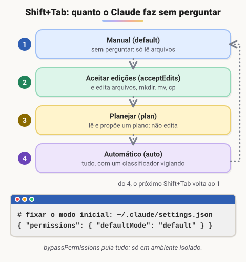
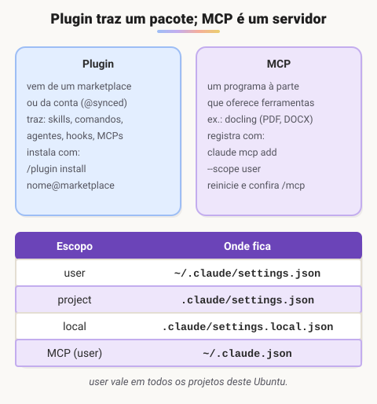

# 9. Claude Code no WSL

> 🗺️ **Neste capítulo:** como instalar o Claude Code no Ubuntu do WSL como o seu usuário (e não como root), os comandos e atalhos do dia a dia, os modos de permissão, os plugins e os MCPs, e como fixar o modo inicial e o idioma das respostas no `~/.claude/settings.json`. Tudo conferido com o Claude Code 2.x (versão 2.1.325) em 2026-11-15.

## De onde paramos

No capítulo anterior você aprendeu a exportar o Ubuntu inteiro e a restaurá-lo com o seu usuário. Com o ambiente protegido, é hora de pôr um assistente de programação para trabalhar dentro dele. O Claude Code roda no terminal, lê e edita os arquivos do projeto e executa comandos, e por isso o jeito como você o instala e as permissões que você dá a ele importam tanto quanto o próprio programa.

## WSL ou Windows?

O Claude Code existe para Windows (PowerShell) e para Linux. No seu computador, isso significa que você pode ter **duas instalações**: uma no Windows e outra dentro do Ubuntu.

**As duas instalações são independentes: cada uma tem o seu login, as suas configurações, os seus MCPs e o seu histórico de conversas.**

|  | Claude Code do WSL | Claude Code do Windows |
| --- | --- | --- |
| Onde instala | No Ubuntu, com `curl ... install.sh` | No PowerShell, com `irm ... install.ps1` |
| Projetos | Em `~/projetos`, no disco do Linux | Em pastas do Windows (`C:\...`) |
| Ferramentas que ele usa | As do Linux: bash, git, nvm, uv | As do Windows: PowerShell ou Git Bash |
| Sandbox | Suportado no WSL 2 | Não suportado |
| Quando usar | Projetos Linux, web, Python, Node | Apps e instaladores do Windows |

A documentação oficial resume a escolha assim: use o WSL 2 quando precisar das ferramentas do Linux ou da execução de comandos em sandbox (uma área isolada onde os comandos não alcançam o resto do sistema); use o Windows nativo para projetos e ferramentas do Windows. Este livro usa a instalação do WSL.

**Armadilha comum:** fazer login, configurar MCPs e plugins no Windows e esperar que apareçam no Ubuntu. Não aparecem: o que você configura numa instalação não vale para a outra.

## Pré-requisitos

- **Plano pago.** O Claude Code exige uma conta Pro, Max, Team, Enterprise ou Console. O plano grátis do claude.ai não inclui o Claude Code.
- **WSL 2 com o Ubuntu-26.04**, atualizado (capítulos 2 e 3).
- **Node.js não é necessário.** O instalador nativo baixa um programa pronto, que não usa o Node. Você só vai precisar do Node (instalado com o nvm, capítulo 6) para os MCPs e ferramentas que rodam com `npx`, e do `uv` (também do capítulo 6) para os que rodam com `uvx`, como o Docling deste capítulo.

## Instalar como usuário

**A instalação nativa é um script que baixa o Claude Code para a sua pasta pessoal (**`~/.local/share/claude`**) e cria o comando** `claude` **em** `~/.local/bin`**; ela se atualiza sozinha em segundo plano.**

Como tudo fica na sua pasta pessoal, a instalação é feita pelo seu usuário, sem `sudo`. No terminal do Ubuntu, com o prompt terminando em `$`:

```bash
# confirme que você NÃO é root (o prompt termina em $)
whoami

# baixa e instala na sua pasta pessoal;
# não mostra progresso enquanto baixa
curl -fsSL https://claude.ai/install.sh | bash
```

Feche e abra o terminal e confira:

```bash
claude --version
```

Saída no ambiente do livro (o número da sua versão será maior):

```
2.1.325 (Claude Code)
```

### Se o claude não for encontrado: o PATH

O PATH é a lista de pastas onde o bash procura os comandos. Se `~/.local/bin` não estiver nela, o `claude` está instalado, mas o bash responde `command not found`. O `claude doctor` (fora da sessão) mostra o problema e a correção; esta é a saída real no ambiente do livro, resumida:

```
4 warnings found
- Native installation exists but ~/.local/bin
  is not in your PATH
  Fix: Run: echo 'export PATH="$HOME/.local/bin:$PATH"'
  >> ~/.bashrc then open a new terminal or run:
  source ~/.bashrc
```

A correção é a que ele indica:

```bash
# acrescenta ~/.local/bin no começo do PATH,
# em todo terminal novo
echo 'export PATH="$HOME/.local/bin:$PATH"' \
  >> ~/.bashrc
source ~/.bashrc
```

### Instalei como root por engano

Com `sudo` ou depois de um `su`, o instalador grava tudo em `/root`. O seu usuário não enxerga essa pasta, e o Claude Code instalado ali rodaria com permissão total sobre o Ubuntu. No ambiente do livro, o usuário comum tentando olhar a pasta do root:

```
$ ls /root/.local/bin
ls: cannot access '/root/.local/bin': Permission denied
```

Para desfazer, ainda como root, apague a instalação errada (são os mesmos caminhos da desinstalação oficial, só que dentro de `/root`), volte ao seu usuário e instale de novo:

```bash
# como root: remove o comando e as versões
rm -f /root/.local/bin/claude
rm -rf /root/.local/share/claude

# volta ao seu usuário (prompt com $)
exit
```

**Armadilha comum:** usar `sudo` "para garantir". O instalador não precisa de privilégios, e a documentação avisa que até o método alternativo pelo npm não deve ser usado com `sudo npm install -g`, por causar problemas de permissão e de segurança.

## Login e a tela de confiança

Na primeira vez que você roda `claude`, ele abre o login no navegador. No WSL, se o navegador não abrir sozinho, copie o link mostrado no terminal e abra no navegador do Windows.

Em seguida aparece a tela de confiança na pasta (*"Is this a project you trust?"*): o Claude Code pergunta se pode ler, editar e executar arquivos na pasta atual. Até você confiar, as regras e plugins que vêm de um repositório não são aplicados.

- Numa **pasta de projeto** sua: escolha **Yes, I trust this folder**.
- Na **pasta pessoal** (`/home/ana`), ou numa pasta que você não conhece: escolha **No, exit**. O login já fica salvo mesmo assim.

Por isso, use o Claude Code **sempre dentro de uma pasta de projeto** em `~/projetos`, no disco do Linux (capítulo 4):

```bash
mkdir -p ~/projetos/teste && cd ~/projetos/teste
claude
```

**Armadilha comum:** abrir o `claude` na pasta pessoal ou em `/mnt/c/...`. Na pasta pessoal ele enxerga todos os seus arquivos (chaves SSH, backups, configurações); em `/mnt/c` tudo fica mais lento e voltam os problemas de permissão e de quebra de linha.

## Comandos e atalhos da sessão

Dentro da sessão, os comandos começam com `/`. Digite só `/` para ver a lista e filtrar. Os essenciais:

| Comando | Para que serve |
| --- | --- |
| `/help` | Ajuda e lista de comandos |
| `/init` | Cria um `CLAUDE.md` com o contexto do projeto |
| `/memory` | Edita os `CLAUDE.md` e a memória automática |
| `/model` | Troca o modelo e o salva como padrão |
| `/plan` | Entra no modo planejar |
| `/context` | Mostra o que ocupa a janela de contexto |
| `/compact` | Resume a conversa para liberar contexto |
| `/clear` | Começa uma conversa nova, com o contexto vazio |
| `/resume` | Retoma uma conversa anterior |
| `/rewind` | Volta código e conversa a um ponto anterior |
| `/mcp` | Mostra e gerencia os servidores MCP |
| `/plugin` | Abre o painel de plugins |
| `/permissions` | Regras do que ele pode fazer sem perguntar |
| `/config` | Configurações: tema, modelo e outras |
| `/usage` | Uso do limite do seu plano |
| `/doctor` | Checa a instalação e propõe correções |
| `/exit` | Sai da sessão |

E os atalhos:

| Atalho | O que faz |
| --- | --- |
| **Shift+Tab** | Troca o modo de permissão (próxima seção) |
| **Esc** | Interrompe a resposta atual; o que já foi feito fica |
| **Esc Esc** | Com a caixa vazia, abre o menu do `/rewind` |
| **@** | Menciona um arquivo: `explique @src/main.py` |
| **!** no início | Roda um comando do terminal: `!git status` |

Fora da sessão, no bash, os mais úteis são `claude -c` (continua a última conversa da pasta), `claude doctor` (diagnóstico só de leitura), `claude mcp list` e `claude plugin list`.

**Armadilha comum:** usar `/clear` achando que só "limpa a tela". Ele começa uma conversa nova; para liberar espaço sem perder o fio, use `/compact`.

## Modos de permissão

Um assistente que edita arquivos e roda comandos precisa de um limite claro: quando ele age sozinho e quando para e pergunta.

**O modo de permissão define o que o Claude Code faz sem pedir a sua aprovação; o modo atual aparece no rodapé, embaixo da caixa de texto.**

| Modo | Valor | Faz sem perguntar | Quando usar |
| --- | --- | --- | --- |
| Manual | `default` | Só lê arquivos | Aprender; código de terceiros |
| Aceitar edições | `acceptEdits` | Lê, edita e roda `mkdir`, `mv`, `cp` na pasta | Você acompanha, sem aprovar cada edição |
| Planejar | `plan` | Lê e monta um plano; não edita | Antes de mudanças grandes |
| Automático | `auto` | Tudo, com um classificador vigiando | Tarefas longas nos seus projetos |

No modo automático, cada ação passa antes por um segundo modelo, o classificador, que bloqueia o que parece arriscado (apagar coisas importantes, mandar dados para fora, ir além do pedido). No Claude Code 2.1.283 ou mais novo, no terminal, a sessão **já começa no automático**, se o modelo em uso o suportar e a sua organização não o desligar; senão, começa no manual.



> 💡 **Analogia:** é a autoescola. No manual, o instrutor autoriza cada manobra antes de você fazer. Em aceitar edições, você troca marcha e faz curvas sozinho, mas pergunta antes de entrar na avenida. Em planejar, vocês traçam o trajeto no mapa antes de dar a partida. No automático, você dirige sozinho, com o instrutor ao lado e o pé no freio duplo (o classificador) para frear o que for perigoso. Tirar o instrutor e o freio (o modo que pula tudo) só vale numa pista fechada.

### Trocar durante a sessão e abrir num modo

Aperte **Shift+Tab**: cada toque passa para o próximo modo, na ordem manual → aceitar edições → planejar → automático → manual. A troca vale só para a sessão aberta. Para abrir já num modo:

```bash
# abre no manual (a linha de comando aceita "manual")
claude --permission-mode manual

# abre no modo planejar
claude --permission-mode plan
```

### Fixar o modo inicial

Para que toda sessão comece num modo, use a chave `permissions.defaultMode` no arquivo de configurações do seu usuário, `~/.claude/settings.json`. Para começar sempre no manual:

```json
{
  "permissions": {
    "defaultMode": "default"
  }
}
```

> ⚠️ O guia do autor usava `"defaultMode": "manual"`. Na documentação, o valor do modo manual é `"default"`, e `manual` aparece como apelido aceito pela linha de comando (`--permission-mode manual`). No arquivo, use `"default"`.

Para começar no automático, troque por `"auto"`. Essa troca precisa ficar no arquivo do **usuário**: num `.claude/settings.json` de projeto, `auto` e `bypassPermissions` são ignorados.

**O modo que pula tudo.** Existe ainda o `bypassPermissions`, que executa tudo sem nenhuma verificação; ele só entra no ciclo do Shift+Tab se a sessão foi aberta com ele. A documentação manda usá-lo só em ambientes isolados (contêineres ou máquinas virtuais sem internet), e ele é recusado quando o Claude Code roda como root. No seu Ubuntu do dia a dia, **não use**.

**Armadilha comum:** retomar uma conversa antiga (`claude -c` ou `/resume`) e não olhar o rodapé. Confira o modo antes de pedir algo que mexe em muitos arquivos.

## Plugins

Plugins adicionam ao Claude Code pacotes prontos de skills (instruções especializadas), comandos, agentes, hooks e até MCPs. Eles vêm de **marketplaces**, catálogos que você adiciona uma vez.

**Um plugin é um pacote de extensões instalado de um marketplace; o escopo escolhido na instalação decide onde ele vale.**

O marketplace oficial da Anthropic, `claude-plugins-official`, é adicionado sozinho na primeira sessão interativa. Exemplo: instalar o `commit-commands`, que cria comandos para commit, push e pull request:

```
/plugin install commit-commands@claude-plugins-official
```

O comando abre a tela de detalhes do plugin, que mostra o que ele vai instalar. Leia antes de confirmar: plugins podem rodar hooks e MCPs. Depois, escolha o escopo:

- **Install for you (user)**: em todos os projetos deste Ubuntu (fica em `~/.claude/settings.json`). É o certo na maioria dos casos.
- **Project**: para todos que usam o repositório (fica em `.claude/settings.json`, que vai para o git).
- **Local**: só para você, só neste repositório (fica em `.claude/settings.local.json`).

Para plugins de outro marketplace, adicione-o antes com `/plugin marketplace add dono/repositorio`. Para ver, desligar ou remover: `/plugin`, aba **Installed** (Espaço liga e desliga).

**Plugins da sua conta.** Os plugins que você ativou no claude.ai também chegam ao Claude Code do WSL quando você entra com a conta do claude.ai (a partir da versão 2.1.273). Eles aparecem como `nome@synced` na aba Installed e no `claude plugin list`. Para tirar um deles só do WSL, desligue-o na aba Installed; para removê-lo de vez, desligue-o no claude.ai.

**Armadilha comum:** deixar ativos plugins que você não usa. Cada plugin ocupa contexto em todas as mensagens. A aba Installed mostra os que não foram usados recentemente: desligue-os.

## MCPs

Plugins trazem pacotes de instruções. Às vezes o Claude precisa de uma ferramenta nova de verdade, como ler um PDF ou falar com um serviço.

**Um servidor MCP (*Model Context Protocol*) é um programa à parte que oferece ferramentas ao Claude Code; você o registra com** `claude mcp add`**, no bash, fora da sessão.**

O formato é `claude mcp add [opções] <nome> -- <comando> [argumentos]`. Tudo o que vem depois do `--` é o comando que inicia o servidor, passado para ele sem mudanças. Os escopos:

- **local** (o padrão): só no projeto atual, guardado em `~/.claude.json`;
- **project**: no projeto, para a equipe, num arquivo `.mcp.json` na raiz;
- **user**: em todos os seus projetos, guardado em `~/.claude.json`.

Exemplo real: o **Docling**, que converte PDF, DOCX, PPTX e imagens para o Claude ler. Ele roda com o `uvx` (do uv, capítulo 6), e o `--python 3.12` fixa uma versão do Python que tem todos os pacotes de que ele precisa:

```bash
claude mcp add --scope user docling -- \
  uvx --python 3.12 --from docling-mcp \
  docling-mcp-server
```

Depois de registrar, reinicie o Claude Code (`/exit` e `claude`) e confira com `/mcp`: o `docling` deve aparecer como conectado. Na primeira conversão ele baixa modelos de leitura de documentos e demora.



> 💡 **Analogia:** pense numa obra. O plugin é uma maleta de ferramentas montada por alguém e comprada numa loja (o marketplace): vem com manuais, ferramentas e, às vezes, uma máquina dentro. O MCP é uma máquina avulsa, como uma serra de bancada, que você liga na tomada e o pedreiro usa quando precisa. O escopo é onde a maleta fica: user é a sua maleta pessoal, que vai com você para toda obra; project é o armário da obra, para toda a equipe; local é a sua gaveta só naquela obra.

Engenharia reversa com o MCP REA e o Ghidra, que o autor usa no WSL, fica para um livro futuro desta trilha.

**Armadilha comum:** registrar um MCP cujo comando não existe no Linux. O registro funciona, mas a conexão falha. Você vai ver isso de verdade no Laboratório. Outra: confiar em qualquer servidor; a documentação lembra que servidores que buscam conteúdo de fora podem trazer instruções escondidas (*prompt injection*).

## Idioma das respostas

O Claude costuma responder no idioma em que você escreve. Para fixar o português, acrescente a chave `language` ao mesmo `~/.claude/settings.json`:

```json
{
  "language": "portuguese",
  "permissions": {
    "defaultMode": "default"
  }
}
```

O valor é passado ao Claude como instrução e não é conferido: qualquer nome de idioma serve, e um erro de digitação não dá erro, só chega ao Claude como foi escrito. A mesma chave vale para os títulos automáticos das sessões e para o ditado por voz. Ela não muda o idioma do Ubuntu (capítulo 5).

**Armadilha comum:** deixar uma vírgula sobrando ou um comentário `//` no arquivo. O `settings.json` é JSON estrito; com erro, o Claude Code avisa no início da sessão e ignora o arquivo. Confira com `python3 -m json.tool`, como no Laboratório.

## 🧪 Laboratório

> ⚠️ O passo 1 (o script de instalação) não foi executado na produção do livro: a rede do ambiente bloqueou o download. Os demais passos rodaram num Ubuntu 24.04 com um usuário comum (`teste`) e o Claude Code 2.1.325, sem login. O login e o `/mcp` dependem da sua conta: confira a saída no seu computador.

Objetivo: instalar como usuário, conferir a versão, fixar o modo e o idioma, registrar o Docling e ver o que acontece quando falta o `uvx`.

**1. Instalar como usuário.**

```bash
whoami
curl -fsSL https://claude.ai/install.sh | bash
```

**2. Conferir a versão e o diagnóstico.**

```bash
claude --version
claude doctor
```

Saída do `--version`:

```
2.1.325 (Claude Code)
```

Se o `claude doctor` mostrar o aviso de `~/.local/bin` fora do PATH, aplique a correção da seção "Se o claude não for encontrado".

**3. Criar a pasta do projeto.**

```bash
mkdir -p ~/projetos/teste && cd ~/projetos/teste
```

**4. Fixar o modo manual e o português.**

```bash
mkdir -p ~/.claude
nano ~/.claude/settings.json
```

Cole o JSON da seção "Idioma das respostas", salve (Ctrl+O, Enter, Ctrl+X) e confira se o JSON é válido:

```bash
# imprime o arquivo formatado; se houver erro,
# mostra a linha em vez disso
python3 -m json.tool ~/.claude/settings.json
```

Saída:

```
{
  "language": "portuguese",
  "permissions": {
    "defaultMode": "default"
  }
}
```

**5. Registrar o Docling e conferir.**

```bash
claude mcp add --scope user docling -- \
  uvx --python 3.12 --from docling-mcp \
  docling-mcp-server
claude mcp get docling
```

Saída no ambiente do livro, que ainda não tinha o uv:

```
Added stdio MCP server docling with command: uvx
--python 3.12 --from docling-mcp docling-mcp-server
to user config
File modified: /home/teste/.claude.json

docling:
  Scope: User config (available in all your projects)
  Status: × Failed to connect
  Issue: ENOENT: Executable not found in $PATH: "uvx"
  Type: stdio
  Command: uvx
```

O registro foi feito (no `~/.claude.json`), mas a conexão falhou porque o comando `uvx` não existe. Instale o uv como no capítulo 6, abra um terminal novo e rode `claude mcp get docling` de novo: o status deve mudar para conectado (a primeira vez demora, porque o `uvx` baixa o pacote).

**6. Entrar e conferir na sessão.**

```bash
claude
```

Faça o login, confie na pasta `~/projetos/teste` e digite `/mcp` para ver o `docling`, `/plugin` para ver os plugins (os `@synced` da sua conta aparecem aqui) e aperte Shift+Tab algumas vezes, olhando o rodapé. Antes do login, o `claude plugin list` no ambiente do livro respondeu:

```
No plugins installed. Use `claude plugin install`
to install a plugin.
```

## 🏋️ Pratique

**1.** Um colega instalou o Claude Code com `sudo bash` e agora, como usuário, recebe `claude: command not found`. Explique o que aconteceu e liste os comandos para consertar.

<details>
<summary>Ver resposta</summary>

Com `sudo`, o instalador rodou como root e gravou tudo em `/root/.local`, que o usuário nem consegue listar. Para consertar:

```bash
# como root (sudo -i), apaga a instalação errada
rm -f /root/.local/bin/claude
rm -rf /root/.local/share/claude
exit

# como o usuário, sem sudo
curl -fsSL https://claude.ai/install.sh | bash
```

Teste: num terminal novo, `claude --version` → um número de versão seguido de `(Claude Code)`. Se ainda der `command not found`, falta o `~/.local/bin` no PATH.

</details>

**2.** Escreva um `~/.claude/settings.json` que faça toda sessão abrir no modo **planejar** e responder em português. Depois diga por que `"defaultMode": "auto"` num `.claude/settings.json` de projeto não funcionaria.

<details>
<summary>Ver resposta</summary>

```json
{
  "language": "portuguese",
  "permissions": {
    "defaultMode": "plan"
  }
}
```

Teste: `python3 -m json.tool ~/.claude/settings.json` → o JSON formatado, sem erro; ao abrir o `claude`, o rodapé mostra `⏸ plan mode on`. O `auto` é ignorado em arquivos de projeto por segurança: um repositório baixado da internet não pode ligar sozinho o modo que age sem perguntar.

</details>

**3.** Você quer o Docling só no projeto `~/projetos/relatorios`, e não em todos. Qual comando usar, de qual pasta, e onde ele fica guardado?

<details>
<summary>Ver resposta</summary>

Sem `--scope`, o padrão é `local`, que vale só para o projeto atual. Rode de dentro da pasta:

```bash
cd ~/projetos/relatorios
claude mcp add docling -- \
  uvx --python 3.12 --from docling-mcp \
  docling-mcp-server
```

Ele fica guardado no `~/.claude.json`, ligado a esse projeto. Teste: `claude mcp get docling` nessa pasta mostra o servidor; em outra pasta, o `claude mcp list` não o lista.

</details>

## 🧠 Revisão rápida

**O login e os MCPs do Claude Code do Windows valem no Ubuntu?**

Não: as duas instalações são independentes, cada uma com o seu login, as suas configurações e os seus MCPs.

**Qual a diferença entre o modo manual e o automático?**

No manual, ele só lê sem perguntar e pede aprovação para editar ou executar; no automático, faz tudo sozinho, com um classificador bloqueando o que for arriscado.

**Registrei um MCP com `claude mcp add` e o `/mcp` não mostra nada. O que fazer?**

Reinicie a sessão (`/exit` e `claude`) e, se ele aparecer com falha, rode `claude mcp get <nome>`: o campo `Issue` diz o motivo, como um comando que não existe.

> ➡️ **Próximo passo:** com o Claude Code instalado e sob controle, falta usá-lo num projeto de verdade, do zero ao fim. O próximo capítulo, **10. Projeto final: um app com Spec Kit**, cria um app no fluxo specify, plan, tasks e implement e guarda o ambiente em backup.

## 📚 Fontes

Conferido em 2026-11-15, com o Claude Code 2.1.325.

- [Advanced setup: requisitos, instalação no WSL e desinstalação (Claude Code Docs)](https://code.claude.com/docs/en/setup)
- [Permission modes (Claude Code Docs)](https://code.claude.com/docs/en/permission-modes)
- [Commands e Interactive mode (Claude Code Docs)](https://code.claude.com/docs/en/commands)
- [Settings files and precedence (Claude Code Docs)](https://code.claude.com/docs/en/settings)
- [Install and manage plugins (Claude Code Docs)](https://code.claude.com/docs/en/plugins/install)
- [Connect Claude Code to tools via MCP (Claude Code Docs)](https://code.claude.com/docs/en/mcp)
- Guias do autor: [🤖Claude Code no WSL (com REA)](https://app.notion.com/p/Claude-Code-no-WSL-com-REA-401345e20443810fbd90d3e082d15ef6?pvs=21) e [⌨️Usando o Claude Code no WSL](https://app.notion.com/p/Usando-o-Claude-Code-no-WSL-401345e20443811195e3e51f46929d88?pvs=21)

## 📌 Resumo

| Item | Em uma frase |
| --- | --- |
| WSL x Windows | Instalações independentes; use a do WSL para projetos Linux |
| `curl -fsSL https://claude.ai/install.sh \| bash` | Instala como o seu usuário, em `~/.local`, sem `sudo` |
| `~/.local/bin` no PATH | Sem ele, o `claude` instalado dá `command not found` |
| Instalado como root | Apague `/root/.local/bin/claude` e `/root/.local/share/claude` e reinstale |
| Tela de confiança | Confie só em pastas de projeto em `~/projetos` |
| Shift+Tab | Percorre manual, aceitar edições, planejar e automático |
| `permissions.defaultMode` | Fixa o modo inicial no `~/.claude/settings.json` (`default`, `plan`, `auto`...) |
| `bypassPermissions` | Pula todas as verificações: só em ambiente isolado |
| Plugin | Pacote de um marketplace, no escopo user, project ou local |
| `@synced` | Plugins ativados na sua conta do claude.ai |
| `claude mcp add --scope user` | Registra um servidor MCP para todos os seus projetos |
| `"language"` | Fixa o idioma das respostas do Claude |
