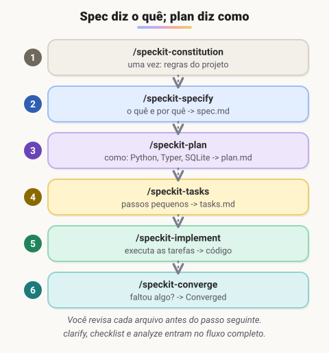
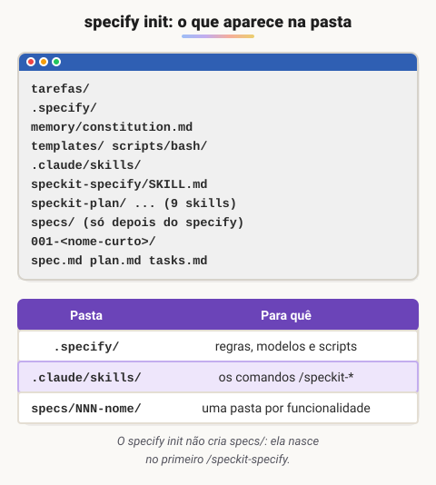
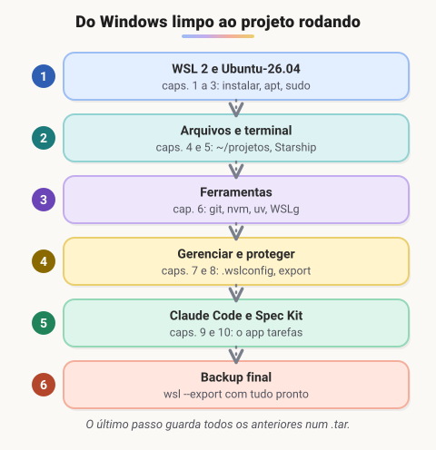

# 10. Projeto final: um app com Spec Kit

> 🗺️ **Neste capítulo:** o projeto final do livro. Você instala o Spec Kit (versão 1.4.0, conferida em 2026-11-15), cria um app de lista de tarefas no terminal seguindo o fluxo especificar, planejar, quebrar em tarefas e implementar com o Claude Code, e fecha o livro com o checklist do ambiente completo e um backup final do Ubuntu.

## De onde paramos

No capítulo anterior você instalou o Claude Code como o seu usuário e aprendeu a controlar o que ele faz sozinho. Falta usá-lo num projeto de verdade. Pedir "faça um app de tarefas" numa frase só costuma dar um resultado que ninguém revisou e que ninguém sabe explicar. Este capítulo mostra um jeito organizado de trabalhar com o assistente, do zero até o app rodando com testes.

## Spec-Driven Development e o Spec Kit

Quando você pede código direto a um assistente, ele precisa adivinhar o que você quer, que tecnologia usar e em que ordem fazer. Cada adivinhação errada só aparece no código, quando corrigir já custa caro.

**Spec-Driven Development (SDD, desenvolvimento guiado por especificação) é escrever primeiro o que o programa deve fazer, depois como fazer, depois a lista de tarefas, e só então o código; o Spec Kit, do GitHub, é o kit de ferramentas que transforma isso em comandos para o assistente.**

A regra de ouro é separar duas perguntas:

|  | Especificação (spec) | Plano (plan) |
| --- | --- | --- |
| Responde | O quê e por quê | Como |
| Exemplo | "Apagar uma tarefa pede confirmação" | "Python com Typer; dados em SQLite" |
| Fala de tecnologia? | Não | Sim |
| Arquivo | `spec.md` | `plan.md` |

Cada etapa gera um arquivo Markdown dentro do projeto. Você lê, corrige e só então passa para a próxima. Se o Claude errar a especificação, você conserta uma frase, e não cem linhas de código.



> 💡 **Analogia:** é contratar uma agência de viagens. As suas regras fixas ("nunca voo de madrugada, sempre seguro-viagem") são a constitution. O pedido ("dez dias na praia, em julho, com as crianças") é a spec: diz o que você quer, sem escolher companhia aérea. A agência devolve o roteiro com voos e hotéis (o plan), depois a lista de reservas a fazer, na ordem (as tasks), e faz as reservas (o implement). No fim, alguém confere as passagens contra o pedido original (o converge) e corrige o que ficou faltando.

**Armadilha comum:** pôr tecnologia na especificação ("um app em Python que..."). Isso mistura as duas perguntas e tira do plano a chance de discutir a escolha. Na spec, descreva o comportamento; deixe Python, Typer e SQLite para o plan.

## Pré-requisitos e instalação do Specify CLI

O Spec Kit tem duas partes: o **Specify CLI**, um programa de terminal (`specify`) que prepara a pasta do projeto, e os **comandos** `/speckit-*`, que o CLI instala dentro do projeto para você usar no Claude Code.

Você já tem quase tudo do livro:

- **Python 3.11 ou mais novo** e o **uv** (capítulo 6). Confira com `python3 --version` e `uv --version`.
- **git** (capítulo 6). Na versão atual, o Spec Kit só exige o git se você ativar a extensão git dele; mesmo assim, vamos usá-lo para guardar cada fase do projeto.
- **Claude Code** instalado e com login (capítulo 9).

**O** `uv tool install` **instala um programa Python num ambiente isolado só dele e põe o comando em** `~/.local/bin`**, sem mexer no Python do sistema e sem** `sudo`**.**

```bash
# instala o CLI a partir do PyPI, como o seu usuário
uv tool install specify-cli

# confere a versão e o ambiente
specify version
specify check
```

O `specify version` mostra a versão do CLI, a do Python e a plataforma. O `specify check` procura, sem usar a internet, os agentes de linha de comando instalados (como o `claude`).

Para fixar uma versão exata, a documentação recomenda instalar do repositório com a tag da versão. A mais recente em 2026-11-15 é a **v1.4.0** (de 10/11/2026):

```bash
# a tag leva o "v" na frente
uv tool install specify-cli \
  --from git+https://github.com/github/spec-kit.git@v1.4.0
```

> ⚠️ O guia do autor indicava a v1.2.3 como a mais recente (22/10/2026). Em 2026-11-15 a versão atual é a v1.4.0. O Spec Kit lança versões quase toda semana: confira a lista em github.com/github/spec-kit/releases antes de fixar uma.

**Armadilha comum:** rodar `uv tool install specify-cli` de novo esperando atualizar. Se o CLI já está instalado, o comando mantém a versão antiga. Para atualizar, use `specify self upgrade` (seção "Extensões e atualização").

## Criar o projeto com specify init

**O** `specify init` **cria a estrutura do Spec Kit numa pasta: regras, modelos, scripts e os comandos para o agente escolhido com** `--integration`**.**

Projeto novo, numa pasta nova dentro de `~/projetos` (capítulo 4):

```bash
cd ~/projetos
# cria a pasta tarefas/ já preparada para o Claude Code
specify init tarefas --integration claude
cd tarefas
```

Pasta que já existe (por exemplo, um projeto que já tem código):

```bash
# --here usa a pasta atual em vez de criar outra;
# se ela já tiver arquivos, o init avisa e pede
# confirmação (--force pula a pergunta)
specify init --here --integration claude
```

Projeto que já usa o Spec Kit com outro agente: `specify integration install claude`.

Sem o `--integration`, o `specify init` pergunta qual agente usar num menu. No Linux, os scripts gerados são em bash (`--script sh`, o padrão fora do Windows).

> ⚠️ O guia do autor já usava `--integration claude`, e está certo. Tutoriais antigos usam `--ai claude`: essa opção foi removida na versão 0.10.0 e não existe mais no `specify init`.

### O que é criado



> 💡 **Analogia:** pense num fichário escolar novo. A folha da capa, com o regulamento da escola, é o `.specify/memory/constitution.md`. O bloco de folhas-modelo pautadas no fundo do fichário são os `.specify/templates/`. As abas coloridas que abrem cada seção são os comandos em `.claude/skills/`. E as divisórias por matéria (`specs/001-...`, `specs/002-...`) só aparecem quando você começa a estudar a primeira matéria.

| Pasta ou arquivo | Conteúdo |
| --- | --- |
| `.specify/memory/constitution.md` | Princípios do projeto (preenchidos pelo `/speckit-constitution`) |
| `.specify/templates/` e `.specify/scripts/bash/` | Modelos e scripts que os comandos usam |
| `.specify/feature.json` | Qual funcionalidade está ativa (fica fora do git) |
| `.claude/skills/speckit-*/SKILL.md` | Os comandos `/speckit-*` do Claude Code |
| `specs/NNN-nome/` | Uma pasta por funcionalidade: `spec.md`, `plan.md`, `tasks.md`, `data-model.md`, `contracts/`, `checklists/` |

O `specify init` não cria repositório git nem ramos (*branches*): isso ficou com a extensão git, que é opcional (`specify extension add git`). Neste projeto, você mesmo roda o `git init`.

**Armadilha comum:** rodar `specify init --here --force` numa pasta com trabalho não salvo. Ele mescla arquivos com os seus; faça um commit antes, para poder ver depois o que mudou com `git diff`.

## Os comandos /speckit-*

Os comandos do Spec Kit não são programas do terminal: são **skills** do Claude Code. Você os digita **dentro da sessão do** `claude`, e o texto depois do comando é a sua instrução.

**No Claude Code, os comandos do Spec Kit se chamam** `/speckit-<etapa>`**, com hífen; a forma com ponto (**`/speckit.specify`**) é a notação usada nas páginas de referência e em outros agentes.**

| Comando | Quando usar | Gera |
| --- | --- | --- |
| `/speckit-constitution` | Uma vez por projeto: regras fixas (testes, idioma, restrições) | `constitution.md` |
| `/speckit-specify` | O quê e por quê, sem tecnologia | `spec.md` |
| `/speckit-clarify` | Tirar ambiguidades: até 5 perguntas, respostas gravadas na spec | `spec.md` atualizado |
| `/speckit-plan` | Como: linguagem, bibliotecas, banco, estrutura | `plan.md`, `data-model.md`, `contracts/` |
| `/speckit-checklist` | Checar a qualidade dos requisitos ("testes da spec") | `checklists/` |
| `/speckit-tasks` | Quebrar o plano em tarefas ordenadas, por fases | `tasks.md` |
| `/speckit-analyze` | Conferir se spec, plan e tasks batem (só lê) | Relatório |
| `/speckit-implement` | Executar as tarefas do `tasks.md` | Código |
| `/speckit-converge` | Comparar o código com os arquivos e acrescentar o que faltou | `tasks.md` atualizado |

> ⚠️ Os comandos `/speckit-*` rodam dentro do Claude Code, com login numa conta paga, e não foram executados na produção do livro. As instruções abaixo seguem o guia do autor (executado por ele em out/2026) e a documentação oficial; o que o Claude responde varia a cada execução.

### Fluxo curto e fluxo completo

**Fluxo curto**, para funcionalidades pequenas:

```
/speckit-specify -> /speckit-plan -> /speckit-tasks
-> /speckit-implement -> /speckit-converge
```

**Fluxo completo**, para o que é importante, com três portões de qualidade a mais (clarify, checklist e analyze):

```
/speckit-constitution   (uma vez por projeto)
/speckit-specify -> /speckit-clarify
-> /speckit-plan -> /speckit-checklist
-> /speckit-tasks -> /speckit-analyze
-> /speckit-implement -> /speckit-converge
```

Repita `/speckit-implement` e `/speckit-converge` até o converge responder **Converged**.

**Armadilha comum:** digitar `/speckit-specify` no bash. O bash responde que o comando não existe. Os comandos `/speckit-*` vão na caixa de texto do Claude Code; no terminal ficam só os comandos `specify ...`.

## O projeto guiado: tarefas no terminal

Agora o projeto inteiro, passo a passo: um app de lista de tarefas pela linha de comando, em Python, com Typer (biblioteca para criar comandos de terminal), SQLite (banco de dados num arquivo) e pytest (testes). Você vai seguir o fluxo completo.

### 1. Criar o projeto e o repositório

```bash
# cria o projeto e o repositório git
cd ~/projetos
specify init tarefas --integration claude
cd tarefas

# o init não cria repositório: guarde o ponto
# de partida antes de o Claude escrever código
git init
git add -A
git commit -m "Spec Kit inicial"

claude
```

Confie na pasta (capítulo 9) e digite `/speckit`: os nove comandos devem aparecer na lista.

### 2. Constitution (uma vez)

```
/speckit-constitution App de linha de comando simples e
offline. Princípios: código legível, testes obrigatórios
para cada funcionalidade, sem dependências
desnecessárias, mensagens ao usuário em português,
código em inglês.
```

Abra `.specify/memory/constitution.md` e confira se as regras ficaram como você quer. Todas as etapas seguintes são avaliadas contra elas.

### 3. Specify: o quê, sem tecnologia

```
/speckit-specify O usuário pode adicionar, listar,
concluir e apagar tarefas pelo terminal. Cada tarefa
tem título, data de criação e prioridade (alta, média,
baixa). A lista pode ser filtrada por prioridade e por
status. Os dados ficam salvos entre execuções.
Critérios: adicionar e listar em menos de 1 segundo;
apagar pede confirmação; título vazio é recusado com
uma mensagem clara.
```

Ele cria a pasta `specs/001-<nome-curto>/` (o nome curto é escolhido a partir da descrição) com o `spec.md`. Leia as histórias de usuário e os requisitos. Trechos marcados com `NEEDS CLARIFICATION` são dúvidas que ele não quis adivinhar.

### 4. Clarify

```
/speckit-clarify
```

Ele faz até cinco perguntas (por exemplo, se uma tarefa concluída pode voltar a pendente) e grava as respostas no `spec.md`. Pode rodar de novo, focando outro assunto.

### 5. Plan: como

```
/speckit-plan Python 3.12 ou mais novo, com Typer para
a linha de comando, SQLite para salvar os dados e
pytest para os testes. Projeto gerenciado com uv.
Estrutura em src/ e tests/.
```

Revise o `plan.md` e o `data-model.md` (a tabela de tarefas e os campos). É aqui que se discute tecnologia.

### 6. Checklist, tasks e analyze

```
/speckit-checklist
/speckit-tasks
/speckit-analyze
```

O checklist cria perguntas sobre a qualidade da spec; marque com `[x]` só o que você revisou. O tasks gera o `tasks.md`, organizado em fases: Setup, Foundational (a base de que tudo depende), uma fase por história de usuário e um Polish no fim. O analyze só lê e aponta conflitos; se ele achar algo, volte à etapa dona do problema (specify, plan ou tasks) e corrija lá.

Leia o `tasks.md` inteiro antes de seguir: é exatamente o roteiro que o Claude vai executar.

### 7. Implement em fases, com commit em cada fase

```
/speckit-implement Execute apenas a fase Setup e pare.
```

Quando ele parar, confira e salve a fase no terminal (com `!` na frente, dá para rodar sem sair do Claude Code):

```bash
# os testes do projeto passam?
uv run pytest

# guarda a fase: se a próxima der errado,
# você volta a este ponto
git add -A
git commit -m "Fase 1: setup"
```

Siga fase por fase: `Execute apenas a fase Foundational e pare.`, depois cada história de usuário, sempre testando e fazendo commit no fim.

### 8. Converge

```
/speckit-converge
```

Ele compara o código com a spec, o plan e as tasks. Se faltou algo, acrescenta tarefas numa seção Convergence do `tasks.md` (sem mexer no código); rode `/speckit-implement` de novo e repita. Quando tudo bater, ele responde **Converged**.

### 9. A próxima funcionalidade

Para acrescentar, por exemplo, uma data de vencimento, volte ao passo 3 com um novo `/speckit-specify`. Ele cria `specs/002-.../`; a constitution continua valendo e não precisa ser refeita.

**Armadilha comum:** mandar `/speckit-implement` sem limite num projeto grande. O Claude tenta fazer tudo de uma vez, o contexto enche e fica difícil revisar. Implemente uma fase por vez, como no passo 7.

## Boas práticas

- **Spec diz o quê, plan diz como.** Nada de tecnologia no `/speckit-specify`.
- **Revise cada arquivo antes de seguir.** Erro na spec vira erro no código.
- **Nunca rode o implement sem ler o** `tasks.md`**.**
- **Uma fase por vez, um commit por fase.** O git é o seu botão de desfazer.
- **Uma funcionalidade por vez.** Cada uma ganha a sua pasta em `specs/`.
- **Use** `/clear` **entre etapas longas** (capítulo 9): os arquivos em `specs/` guardam o progresso, e a conversa nova começa com o contexto vazio.
- **Modo de permissão:** no implement, o modo aceitar edições deixa você acompanhar sem aprovar cada arquivo; nas etapas de texto, o manual basta.

## Extensões e atualização

O Spec Kit traz dois processos extras, instalados como extensões, pelo terminal, dentro da pasta do projeto:

```bash
# avaliar se uma ideia vale a pena (go, needs-
# clarification ou kill), em .specify/assessments/
specify extension add assess

# corrigir um bug sem precisar de spec antes,
# com relatórios em .specify/bugs/
specify extension add bug
```

Eles ganham comandos próprios, como `/speckit-assess-intake` e `/speckit-bug-assess`; só o veredito `verified` do bug confirma a correção. Extensões da comunidade (`specify extension search`) não são auditadas: leia o código antes de instalar.

Para atualizar:

```bash
# só consulta se há versão nova
specify self check

# atualiza o CLI
specify self upgrade

# dentro do projeto: atualiza os comandos e as
# extensões (specs/ e o seu código não são tocados)
specify integration upgrade claude
specify extension update
```

## Encerramento: o ambiente completo

Você começou com um Windows sem Linux e terminou com um projeto especificado, testado e versionado. Antes de guardar tudo, confira o caminho inteiro.



> 💡 **Analogia:** é completar um álbum de figurinhas. Cada página (instalação, terminal, ferramentas, gerenciamento, Claude Code) foi preenchida aos poucos, figurinha por figurinha. Com o álbum completo, o colecionador cuidadoso escaneia todas as páginas e guarda a cópia em outro lugar: se o álbum molhar, ele não recomeça do zero. O backup final é esse escaneamento.

### Checklist do ambiente

- `wsl --version` no PowerShell mostra o WSL e `wsl -l -v` mostra o `Ubuntu-26.04` na versão 2 (caps. 1 e 2)
- O Ubuntu abre com o seu usuário (prompt com `$`) e `sudo apt update` funciona (cap. 3)
- Projetos em `~/projetos`, no disco do Linux, e não em `/mnt/c` (cap. 4)
- Terminal com tema, Nerd Font, Starship e idioma configurados (cap. 5)
- `git`, `node`, `python3` e `uv` respondem com `--version` (cap. 6)
- `.wslconfig` com limites de memória e CPU, se você precisou (cap. 7)
- `claude --version` responde e o `~/.claude/settings.json` é JSON válido (cap. 9)
- `specify check` encontra o `claude`, e o app `tarefas` passa no `uv run pytest` (cap. 10)
- O projeto tem um commit por fase, e o converge respondeu Converged

### Backup final

Com tudo marcado, faça o backup que guarda o ambiente inteiro, exatamente como no capítulo 8 (lá estão os detalhes: `--vhd`, importação, usuário padrão e clone de teste):

```powershell
# no PowerShell, com o Ubuntu fechado
wsl --shutdown
wsl --export Ubuntu-26.04 D:\Backup\wsl-final-2026-11-15.tar
```

Guarde o arquivo fora do disco C:, confira-o importando um clone (Laboratório do capítulo 8) e mantenha o `git push` dos projetos em dia, que é o backup do dia a dia.

**Armadilha comum:** deixar o backup da distro só para "quando der". O ambiente deste livro levou dez capítulos para montar; o export leva minutos. Faça agora e repita antes de qualquer mudança grande.

## 🧪 Laboratório

> ⚠️ Os comandos do Windows deste laboratório vêm do guia do autor (executados em out/2026) e da documentação oficial; não foram executados na produção do livro. Confira a saída no seu computador. Também não foram executados aqui o `specify` (a rede do ambiente bloqueou o PyPI, de onde o uv baixa o CLI e as dependências dele) e os comandos `/speckit-*` (exigem o Claude Code com login). Os passos 1 e 3 rodaram num Ubuntu 24.04 com um usuário comum (`teste`).

Objetivo: conferir os pré-requisitos, instalar o Specify CLI, criar o projeto `tarefas` com o git, rodar a primeira fase e guardar o ambiente.

**1. Conferir os pré-requisitos (Linux).**

```bash
# confere usuário e pré-requisitos
whoami
python3 --version
uv --version
git --version
```

Saída no ambiente do livro (as suas versões serão outras; o Python precisa ser 3.11 ou mais novo):

```
teste
Python 3.13.17
uv 0.11.32 (x86_64-unknown-linux-gnu)
git version 2.43.0
```

**2. Instalar e conferir o Specify CLI (Linux).**

```bash
uv tool install specify-cli
specify version
specify check
```

O `specify version` deve mostrar a versão (1.4.0 ou mais nova) e o `specify check` deve encontrar o `claude`. Se o bash disser `specify: command not found`, falta o `~/.local/bin` no PATH (capítulo 9, mesma correção).

**3. Criar o projeto e o repositório (Linux).**

```bash
# cria o projeto e o repositório git
cd ~/projetos
specify init tarefas --integration claude
cd tarefas
git init -b main
git status
```

Saída do `git init` e do `git status` no ambiente do livro, numa pasta `tarefas` ainda sem os arquivos do Spec Kit:

```
Initialized empty Git repository in /home/teste/projetos/tarefas/.git/
On branch main

No commits yet

nothing to commit (create/copy files and use "git add" to track)
```

No seu computador, depois do `specify init`, o `git status` lista as pastas `.specify/` e `.claude/` como novas. Confira a árvore com `ls -a` e `ls .claude/skills` (as nove pastas `speckit-*`) e faça o primeiro commit:

```bash
git add -A
git commit -m "Spec Kit inicial"
```

**4. Rodar o fluxo no Claude Code.** Abra o `claude` na pasta e siga os passos 2 a 7 do projeto guiado: constitution, specify, clarify, plan, checklist, tasks, analyze e implement da fase Setup. Depois da fase, no terminal:

```bash
# testes passando, commit da fase
uv run pytest
git add -A
git commit -m "Fase 1: setup"
git log --oneline
```

O `git log --oneline` deve listar os dois commits, o mais novo em cima. Continue fase por fase até o converge responder Converged.

**5. Backup final (Windows).** Feche o Ubuntu e, no PowerShell:

```powershell
wsl --shutdown
wsl --export Ubuntu-26.04 D:\Backup\wsl-final-2026-11-15.tar
```

Quando o prompt voltar, confira o arquivo no Explorador e teste-o com um clone, como no capítulo 8.

## 🏋️ Pratique

**1.** Separe as frases entre o `/speckit-specify` e o `/speckit-plan`: (a) "a lista mostra primeiro as tarefas de prioridade alta"; (b) "usar SQLite num arquivo dentro da pasta de dados do usuário"; (c) "apagar uma tarefa pede confirmação"; (d) "os testes usam pytest".

<details>
<summary>Ver resposta</summary>

Specify: (a) e (c), porque descrevem o comportamento que o usuário vê. Plan: (b) e (d), porque escolhem tecnologia. Teste: leia cada frase e pergunte "ela continua verdadeira se eu trocar Python por outra linguagem?". Se sim, é spec; se não, é plan.

</details>

**2.** Você tem uma pasta `~/projetos/agenda` com código e um repositório git, e quer começar a usar o Spec Kit nela com o Claude Code. Quais comandos, e o que fazer antes?

<details>
<summary>Ver resposta</summary>

Primeiro, um commit de tudo, para poder comparar depois. Então, dentro da pasta:

```bash
cd ~/projetos/agenda
git add -A && git commit -m "antes do Spec Kit"
specify init --here --integration claude
```

Como a pasta já tem arquivos, o init avisa e pede confirmação (ou use `--force`). Teste: `git status` mostra `.specify/` e `.claude/` como novas, e `git diff` mostra se algum arquivo seu mudou.

</details>

**3.** Depois do `/speckit-implement`, o `/speckit-converge` respondeu que acrescentou 2 tarefas ao `tasks.md`. O que isso significa e qual é o próximo passo?

<details>
<summary>Ver resposta</summary>

Significa que o código ainda não cumpre tudo o que a spec, o plan e as tasks pedem; o converge não mexeu no código, só anotou o que falta numa seção Convergence do `tasks.md`. Leia as tarefas novas, rode `/speckit-implement` para executá-las, teste, faça commit e rode `/speckit-converge` de novo. Teste: o ciclo termina quando a resposta for Converged e o `tasks.md` não mudar.

</details>

## 🧠 Revisão rápida

**Qual a diferença entre o `specify` e o `/speckit-specify`?**

O `specify` é o CLI, rodado no bash (instalar, `init`, `check`, extensões); o `/speckit-specify` é um comando do Claude Code, digitado na sessão, que escreve a spec.

**Por que implementar uma fase por vez e fazer commit em cada uma?**

Para revisar pouco código de cada vez, não encher o contexto do Claude e ter um ponto seguro para voltar se a fase seguinte der errado.

**O `specify init` cria o repositório git do projeto?**

Não: na versão atual, git e ramos ficam com a extensão git, que é opcional. Rode `git init` você mesmo.

> ➡️ **Próximo passo:** o seu ambiente está completo e guardado em backup. O último capítulo, **11. Próximos livros da trilha**, mostra o que ficou para depois (contêineres, VS Code com WSL, GPU, engenharia reversa) e por onde continuar.

## 📚 Fontes

Conferido em 2026-11-15, com o Spec Kit v1.4.0.

- [Spec Kit no GitHub (README e releases)](https://github.com/github/spec-kit)
- [Installation Guide (Spec Kit docs)](https://github.github.io/spec-kit/installation.html)
- [Spec-Driven Development Quickstart (Spec Kit docs)](https://github.github.io/spec-kit/quickstart.html)
- [Agentic SDD: referência dos comandos (Spec Kit docs)](https://github.github.io/spec-kit/reference/agentic-sdd.html)
- [Core Commands e Upgrade Guide (Spec Kit docs)](https://github.github.io/spec-kit/reference/core.html)
- Guia do autor: [📐Spec Kit com Claude Code](https://app.notion.com/p/Spec-Kit-com-Claude-Code-401345e2044381bcb53ee87e78b634f0?pvs=21)

## 📌 Resumo

| Item | Em uma frase |
| --- | --- |
| SDD | Escrever o quê, depois o como, depois as tarefas, e só então o código |
| Spec x plan | A spec descreve comportamento; o plan escolhe a tecnologia |
| `uv tool install specify-cli` | Instala o Specify CLI como o seu usuário, isolado |
| `specify version` e `specify check` | Mostram a versão e os agentes encontrados |
| `specify init tarefas --integration claude` | Cria o projeto com os comandos para o Claude Code |
| `--here` | Prepara a pasta atual em vez de criar outra |
| `/speckit-*` | Comandos digitados no Claude Code, com hífen |
| Fluxo curto | specify, plan, tasks, implement, converge |
| Fluxo completo | Acrescenta constitution, clarify, checklist e analyze |
| Implement em fases | Uma fase por vez, com teste e commit no fim |
| Converged | O código cumpre a spec, o plan e as tasks |
| `specify self upgrade` | Atualiza o CLI; `integration upgrade` atualiza o projeto |
| Backup final | `wsl --export` com o ambiente completo, guardado fora do C: |
