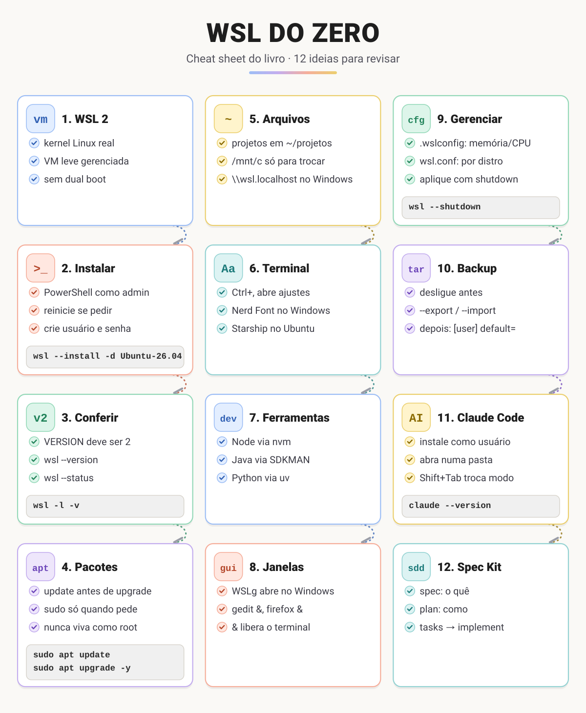

# 11. Próximos livros da trilha

> 🗺️ **Neste capítulo:** o que este livro deixou de fora de propósito e os próximos livros da trilha, para continuar de onde você parou.

## De onde paramos

Você saiu de um Windows sem Linux e chegou a um ambiente completo: Ubuntu no WSL 2, terminal personalizado, ferramentas de desenvolvimento, backup testado, Claude Code e um projeto criado com o Spec Kit. Alguns temas ficaram de fora para o livro continuar curto e para iniciantes. Eles viram os próximos livros.

## Próximos livros

| Livro sugerido | Para quê | Parte de |
| --- | --- | --- |
| Docker do zero | Empacotar aplicações em contêineres; no Windows, o Docker Desktop roda sobre o WSL 2 | cap. 2 e 7 deste livro |
| Contêineres no WSL | Usar contêineres direto no WSL, sem Docker Desktop, e os contêineres nativos do WSL (WSLC) | Docker do zero |
| VS Code com WSL | Editar no Windows com os arquivos e as ferramentas do Linux (extensão WSL) | cap. 4 e 6 |
| GPU no WSL | Usar a placa de vídeo para IA e computação (CUDA) dentro do Linux | cap. 6 e 7 |
| Engenharia reversa com REA e Ghidra | Analisar programas com o Claude Code e ferramentas de engenharia reversa | cap. 6 e 9 |

> 💡 O **Docker do zero** já tem ementa aprovada e é o próximo a ser escrito. Ele indica este livro para quem vai instalar o Docker Desktop no Windows.

## Como pedir o próximo livro

Abra um chat com a skill `criar-livro-tecnologia` e diga o tema. Ela lê o mapa das trilhas, vê o que este livro já cobre e propõe uma ementa que começa daqui, sem repetir o que você já viu.

## 🧠 Revisão rápida

Qual livro vem depois deste na prática?

O Docker do zero: no Windows, o Docker Desktop roda sobre o WSL 2 que você montou aqui.

Por que REA e Ghidra ficaram de fora?

São ferramentas avançadas de engenharia reversa; um livro para iniciantes precisa primeiro do ambiente pronto.

Como pedir o próximo livro sem repetir conteúdo?

Com a skill criar-livro-tecnologia: ela lê o mapa das trilhas e propõe uma ementa que começa de onde este livro parou.

> ➡️ **Próximo passo:** escolher um dos livros acima. Se você trabalha com aplicações web ou APIs, o *Docker do zero* é o mais útil agora.

## 🧭 Cheat sheet do livro

As 12 ideias do livro numa folha, para revisar antes de montar um ambiente novo.

## 📌 Resumo

| Item | Em uma frase |
| --- | --- |
| Este livro | Montou um ambiente Linux completo e reproduzível dentro do Windows |
| Próximo da trilha | Docker do zero, já com ementa aprovada |
| Temas futuros | Contêineres no WSL, VS Code com WSL, GPU no WSL, engenharia reversa |
