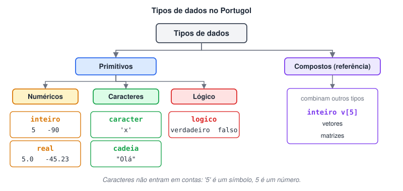

# O que são Tipos de Dados em Lógica de Programação

> 🗺️ **Nesta aula:** o que são dados, por que cada dado tem um tipo, os tipos primitivos (numéricos, caracteres e texto, lógicos) e os compostos, e as palavras de cada tipo no Portugol.

## O que são dados

Dado é qualquer fato que pode ser observado ou medido e depois guardado: uma idade, um nome, uma temperatura, a resposta "sim" ou "não". Para o computador, dados são a matéria-prima que o programa recebe, processa e transforma em informação.

## Tipos de dados

Cada dado tem um **tipo**, que diz ao computador quanto espaço reservar na memória e que operações são permitidas com ele (dá para somar números, mas não nomes).

### Numéricos (tipo primitivo)

Números usados diretamente em cálculos. Dividem-se em dois tipos:

- **Inteiro** (`int`): números sem casa decimal, positivos ou negativos. Ex.: `5`, `-90`, `0`.
- **Real** (`float`): números com casas decimais, positivos ou negativos. Ex.: `5.0`, `-45.23`, `0.333`.

No código, a casa decimal é separada por **ponto**, não por vírgula: `7.5`, e não `7,5`.

### Caracteres e texto (tipo primitivo)

Letras, dígitos e símbolos tratados como texto. Não servem para cálculos, mesmo quando são dígitos: `"10"` é um texto, não o número dez.

- **Caractere** (`char`): um único símbolo, entre aspas simples. Ex.: `'A'`, `'7'`, `'#'`.
- **Cadeia** (`string`): sequência de caracteres (palavra ou frase), entre aspas duplas. Ex.: `"Olá, mundo"`.

### Lógicos (tipo primitivo)

Também chamados de booleanos. Só podem ter dois valores: **verdadeiro** ou **falso** (em muitas linguagens, `true`/`false`, representados internamente por 1 e 0). São o resultado de comparações e controlam as decisões do programa.

### Compostos (ou de referência)

São formados pela combinação de vários dados, primitivos ou compostos. Exemplos que aparecem mais adiante no curso: **vetores** e **matrizes**, que guardam vários valores sob um mesmo nome.

## 📌 Resumo: os tipos no Portugol

| Tipo | Palavra no Portugol | Exemplo de valor |
| --- | --- | --- |
| Inteiro | `inteiro` | `32` |
| Real | `real` | `7.5` |
| Caractere | `caracter` | `'x'` |
| Cadeia (texto) | `cadeia` | `"Ana"` |
| Lógico | `logico` | `verdadeiro` / `falso` |
