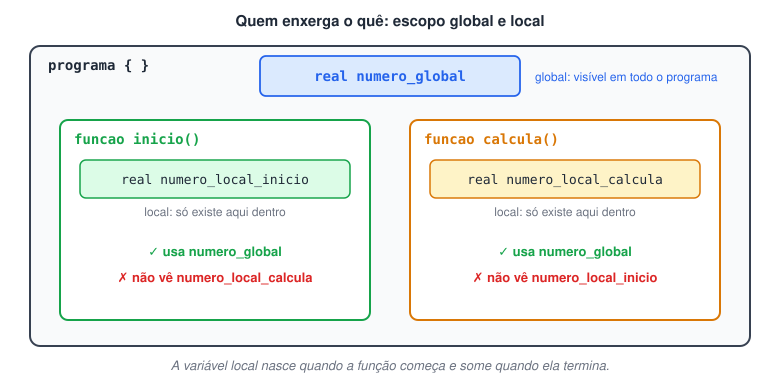

# O que é Escopo de Variáveis?

> 🗺️ **Nesta aula:** o que é escopo (visibilidade e tempo de vida), a diferença entre variáveis globais e locais e um programa que mostra quem enxerga o quê.

## O que é escopo

O **escopo** de uma variável é a região do programa onde ela existe e pode ser usada. Ele define duas coisas:

- **Visibilidade**: quais partes do código conseguem acessar a variável.
- **Tempo de vida**: por quanto tempo ela ocupa espaço na memória.

Uma variável só pode ser usada dentro do escopo em que foi criada. Fora dele, para o programa, ela não existe.

## Variáveis globais e locais

|  | Variável global | Variável local |
| --- | --- | --- |
| Onde é declarada | No início do programa, fora de qualquer função (no Portugol, logo após `programa {`) | Dentro de uma função |
| Quem enxerga | Todo o programa (escopo amplo) | Só a função onde foi declarada (escopo restrito) |
| Tempo de vida | Do início ao fim da execução do programa | Só enquanto a função está sendo executada |
| Uso típico | Compartilhar um dado entre várias funções | Guardar valores de trabalho de uma única função |



> 💡 Use variáveis globais com moderação. Elas ocupam memória durante toda a execução, e como qualquer função pode alterá-las, um valor errado numa global é mais difícil de rastrear na depuração. Prefira variáveis locais e passe valores entre funções quando possível.

## Projeto: testando o escopo no Portugol

**Código**

```c
programa
{
  // Escopo global
  real numero_global

  funcao inicio()
  {
    // Escopo local de inicio()
    numero_global = 10.0                // inicio() enxerga a global
    real numero_local_inicio = 12.0     // só existe dentro de inicio()

    escreva("O número global é: ", numero_global, "\n")
    escreva("O número local de inicio é: ", numero_local_inicio, "\n")
    escreva("numero_local_calcula x numero_global = ", calcula(), "\n")
    escreva("Foi tudo! Agora, segue o baile.\n")
  }

  funcao real calcula()   // função que devolve um valor real
  {
    real numero_local_calcula = 5.0     // local de calcula()
    retorne numero_local_calcula * numero_global   // calcula() também enxerga a global
    // numero_local_inicio não pode ser usado aqui: pertence a inicio()
  }
}
```

Saída:

```
O número global é: 10.0
O número local de inicio é: 12.0
numero_local_calcula x numero_global = 50.0
Foi tudo! Agora, segue o baile.
```

## 📌 Resumo

| Conceito | Em uma frase |
| --- | --- |
| Escopo | Região do programa onde a variável existe e pode ser usada |
| Global | Declarada fora das funções; vista por todas e vive o programa inteiro |
| Local | Declarada dentro de uma função; só existe enquanto ela roda |
| Boa prática | Prefira locais; use globais só para dados compartilhados |
