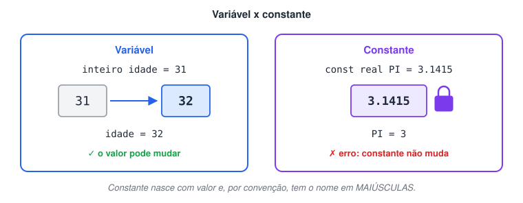

# Estudo complementar de Constantes

> 🗺️ **Nesta aula:** a diferença entre variável e constante, quando usar constantes e como declarar uma com `const` no Portugol.

## Variáveis x constantes

|  | Variável | Constante |
| --- | --- | --- |
| O valor pode mudar? | Sim, quantas vezes for preciso durante a execução | Não: é definido uma vez e fica fixo até o fim |
| Quando recebe o valor | Pode ser declarada agora e receber o valor depois | Precisa receber o valor **na própria declaração** |
| Convenção de nome | minúsculas (`nota_final`) | MAIÚSCULAS (`PI`, `TAXA_JUROS`) |



Use constantes para valores que não devem mudar: o valor de π, uma taxa fixa, a nota mínima de aprovação. Além de proteger o valor (o programa dá erro se alguém tentar alterá-lo), o nome deixa o código mais legível: `MEDIA_MINIMA` diz mais que um `7` solto no meio do código.

> 💡 Assim como as variáveis, as constantes podem ser locais ou globais.

## Como declarar

```c
const tipo NOME_DA_CONSTANTE = valor
```

## Projeto: criando uma constante

**Código**

```c
programa
{
  const real PI = 3.1415   // declarada e inicializada na mesma linha

  funcao inicio()
  {
    escreva("Aqui usamos a constante para armazenar o valor de Pi: ", PI, "\n")

    // PI = 3.0   ← erro: não é possível alterar o valor de uma constante
  }
}
```

## 📌 Resumo

| Conceito | Em uma frase |
| --- | --- |
| Constante | Valor fixo, definido uma vez e nunca alterado |
| Declaração | `const tipo NOME = valor`, sempre com o valor na mesma linha |
| Nome | Em MAIÚSCULAS, por convenção |
| Para que serve | Proteger valores fixos e deixar o código mais legível |
