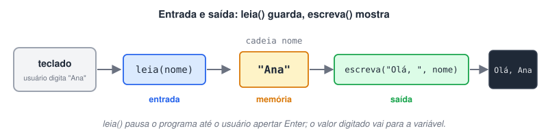

# Entrada e Saída de Dados com Leia e Escreva

> 🗺️ **Nesta aula:** os comandos de entrada (`leia`) e saída (`escreva`), como juntar textos e variáveis, quebrar linhas com `\n` e orientar o usuário antes de cada leitura.

## Os dois comandos

| Comando | Papel | O que faz |
| --- | --- | --- |
| `leia(variavel)` | **Entrada** | Pausa o programa, espera o usuário digitar algo e apertar Enter, e guarda o valor na variável |
| `escreva(...)` | **Saída** | Mostra textos e valores de variáveis no console |



Detalhes do `escreva`:

- Textos fixos vão entre aspas duplas: `escreva("Olá")`.
- Vários itens são separados por **vírgula**: `escreva("Idade: ", idade)`.
- O `escreva` não pula linha sozinho. Para quebrar a linha, inclua `"\n"`.

> 💡 Antes de cada `leia`, use um `escreva` dizendo o que o usuário deve digitar. Sem isso, o programa só para e fica esperando, sem explicar nada.

## Projeto: testando leia e escreva

**Código**

```c
programa
{
  inteiro valor
  cadeia nome

  funcao inicio()
  {
    // Entrada: o que for digitado vai para a variável
    leia(valor)   // espera um número inteiro
    leia(nome)    // espera um texto

    // Saída
    escreva(1, "\n")                                  // sem "\n", tudo sairia na mesma linha
    escreva("O número digitado foi: ", valor, "\n")   // texto fixo entre aspas, vírgula separa os itens
    escreva("O texto digitado foi: ", nome, "\n")
  }
}
```

## Projeto: nome, idade e salário

**Código**

```c
programa
{
  inteiro idade
  cadeia nome
  real salario

  funcao inicio()
  {
    // Entradas, cada uma com uma mensagem de orientação
    escreva("Digite seu nome: ")
    leia(nome)

    escreva("Digite sua idade (só o número): ")
    leia(idade)

    escreva("Digite seu salário (use ponto para os centavos, ex.: 2500.50): ")
    leia(salario)

    // Saída dos dados digitados
    escreva("\nSeu nome é: ", nome, "\n")
    escreva("Sua idade é: ", idade, "\n")
    escreva("O valor do seu salário é: R$ ", salario, "\n")
  }
}
```

Exemplo de execução:

```
Digite seu nome: Ana
Digite sua idade (só o número): 28
Digite seu salário (use ponto para os centavos, ex.: 2500.50): 3200.0

Seu nome é: Ana
Sua idade é: 28
O valor do seu salário é: R$ 3200.0
```

## 📌 Resumo

| Item | Em uma frase |
| --- | --- |
| `leia(x)` | Espera o usuário digitar e guarda o valor em `x` |
| `escreva(...)` | Mostra textos e valores no console |
| Vários itens | Separados por vírgula: `escreva("Idade: ", idade)` |
| `"\n"` | Quebra a linha (o `escreva` não pula sozinho) |
| Boa prática | Um `escreva` explicando o que digitar antes de cada `leia` |
