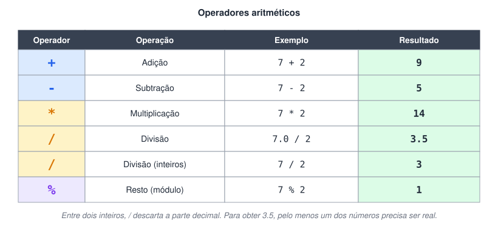
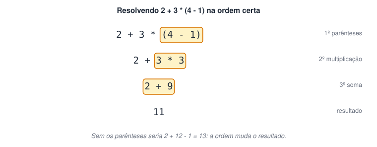
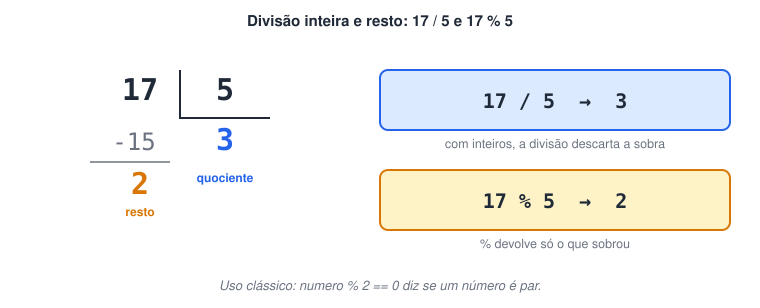
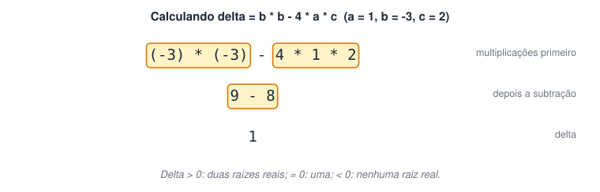

# Operadores e Expressões Aritméticas

> 🗺️ **Nesta aula:** os cinco operadores aritméticos, a ordem de precedência, o operador de resto e três projetos: calculadoras por operação, calculadora com menu e o delta da equação do segundo grau.

## Os operadores



Uma **expressão aritmética** combina valores, variáveis e operadores e sempre produz um número: `media = (n1 + n2) / 2`.

## Ordem de precedência

Como na matemática, as operações não são feitas da esquerda para a direita, e sim nesta ordem:

1. Parênteses `( )`. Em programação só se usam parênteses (nada de colchetes ou chaves); para agrupar mais de um nível, coloque parênteses dentro de parênteses.
2. Potências e raízes (no Portugol, por funções da biblioteca `Matematica`, vistas mais adiante).
3. Multiplicação `*`, divisão `/` e resto `%`.
4. Adição `+` e subtração `-`.

Operadores com a mesma prioridade são resolvidos da esquerda para a direita.



## O operador de resto (%)

O `%` devolve o que sobra de uma divisão inteira. Só funciona com inteiros.



## Projeto: uma calculadora para cada operação

Os cinco programas seguem o mesmo modelo, mudando só o operador:

**Soma**

```c
programa
{
  real a, b, soma

  funcao inicio()
  {
    escreva("Digite um número: ")
    leia(a)

    escreva("Digite outro número: ")
    leia(b)

    soma = a + b

    escreva("\nO resultado da soma é: ", soma, "\n")
  }
}
```

**Subtração**

```c
programa
{
  real a, b, sub

  funcao inicio()
  {
    escreva("Digite um número: ")
    leia(a)

    escreva("Digite outro número: ")
    leia(b)

    sub = a - b

    escreva("\nO resultado da subtração é: ", sub, "\n")
  }
}
```

**Multiplicação**

```c
programa
{
  real a, b, multi

  funcao inicio()
  {
    escreva("Digite um número: ")
    leia(a)

    escreva("Digite outro número: ")
    leia(b)

    multi = a * b

    escreva("\nO resultado da multiplicação é: ", multi, "\n")
  }
}
```

**Divisão**

```c
programa
{
  real a, b, div

  funcao inicio()
  {
    escreva("Digite um número: ")
    leia(a)

    escreva("Digite outro número: ")
    leia(b)

    div = a / b   // com real, 7 / 2 dá 3.5; se b for 0, o programa dá erro

    escreva("\nO resultado da divisão é: ", div, "\n")
  }
}
```

**Resto**

```c
programa
{
  inteiro a, b, mod   // % só funciona com inteiros

  funcao inicio()
  {
    escreva("Digite um número: ")
    leia(a)

    escreva("Digite outro número: ")
    leia(b)

    mod = a % b

    escreva("\nO resto da divisão é: ", mod, "\n")
  }
}
```

## Projeto: calculadora com escolha de operação

Este projeto já usa o `se ... senao se`, estudado em detalhe na seção de estruturas de decisão.

**Código**

```c
programa
{
  inteiro a, b, operacao

  funcao inicio()
  {
    escreva("Digite um número: ")
    leia(a)

    escreva("Digite outro número: ")
    leia(b)

    escreva("\nEscolha a operação:\n")
    escreva("1 - soma | 2 - subtração | 3 - multiplicação | 4 - divisão | 5 - resto\n")
    leia(operacao)

    se (operacao == 1) {
      escreva("Soma: ", a + b, "\n")
    } senao se (operacao == 2) {
      escreva("Subtração: ", a - b, "\n")
    } senao se (operacao == 3) {
      escreva("Multiplicação: ", a * b, "\n")
    } senao se (operacao == 4) {
      escreva("Divisão inteira: ", a / b, "\n")
    } senao se (operacao == 5) {
      escreva("Resto: ", a % b, "\n")
    } senao {
      escreva("Opção inválida. As opções são de 1 a 5.\n")
    }
  }
}
```

> 💡 Em relação à versão original, cada conta passou a ser feita só no ramo escolhido (antes, as cinco eram calculadas sempre) e o resultado não é mais guardado na própria variável `operacao`. A mensagem de opção inválida também passou a citar as 5 opções.

## Projeto: delta da equação do segundo grau (Δ)

Para uma equação `ax² + bx + c = 0`, o delta é `Δ = b² - 4ac`. Como a multiplicação vem antes da subtração, a fórmula pode ser escrita sem parênteses: `b * b - 4 * a * c`.



**Código**

```c
programa
{
  inteiro a, b, c, delta

  funcao inicio()
  {
    escreva("Cálculo do Δ de uma equação do segundo grau\n")

    escreva("Digite o valor de a: ")
    leia(a)

    escreva("Digite o valor de b: ")
    leia(b)

    escreva("Digite o valor de c: ")
    leia(c)

    escreva("\nA equação ficou: ", a, "x² + ", b, "x + ", c, " = 0")

    delta = b * b - 4 * a * c

    escreva("\nO Δ da equação é: ", delta, "\n")
  }
}
```

## 📌 Resumo

| Item | Em uma frase |
| --- | --- |
| Operadores | Soma `+`, subtração `-`, multiplicação `*`, divisão `/`, resto `%` |
| Precedência | Parênteses, depois potência/raiz, depois `*` `/` `%`, por fim soma e subtração |
| Empate | Mesma prioridade: da esquerda para a direita |
| Resto `%` | O que sobra da divisão inteira; só com inteiros |
| Divisão | Entre inteiros descarta a parte decimal; entre reais, não |
| Delta | `b * b - 4 * a * c` dispensa parênteses |
