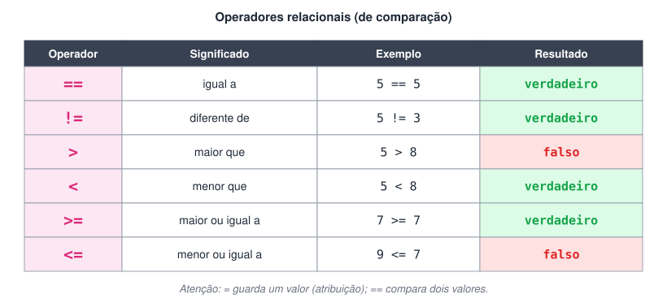
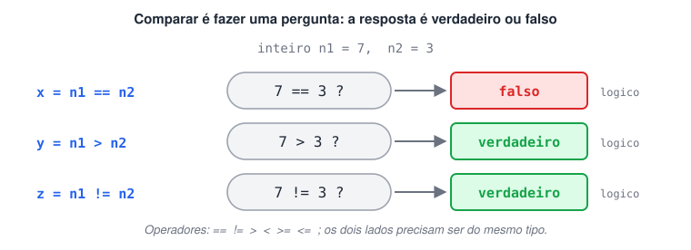

# Como usar Operadores e Expressões Relacionais (ou de Comparação)

> 🗺️ **Nesta aula:** os seis operadores de comparação, por que o resultado é sempre um valor lógico e um programa que compara dois números.

## O que são operadores relacionais

São os operadores que **comparam dois valores** (operandos): o da esquerda com o da direita. Toda comparação funciona como uma pergunta de sim ou não, e por isso o resultado é sempre um valor **lógico**: `verdadeiro` ou `falso`.

- Comparam números, caracteres e cadeias, desde que os dois lados sejam de tipos compatíveis.
- O resultado pode ser guardado numa variável `logico` ou usado direto numa decisão (`se`), como veremos na próxima seção.

## Os operadores





## Projeto: comparando dois números

**Código**

```c
programa
{
  logico x, y, z    // guardam as respostas das comparações
  inteiro n1, n2

  funcao inicio()
  {
    escreva("Digite um número: ")
    leia(n1)

    escreva("Digite outro número: ")
    leia(n2)

    x = n1 == n2   // n1 é igual a n2?
    escreva("\nOs números ", n1, " e ", n2, " são iguais? ", x, "\n")

    y = n1 > n2    // n1 é maior que n2?
    escreva("O número ", n1, " é maior que ", n2, "? ", y, "\n")

    z = n1 != n2   // n1 é diferente de n2?
    escreva("Os números ", n1, " e ", n2, " são diferentes? ", z, "\n")
  }
}
```

Digitando 7 e 3:

```
Os números 7 e 3 são iguais? falso
O número 7 é maior que 3? verdadeiro
Os números 7 e 3 são diferentes? verdadeiro
```

## 📌 Resumo

| Operador | Pergunta |
| --- | --- |
| `==` | É igual? (não confunda com `=`, que atribui) |
| `!=` | É diferente? |
| `>` / `<` | É maior? / É menor? |
| `>=` / `<=` | É maior ou igual? / É menor ou igual? |
| Resultado | Sempre `verdadeiro` ou `falso` |
