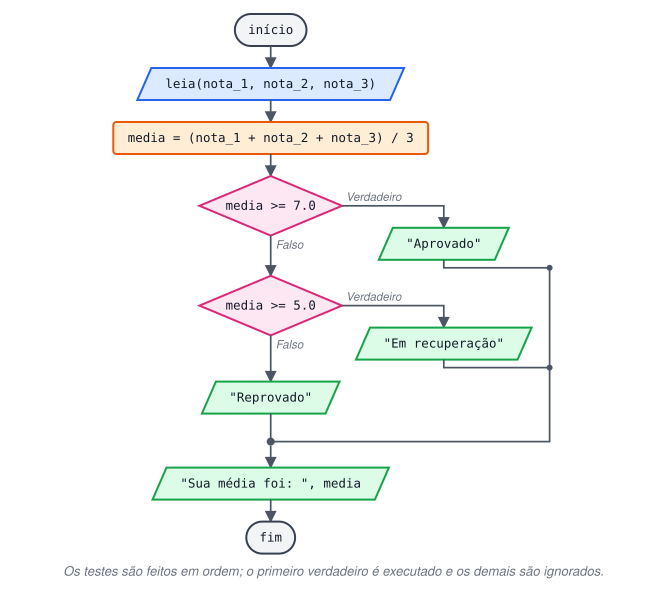
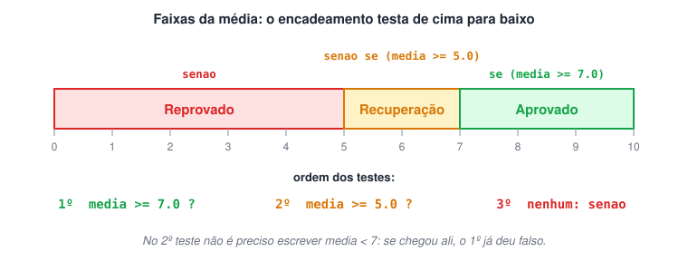
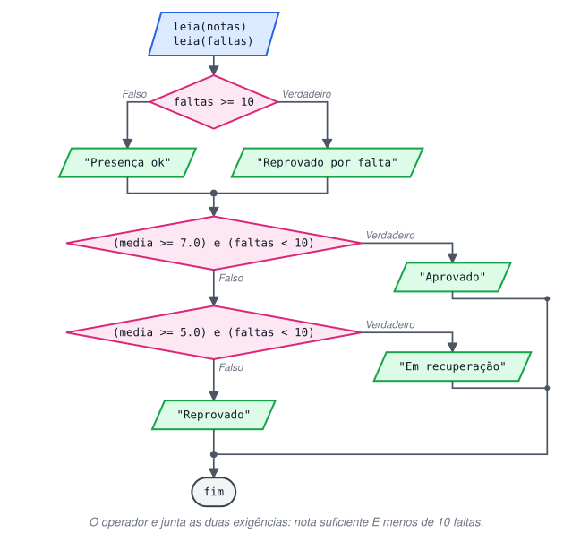

# Estrutura de Decisão Condicional Encadeada (SE, SENÃO SE, SENÃO)

> 🗺️ **Nesta aula:** como encadear condições com `senao se` quando há mais de dois caminhos, por que a ordem dos testes importa e o desafio da média com faltas.

## Decisão encadeada: se / senao se / senao

Quando há mais de dois caminhos possíveis, encadeamos várias condições:

- O programa testa as condições **em ordem**, de cima para baixo.
- Executa o bloco da **primeira condição verdadeira** e ignora todas as demais, mesmo que alguma delas também fosse verdadeira.
- O `senao` final é opcional e funciona como "nenhuma das anteriores": só é executado se todas as condições forem falsas.

> 💡 Entre o primeiro `se` e o `senao` final cabem quantos `senao se` forem necessários.

```c
se (condicao_1) {
  // condição 1 verdadeira
}
senao se (condicao_2) {
  // condição 1 falsa e condição 2 verdadeira
}
senao se (condicao_3) {
  // condições 1 e 2 falsas e condição 3 verdadeira
}
senao {
  // todas as condições falsas
}
// executado sempre, depois da cadeia
```



Como os testes são feitos em ordem, o segundo não precisa repetir o limite superior: se o programa chegou ao `media >= 5.0`, já se sabe que a média é menor que 7.



## Projeto: média com se / senao se / senao

**Código**

```c
programa
{
  real nota_1, nota_2, nota_3
  real media

  funcao inicio()
  {
    escreva("Digite a primeira nota: ")
    leia(nota_1)
    escreva("Digite a segunda nota: ")
    leia(nota_2)
    escreva("Digite a terceira nota: ")
    leia(nota_3)

    media = (nota_1 + nota_2 + nota_3) / 3

    se (media >= 7.0) {             // 1º teste
      escreva("Resultado: Aprovado, chefe!\n")
    }
    senao se (media >= 5.0) {       // 2º teste (só chega aqui se media < 7)
      escreva("Em recuperação! Calma que ainda dá.\n")
    }
    senao {                         // todos os testes falsos
      escreva("Reprovado. Esse ano não deu, mas ano que vem tem mais.\n")
    }

    escreva("Sua média foi: ", media, "\n")
  }
}
```

## Desafio: média e faltas

Calcule a média e verifique também as faltas: com 10 faltas ou mais, o aluno é reprovado independentemente da nota.



<details>
<summary>Ver resposta</summary>

```c
programa
{
  real nota_1, nota_2, nota_3
  real media
  inteiro faltas

  funcao inicio()
  {
    escreva("Digite a primeira nota: ")
    leia(nota_1)
    escreva("Digite a segunda nota: ")
    leia(nota_2)
    escreva("Digite a terceira nota: ")
    leia(nota_3)
    escreva("Digite a quantidade de faltas: ")
    leia(faltas)

    media = (nota_1 + nota_2 + nota_3) / 3

    // 1ª decisão: frequência
    se (faltas >= 10) {
      escreva("\nReprovado por falta, independentemente da nota.\n")
    }
    senao {
      escreva("\nVocê está dentro do limite de faltas.\n")
    }
    escreva("Quantidade de faltas: ", faltas, "\n")

    // 2ª decisão: resultado final (nota E presença)
    se ((media >= 7.0) e (faltas < 10)) {
      escreva("Resultado: Aprovado, chefe!\n")
    }
    senao se ((media >= 5.0) e (faltas < 10)) {
      escreva("Em recuperação! Calma que ainda dá.\n")
    }
    senao {
      escreva("Reprovado. Esse ano não deu, mas ano que vem tem mais.\n")
    }

    escreva("Sua média foi: ", media, "\n")
  }
}
```

</details>

## 📌 Resumo

| Item | Em uma frase |
| --- | --- |
| `senao se` | Testa outra condição quando as anteriores foram falsas |
| Ordem | Os testes são feitos de cima para baixo; vale a primeira condição verdadeira |
| Limites | Cada teste já sabe que os anteriores falharam, então não precisa repeti-los |
| `senao` final | Opcional; roda quando todas as condições são falsas |
| Várias regras | Combine condições com `e`/`ou` (média e faltas) |
