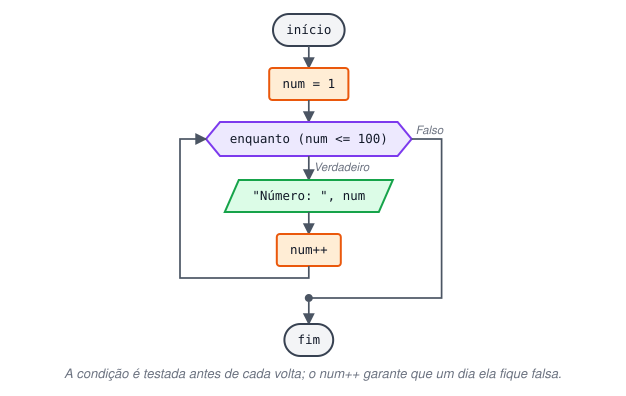
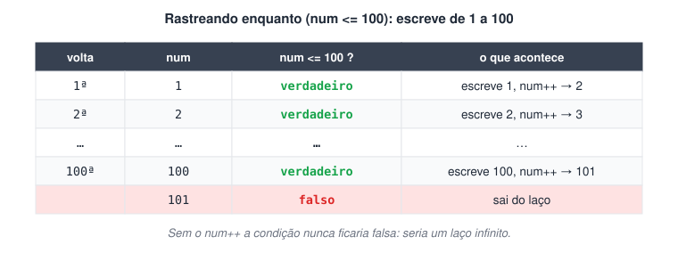
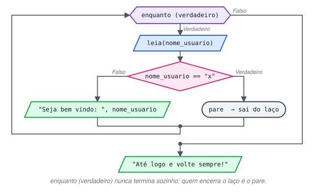

# Laço de Repetição “Enquanto”

> 🗺️ **Nesta aula:** o que é um laço de repetição, como funciona o `enquanto`, o risco do laço infinito e duas formas de repetir até o usuário pedir para sair (com e sem `pare`).

## Laços de repetição

Muitas vezes um trecho do programa precisa ser executado várias vezes: mostrar 100 números, pedir dados até o usuário digitar "sair", somar os valores de uma lista. Em vez de copiar o código, usamos um **laço de repetição** (ou *loop*), que repete um bloco quantas vezes forem necessárias.

## O laço enquanto

O `enquanto` testa uma condição **antes** de cada volta:

- Se a condição for **verdadeira**, executa o bloco e volta para testar de novo.
- Se for **falsa**, o laço termina e o programa segue para a instrução seguinte.
- Se a condição já começar falsa, o bloco não é executado nenhuma vez.

É o laço indicado quando **não se sabe de antemão** quantas repetições serão necessárias.

```c
enquanto (condicao) {
  // repetido enquanto a condição for verdadeira
}
// executado quando a condição ficar falsa
```

> 💡 Dentro do laço, alguma coisa precisa mudar para que a condição um dia fique falsa: um contador que aumenta, um novo valor lido do usuário. Sem isso, o programa entra em **laço infinito** e nunca termina.



## Projeto: escreva de 1 a 100



**Código**

```c
programa
{
  inteiro num

  funcao inicio()
  {
    num = 1   // valor inicial

    enquanto (num <= 100) {
      escreva("Número: ", num, "\n")
      num++   // sem isso, num seria 1 para sempre: laço infinito
    }
  }
}
```

## Projeto: boas-vindas a vários usuários

O programa pede nomes até o usuário digitar `x`. Como não se sabe quantos nomes virão, o `enquanto` é a escolha natural. Há duas formas de montar o laço.

### Forma 1: ler antes do laço e no final de cada volta

**Código**

```c
programa
{
  cadeia nome

  funcao inicio()
  {
    escreva("Digite seu nome (ou x para sair): ")
    leia(nome)   // 1ª leitura, antes do laço

    enquanto (nome != "x") {
      escreva("Bem-vindo, ", nome, "!\n")

      escreva("\nDigite seu nome (ou x para sair): ")
      leia(nome)   // nova leitura a cada volta
    }
    escreva("\nHasta la vista, baby!\n")
  }
}
```

### Forma 2: laço infinito encerrado com pare

`enquanto (verdadeiro)` cria um laço que nunca termina sozinho. Quem o encerra é o `pare`, que sai do laço na hora e continua o programa depois dele.



**Código**

```c
programa
{
  cadeia nome

  funcao inicio()
  {
    enquanto (verdadeiro) {   // laço infinito proposital
      escreva("Digite seu nome (ou x para sair): ")
      leia(nome)

      se (nome == "x") {
        pare   // sai do laço imediatamente
      }
      escreva("Seja bem-vindo, ", nome, "!\n")
    }
  }
}
```

Versão reestruturada, com despedida no final:

**Código**

```c
programa
{
  cadeia nome_usuario

  funcao inicio()
  {
    enquanto (verdadeiro) {
      escreva("Digite seu nome (ou x para sair): ")
      leia(nome_usuario)

      se (nome_usuario == "x") {
        pare
      }
      senao {
        escreva("Seja bem-vindo, ", nome_usuario, "!\n")
      }
    }
    escreva("\nAté logo e volte sempre!\n")   // executado depois do pare
  }
}
```

> 💡 O `pare` não torna a condição falsa: ele simplesmente pula para fora do laço, como o `break` de outras linguagens. É o mesmo `pare` usado no `escolha`.

## 📌 Resumo

| Item | Em uma frase |
| --- | --- |
| Laço de repetição | Repete um bloco quantas vezes for preciso |
| `enquanto (condicao)` | Testa antes de cada volta; repete enquanto for verdadeira |
| Quando usar | Quando não se sabe de antemão quantas voltas serão |
| Laço infinito | Acontece se nada dentro do laço muda a condição |
| `enquanto (verdadeiro)` com `pare` | Laço infinito proposital, encerrado de dentro |
| `pare` | Sai do laço na hora, como o `break` |
