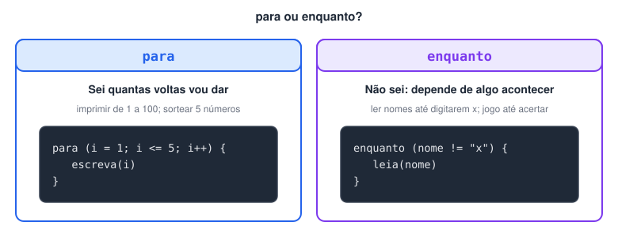
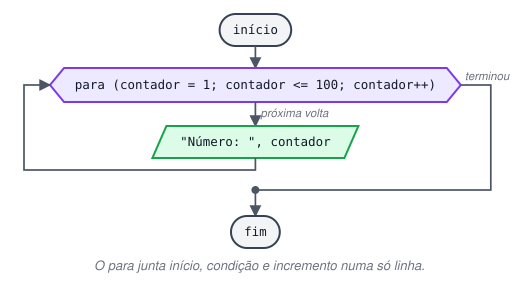
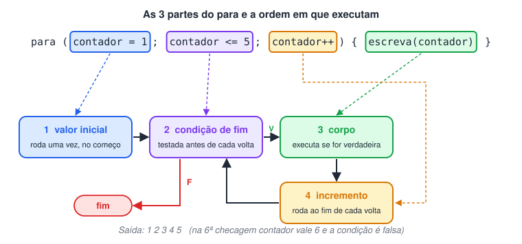
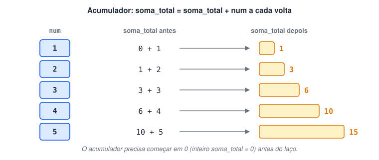

# Laço de Repetição “Para”

> 🗺️ **Nesta aula:** o laço `para` e suas três partes, quando preferi-lo ao `enquanto`, sorteios em sequência e a variável acumuladora para somar valores.

## O laço para

O `para` é o laço indicado quando **se sabe de antemão quantas repetições** serão feitas: 100 números, 5 sorteios, uma volta para cada item de um vetor. Ele concentra numa só linha tudo o que controla a repetição.

O `enquanto`, por outro lado, é usado quando o número de repetições depende de algo que só se descobre durante a execução.



## Sintaxe

```c
para (inicializacao; condicao; incremento) {
  // repetido enquanto a condição for verdadeira
}
```

- **Inicialização**: executada uma única vez, no começo. Define o valor inicial do contador (`i = 1`).
- **Condição**: testada antes de cada volta. Enquanto for verdadeira, o bloco é executado (`i <= 100`).
- **Incremento**: executado no fim de cada volta. Atualiza o contador (`i++`).





## Projeto: escreva de 1 a 100

**Código**

```c
programa
{
  inteiro contador

  funcao inicio()
  {
    para (contador = 1; contador <= 100; contador++) {
      escreva("Número: ", contador, "\n")
    }
  }
}
```

Compare com a versão em `enquanto` da aula anterior: as mesmas três partes (valor inicial, condição e `++`) estavam espalhadas em três linhas diferentes.

## Projeto: escreva quantos números o usuário pedir

**Código**

```c
programa
{
  inteiro num, quant_num

  funcao inicio()
  {
    escreva("Quantos números você quer? ")
    leia(quant_num)

    para (num = 1; num <= quant_num; num++) {
      escreva("Número: ", num, "\n")
    }
  }
}
```

## Projeto: 5 números para a loteria

Gere 5 números aleatórios entre 1 e 50.

**Código**

```c
programa
{
  inclua biblioteca Util --> u

  inteiro i

  funcao inicio()
  {
    escreva("Seus 5 números da sorte: ")

    para (i = 1; i <= 5; i++) {
      escreva(u.sorteia(1, 50), " ")
    }
    escreva("\n")
  }
}
```

> 💡 Como cada sorteio é independente, o mesmo número pode sair duas vezes. Evitar repetições exige guardar os números já sorteados, o que fica fácil com os vetores, mais adiante no curso.

## Projeto: sorteie quantos números o usuário pedir

**Código**

```c
programa
{
  inclua biblioteca Util --> u

  inteiro quant_num, i

  funcao inicio()
  {
    escreva("Quantos números quer sortear? ")
    leia(quant_num)

    para (i = 1; i <= quant_num; i++) {
      escreva(u.sorteia(1, 50), " ")
    }
    escreva("\n")
  }
}
```

## Projeto: imprimir números e somá-los

Para somar valores dentro de um laço, usa-se uma **variável acumuladora**: ela começa em 0 e, a cada volta, recebe o próprio valor mais o número da vez.



**Código**

```c
programa
{
  inteiro soma_total = 0   // o acumulador precisa começar em zero
  inteiro num, quant_num

  funcao inicio()
  {
    escreva("Quantos números quer imprimir? ")
    leia(quant_num)
    escreva("\nNúmeros:\n")

    para (num = 1; num <= quant_num; num++) {
      se (num <= 9) {
        escreva(0)   // completa com zero à esquerda: 01, 02... 09
      }
      escreva(num, "\n")

      soma_total = soma_total + num   // acumula
    }

    escreva("\nA soma total dos números é: ", soma_total, "\n")
  }
}
```

## 📌 Resumo

| Item | Em uma frase |
| --- | --- |
| `para (ini; cond; inc)` | Controla a repetição inteira numa só linha |
| Inicialização | Roda uma vez, no começo (`i = 1`) |
| Condição | Testada antes de cada volta (`i <= 100`) |
| Incremento | Roda no fim de cada volta (`i++`) |
| Quando usar | Quando se sabe quantas voltas serão |
| Acumulador | Começa em 0 e soma o valor da vez: `soma = soma + num` |
