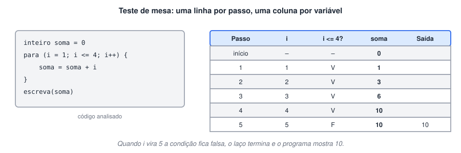

# Teste de mesa: simulando o programa no papel

> ✨ **Página nova.** O curso usa diagramas de rastreio em várias aulas; esta página ensina a técnica por trás deles.

> 🗺️ **Nesta aula:** o que é o teste de mesa, como montar a tabela passo a passo e como usá-lo para achar um erro num laço.

## O que é

O **teste de mesa** é simular a execução de um algoritmo à mão, anotando numa tabela o valor de cada variável a cada passo. Você faz o papel do computador: lê uma instrução, executa, atualiza a tabela e passa para a próxima.

Serve para:

- entender o que um código faz antes de rodá-lo;
- conferir se o algoritmo dá o resultado esperado;
- encontrar erros de lógica, principalmente em laços e decisões.

## Como montar

1. Crie uma coluna para cada variável, uma para as condições importantes e uma para a saída (o que aparece na tela).
2. Escolha valores de entrada para testar.
3. Siga o código linha a linha, sem pular nada. A cada atribuição, anote o novo valor numa nova linha da tabela.
4. Em cada condição, anote se ela deu V ou F e siga o caminho correspondente.
5. No final, compare a saída com o resultado que você esperava.



## Projeto: achando um erro com o teste de mesa

O programa abaixo deveria ler 3 notas e mostrar a média, mas o resultado sai errado.

```c
programa
{
  real nota, soma = 0.0
  inteiro cont = 1

  funcao inicio()
  {
    enquanto (cont < 3) {
      escreva("Nota: ")
      leia(nota)
      soma += nota
      cont++
    }
    escreva("Média: ", soma / 3, "\n")
  }
}
```

Teste de mesa digitando as notas 6, 8 e 10 (média esperada: 8):

| Passo | cont | cont < 3? | nota | soma | Saída |
| --- | --- | --- | --- | --- | --- |
| início | 1 | – | – | 0 |  |
| 1ª volta | 1 → 2 | V | 6 | 6 |  |
| 2ª volta | 2 → 3 | V | 8 | 14 |  |
| teste | 3 | F | – | 14 | Média: 4.67 |

A tabela mostra o problema: com `cont` começando em 1 e a condição `cont < 3`, o laço dá só **duas** voltas. A terceira nota nunca é lida, e a soma de duas notas é dividida por 3.

> 🛠️ **Correção:** usar `cont <= 3` (ou começar `cont` em 0 e manter `cont < 3`). Refazendo o teste de mesa, são três voltas, a soma chega a 24 e a média sai 8.

> 💡 Teste sempre os **limites**: a primeira e a última volta de cada laço e os valores exatos das condições (como 7 em `media >= 7`). A maioria dos erros de laço é de "uma volta a mais ou a menos". Para programas maiores, a depuração do Portugol Studio faz o mesmo trabalho automaticamente.

## 📌 Resumo

| Item | Em uma frase |
| --- | --- |
| Teste de mesa | Simular o programa à mão, anotando as variáveis a cada passo |
| Colunas | Uma por variável, uma por condição importante e uma para a saída |
| Linhas | Uma por passo ou volta do laço |
| Para que serve | Entender o código e achar erros de lógica |
| Onde olhar | Primeira e última volta, valores exatos das condições |
