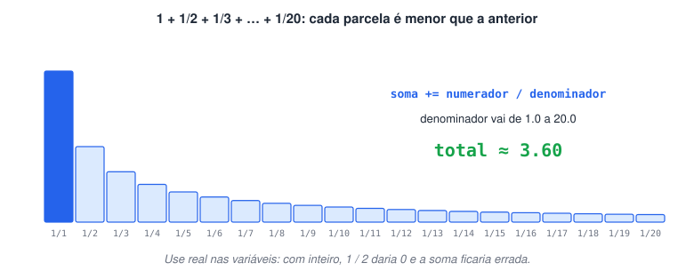
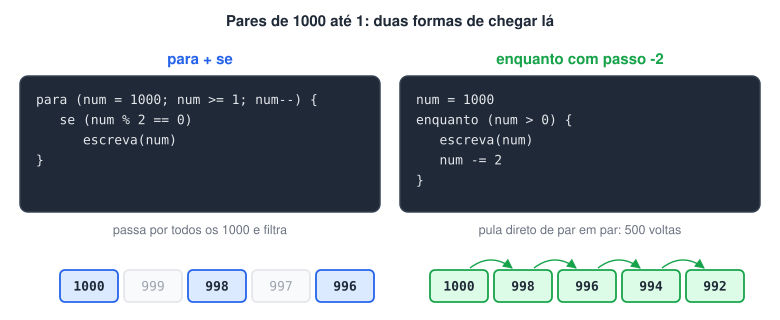
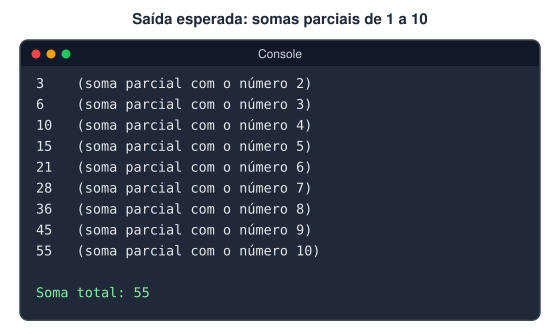
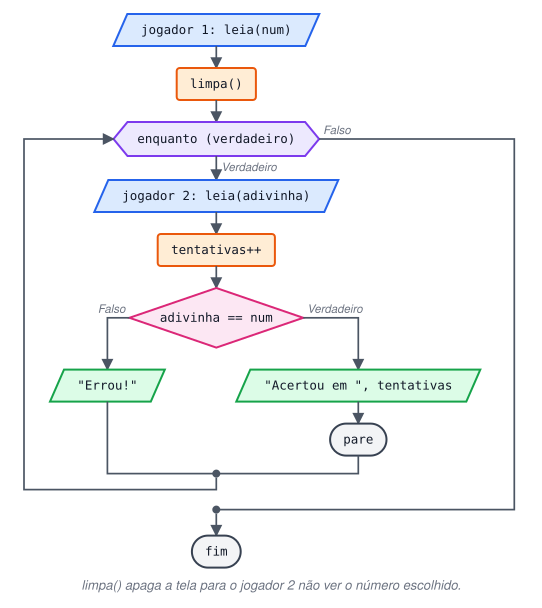
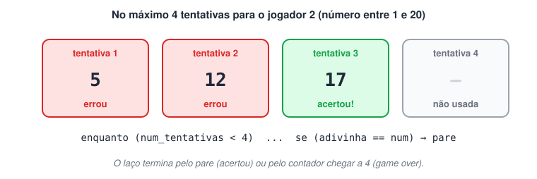
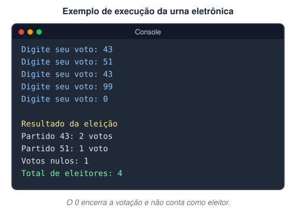
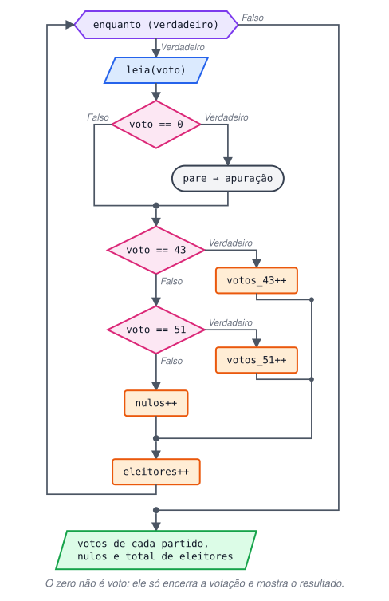
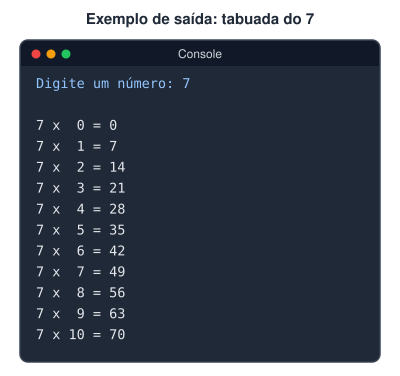
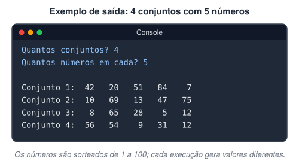

# 3ª Lista de exercícios

> 🗺️ **Nesta lista:** oito exercícios de repetição: somatórios, contagem regressiva, jogos de adivinhação, urna eletrônica, tabuada e conjuntos aleatórios com laços aninhados.

Exercícios sobre laços de repetição (`enquanto`, `para` e laços aninhados).

## Exercício 1: soma de 20 frações

Mostre o somatório da sequência `1 + 1/2 + 1/3 + 1/4 + … + 1/20`.



<details>
<summary>Ver resposta</summary>

```c
programa
{
  inclua biblioteca Matematica --> m   // para arredondar o resultado

  const real NUMERADOR = 1.0
  real denominador
  real soma = 0.0

  funcao inicio()
  {
    para (denominador = 1.0; denominador <= 20.0; denominador++) {
      soma += NUMERADOR / denominador   // soma += x é o mesmo que soma = soma + x
    }

    escreva("Somatório das frações: ", m.arredondar(soma, 2), "\n")   // 3.6
  }
}
```

</details>

## Exercício 2: pares de 1000 até 1

Mostre todos os números pares entre 1000 e 1, em ordem decrescente.



<details>
<summary>Ver resposta: Forma 1: para de 1 em 1, filtrando com se</summary>

```c
programa
{
  inteiro num

  funcao inicio()
  {
    para (num = 1000; num >= 1; num--) {
      se (num % 2 == 0) {
        escreva(num, "\n")
      }
    }
  }
}
```

</details>

<details>
<summary>Ver resposta: Forma 2: enquanto de 2 em 2 (sem teste)</summary>

```c
programa
{
  inteiro num = 1000

  funcao inicio()
  {
    enquanto (num > 0) {
      escreva(num, "\n")
      num -= 2   // pula direto para o próximo par
    }
  }
}
```

</details>

A forma 2 faz metade das voltas e dispensa o `se`, porque já começa num par e anda de 2 em 2.

## Exercício 3: somas parciais de 1 a 10

Some os números de 1 a 10 mostrando as somas parciais e, no final, o total, neste formato:



<details>
<summary>Ver resposta</summary>

```c
programa
{
  inteiro soma_total = 0
  inteiro num

  funcao inicio()
  {
    para (num = 1; num <= 10; num++) {
      soma_total = soma_total + num

      se (num >= 2) {   // a 1ª parcial do enunciado já é 1 + 2
        escreva(soma_total, " (soma parcial com o número ", num, ")\n")
      }
    }
    escreva("Soma total: ", soma_total, "\n")
  }
}
```

</details>

<details>
<summary>Ver resposta: Forma 2 original: com o operador +=</summary>

```c
programa
{
  inteiro num, total = 0

  funcao inicio()
  {
    para (num = 1; num <= 10; num++) {
      total += num
      escreva(total, "\n")   // mostra também a primeira parcial (1)
    }
    escreva("\nA soma total dos números é: ", total, "\n")
  }
}
```

</details>

## Exercício 4: jogo de adivinhação

O jogador 1 escolhe um número entre 1 e 10, e o jogador 2 digita números até acertar.



<details>
<summary>Ver resposta</summary>

```c
programa
{
  inteiro num, adivinha
  inteiro tentativas = 0

  funcao inicio()
  {
    escreva("Jogador 1, digite um número entre 1 e 10: ")
    leia(num)
    limpa()   // apaga a tela para o jogador 2 não ver o número

    enquanto (verdadeiro) {
      escreva("Jogador 2, qual é o número? ")
      leia(adivinha)
      tentativas++

      se (adivinha == num) {
        escreva("\nVocê acertou! O número era: ", num, "\n")
        escreva("Tentativas usadas: ", tentativas, "\n")
        pare
      }
      escreva("Errou! Tente de novo.\n")
    }
  }
}
```

</details>

## Exercício 5: adivinhação com limite

Reescreva o jogo: o jogador 1 só pode escolher números entre 1 e 20, e o jogador 2 tem apenas 4 tentativas.



<details>
<summary>Ver resposta</summary>

```c
programa
{
  const inteiro MAX_TENTATIVAS = 4

  inteiro num, adivinha
  inteiro tentativas = 0
  logico acertou = falso

  funcao inicio()
  {
    // valida a escolha do jogador 1
    enquanto (verdadeiro) {
      escreva("Jogador 1, digite um número entre 1 e 20: ")
      leia(num)
      se (num >= 1 e num <= 20) {
        pare
      }
      escreva("Número inválido! Ele deve estar entre 1 e 20.\n")
    }
    limpa()

    // no máximo 4 tentativas, parando antes se acertar
    enquanto (tentativas < MAX_TENTATIVAS e nao acertou) {
      escreva("Tentativa ", tentativas + 1, " de ", MAX_TENTATIVAS, ". Qual é o número? ")
      leia(adivinha)
      tentativas++

      se (adivinha == num) {
        acertou = verdadeiro
      }
      senao {
        escreva("Errou!\n")
      }
    }

    se (acertou) {
      escreva("\nVocê acertou em ", tentativas, " tentativa(s)!\n")
    }
    senao {
      escreva("\nGame over! O número era ", num, ".\n")
    }
  }
}
```

</details>

> ⚠️ As duas versões originais tinham falhas na contagem. Na 1ª, a mensagem "Você errou!" aparecia também depois do "Game over". Na 2ª, o acerto só era reconhecido quando `num_t == 0`, uma condição que nunca acontece naquele ponto, então acertar não encerrava o jogo. A versão acima usa uma variável `logico` (`acertou`) e decide a mensagem final depois do laço.

## Exercício 6: urna eletrônica

Os partidos válidos são o 43 e o 51. Cada eleitor digita seu voto e tecla Enter, e o programa chama o próximo eleitor. Qualquer outro número é voto **nulo**. Digitar **0** encerra a votação e mostra o resultado: votos de cada partido, votos nulos e total de eleitores.





<details>
<summary>Ver resposta (conforme o enunciado)</summary>

```c
programa
{
  inteiro voto
  inteiro votos_43 = 0, votos_51 = 0, nulos = 0, eleitores = 0

  funcao inicio()
  {
    enquanto (verdadeiro) {
      escreva("Digite seu voto: ")
      leia(voto)

      se (voto == 0) {
        pare   // encerra a votação; 0 não conta como eleitor
      }

      eleitores++
      se (voto == 43) {
        votos_43++
      }
      senao se (voto == 51) {
        votos_51++
      }
      senao {
        nulos++
      }
      limpa()   // voto é secreto
    }

    escreva("\nResultado da eleição\n")
    escreva("Partido 43: ", votos_43, " votos\n")
    escreva("Partido 51: ", votos_51, " votos\n")
    escreva("Votos nulos: ", nulos, "\n")
    escreva("Total de eleitores: ", eleitores, "\n")
  }
}
```

</details>

<details>
<summary>Ver versão estendida: número de eleitores definido antes, com brancos</summary>

```c
programa
{
  inteiro num_eleitores, voto, i
  inteiro brancos = 0, nulos = 0, votos_13 = 0, votos_22 = 0

  funcao inicio()
  {
    escreva("Digite o número de eleitores: ")
    leia(num_eleitores)

    para (i = 1; i <= num_eleitores; i++) {
      limpa()
      escreva("Digite o seu voto: ")
      leia(voto)

      se (voto == 13) {
        votos_13++
      }
      senao se (voto == 22) {
        votos_22++
      }
      senao se (voto == 0) {
        brancos++
      }
      senao {
        nulos++
      }
      limpa()
    }

    escreva("Resultado da eleição\n")
    escreva("Total de votantes: ", num_eleitores, "\n")
    escreva("Votos válidos: ", votos_13 + votos_22, "\n")
    escreva("Brancos e nulos: ", brancos + nulos, "\n\n")
    escreva("Partido 13: ", votos_13, "\n")
    escreva("Partido 22: ", votos_22, "\n")

    se (num_eleitores == 0) {
      escreva("\nNão houve eleitores. Eleição inválida.\n")
    }
    senao se (votos_13 == 0 e votos_22 == 0) {
      escreva("\nNenhum partido recebeu votos.\n")
    }
    senao se (votos_13 > votos_22) {
      escreva("\nO partido 13 venceu.\n")
    }
    senao se (votos_22 > votos_13) {
      escreva("\nO partido 22 venceu.\n")
    }
    senao {
      escreva("\nEmpate: haverá 2º turno.\n")
    }
  }
}
```

</details>

> 💡 A variação original difere do enunciado: pergunta antes quantos eleitores vão votar, usa os partidos 13 e 22 e trata o 0 como voto branco em vez de fim da votação. Também reorganizei a ordem dos testes do resultado: no original, o caso "nenhum voto" vinha depois do "empate" e nunca era alcançado.

## Exercício 7: tabuada

Pergunte um número ao usuário e mostre a tabuada dele:



<details>
<summary>Ver resposta (versão original, que repete até digitar 0)</summary>

```c
programa
{
  inteiro num_tab, i

  funcao inicio()
  {
    enquanto (verdadeiro) {
      escreva("Digite um número de 1 a 9 para ver a tabuada (0 para sair): ")
      leia(num_tab)

      se (num_tab >= 1 e num_tab <= 9) {
        limpa()
        escreva("Tabuada do ", num_tab, ":\n")
        para (i = 0; i <= 10; i++) {
          escreva(num_tab, " x ", i, " = ", num_tab * i, "\n")
        }
      }
      senao se (num_tab == 0) {
        limpa()
        escreva("Até a próxima!\n")
        pare
      }
      senao {
        limpa()
        escreva(num_tab, " é uma opção inválida\n")
      }
      escreva("\n")
    }
  }
}
```

</details>

## Exercício 8: conjuntos de números

Pergunte quantos conjuntos o usuário quer gerar e quantos números cada conjunto terá (por exemplo, 10 conjuntos de 3 números, ou 5 de 9). Mostre os conjuntos com números aleatórios:



<details>
<summary>Ver resposta</summary>

```c
programa
{
  inclua biblioteca Util --> u

  inteiro i, j, quant_conj, quant_num

  funcao inicio()
  {
    // repete a pergunta até receber valores válidos
    enquanto (verdadeiro) {
      escreva("Quantos conjuntos? ")
      leia(quant_conj)
      escreva("Quantos números em cada? ")
      leia(quant_num)

      se (quant_conj >= 1 e quant_num >= 1) {
        pare
      }
      limpa()
      escreva("As duas quantidades precisam ser maiores que zero.\n\n")
    }

    escreva("\n")
    para (i = 1; i <= quant_conj; i++) {          // um conjunto por volta
      escreva("Conjunto ", i, ":\t")
      para (j = 1; j <= quant_num; j++) {       // um número por volta
        escreva(u.sorteia(1, 100), "\t")
      }
      escreva("\n")
    }
  }
}
```

</details>

## 📌 Resumo

| Exercício | O que pratica |
| --- | --- |
| 1. Soma de frações | Acumulador com `+=` e `m.arredondar()` |
| 2. Pares de 1000 a 1 | Laço decrescente; andar de 2 em 2 evita o teste |
| 3. Somas parciais | Mostrar o acumulador a cada volta |
| 4. Adivinhação | `enquanto (verdadeiro)` com `pare` e contador de tentativas |
| 5. Adivinhação com limite | Validar a entrada e usar uma variável `logico` como flag |
| 6. Urna eletrônica | Vários contadores e valor de parada (0) |
| 7. Tabuada | `para` dentro de `enquanto` com menu |
| 8. Conjuntos | `para` dentro de `para` |
