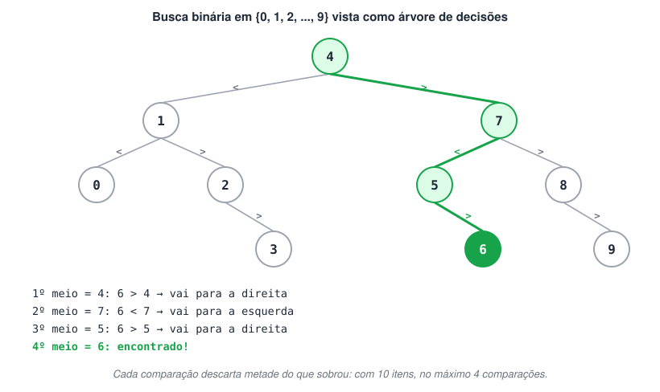
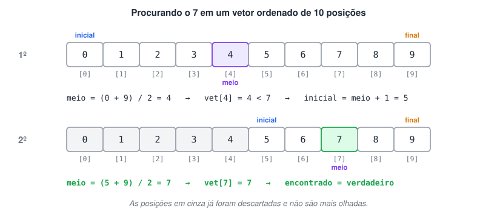
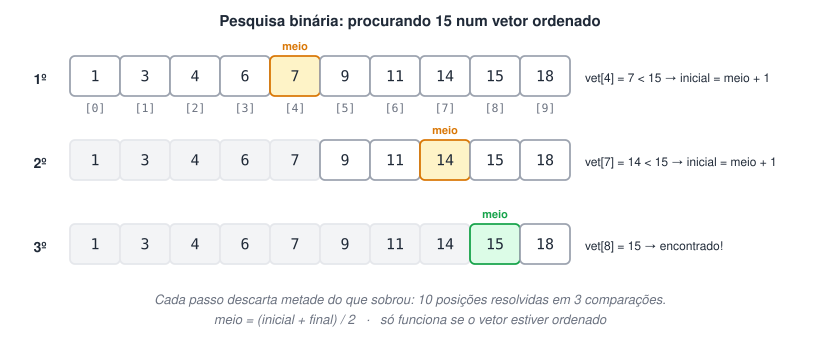

# Algoritmo de pesquisa binária em vetores

**Calculadora de log₂ (Omni)**

🔗 [Log Base 2 Calculator](https://www.omnicalculator.com/math/log-2)

> 🗺️ **Nesta aula:** como a pesquisa binária divide o vetor ao meio a cada passo, por que ele precisa estar ordenado, o papel de cada variável e um projeto que sorteia, ordena e pesquisa.

## Pesquisa binária

A pesquisa binária procura um valor num vetor **ordenado** dividindo o espaço de busca ao meio a cada passo:

1. Compara o valor procurado com o elemento do **meio** do trecho que ainda pode contê-lo.
2. Se for igual, encontrou.
3. Se o procurado for **menor**, descarta a metade da direita; se for **maior**, descarta a da esquerda.
4. Repete com a metade que sobrou, até encontrar ou até não sobrar nada.

É um exemplo do paradigma **dividir para conquistar**. Num vetor de 1.000 posições, a pesquisa linear pode precisar de 1.000 comparações; a binária, de no máximo 10 (porque 2¹⁰ = 1.024). Por isso a calculadora de log₂ acima: o número máximo de passos é log₂(n), arredondado para cima.

> 📎 A pesquisa binária **só funciona se o vetor estiver ordenado** (do menor para o maior). Num vetor desordenado, descartar uma metade pode jogar fora justamente o valor procurado. Se o vetor não estiver ordenado, ordene antes (com o selection sort, por exemplo) ou use a pesquisa linear.

## A busca como árvore de decisões

Cada comparação com o meio é uma bifurcação: menor vai para a esquerda, maior vai para a direita. No vetor `{0, 1, 2, ..., 9}`, procurar o 6 percorre o caminho em verde:



## Passo a passo com as variáveis

A implementação usa quatro variáveis:

| Variável | Papel |
| --- | --- |
| `inicial` | primeira posição do trecho que ainda está sendo pesquisado (começa em 0) |
| `final` | última posição desse trecho (começa em tamanho - 1) |
| `meio` | `(inicial + final) / 2`, calculado a cada volta |
| `encontrado` | sinalizador (`logico`) que vira `verdadeiro` quando o valor é achado |

Procurando o 7 no vetor de 0 a 9:



E um caso mais longo, procurando o 15:



## Projeto: sortear, ordenar e pesquisar

Crie um vetor de 10 posições com números aleatórios, ordene do menor para o maior e diga se um número informado pelo usuário está no vetor.

**Código**

```c
programa
{
  inclua biblioteca Util --> u

  inteiro vet[10]

  funcao inicio()
  {
    preenche_ordena_vetor(vet)

    // mostra o vetor ordenado, para conferir
    para (inteiro i = 0; i < 10; i++) {
      escreva(vet[i], " ")
    }
    escreva("\n")

    inteiro inicial = 0
    inteiro final = 9
    inteiro meio
    logico encontrado = falso
    inteiro busca

    escreva("Digite o valor a pesquisar: ")
    leia(busca)

    enquanto ((inicial <= final) e (nao encontrado)) {
      meio = (inicial + final) / 2

      se (vet[meio] == busca) {
        encontrado = verdadeiro
      }
      senao se (vet[meio] > busca) {
        final = meio - 1      // descarta a metade da direita
      }
      senao {
        inicial = meio + 1    // descarta a metade da esquerda
      }
    }

    se (encontrado) {
      escreva("\nSim! O número está no vetor.\n")
    }
    senao {
      escreva("\nNão. O número não está no vetor.\n")
    }
  }

  // preenche com sorteios e ordena (selection sort)
  funcao preenche_ordena_vetor(inteiro vetor[])
  {
    inteiro a, b, aux

    para (a = 0; a < 10; a++) {
      vetor[a] = u.sorteia(1, 20)
    }

    para (a = 0; a < 9; a++) {
      para (b = a + 1; b < 10; b++) {
        se (vetor[a] > vetor[b]) {
          aux = vetor[a]
          vetor[a] = vetor[b]
          vetor[b] = aux
        }
      }
    }
  }
}
```

> 💡 A função `preenche_ordena_vetor` (funções são vistas na seção de sub-rotinas) recebe o vetor como parâmetro. No original, ela misturava o parâmetro `vetor` com a variável global `vet` no preenchimento e na troca. Funcionava só porque os dois eram o mesmo vetor; agora a função usa apenas o parâmetro e tem suas próprias variáveis locais.

## 📌 Resumo

| Item | Em uma frase |
| --- | --- |
| Pesquisa binária | Compara com o meio e descarta a metade que não pode conter o valor |
| Pré-requisito | O vetor precisa estar ordenado |
| Passos | No máximo log₂(n): 10 comparações para 1.000 posições |
| `meio` | `(inicial + final) / 2`, recalculado a cada volta |
| Procurado menor | `final = meio - 1` |
| Procurado maior | `inicial = meio + 1` |
| Fim | Quando acha ou quando `inicial` passa de `final` |
