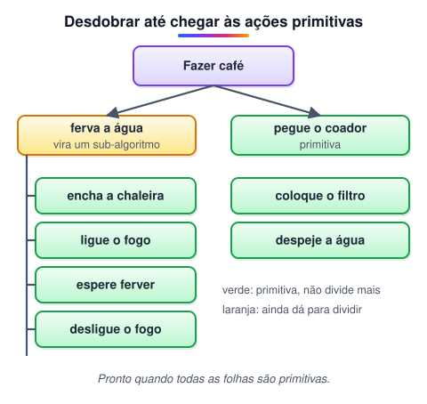
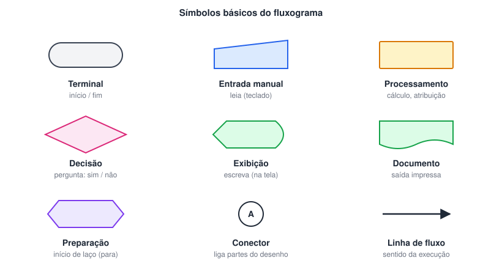
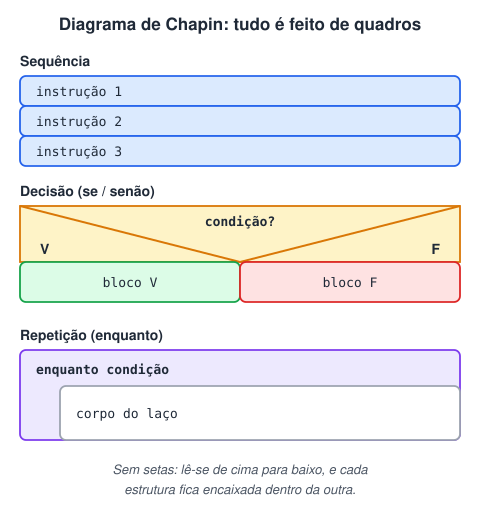
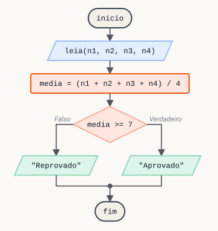
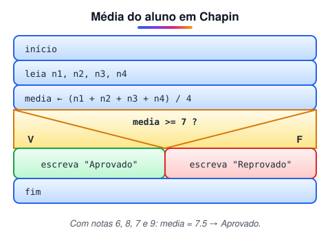

# Algoritmo, Fluxograma e Diagrama de Chapin

> 🗺️ **Nesta aula:** as características de um algoritmo, ações primitivas e não primitivas, e as três formas de representá-lo (português estruturado, fluxograma e diagrama de Chapin), com o mesmo exemplo nas três.

## O que é um algoritmo

Um algoritmo é uma sequência de instruções que:

- é **ordenada**: cada passo vem na hora certa;
- é **finita**: termina em algum momento, num tempo finito;
- **não é ambígua**: cada passo tem um único significado possível;
- pode **se comunicar com o exterior**: receber dados e devolver resultados.

Cada linha deve conter uma única instrução, como numa receita de bolo.

## Exemplo: fazer café com filtro de papel (descrição narrativa)

1. Pegue o coador.
2. Coloque o filtro de papel no coador.
3. Coloque o coador sobre a garrafa térmica.
4. Pegue o pó de café.
5. Coloque três colheres de pó no filtro.
6. Guarde o pó de café.
7. Ferva a água.
8. Despeje a água fervida sobre o pó.
9. Espere a água passar pelo filtro.
10. Descarte o filtro usado.

### Ações primitivas e não primitivas

Algumas ações podem ser quebradas em ações menores. O passo 7 ("ferva a água") é uma ação **não primitiva**: ele é, na verdade, um pequeno algoritmo (um sub-algoritmo):

1. Encha a chaleira com água.
2. Ligue o fogo.
3. Espere a água ferver.
4. Desligue o fogo.

Já "pegue o coador" é uma ação **primitiva**: não dá para dividir em passos menores.



> 💡 O objetivo de um algoritmo computacional é chegar às ações primitivas: refinar cada passo até que ele seja indivisível, porque o computador só executa instruções simples.

## Formas de representar um algoritmo

Antes de escrever o código, planejamos os passos numa representação mais simples. As três mais usadas:

### 1. Português estruturado (foco do curso)

Escreve o algoritmo em português, com **uma instrução por linha**, entre as palavras `início` e `fim`. É a base do Portugol.

### 2. Fluxograma

Representa o algoritmo com formas geométricas ligadas por setas. Cada forma indica um tipo de ação (entrada, processamento, decisão, saída). É ótimo para visualizar algoritmos **curtos**; em algoritmos longos o desenho fica difícil de acompanhar.



### 3. Diagrama de Chapin

Criado por Nassi e Shneiderman e ampliado por Ned Chapin, **substitui as setas do fluxograma por quadros encaixados**. A leitura é sempre de cima para baixo, o que dá uma visão hierárquica e estruturada da lógica e facilita a passagem para o código.



## Exemplo completo nas três formas

**Problema:** calcular a média de um aluno a partir das 4 notas do ano. Com média 7 ou mais, o aluno está aprovado; abaixo de 7, reprovado.

### Em português estruturado

```
início
    leia nota1, nota2, nota3, nota4
    media ← (nota1 + nota2 + nota3 + nota4) / 4
    se media >= 7 então
        escreva "Aprovado"
    senão
        escreva "Reprovado"
    fim se
fim
```

### Em fluxograma



### Em diagrama de Chapin



> ⚠️ Os parênteses em `(n1 + n2 + n3 + n4) / 4` são obrigatórios. Sem eles, só a última nota seria dividida por 4, porque a divisão é feita antes da soma.

## 📌 Resumo

| Conceito | Em uma frase |
| --- | --- |
| Algoritmo | Sequência ordenada, finita e sem ambiguidade, uma instrução por linha |
| Ação primitiva | Não pode ser dividida em passos menores |
| Ação não primitiva | Vira um sub-algoritmo de ações menores |
| Português estruturado | Instruções em português entre `início` e `fim` (base do Portugol) |
| Fluxograma | Formas geométricas ligadas por setas; bom para algoritmos curtos |
| Diagrama de Chapin | Quadros encaixados, lidos de cima para baixo, sem setas |
