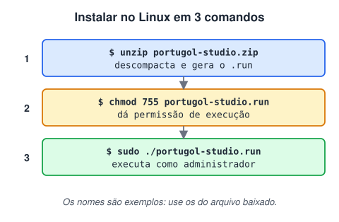

# Como baixar e instalar o Portugol Studio no Windows, Linux e Mac

> 🗺️ **Nesta aula:** as duas formas de usar o Portugol Studio, direto no navegador ou instalado no computador, com os comandos da instalação no Linux.

O Portugol Studio é a ferramenta usada no curso: um editor com a linguagem Portugol (pseudocódigo em português), que executa o programa e mostra os erros em português. Há duas formas de usar.

## Sem instalar: Portugol Webstudio

Roda direto no navegador e serve para todos os exercícios do curso.

🔗 [Portugol Webstudio](https://portugol-webstudio.cubos.io/)

## Instalando no computador

Site oficial da Univali, com o instalador para Windows:

🔗 [Portugol Studio](http://lite.acad.univali.br/portugol/)

Repositório do projeto no GitHub, com instaladores para Windows, Linux e macOS (aba *Releases*):

### Windows e macOS

Baixe o instalador da sua plataforma e siga o assistente de instalação normalmente.

### Linux

Depois de baixar o arquivo compactado, abra o terminal na pasta do download e rode três comandos:



```bash
# 1. Descompactar o arquivo baixado
unzip nome_do_arquivo_portugol.zip

# 2. Dar permissão de execução ao script de instalação que foi extraído
chmod 755 nome_do_script_do_portugol.run

# 3. Executar o instalador como administrador
sudo ./nome_do_script_do_portugol.run
```

> 💡 `chmod 755` deixa o arquivo executável. Sem esse passo, o terminal responde `Permissão negada` ao tentar rodar o script.

## 📌 Resumo

| Opção | Como |
| --- | --- |
| Portugol Webstudio | Abre no navegador, sem instalar nada |
| Windows e macOS | Instalador da Univali ou da aba Releases do GitHub |
| Linux | `unzip` → `chmod 755` → `sudo ./script.run` |
