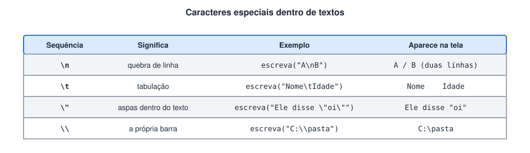

# Recursos do Portugol Studio: comentários, caracteres especiais e depuração

> ✨ **Página nova.** Reúne recursos do Portugol Studio que aparecem nos códigos do curso sem explicação própria.

> 🗺️ **Nesta aula:** comentários, caracteres especiais dentro de textos (`\n`, `\t`, `\"`), o comando `limpa()` e como depurar um programa passo a passo.

## Comentários

Comentários são textos que o programa ignora na execução. Servem para explicar o código para quem vai lê-lo, inclusive você mesmo daqui a alguns meses.

```c
// comentário de uma linha: vai do // até o fim da linha

/* comentário de várias linhas:
   tudo entre a barra-asterisco e o asterisco-barra
   é ignorado */

inteiro idade = 30   // também pode vir depois de um comando
```

> 💡 Um bom comentário explica o **porquê**, não o óbvio. `// soma 1 em i` não ajuda; `// pula o cabeçalho, que está na posição 0` ajuda. Comentários também servem para desativar uma linha temporariamente sem apagá-la.

Ao salvar um arquivo, o Portugol Studio acrescenta no final um bloco `/* $$$ Portugol Studio $$$ ... */` com informações do editor (posição do cursor, trechos dobrados). É um comentário comum e pode ser ignorado.

## Caracteres especiais em textos

Dentro de uma `cadeia`, a barra invertida `\` indica um caractere especial: o que vem logo depois dela não é escrito literalmente.



O `\t` (tabulação) é o jeito mais simples de alinhar colunas, como nas tabelas e matrizes do curso:

```c
escreva("Produto\tQtd\n")
escreva("Arroz\t10\n")
escreva("Feijão\t25\n")
```

## Limpando o console: limpa()

O comando `limpa()` apaga tudo o que já foi escrito no console. Os usos mais comuns no curso:

- esconder um dado, como o número secreto do jogo de adivinhação ou o voto na urna eletrônica;
- mostrar o resultado numa tela limpa, depois de várias perguntas.

```c
escreva("Jogador 1, digite o número secreto: ")
leia(secreto)
limpa()   // o jogador 2 não vê o que foi digitado
```

## Depuração: executando passo a passo

Quando o programa não dá o resultado esperado, a ferramenta de depuração do Portugol Studio deixa você acompanhar a execução linha por linha. É a versão automática do **teste de mesa**.

1. Em vez de **Executar** (Shift + F6), use o botão **Depurar**, ao lado dele na barra de ferramentas.
2. O programa para na primeira linha, que fica destacada. Cada clique em **Depurar** executa a próxima instrução.
3. Para acompanhar valores, arraste variáveis para o **Inspetor de variáveis**, o painel lateral do editor. O valor de cada uma é atualizado a cada passo.
4. Para pular direto até um trecho, clique ao lado do número da linha para criar um **ponto de parada**; a execução para quando chega nele.

> ⚠️ Os nomes dos botões e painéis podem variar um pouco entre versões do Portugol Studio, e o Portugol Webstudio (no navegador) tem menos recursos de depuração. A ideia é a mesma: executar aos poucos e observar as variáveis.

## 📌 Resumo

| Recurso | Para que serve |
| --- | --- |
| `// texto` | Comentário de uma linha |
| `/* texto */` | Comentário de várias linhas |
| `\n` | Quebra de linha dentro do texto |
| `\t` | Tabulação, para alinhar colunas |
| `\"` e `\\` | Aspas e barra invertida dentro do texto |
| `limpa()` | Apaga o console |
| Depurar | Executa uma instrução por vez e mostra as variáveis |
| Ponto de parada | Faz a execução parar numa linha escolhida |
