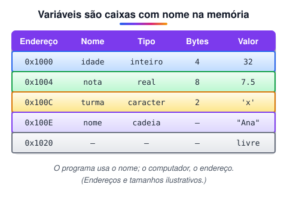
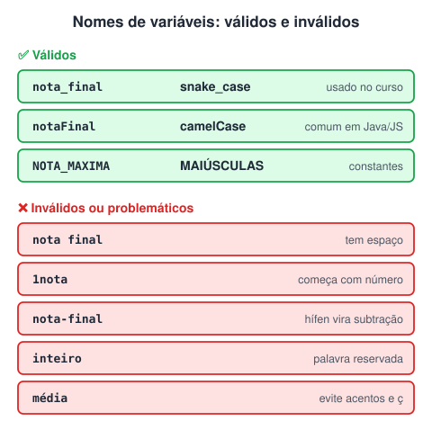
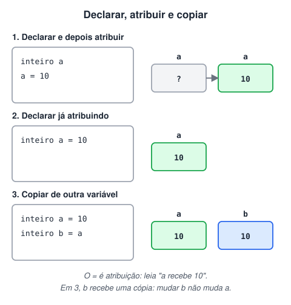
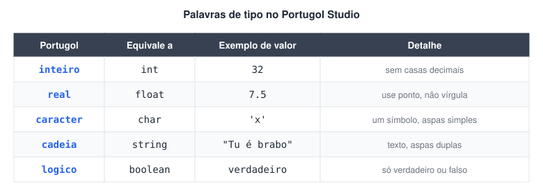

# Declaração e Atribuição de Variáveis em Lógica de Programação

> 🗺️ **Nesta aula:** o que é uma variável e suas cinco características, as regras e convenções de nomes, como declarar e como atribuir valores, com um programa completo no Portugol.

## O que é uma variável

Variável é uma área da memória RAM, identificada por um nome, onde o programa guarda um dado temporariamente enquanto está sendo executado. Toda variável tem:

- **Nome** (identificador): como o programa se refere a ela.
- **Endereço**: a posição dela na memória, um número que o computador usa internamente.
- **Tipo de dado**: primitivo (inteiro, real, caractere, cadeia, lógico) ou composto.
- **Tamanho**: quanto espaço ocupa na memória, que depende do tipo.
- **Valor**: o conteúdo guardado naquele momento. Pode mudar durante a execução, daí o nome "variável".



## Regras para nomes de variáveis

- Pode ter um ou mais caracteres.
- O primeiro caractere precisa ser uma **letra** (ou `_`, em algumas linguagens).
- Pode conter letras, dígitos e `_`, mas **não pode começar com um dígito**: `nota1` é válido, `1nota` não.
- Não pode ter espaços.
- Não pode ter símbolos como `-`, `@`, `!` ou `.`; o `_` é a exceção usada para separar palavras.
- Não pode ser uma palavra reservada da linguagem (`inteiro`, `se`, `programa`…).
- Evite acentos e `ç`: muitas linguagens não aceitam.

Além das regras, escolha nomes que digam o que a variável guarda: `media_final` é melhor que `mf`.

## Nomes compostos

Quando o nome tem mais de uma palavra, usa-se uma convenção para juntá-las sem espaço:



## Declaração: criando a variável

Antes de usar uma variável, é preciso **declará-la**: informar o tipo e o nome. A forma geral é `tipo nome`, e várias variáveis do mesmo tipo podem ser declaradas de uma vez, separadas por vírgula.

```c
// Declarando uma variável
inteiro a

// Declarando várias do mesmo tipo
inteiro a, b, c
```

## Atribuição: guardando um valor

O sinal `=` é o **operador de atribuição**: ele guarda na variável da esquerda o valor da direita. Não é uma comparação de igualdade.

```c
// 1. Declarar e depois atribuir
inteiro a
a = 10

// 2. Declarar já atribuindo (inicializar)
inteiro a = 10

// 3. Atribuir o valor de uma variável a outra (cópia)
inteiro a = 10
inteiro b = a   // b recebe uma cópia de 10; mudar a depois não muda b
```



## Os tipos no Portugol



## Projeto: criando e atribuindo variáveis no Portugol

**Código**

```c
programa
{
	// Variáveis declaradas aqui são GLOBAIS: visíveis em todo o programa

	caracter simbolo             // um único caractere
	cadeia mensagem              // texto (sequência de caracteres)
	real n1, n2, n3, n4          // números com casas decimais; vírgula separa várias variáveis
	logico passa_ou_repassa      // verdadeiro ou falso
	inteiro idade                // número inteiro

	funcao inicio()
	{
		// Variáveis declaradas aqui são LOCAIS: só existem dentro de inicio()
		real media
		cadeia nome
		real notas

		// Atribuindo valores
		simbolo = 'x'                        // caractere: aspas simples
		mensagem = "Tu é brabo, chefe"       // cadeia: aspas duplas
		n1 = 7.5                             // casas decimais com ponto, não vírgula
		n2 = n1                              // copia o valor de n1
		n3 = 8.2
		n4 = 6.9
		notas = n1 + n2 + n3 + n4
		passa_ou_repassa = verdadeiro
		idade = 32
		media = notas / 4
		nome = "Ana Souza"

		// Mostrando no console ("\n" pula uma linha)
		escreva("Turma: ", simbolo, "\n")
		escreva("O nome do aluno é: ", nome, "\n")
		escreva("Sua idade é: ", idade, "\n")
		escreva("Passou? ", passa_ou_repassa, "\n")   // mostra "verdadeiro"
		escreva("Suas notas foram: ", n1, " / ", n2, " / ", n3, " / ", n4, "\n")
		escreva("Sua média foi: ", media, "\n")
		escreva(mensagem, "\n")
	}
}
```

> ⌨️ Para executar o programa no Portugol Studio, use **Shift + F6**.

## 📌 Resumo

| Conceito | Em uma frase |
| --- | --- |
| Variável | Espaço nomeado da memória que guarda um valor que pode mudar |
| Características | Nome, endereço, tipo, tamanho e valor |
| Nome válido | Começa com letra, sem espaços, acentos ou símbolos (exceto `_`), sem palavra reservada |
| Declaração | `tipo nome`, por exemplo `inteiro idade` |
| Atribuição | `=` guarda à esquerda o valor da direita (não compara) |
| Inicialização | Declarar já com valor: `inteiro a = 10` |
| Casas decimais | Com ponto: `7.5` |
