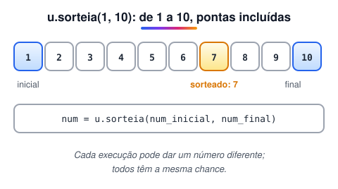

# Gerar números aleatórios com biblioteca “Util”

> 🗺️ **Nesta aula:** o que são números aleatórios (e pseudoaleatórios), a função `u.sorteia` da biblioteca `Util` e dois projetos de sorteio.

## O que é um número aleatório

É um número gerado pelo próprio programa, sem que se saiba de antemão qual será, como no lançamento de um dado. Serve para jogos, sorteios, simulações e testes com dados variados.

A palavra vem do latim *alea*, que quer dizer "dado" ou "sorte". Daí a famosa frase *alea jacta est*: "a sorte está lançada".

> 💡 Na verdade o computador gera números **pseudoaleatórios**: eles vêm de um cálculo matemático, mas a sequência é tão imprevisível que, na prática, funcionam como sorteio.

## No Portugol: u.sorteia()

A função `sorteia` da biblioteca `Util` devolve um número inteiro dentro de um intervalo, **incluindo** os dois extremos.

```c
inclua biblioteca Util --> u

numero = u.sorteia(inicio, fim)   // ex.: u.sorteia(1, 6) simula um dado
```



## Projeto: sorteio no intervalo escolhido

**Código**

```c
programa
{
	inclua biblioteca Util --> u

	inteiro num_inicial, num_final, num_sorteado

	funcao inicio()
	{
		escreva("Digite o primeiro número do intervalo: ")
		leia(num_inicial)

		escreva("Digite o último número do intervalo: ")
		leia(num_final)

		num_sorteado = u.sorteia(num_inicial, num_final)

		escreva("\nO número sorteado entre ", num_inicial, " e ", num_final, " é: ", num_sorteado, "\n")
	}
}
```

## Projeto: vários sorteios no mesmo intervalo

O laço `para` (visto mais adiante) repete o sorteio uma vez para cada número do intervalo: de 1 a 5, por exemplo, são 5 sorteios. Os números podem se repetir, porque cada sorteio é independente dos anteriores.

**Código**

```c
programa
{
	inclua biblioteca Util --> u

	inteiro num_inicial, num_final, sorteado

	funcao inicio()
	{
		escreva("Digite o primeiro número do intervalo: ")
		leia(num_inicial)

		escreva("Digite o último número do intervalo: ")
		leia(num_final)

		escreva("\nSorteios entre ", num_inicial, " e ", num_final, ":\n")

		para (inteiro i = num_inicial; i <= num_final; i++) {
			sorteado = u.sorteia(num_inicial, num_final)
			escreva("Número gerado: ", sorteado, "\n")
		}
	}
}
```

## 📌 Resumo

| Item | Em uma frase |
| --- | --- |
| Aleatório | Número que não se sabe de antemão, como num lançamento de dado |
| Pseudoaleatório | Gerado por cálculo, mas imprevisível na prática |
| `u.sorteia(a, b)` | Inteiro entre `a` e `b`, incluindo os dois extremos |
| Vários sorteios | Cada um é independente; os números podem se repetir |
