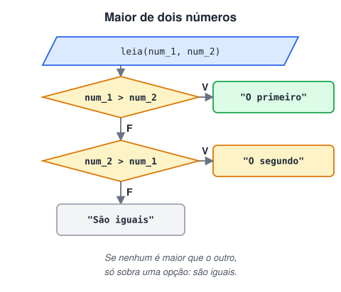
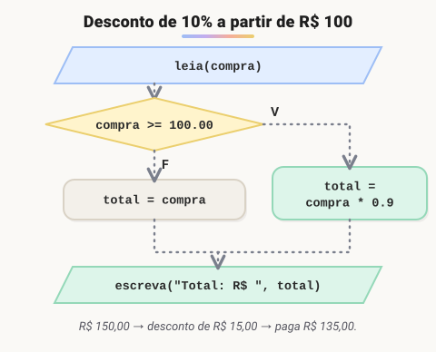
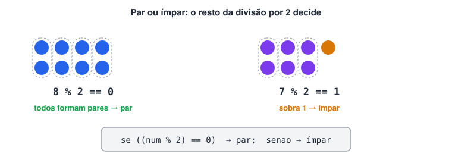
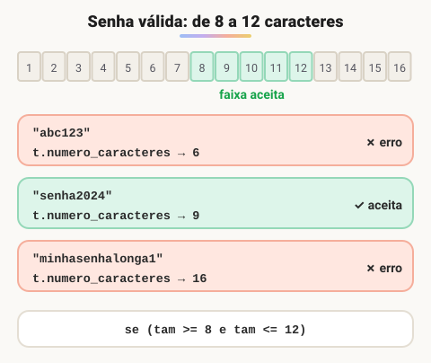
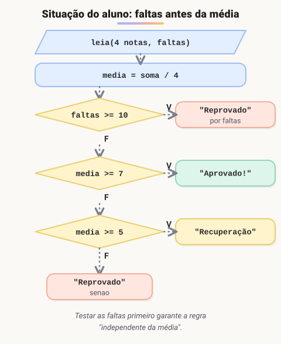

# 2ª Lista de exercícios

> 🗺️ **Nesta lista:** nove exercícios de decisão: comparações, descontos, idades, par ou ímpar, metas, validação de senha, situação do aluno e sorteios.

Exercícios sobre estruturas de decisão (`se`, `senao`, `senao se`, `escolha`). Cada um traz o enunciado e a resolução, que fica recolhida: tente resolver antes de abrir. Quando a resolução original foi além do enunciado, ela aparece como versão estendida.

## Exercício 1: maior e menor

Leia dois números e indique qual é o menor e qual é o maior.



<details>
<summary>Ver resposta</summary>

```c
programa
{
	inteiro num_1, num_2

	funcao inicio()
	{
		escreva("Digite o 1º número: ")
		leia(num_1)
		escreva("Digite o 2º número: ")
		leia(num_2)

		se (num_1 > num_2) {
			escreva("\nMaior: ", num_1, " | Menor: ", num_2, "\n")
		}
		senao se (num_2 > num_1) {
			escreva("\nMaior: ", num_2, " | Menor: ", num_1, "\n")
		}
		senao {
			escreva("\nOs números são iguais.\n")
		}
	}
}
```

</details>

## Exercício 2: a pessoa mais alta

Leia os nomes e as alturas (em metros) de duas pessoas e mostre os dados da mais alta.

<details>
<summary>Ver resposta</summary>

```c
programa
{
	cadeia nome_1, nome_2
	real alt_1, alt_2

	funcao inicio()
	{
		escreva("Nome da 1ª pessoa: ")
		leia(nome_1)
		escreva("Altura da 1ª pessoa (m): ")
		leia(alt_1)
		escreva("Nome da 2ª pessoa: ")
		leia(nome_2)
		escreva("Altura da 2ª pessoa (m): ")
		leia(alt_2)

		se (alt_1 > alt_2) {
			escreva("\nMais alta: ", nome_1, ", com ", alt_1, " m\n")
		}
		senao se (alt_2 > alt_1) {
			escreva("\nMais alta: ", nome_2, ", com ", alt_2, " m\n")
		}
		senao {
			escreva("\n", nome_1, " e ", nome_2, " têm a mesma altura: ", alt_1, " m\n")
		}
	}
}
```

</details>

<details>
<summary>Ver versão estendida: altura e idade</summary>

```c
programa
{
	cadeia nom_1, nom_2
	real alt_1, alt_2
	inteiro idade_1, idade_2

	funcao inicio()
	{
		escreva("Nome da 1ª pessoa: ")
		leia(nom_1)
		escreva("Idade da 1ª pessoa: ")
		leia(idade_1)
		escreva("Altura da 1ª pessoa: ")
		leia(alt_1)
		escreva("\nNome da 2ª pessoa: ")
		leia(nom_2)
		escreva("Idade da 2ª pessoa: ")
		leia(idade_2)
		escreva("Altura da 2ª pessoa: ")
		leia(alt_2)

		// 9 combinações: (mais alta, mesma altura, mais baixa) x (mais velha, mesma idade, mais nova)
		se ((alt_1 > alt_2) e (idade_1 > idade_2)) {
			escreva("\nA primeira pessoa é a mais alta e a mais velha.\n")
		}
		senao se ((alt_1 > alt_2) e (idade_1 < idade_2)) {
			escreva("\nA primeira pessoa é a mais alta, mas não a mais velha.\n")
		}
		senao se ((alt_1 > alt_2) e (idade_1 == idade_2)) {
			escreva("\nA primeira pessoa é a mais alta; as duas têm a mesma idade.\n")
		}
		senao se ((alt_1 < alt_2) e (idade_1 > idade_2)) {
			escreva("\nA segunda pessoa é a mais alta, mas não a mais velha.\n")
		}
		senao se ((alt_1 < alt_2) e (idade_1 < idade_2)) {
			escreva("\nA segunda pessoa é a mais alta e a mais velha.\n")
		}
		senao se ((alt_1 < alt_2) e (idade_1 == idade_2)) {
			escreva("\nA segunda pessoa é a mais alta; as duas têm a mesma idade.\n")
		}
		senao se ((alt_1 == alt_2) e (idade_1 > idade_2)) {
			escreva("\nMesma altura, mas a primeira é a mais velha.\n")
		}
		senao se ((alt_1 == alt_2) e (idade_1 < idade_2)) {
			escreva("\nMesma altura, mas a segunda é a mais velha.\n")
		}
		senao {
			escreva("\nAs duas têm a mesma altura e a mesma idade.\n")
		}

		escreva("1ª pessoa: ", nom_1, ", idade: ", idade_1, ", altura: ", alt_1, "\n")
		escreva("2ª pessoa: ", nom_2, ", idade: ", idade_2, ", altura: ", alt_2, "\n")
	}
}
```

</details>

## Exercício 3: desconto da loja

Uma loja dá 10% de desconto em compras de no mínimo R$ 100,00. Leia o valor da compra e calcule o total a pagar, já com o desconto quando houver.



<details>
<summary>Ver resposta</summary>

```c
programa
{
	real compra, total

	funcao inicio()
	{
		escreva("Valor da compra (R$): ")
		leia(compra)

		se (compra >= 100.00) {
			total = compra - compra * 10 / 100   // tira 10%
		}
		senao {
			total = compra
		}

		escreva("Total a pagar: R$ ", total, "\n")
	}
}
```

</details>

<details>
<summary>Ver versão estendida: descontos de 10%, 20% e 30% (corrigida)</summary>

```c
programa
{
	real compra, valor_desconto, total
	inteiro desconto
	cadeia nome_cliente

	funcao inicio()
	{
		escreva("Nome do cliente: ")
		leia(nome_cliente)
		escreva("Valor da compra (R$): ")
		leia(compra)

		se (compra >= 500.00) {
			desconto = 30
		}
		senao se (compra >= 300.00) {
			desconto = 20
		}
		senao se (compra >= 100.00) {
			desconto = 10
		}
		senao {
			desconto = 0
		}

		valor_desconto = compra * desconto / 100
		total = compra - valor_desconto

		escreva("\nCliente: ", nome_cliente, " | Compra: R$ ", compra, " | Desconto: ", desconto, "%\n")
		escreva("Total a pagar: R$ ", total, "\n")
	}
}
```

</details>

> ⚠️ A versão original calculava `compras / desconto`. Isso divide pelo número 10 em vez de tirar 10%, e com desconto 0 o programa para com erro de divisão por zero. A porcentagem se calcula com `valor * desconto / 100`.

## Exercício 4: quem é a pessoa mais nova

Pergunte o nome e o ano de nascimento de duas pessoas, calcule a idade aproximada de cada uma em relação ao ano atual, mostre nome e idade das duas e indique a mais nova.

<details>
<summary>Ver resposta</summary>

```c
programa
{
	inclua biblioteca Calendario --> c

	cadeia nome_1, nome_2
	inteiro ano_1, ano_2, idade_1, idade_2

	funcao inicio()
	{
		escreva("Nome da 1ª pessoa: ")
		leia(nome_1)
		escreva("Ano de nascimento: ")
		leia(ano_1)
		escreva("Nome da 2ª pessoa: ")
		leia(nome_2)
		escreva("Ano de nascimento: ")
		leia(ano_2)

		idade_1 = c.ano_atual() - ano_1
		idade_2 = c.ano_atual() - ano_2

		escreva("\n", nome_1, ": ", idade_1, " anos\n")
		escreva(nome_2, ": ", idade_2, " anos\n")

		se (idade_1 < idade_2) {
			escreva("A mais nova é ", nome_1, "\n")
		}
		senao se (idade_2 < idade_1) {
			escreva("A mais nova é ", nome_2, "\n")
		}
		senao {
			escreva("As duas têm a mesma idade aproximada.\n")
		}
	}
}
```

</details>

<details>
<summary>Ver versão estendida: data completa, com desempate por mês e dia</summary>

```c
programa
{
	inclua biblioteca Calendario --> c

	cadeia nome_1, nome_2
	inteiro dia_1, mes_1, ano_1, dia_2, mes_2, ano_2, ano_atual
	inteiro idade_1, idade_2

	funcao inicio()
	{
		escreva("Nome da 1ª pessoa: ")
		leia(nome_1)
		escreva("Dia, mês e ano de nascimento (um por linha): ")
		leia(dia_1, mes_1, ano_1)
		escreva("\nNome da 2ª pessoa: ")
		leia(nome_2)
		escreva("Dia, mês e ano de nascimento (um por linha): ")
		leia(dia_2, mes_2, ano_2)

		ano_atual = c.ano_atual()
		idade_1 = ano_atual - ano_1
		idade_2 = ano_atual - ano_2

		// valida as DUAS datas
		se ((dia_1 >= 1 e dia_1 <= 31) e (mes_1 >= 1 e mes_1 <= 12) e (ano_1 <= ano_atual) e
		    (dia_2 >= 1 e dia_2 <= 31) e (mes_2 >= 1 e mes_2 <= 12) e (ano_2 <= ano_atual)) {

			// compara ano; se empatar, o mês; se empatar, o dia
			se (ano_1 > ano_2) {
				escreva("\n", nome_2, " é mais velha (ano de nascimento).\n")
			}
			senao se (ano_1 < ano_2) {
				escreva("\n", nome_1, " é mais velha (ano de nascimento).\n")
			}
			senao se (mes_1 > mes_2) {
				escreva("\n", nome_2, " é mais velha (mês de nascimento).\n")
			}
			senao se (mes_1 < mes_2) {
				escreva("\n", nome_1, " é mais velha (mês de nascimento).\n")
			}
			senao se (dia_1 > dia_2) {
				escreva("\n", nome_2, " é mais velha (dia de nascimento).\n")
			}
			senao se (dia_1 < dia_2) {
				escreva("\n", nome_1, " é mais velha (dia de nascimento).\n")
			}
			senao {
				escreva("\nAs duas nasceram no mesmo dia.\n")
			}

			escreva("\n", nome_1, ": ", dia_1, "/", mes_1, "/", ano_1, ", cerca de ", idade_1, " anos\n")
			escreva(nome_2, ": ", dia_2, "/", mes_2, "/", ano_2, ", cerca de ", idade_2, " anos\n")
		}
		senao {
			escreva("\nData inválida. O dia deve estar entre 1 e 31, o mês entre 1 e 12 e o ano não pode passar do atual.\n")
		}
	}
}
```

</details>

## Exercício 5: par ou ímpar

Leia um número e diga se ele é par ou ímpar. Um número é par quando o resto da divisão por 2 é zero.



<details>
<summary>Ver resposta</summary>

```c
programa
{
	inteiro num

	funcao inicio()
	{
		escreva("Digite um número: ")
		leia(num)

		se (num % 2 == 0) {
			escreva("\n", num, " é par.\n")
		}
		senao {
			escreva("\n", num, " é ímpar.\n")
		}
	}
}
```

</details>

## Exercício 6: meta de vendas

Leia o valor da meta de um funcionário e o valor que ele vendeu. Mostre "Ganhou!" se ele atingiu a meta e "Não ganhou…" se não atingiu.

<details>
<summary>Ver resposta</summary>

```c
programa
{
	real meta, vendas

	funcao inicio()
	{
		escreva("Valor da meta (R$): ")
		leia(meta)
		escreva("Valor vendido (R$): ")
		leia(vendas)

		se (vendas >= meta) {
			escreva("Ganhou!\n")
		}
		senao {
			escreva("Não ganhou…\n")
		}
	}
}
```

</details>

<details>
<summary>Ver versão estendida: vendas por trimestre e comissão</summary>

```c
programa
{
	const real META_ANUAL = 36000.0

	cadeia nome_func
	real tri_1, tri_2, tri_3, tri_4, total_ano, comissao

	funcao inicio()
	{
		escreva("Nome do funcionário: ")
		leia(nome_func)
		escreva("Vendas do 1º trimestre (R$): ")
		leia(tri_1)
		escreva("Vendas do 2º trimestre (R$): ")
		leia(tri_2)
		escreva("Vendas do 3º trimestre (R$): ")
		leia(tri_3)
		escreva("Vendas do 4º trimestre (R$): ")
		leia(tri_4)

		total_ano = tri_1 + tri_2 + tri_3 + tri_4   // é a soma do ano, não uma média

		escreva("\nFuncionário: ", nome_func, "\n")
		escreva("Total vendido no ano: R$ ", total_ano, "\n")

		se (total_ano >= META_ANUAL) {
			comissao = total_ano * 25 / 100   // 5% de comissão + 20% de prêmio
			escreva("Meta de R$ ", META_ANUAL, " batida! Comissão + prêmio: 25%\n")
		}
		senao {
			comissao = total_ano * 5 / 100
			escreva("Meta de R$ ", META_ANUAL, " não foi batida. Comissão: 5%\n")
		}
		escreva("Valor a receber de comissão: R$ ", comissao, "\n")
	}
}
```

</details>

## Exercício 7: validação de senha

Pergunte o login desejado e peça uma senha. A senha deve ter **entre 8 e 12 caracteres**. Fora desse intervalo, mostre uma mensagem de erro. Dentro dele, mostre "usuário XXX criado com sucesso!", onde XXX é o login.



<details>
<summary>Ver resposta (com o teste de login da versão original)</summary>

```c
programa
{
	inclua biblioteca Texto --> t

	cadeia login, senha, teste_login, teste_senha
	inteiro tamanho_senha

	funcao inicio()
	{
		escreva("Login desejado: ")
		leia(login)
		escreva("Senha (de 8 a 12 caracteres): ")
		leia(senha)

		tamanho_senha = t.numero_caracteres(senha)

		se (tamanho_senha >= 8 e tamanho_senha <= 12) {
			escreva("\nUsuário ", login, " criado com sucesso!\n")

			// extra: confere se o usuário lembra os dados
			escreva("\nDigite o login novamente: ")
			leia(teste_login)
			escreva("Digite a senha novamente: ")
			leia(teste_senha)

			se (teste_login == login e teste_senha == senha) {
				escreva("\nLogin e senha conferem com o cadastro.\n")
			}
			senao {
				escreva("\nOs dados digitados não conferem com o cadastro.\n")
			}
		}
		senao {
			escreva("\nErro: a senha tem ", tamanho_senha, " caracteres; ela deve ter de 8 a 12.\n")
		}
	}
}
```

</details>

> ⚠️ A versão original aceitava senhas de 9 a 12 caracteres; o enunciado pede de 8 a 12. A condição foi corrigida para `tamanho_senha >= 8`.

## Exercício 8: situação do aluno

Leia 4 notas e o número de faltas de um aluno, calcule a **média aritmética** e mostre:

- "Aprovado!" se a média for 7 ou mais;
- "Recuperação" se a média estiver entre 5 e 7;
- "Reprovado…" se a média for menor que 5;
- "Reprovado por Faltas" se o aluno tiver 10 faltas ou mais, independentemente da média.



<details>
<summary>Ver resposta</summary>

```c
programa
{
	real nota_1, nota_2, nota_3, nota_4, media
	inteiro faltas

	funcao inicio()
	{
		escreva("Digite a 1ª nota: ")
		leia(nota_1)
		escreva("Digite a 2ª nota: ")
		leia(nota_2)
		escreva("Digite a 3ª nota: ")
		leia(nota_3)
		escreva("Digite a 4ª nota: ")
		leia(nota_4)
		escreva("Quantidade de faltas: ")
		leia(faltas)

		media = (nota_1 + nota_2 + nota_3 + nota_4) / 4

		// as faltas são testadas primeiro, porque reprovam independentemente da média
		se (faltas >= 10) {
			escreva("\nReprovado por Faltas\n")
		}
		senao se (media >= 7) {
			escreva("\nAprovado!\n")
		}
		senao se (media >= 5) {
			escreva("\nRecuperação\n")
		}
		senao {
			escreva("\nReprovado…\n")
		}
		escreva("Média: ", media, " | Faltas: ", faltas, "\n")
	}
}
```

</details>

> 💡 A versão original usava média ponderada (pesos 1, 2, 2 e 3, dividindo por 8). O enunciado pede média aritmética simples: soma das 4 notas dividida por 4.

## Exercício 9: dois números aleatórios

Gere dois números aleatórios entre 1 e 5 e compare-os. Se forem iguais, mostre "Números iguais"; senão, "Os números são diferentes". Mostre também os números gerados.

<details>
<summary>Ver resposta</summary>

```c
programa
{
	inclua biblioteca Util --> u

	inteiro num_1, num_2

	funcao inicio()
	{
		num_1 = u.sorteia(1, 5)
		num_2 = u.sorteia(1, 5)

		escreva("Números sorteados: ", num_1, " e ", num_2, "\n")

		se (num_1 == num_2) {
			escreva("Números iguais\n")
		}
		senao {
			escreva("Os números são diferentes\n")

			// extra da versão original: diz qual é o maior
			se (num_1 > num_2) {
				escreva("O primeiro é maior que o segundo\n")
			}
			senao {
				escreva("O segundo é maior que o primeiro\n")
			}
		}
	}
}
```

</details>

A versão original também pedia para o usuário digitar `start` antes de sortear, um detalhe que não faz parte do enunciado.

## 📌 Resumo

| Exercício | O que pratica |
| --- | --- |
| 1. Maior e menor | `se` / `senao se` / `senao` com o caso de empate |
| 2. Mais alta | Comparar reais e mostrar os dados do vencedor |
| 3. Desconto | Porcentagem: `valor * desconto / 100` |
| 4. Mais nova | `c.ano_atual()` e desempate por mês e dia |
| 5. Par ou ímpar | `num % 2 == 0` |
| 6. Meta de vendas | Decisão composta e constante `META_ANUAL` |
| 7. Senha | `t.numero_caracteres()` e faixa com `e` |
| 8. Situação do aluno | Testar primeiro a regra que vale independentemente das outras (faltas) |
| 9. Sorteio | `u.sorteia()` e decisão dentro de decisão |
