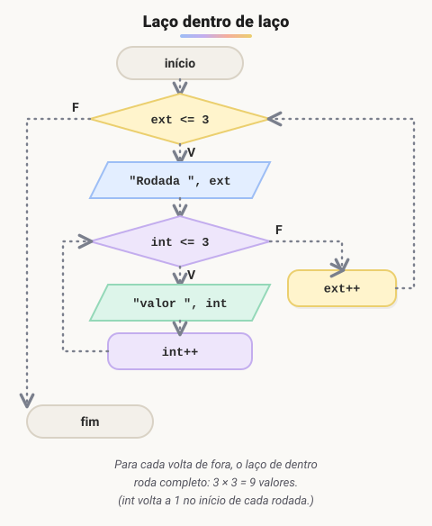
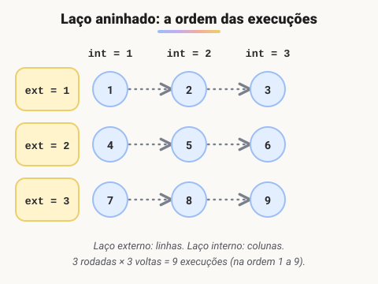
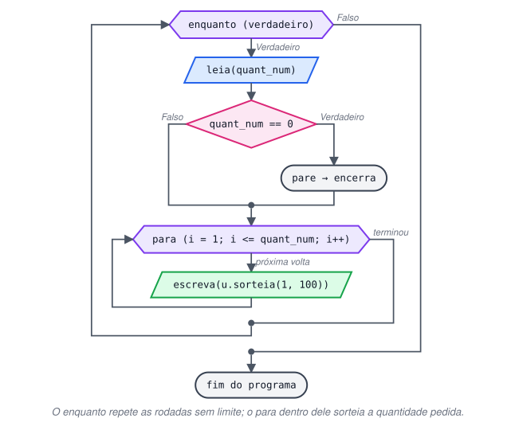

# Encadeamento de Laços de Repetição Para e Enquanto

> 🗺️ **Nesta aula:** como colocar um laço dentro de outro, a ordem em que as voltas acontecem e dois projetos: `para` dentro de `para` e `para` dentro de `enquanto`.

## Laços dentro de laços

Um laço pode ficar dentro de outro. Todas as combinações são possíveis:

- `enquanto` dentro de `enquanto`;
- `para` dentro de `para`;
- `para` dentro de `enquanto`;
- `enquanto` dentro de `para`.

A regra é sempre a mesma: **a cada volta do laço de fora, o laço de dentro é executado do começo ao fim**.

```c
para (la_ext = 1; la_ext <= 3; la_ext++) {
	// comandos do laço externo

	para (la_int = 1; la_int <= 3; la_int++) {
		// comandos do laço interno
	}
}
// 3 voltas externas x 3 voltas internas = 9 execuções do bloco interno
```





## Projeto: 5 valores em cada rodada (para dentro de para)

**Código**

```c
programa
{
	inteiro cont_a, cont_b

	funcao inicio()
	{
		para (cont_a = 1; cont_a <= 5; cont_a++) {        // 5 rodadas
			escreva("Rodada: ", cont_a, "\n")

			para (cont_b = 1; cont_b <= 5; cont_b++) {    // 5 valores por rodada
				escreva("  valor: ", cont_b, "\n")
			}
			escreva("\n")
		}
	}
}
```

## Projeto: sorteios sem fim (para dentro de enquanto)

Pergunte quantos números o usuário quer gerar (cada um aleatório, de 1 a 100), mostre os números e pergunte de novo, quantas vezes ele quiser. O programa termina quando for digitado 0.



**Código**

```c
programa
{
	inclua biblioteca Util --> u

	inteiro quant_num, i

	funcao inicio()
	{
		escreva("Digite 0 para encerrar o programa.\n")

		enquanto (verdadeiro) {                  // externo: repete até digitar 0
			escreva("\nQuantos números deseja sortear? ")
			leia(quant_num)

			se (quant_num == 0) {
				pare
			}

			para (i = 1; i <= quant_num; i++) {  // interno: um sorteio por volta
				escreva(u.sorteia(1, 100), "\n")
			}
		}
	}
}
```

## 📌 Resumo

| Item | Em uma frase |
| --- | --- |
| Laços aninhados | Um laço dentro de outro, em qualquer combinação de `para` e `enquanto` |
| Regra | A cada volta do externo, o interno roda do começo ao fim |
| Total de execuções | Voltas do externo × voltas do interno (3 × 3 = 9) |
| Uso típico | Rodadas com vários itens, tabelas, matrizes |
