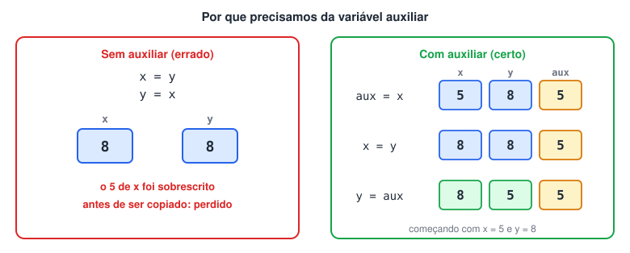
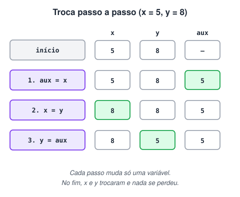

# Rotina de Troca de Valores entre Variáveis

> 🗺️ **Nesta aula:** por que não dá para trocar duas variáveis atribuindo uma à outra e a rotina de troca com variável auxiliar, base dos algoritmos de ordenação.

## O problema

Trocar os valores de duas variáveis entre si é uma tarefa comum: aparece, por exemplo, em todos os algoritmos de ordenação. Mas não dá para fazer a troca atribuindo uma variável diretamente à outra:

```c
x = y   // x perde o valor original...
y = x   // ...e y recebe de volta o próprio valor
```

Ao executar `x = y`, o valor antigo de `x` é sobrescrito e se perde para sempre.



## A solução: uma variável auxiliar

A rotina de troca usa uma terceira variável, `aux`, para guardar temporariamente um dos valores:

1. Copie o valor de `x` para `aux` (agora ele está salvo).
2. Copie o valor de `y` para `x` (pode sobrescrever, porque o valor antigo de `x` está em `aux`).
3. Copie o valor de `aux` para `y`.



> 💡 As três variáveis precisam ser do mesmo tipo: para trocar dois inteiros, `aux` também deve ser `inteiro`.

## Projeto: trocando os valores de x e y

**Código**

```c
programa
{
	inteiro x, y, aux

	funcao inicio()
	{
		escreva("Digite o valor de x: ")
		leia(x)
		escreva("Digite o valor de y: ")
		leia(y)

		escreva("\nAntes da troca: x = ", x, " e y = ", y, "\n")

		// rotina de troca
		aux = x
		x = y
		y = aux

		escreva("Depois da troca: x = ", x, " e y = ", y, "\n")
	}
}
```

## 📌 Resumo

| Item | Em uma frase |
| --- | --- |
| Problema | `x = y` sobrescreve `x`, e o valor antigo se perde |
| Solução | `aux = x`, depois `x = y`, depois `y = aux` |
| Tipo | `aux` precisa ser do mesmo tipo das variáveis trocadas |
| Onde aparece | Em todos os algoritmos de ordenação |
