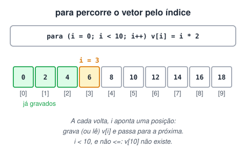
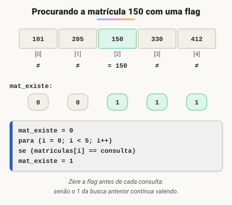

# Manipulação de Vetores com Laço Para

> 🗺️ **Nesta aula:** como usar o contador do `para` como índice para gravar e ler um vetor inteiro, o limite dos índices e dois projetos: média de notas e consulta de matrículas com flag.

## Percorrendo um vetor com para

O laço `para` combina perfeitamente com vetores: o contador do laço serve de **índice**, e a cada volta o programa acessa uma posição diferente, `vetor[i]`. Assim é possível preencher ou ler um vetor inteiro com duas ou três linhas, seja ele de 10 ou de 1.000 posições.

```c
inteiro vetor[10]

// Gravando: cada posição recebe o dobro do seu índice
para (inteiro i = 0; i < 10; i++) {
	vetor[i] = i * 2
}

// Lendo: mostra as 10 posições
para (inteiro i = 0; i < 10; i++) {
	escreva(vetor[i], "\n")
}
```



> ⚠️ Os índices vão de 0 a **tamanho - 1**. Por isso a condição é `i < 10`, e não `i <= 10`: acessar `vetor[10]` num vetor de 10 posições é um erro de índice inválido.

## Projeto: média de 4 notas

Leia 4 notas, calcule a média e mostre, no final, a média e cada uma das notas.

**Código**

```c
programa
{
	real media, soma = 0.0
	inteiro i
	real notas[4]
	cadeia nome_aluno

	funcao inicio()
	{
		escreva("Nome do aluno: ")
		leia(nome_aluno)

		// lê e soma as 4 notas no mesmo laço
		para (i = 0; i < 4; i++) {
			escreva("Digite a ", i + 1, "ª nota: ")   // i + 1 para mostrar 1ª a 4ª, não 0 a 3
			leia(notas[i])
			soma += notas[i]
		}

		media = soma / 4
		limpa()

		escreva("Olá, ", nome_aluno, "\n")
		escreva("Sua média é: ", media, "\n")
		para (i = 0; i < 4; i++) {
			escreva("Nota ", i + 1, ": ", notas[i], "\n")
		}
	}
}
```

## Projeto: cadastro e consulta de matrículas

Leia 5 números de matrícula (com o nome de cada aluno). Depois, permita consultar matrículas, uma de cada vez, informando se cada número está ou não cadastrado. O programa termina quando o usuário digitar `n`.

A busca usa uma **variável sinalizadora** (*flag*): `mat_existe` começa em 0 e vira 1 se a matrícula for encontrada durante a varredura.



**Código**

```c
programa
{
	inteiro matriculas[5]
	cadeia alunos[5]
	inteiro i, consulta, mat_existe, posicao
	caracter continua = 's'

	funcao inicio()
	{
		// cadastro
		para (i = 0; i < 5; i++) {
			escreva("Matrícula ", i + 1, ": ")
			leia(matriculas[i])
			escreva("Nome do aluno: ")
			leia(alunos[i])
			escreva("\n")
		}
		limpa()

		// consultas
		enquanto (continua == 's' ou continua == 'S') {
			escreva("Matrícula a consultar: ")
			leia(consulta)

			mat_existe = 0   // zera a flag a cada nova consulta
			para (i = 0; i < 5; i++) {
				se (consulta == matriculas[i]) {
					mat_existe = 1
					posicao = i   // guarda onde encontrou
				}
			}

			se (mat_existe == 1) {
				escreva("\nMatrícula encontrada: ", matriculas[posicao], " - ", alunos[posicao], "\n")
			}
			senao {
				escreva("\nMatrícula não encontrada.\n")
			}

			escreva("\nConsultar outra? (s/n): ")
			leia(continua)
			limpa()
		}
	}
}
```

> ⚠️ Na versão original, `mat_existe` nunca voltava a 0: depois da primeira matrícula encontrada, todas as consultas seguintes diziam "encontrada", mesmo com números inexistentes. A linha `mat_existe = 0` antes de cada busca resolve. Guardar a `posicao` também dispensa o segundo laço que o original usava para mostrar o nome.

## 📌 Resumo

| Item | Em uma frase |
| --- | --- |
| Contador como índice | A cada volta, `vetor[i]` acessa uma posição diferente |
| Índices | Vão de 0 a tamanho − 1; por isso `i < tamanho` |
| Mostrar ao usuário | Use `i + 1` para contar a partir de 1 |
| Flag | Variável que começa em 0 e vira 1 quando algo é encontrado |
| Zerar a flag | Antes de cada nova busca, senão o resultado anterior contamina |
