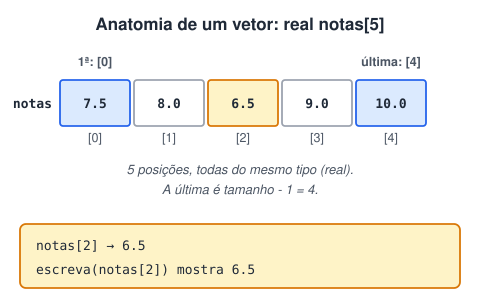
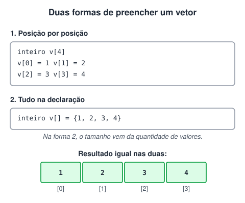
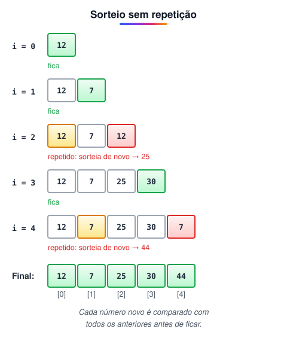

# Declaração e Atribuição de Valores a Vetores

> 🗺️ **Nesta aula:** o que é um vetor e como funcionam os índices, as duas formas de declarar e preencher, e dois projetos: média com pesos num vetor e sorteio sem repetição.

## O que é um vetor

Um vetor (ou *array* unidimensional) é uma variável que guarda **vários valores do mesmo tipo** sob um único nome, como uma lista. Cada valor ocupa uma posição numerada, o **índice**.

- Todos os valores são do mesmo tipo (só inteiros, só reais...).
- Cada posição é acessada pelo nome do vetor seguido do índice entre colchetes: `notas[2]`.
- A **primeira** posição tem índice **0**.
- A **última** posição tem índice **tamanho - 1**: num vetor de 5 posições, vai de 0 a 4.



## Declaração

```c
tipo nome_vetor[quantidade_de_posicoes]

real notas[5]       // 5 reais: notas[0] a notas[4]
cadeia nomes[30]    // 30 textos: nomes[0] a nomes[29]
```

## Atribuindo valores

```c
// 1. Posição por posição, depois de declarar (o tamanho é obrigatório)
inteiro vetor[4]
vetor[0] = 1
vetor[1] = 2
vetor[2] = 3
vetor[3] = 4

// 2. Tudo na declaração, entre chaves e separado por vírgulas
//    (o tamanho pode ser omitido: vem da quantidade de valores)
inteiro vetor[] = {1, 2, 3, 4}
```



## Projeto: média com pesos guardados num vetor

**Código**

```c
programa
{
	inteiro pesos[4]
	real nt_1, nt_2, nt_3, nt_4, media
	cadeia nome

	funcao inicio()
	{
		// um peso em cada posição do vetor
		pesos[0] = 1
		pesos[1] = 2
		pesos[2] = 3
		pesos[3] = 5

		escreva("Vamos calcular sua média\n")
		escreva("Os pesos das notas são: ", pesos[0], ", ", pesos[1], ", ", pesos[2], ", ", pesos[3], "\n")
		escreva("Digite seu nome: ")
		leia(nome)
		escreva("Digite a 1ª nota: ")
		leia(nt_1)
		escreva("Digite a 2ª nota: ")
		leia(nt_2)
		escreva("Digite a 3ª nota: ")
		leia(nt_3)
		escreva("Digite a 4ª nota: ")
		leia(nt_4)

		media = (nt_1 * pesos[0] + nt_2 * pesos[1] + nt_3 * pesos[2] + nt_4 * pesos[3]) / (pesos[0] + pesos[1] + pesos[2] + pesos[3])

		escreva("\nOlá, ", nome, "\n")
		escreva("Sua média é: ", media, "\n")
	}
}
```

O vetor se chamava `notas` no original, mas guarda os **pesos**; renomeá-lo deixa a fórmula mais fácil de ler.

## Projeto: 5 números aleatórios sem repetição

A estratégia: sortear uma posição de cada vez e, antes de aceitar o número, conferir se ele já apareceu nas posições anteriores. Se já apareceu, sorteia de novo.



**Código**

```c
programa
{
	inclua biblioteca Util --> u

	inteiro vet[5]
	inteiro i, j
	logico repetido

	funcao inicio()
	{
		para (i = 0; i < 5; i++) {
			// sorteia até sair um número que ainda não está no vetor
			faca {
				vet[i] = u.sorteia(1, 50)
				repetido = falso
				para (j = 0; j < i; j++) {   // compara só com as posições já preenchidas
					se (vet[j] == vet[i]) {
						repetido = verdadeiro
					}
				}
			} enquanto (repetido)
		}

		para (i = 0; i < 5; i++) {
			escreva(vet[i], "\n")
		}
	}
}
```

> ⚠️ A versão original sorteava tudo primeiro e depois comparava cada posição só com as **seguintes**. Quando uma posição era re-sorteada, o número novo podia coincidir com uma posição **anterior**, já conferida, e a repetição passava. Conferir cada sorteio contra todas as posições anteriores evita isso. O `faca { } enquanto (condição)` é a variação do `enquanto` que executa o bloco pelo menos uma vez antes de testar.

## 📌 Resumo

| Item | Em uma frase |
| --- | --- |
| Vetor | Vários valores do mesmo tipo sob um único nome |
| Índice | A primeira posição é 0; a última é tamanho − 1 |
| Declaração | `tipo nome[tamanho]`, como `real notas[5]` |
| Preencher depois | Posição por posição: `vetor[0] = 1` |
| Preencher na declaração | `inteiro vetor[] = {1, 2, 3, 4}` (o tamanho pode ser omitido) |
| `faca { } enquanto ()` | Executa o bloco pelo menos uma vez antes de testar |
